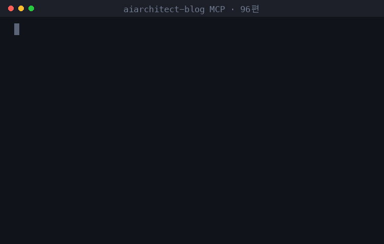

# AI아키텍트 블로그 MCP 서버

[](https://github.com/aiarchitecturedev/aiarchitect-blog-mcp/actions/workflows/ci.yml)
[](https://pypi.org/project/aiarchitect-blog-mcp/)

[aiarchitect.tistory.com](https://aiarchitect.tistory.com/) 의 공개 기술 블로그(현재 번들 **96편 규모**)를
**MCP(Model Context Protocol) 도구**로 노출합니다. Claude·Cursor 등 MCP 클라이언트에 붙이면
AI 에이전트가 MCP·AI Agent·엔터프라이즈 아키텍처·보안·RAG/LLM 주제의 한국어 장문 기술 글을
바로 검색·열람할 수 있습니다.



> 🎬 위 화면은 그려 낸 것이 아니라 **실제 stdio 서버를 띄워 JSON-RPC로 호출한 응답**입니다.
> 점수·본문 글자 수·원문 URL이 전부 실측값이며, `scripts/make_demo_gif.py` 가 서버를 직접
> 호출해 매번 다시 굽습니다(대본을 손으로 적어 두지 않습니다).

**⚡ 원클릭 설치**

[](https://cursor.com/en/install-mcp?name=aiarchitect-blog&config=eyJjb21tYW5kIjoidXZ4IiwiYXJncyI6WyJhaWFyY2hpdGVjdC1ibG9nLW1jcCJdfQ%3D%3D)
[](https://vscode.dev/redirect?url=vscode%3Amcp%2Finstall%3F%257B%2522name%2522%253A%2522aiarchitect-blog%2522%252C%2522command%2522%253A%2522uvx%2522%252C%2522args%2522%253A%255B%2522aiarchitect-blog-mcp%2522%255D%257D)

> 💡 목록·검색·본문 응답에 **원문(정식 게시글) URL**이 실려, 에이전트의 답변에 출처 링크가 남을
> 가능성을 높입니다(추천 유입). ※ 정식 게시 URL이 없는 글은 **fail-closed로 목록·검색·본문에서
> 제외**되어, 홈 URL 폴백이 오도성 출처 링크로 노출되지 않습니다(현재 번들 96편 전부 정식 게시글).

> 🔤 **영문으로 물어도 한글로만 쓴 글에 닿습니다.** 글 본문은 같은 개념을 영문("observability")과
> 한글("관측성")로 번갈아 씁니다. 검색은 두 표기를 **하나의 개념으로 묶어** 세므로, 어느 쪽으로
> 물어도 결과와 순위가 같습니다(수록 기준·측정: `scripts/synonym_report.py`).
>
> 🔡 **붙여 쓴 한글 복합어도 받습니다.** 글이 `검색 증강 생성`으로 써도 `검색증강생성`으로
> 물으면 찾습니다.
>
> 📎 **여러 낱말로 물으면 붙어 있는 쌍을 구(句)로도 셉니다.** `감사 로그`로 물으면 그 구를
> 통째로 담은 글이 먼저 옵니다 — `감사`와 `로그`가 따로 흩어진 글보다 위입니다. 구는
> 거르지 않고 **더하기만** 하므로, 낱말만 맞는 글도 뒤에 그대로 남습니다.

> 🖼️ **도식은 캡션으로 들어갑니다.** 글의 그림은 본문 안에서 열리지 않습니다 — 원문 페이지가
> 쓰는 이미지 주소는 **서명과 만료 시각이 붙어 있어** 번들에 담아 둘 수 없기 때문입니다.
> 그래서 열리지 않는 링크 대신 **그림 설명을 한 줄 캡션으로** 남깁니다. 도식이 무엇을 보여
> 주는지는 그대로 읽히고, 깨진 이미지 문법이 에이전트 답변에 섞이지 않습니다. 원본 그림은
> 각 응답에 실리는 원문 URL에서 볼 수 있습니다.

> 🔒 **읽기 전용 서버**: 5개 도구 모두 로컬 번들 코퍼스만 읽습니다(쓰기·외부 호출·부작용 없음).
> 각 도구에 `readOnlyHint`가 선언돼 있고, `limit`/`offset` 등 입력은 범위 밖 값·잘못된 타입을
> 방어적으로 클램프합니다.

설계와 공개 배포 과정은 다음 글에 정리했습니다.

- [내 블로그를 MCP 서버로 공개하기: AI Agent 검색·출처 링크·PyPI 배포까지](https://aiarchitect.tistory.com/63)
- [블로그 MCP 서버 공개 배포기: PyPI 패키징·하드닝·익명성 게이트](https://aiarchitect.tistory.com/68)

## 🔧 제공 도구

| 도구 | 설명 |
|------|------|
| `list_categories()` | 분류(7종)와 각 편수 |
| `list_articles(category?, limit?, offset?)` | 글 목록(분류 필터·페이지네이션) |
| `search_articles(query, category?, limit?)` | 제목·설명·태그·본문 검색(BM25 랭킹·구 매칭·영↔한 동의어·띄어쓰기 흡수·스니펫) |
| `get_article(article_id)` | 전체 본문(게시용 목차·인라인 CSS·HTML 주석·죽은 이미지 링크를 걷어낸 마크다운) + 원문 URL(출처 링크) |
| `blog_home()` | 블로그 홈 URL·제공 편수 |

## 🚀 설치

### ⚡ 원클릭 (Cursor · VS Code)

[](https://cursor.com/en/install-mcp?name=aiarchitect-blog&config=eyJjb21tYW5kIjoidXZ4IiwiYXJncyI6WyJhaWFyY2hpdGVjdC1ibG9nLW1jcCJdfQ%3D%3D)
[](https://vscode.dev/redirect?url=vscode%3Amcp%2Finstall%3F%257B%2522name%2522%253A%2522aiarchitect-blog%2522%252C%2522command%2522%253A%2522uvx%2522%252C%2522args%2522%253A%255B%2522aiarchitect-blog-mcp%2522%255D%257D)

누르면 편집기가 열리고 **설치 승인 창**이 뜹니다(바로 설치되지 않습니다). 두 버튼 모두
아래 `uvx aiarchitect-blog-mcp` 와 똑같은 설정을 심습니다.

> ℹ️ 버튼이 `https://cursor.com/...` · `https://vscode.dev/...` 를 거치는 이유는, GitHub이
> README에서 `cursor://` · `vscode:` 같은 사용자 지정 스킴 링크를 **잘라 버리기** 때문입니다.
> 각 편집기가 제공하는 https 중계 주소라야 README에서 실제로 눌립니다.

### Claude Code
```bash
claude mcp add aiarchitect-blog -- uvx aiarchitect-blog-mcp
```

### Claude Desktop / Cursor (`mcp.json`)
```json
{
  "mcpServers": {
    "aiarchitect-blog": {
      "command": "uvx",
      "args": ["aiarchitect-blog-mcp"]
    }
  }
}
```

`uvx`가 없으면 [uv](https://docs.astral.sh/uv/)를 설치하거나 `pipx run aiarchitect-blog-mcp` 를 사용하세요.

## 🛠️ 로컬 개발

```bash
uv sync                              # 의존성 설치
uv run python scripts/build_index.py /path/to/blogs  # 블로그 md → data/articles_index.json + 본문 번들
uv run python scripts/check_corpus_drift.py /path/to/blogs  # 소스 ↔ 번들 drift 점검(읽기 전용)
uv run pytest -q                     # 파서·검색 골든 테스트
uv run python scripts/synonym_report.py  # 동의어 사전 ↔ 코퍼스 측정(수록 기준 재확인)
uv build && uv run python scripts/verify_dist.py dist/   # 배포 산출물 검증
uv run aiarchitect-blog-mcp          # stdio 서버 실행
uv run --with pillow python scripts/make_demo_gif.py  # README 데모 GIF 재생성(ffmpeg 필요)
```

`build_index.py`는 소스 블로그 마크다운 디렉터리(파일명 형식 `NN-*.md`, 글 번호 1~3자리)를
인자로 받습니다: `uv run python scripts/build_index.py /path/to/blogs`.
글의 `article_id`는 원문 글 번호와 같습니다(`get_article("100")` → `.../100`).

`check_corpus_drift.py`는 **아무것도 쓰지 않고** "지금 재빌드하면 무엇이 달라지는가"만
보고합니다(신규·삭제 글, 본문·메타 변경, 게시 URL 불일치). 글이 늘거나 고쳐 발행돼도
번들은 스스로 알 수 없으므로, 편수뿐 아니라 **메타 키 이름을 가리지 않고** 정식 게시 URL을
찾아 파서가 읽은 값과 대조합니다. 종료 코드 0=일치 · 1=drift · 2=점검 불가.

`verify_dist.py`는 wheel·sdist **안쪽**을 열어 본문·인덱스 편수와 정합성을 확인합니다. 서빙 코드가
멀쩡해도 데이터 번들이 빠진 wheel은 설치한 쪽에서만 깨지기 때문입니다. `--installed`를 주면
설치된 패키지만으로 코퍼스·검색·본문이 동작하는지 검사합니다(저장소 밖에서 실행).

## 📚 다루는 주제

MCP 설계·OAuth 2.1·원격 MCP · AI Agent 보안/감사 · RAG·STT·화자분리 · 멀티플랫폼 SDK 아키텍처 ·
골든 테스트·시크릿 가드 · AI Agent 관측성·평가·컨트롤 플레인 · A2A 오케스트레이션·위임 인가 ·
SRE/FinOps·용량 산정·릴리스 거버넌스·Assurance Case 등.
전체 목록은 [블로그](https://aiarchitect.tistory.com/)에서 확인하세요.

## 📄 라이선스

패키지 SPDX 표현식: **`MIT AND LicenseRef-AIArchitect-Articles`**

- **코드(SOURCE CODE): MIT** — 자세한 내용은 [`LICENSE`](LICENSE).
- **번들된 글 본문: 별도 커스텀 라이선스** `LicenseRef-AIArchitect-Articles` — 저작권은
  원저자(AI아키텍트)에게 있으며, 본 패키지의 일부로서만 원문 그대로 재배포·열람이 허용됩니다.
  분리 재배포·2차 저작·상업적 재이용은 원저자의 사전 허가가 필요합니다. 자세한 조건은
  [`LICENSE-ARTICLES`](LICENSE-ARTICLES).

각 글은 https://aiarchitect.tistory.com/ 의 공개 원문을 편의상 재노출하며, 원문 페이지가 정본입니다.
