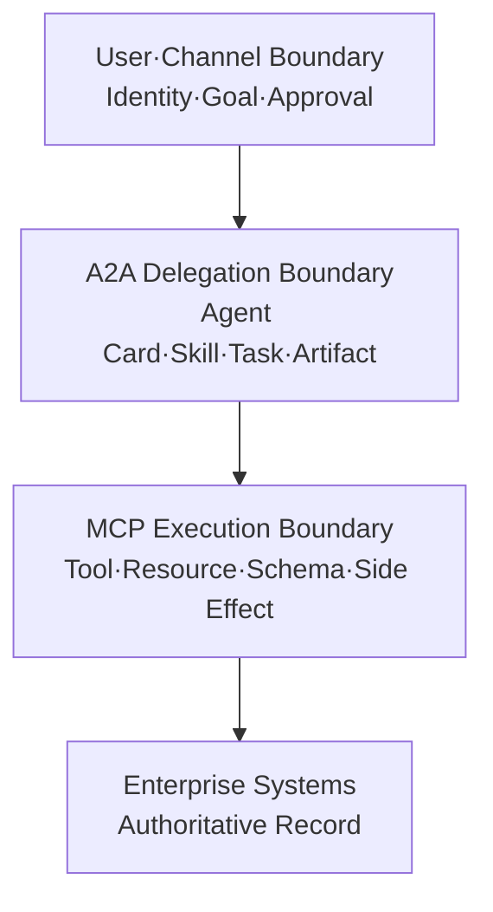

# MCP와 A2A를 함께 쓰는 엔터프라이즈 Agent 통합 아키텍처: Tool 호출과 Agent 위임 경계를 분리하는 법

MCP와 A2A는 경쟁 프로토콜이 아닙니다. MCP는 Agent가 Tool·Resource를 사용하는 경계를, A2A는 독립 Agent에게 목표를 위임하는 경계를 표준화합니다. 이 글은 두 프로토콜의 기능을 길게 나열하지 않고 **어떤 업무를 어느 경계에 배치할지 결정하는 통합 설계**에 집중합니다.

실행 순서, Result Envelope, 부분 성공, Timeout·Cancel·Retry와 Side Effect Commit은 별도 글인 [AI Agent 실행 계약 설계](https://aiarchitect.tistory.com/77)에서 다룹니다. 이 글의 결과물은 그 실행 글에 입력으로 넘길 `Integration Boundary Record`입니다.


사용자가 다음과 같이 요청했다고 가정해 보겠습니다.

```text
“지난 회의의 결정 사항을 찾아 위험을 검토하고,
승인된 항목만 업무 시스템에 초안으로 등록해 줘.”
```

이 요청에는 회의 검색처럼 입력과 결과가 명확한 기능, 위험을 분석해 보고서를 만드는 전문 업무, 승인 이후에만 가능한 Side Effect가 함께 들어 있습니다. 이들을 하나의 거대한 Agent나 하나의 Tool에 몰아넣으면 실행은 가능해도 책임과 증거를 설명하기 어려워집니다.

> 이 글의 Agent, 사용자, Tenant, Task, Artifact, URL, Token, 조직과 업무 Record는 모두 교육용 합성 예시입니다. 특정 회사·고객·제품의 실제 구성이나 성과를 나타내지 않습니다. 명세와 SDK는 바뀔 수 있으므로 실제 구현에서는 사용하는 Protocol Version과 공식 문서를 다시 확인해야 합니다.

<blockquote id="aiarchitect-toc" data-ke-style="box" style="background-color: #f6f9fc; color: #263746; font-family: Pretendard-Regular, AppleSDGothicNeo-Regular, sans-serif; font-weight: 400;" data-mce-style="background-color: #f6f9fc; color: #263746; font-family: Pretendard-Regular, AppleSDGothicNeo-Regular, sans-serif; font-weight: 400;">
<p style="color: #263746; font-weight: 700;" data-mce-style="color: #263746; font-weight: 700;"><b>목차</b></p>
<ol style="list-style-type: decimal; color: #555555; font-weight: 400;" data-mce-style="list-style-type: decimal; color: #555555; font-weight: 400;" data-ke-list-type="decimal">
<li><a href="#ai-section-1">프로토콜보다 책임 경계를 먼저 결정한다</a></li>
<li><a href="#ai-section-2">MCP와 A2A를 한 문장으로 구분한다</a></li>
<li><a href="#ai-section-3">Tool과 Remote Agent를 판정하는 여섯 질문</a></li>
<li><a href="#ai-section-4">통합 아키텍처를 세 개의 경계로 나눈다</a></li>
<li><a href="#ai-section-5">Agent Card를 신뢰 가능한 후보 계약으로 관리한다</a></li>
<li><a href="#ai-section-6">Discovery와 Registry를 구분한다</a></li>
<li><a href="#ai-section-7">Message·Task·Artifact·Context의 소유권을 분리한다</a></li>
<li><a href="#ai-section-8">A2A Task와 MCP Task를 같은 것으로 보지 않는다</a></li>
<li><a href="#ai-section-9">Integration Boundary Record를 남긴다</a></li>
<li><a href="#ai-section-10">Identity·Tenant·Artifact 신뢰 경계를 표시한다</a></li>
<li><a href="#ai-section-11">세 가지 통합 배치 패턴을 비교한다</a></li>
<li><a href="#ai-section-12">Version과 Capability 호환성을 계약으로 만든다</a></li>
<li><a href="#ai-section-13">실행 Runtime에 넘길 것과 넘기지 않을 것을 정한다</a></li>
<li><a href="#ai-section-14">통합 결정 자체를 Evidence로 보존한다</a></li>
<li><a href="#ai-section-15">작은 경계부터 단계적으로 도입한다</a></li>
<li><a href="#ai-section-16">흔한 통합 안티패턴</a></li>
<li><a href="#ai-section-17">설계 검토 체크리스트</a></li>
<li><a href="#ai-section-18">마무리</a></li>
<li><a href="#ai-section-19">공식 참고자료</a></li>
</ol>
</blockquote>

## 1. 프로토콜보다 책임 경계를 먼저 결정한다

통합 설계의 첫 질문은 “MCP인가 A2A인가”가 아닙니다.

```text
이 대상은 정해진 기능을 실행하는가?
아니면 목표를 받아 방법을 선택하고 업무 상태를 소유하는가?
```

기능 실행은 호출자가 순서와 성공 조건을 통제합니다. Agent 위임은 상대가 내부 계획과 Tool을 선택하고, 추가 입력이나 중간 산출물을 만들며, 장기 Task의 상태를 소유할 수 있습니다.

먼저 다음 책임을 배치합니다.

- 업무 계획을 세우는 주체
- Tool과 Remote Agent를 선택하는 주체
- 장기 실행 상태와 Artifact를 소유하는 주체
- 사용자에게 추가 입력·인증·승인을 요청하는 주체
- 업무 시스템의 Side Effect를 최종 인가하는 주체
- 장애 이후 상태를 설명할 책임이 있는 주체

프로토콜은 이 결정을 표현하는 수단입니다. 프로토콜을 도입했다고 책임이 자동으로 정해지지는 않습니다.

## 2. MCP와 A2A를 한 문장으로 구분한다

```text
MCP: Agent 애플리케이션이 Tool·Resource를 사용한다.
A2A: 독립 Agent에게 목표를 위임하고 Task·Artifact를 교환한다.
```

MCP Server는 이름, 입력 Schema, 결과와 오류가 정의된 기능을 제공합니다. 전체 사용자 경험과 업무 조정은 MCP Host가 소유합니다.

A2A Server인 Remote Agent는 내부 Model·Prompt·Memory·Workflow·Tool 구성을 공개하지 않아도 됩니다. Client는 Agent Card로 외부 능력을 확인하고 Message를 보내며, 상태가 있는 Task와 Artifact를 받습니다.

같은 “검색”이라는 표현도 책임에 따라 달라집니다.

- `meeting.search(query, tenant)`처럼 호출자가 조건과 결과를 통제하면 MCP Tool에 가깝습니다.
- “여러 회의에서 충돌하는 결정을 조사하고 근거 보고서를 작성하라”처럼 수행 방법을 상대가 결정하면 A2A Skill에 가깝습니다.

Remote Agent가 내부에서 MCP Tool을 사용하더라도 외부 경계는 A2A로 유지할 수 있습니다.

## 3. Tool과 Remote Agent를 판정하는 여섯 질문

다음 질문 중 오른쪽 답이 많을수록 A2A가 필요할 가능성이 높습니다.

| 질문 | MCP Tool 쪽 | A2A Remote Agent 쪽 |
|---|---|---|
| 호출자가 전달하는 것 | 구체 입력 | 목표·성공 조건 |
| 수행 방법의 소유자 | 호출자 | 상대 Agent |
| 상태 수명 | 짧은 호출 또는 제한된 비동기 작업 | 여러 Turn의 장기 Task |
| 중간 상호작용 | 오류·진행률 | 추가 질문·인증·승인·Artifact |
| 배포 책임 | 같은 제품/기능 경계 | 다른 팀·제품·보안 도메인 |
| 공개 계약 | Tool Schema | Agent Card·Skill·Task·Artifact |

단순 조회 API를 Agent로 감싸면 Discovery, Registry, Task Store와 평가 비용만 늘어납니다. 반대로 독립 Agent를 Tool 함수 하나로 숨기면 장기 상태, 중간 Artifact, 취소와 책임이 호출 Stack 뒤에 가려집니다.

경계 판정에는 기술적 복잡함보다 **업무 책임의 독립성**을 우선합니다.

### 애매한 세 대상을 실제로 판정해 본다

원칙만 보면 쉽지만 실제 후보는 대개 애매합니다. 앞 절 요청에서 나온 세 대상에 여섯 질문을 그대로 적용해 봅니다. `T`는 MCP Tool 쪽 답, `A`는 A2A Remote Agent 쪽 답입니다.

| 질문 | ① 사내 용어 사전 조회 | ② 회의 위험 분석 보고서 | ③ 업무 티켓 초안 등록 |
|---|---|---|---|
| 전달하는 것 | 구체 입력(용어) `T` | 목표·성공 조건 `A` | 구체 입력(제목·본문·담당) `T` |
| 방법의 소유자 | 호출자 `T` | 상대 Agent `A` | 호출자 `T` |
| 상태 수명 | 단일 호출 `T` | 여러 Turn·검토 반복 `A` | 단일 호출 `T` |
| 중간 상호작용 | 없음 `T` | 추가 질문·근거 요청 `A` | 없음 `T` |
| 배포 책임 | 같은 제품 `T` | 리스크관리팀 `A` | 같은 제품 `T` |
| 공개 계약 | 함수 Schema `T` | Agent Card·Skill·Artifact `A` | 함수 Schema `T` |
| **집계** | **T 6 / A 0** | **T 0 / A 6** | **T 6 / A 0** |

집계만 보면 ①과 ③이 같습니다. 그런데 최종 판정은 다릅니다.

**② 회의 위험 분석 보고서 → A2A Remote Agent.** 여섯 질문이 모두 A2A를 가리킵니다. 판단 기준을 리스크관리팀이 소유하고, 결과가 사람이 검토할 수 있는 Artifact여야 합니다. MCP Tool 하나로 감싸면 여러 Turn의 검토 상태와 중간 근거가 호출 Stack 뒤로 사라집니다.

**③ 업무 티켓 초안 등록 → MCP Tool.** Side Effect가 있다는 이유로 Agent로 감싸고 싶어지지만, 무엇을 등록할지는 이미 상위에서 정해졌고 등록 방법의 소유자도 호출자입니다. 승인 여부 판단은 이 Tool의 책임이 아니라 사용자·채널 경계의 책임입니다. **Side Effect의 위험도는 경계 종류를 고르는 기준이 아니라 권한·승인 정책의 입력입니다.**

**① 사내 용어 사전 조회 → 둘 다 아니다. 일반 API로 남긴다.** 여기서 세 번째 선택지를 놓치기 쉽습니다. 이 기능은 Runtime이 **항상** 호출하는 고정 전처리 단계입니다. Agent가 "쓸까 말까"를 판단할 여지가 없다면 Tool Schema로 노출해 모델의 선택 대상에 넣을 이유가 없습니다.

| 선택지 | 기각·채택 근거 |
|---|---|
| A2A Agent | 기각. 독립 업무 책임도, 장기 상태도, 협상할 목표도 없다. Discovery·Registry·Task Store 비용만 늘어난다 |
| MCP Tool | 기각. 동작은 한다. 그러나 모델이 매번 호출 여부를 판단하게 되어 결과가 흔들리고, Tool 개수가 늘어 선택 정확도가 떨어진다 |
| **일반 API** | **채택.** Runtime 전처리에서 결정적으로 호출한다. 실패 시 재시도·Fallback을 코드로 통제하고 모델의 판단 대상에서 제외한다 |

**Tool로 노출할지 결정하는 추가 질문은 "모델이 이것을 쓸지 말지 스스로 판단해야 하는가"입니다.** 답이 아니오라면 프로토콜 경계가 아니라 내부 호출로 둡니다. 이 질문 하나만 적용해도 Tool 목록이 눈에 띄게 줄어듭니다.

## 4. 통합 아키텍처를 세 개의 경계로 나눈다



*그림 1. 사용자, Agent 위임, Tool 실행을 분리한 통합 경계*

사용자·채널 경계는 사용자 Identity, 요청 원문, Tenant, 승인과 최종 응답을 소유합니다. A2A 위임 경계는 Orchestrator와 Specialist 사이에서 목표, Skill, Task, Artifact와 위임 제한을 교환합니다. MCP 실행 경계는 Agent Runtime과 업무 기능 사이에서 Tool·Resource Schema, Resource별 권한, 입력 검증과 Side Effect를 통제합니다.

Gateway는 세 경계의 모든 책임을 대신하는 단일 상자가 아닙니다. 정책 집행 지점은 실제 신뢰 경계마다 존재해야 합니다.

## 5. Agent Card를 신뢰 가능한 후보 계약으로 관리한다

Agent Card는 Remote Agent가 공개하는 능력 설명서입니다. 좋은 Card는 홍보 문구가 아니라 후보 선택과 호환성 검사의 입력입니다.

```json
{
  "name": "Work Planning Agent",
  "version": "2.3.0",
  "supportedInterfaces": [{
    "url": "https://agents.example.com/work-planning",
    "protocolBinding": "HTTP+JSON",
    "protocolVersion": "1.0"
  }],
  "capabilities": {"streaming": true},
  "skills": [{
    "id": "draft-work-plan",
    "description": "근거 기반 업무 초안을 만들며 외부 시스템에는 등록하지 않습니다.",
    "inputModes": ["application/json"],
    "outputModes": ["application/json"]
  }]
}
```

Card에서는 허용 업무와 금지 Side Effect, 실제 지원 Interface·Version·Media Type, 구현된 Capability만 선언했는지 확인합니다. 공개 Card에 내부 Tool, Prompt, Secret이나 실제 Tenant 목록을 넣지 않습니다.

서명된 Card도 권한 증명서는 아닙니다. 출처와 무결성을 확인한 뒤 조직 정책이 실행 허용 여부를 별도로 판정해야 합니다.

## 6. Discovery와 Registry를 구분한다

Discovery는 Agent Card를 찾는 과정이고 Registry는 검토된 Agent·Version·Skill만 사용 가능 상태로 승격하는 조직의 신뢰 목록입니다.

```text
Agent Card 발견
  → Schema·Provider·Signature 검증
  → 보안·데이터 등급·법무 검토
  → 허용 Skill·Tenant·환경 지정
  → Registry Version 발행
  → 실행 Gateway와 Orchestrator Allowlist 반영
```

- Registry: 무엇을 신뢰 후보로 둘 것인가
- Gateway·Policy Engine: 이번 요청을 실행해도 되는가
- Runtime: 어떤 순서와 상태로 실행할 것인가

Card Cache에는 최대 수명과 강제 갱신 경로가 필요합니다. 긴급 폐기된 Agent가 오래된 Cache 때문에 계속 선택되어서는 안 됩니다.

## 7. Message·Task·Artifact·Context의 소유권을 분리한다

| 객체 | 의미 | 소유·보존 원칙 |
|---|---|---|
| Message | 한 번의 의사소통 | 입력·추가 질문·상태 설명에 사용 |
| Task | 상태와 수명주기를 가진 위임 업무 | A2A Server가 ID와 상태를 소유 |
| Artifact | Task가 만든 실제 산출물 | 구조화 결과·파일 참조·Digest 보존 |
| Context | 여러 Message·Task의 논리적 연속성 | 권한·Trace·장기 Memory Key와 분리 |

```text
Context: 업무 계획 대화
  ├─ Task A: 회의 결정 분석
  │    └─ Artifact: decision-analysis.json
  └─ Task B: 업무 계획 초안 작성
       └─ Artifact: work-plan-draft.json
```

`contextId`, `taskId`, `traceId`, 사용자 Session ID와 업무 Record ID를 하나로 재사용하면 수명과 접근 권한이 서로 엉킵니다. 통합 단계에서 각각의 발급 주체와 보존 기간을 정합니다.

### 하나의 ID로 묶으면 무엇이 깨지는가

각 식별자는 발급 주체와 삭제 기준이 서로 다릅니다.

| 식별자 | 발급 주체 | 수명 | 삭제·만료 기준 |
|---|---|---|---|
| `contextId` | Orchestrator(우리) | 대화·업무 단위 | 업무 종료 또는 보존 기간 |
| `taskId` | A2A Server(상대) | 위임 업무 단위 | **상대 팀의** Task 보존 정책 |
| `traceId` | 관측 계층 | 단일 Run | Trace 보존 기간(보통 수일~수주) |
| Session ID | 인증 계층 | 로그인 세션 | 로그아웃·만료 |
| 업무 Record ID | 업무 시스템 | 영구 | 업무 규정·삭제 요청 |

재사용하면 이런 일이 일어납니다. `taskId`를 `contextId`로 쓰면 **상대 팀이** Task 보존 기간을 30일로 줄일 때 우리 쪽 대화 연속성이 함께 끊깁니다. Session ID를 `contextId`로 쓰면 사용자가 로그아웃할 때마다 진행 중인 장기 Task의 맥락이 사라집니다. 업무 Record ID를 `traceId`로 쓰면 Trace 보존 기간이 지난 뒤 감사 추적이 비고, 동시에 Trace 저장소에 영구 업무 식별자가 남아 삭제 요청을 처리할 수 없게 됩니다.

**규칙은 하나입니다. 수명이나 삭제 주체가 다른 식별자는 같은 값으로 쓰지 않고, 필요하면 매핑을 따로 둡니다.** 매핑 표는 비용이지만 각각을 독립적으로 만료·삭제할 수 있게 해 줍니다. 특히 `taskId`처럼 **우리가 통제하지 못하는 식별자**를 우리 데이터의 Key로 쓰는 것은 피합니다.

## 8. A2A Task와 MCP Task를 같은 것으로 보지 않는다

A2A Task는 독립 Agent에 위임한 업무의 외부 수명주기입니다. Message·Context·Artifact와 여러 Turn을 연결할 수 있습니다.

MCP `2026-07-28`의 Tasks Extension은 MCP 요청, 대표적으로 장기 Tool 호출의 비동기 실행 Handle입니다. 한 A2A Task 안에서 여러 MCP Tool을 호출하고 그중 하나가 MCP Task로 실행될 수 있습니다.

```text
A2A Task: 업무 계획 작성
  ├─ MCP Tool: meeting.search       즉시 결과
  ├─ MCP Task: document.export      장기 실행
  └─ MCP Tool: policy.check         즉시 결과
```

두 Task ID와 상태를 자동 복사하지 않습니다. 제한된 Lineage로 연결하고, 상태 결합과 부분 성공 판단은 [BLOG-77 실행 계약](https://aiarchitect.tistory.com/77)의 Root Run이 담당합니다.

## 9. Integration Boundary Record를 남긴다

회의에서 “여기는 MCP, 저기는 A2A”라고 결정하는 것만으로는 운영 시점에 근거가 남지 않습니다. 통합 설계의 산출물을 기계가 읽을 수 있는 Record로 고정합니다.

```yaml
boundary_id: boundary-work-planning-v3
owner: work-automation-team
consumer: enterprise-orchestrator
target: work-planning-agent
integration_kind: A2A_AGENT
reason: target-owns-plan-and-multi-turn-task
allowed_skills: [draft-work-plan]
forbidden_outcomes: [CREATE_PRODUCTION_TICKET]
input_artifacts: [decision-evidence-v2]
output_artifacts: [work-plan-draft-v3]
protocol: {name: A2A, version: "1.0"}
fallback: human-planning-queue
review_on:
  - agent-card-version-change
  - skill-contract-change
  - data-classification-change
```

이 Record는 다음 질문에 답해야 합니다.

- 왜 Tool이 아니라 Agent인가, 또는 그 반대인가?
- 누가 계약과 운영을 소유하는가?
- 허용된 입력·출력·Skill·Side Effect는 무엇인가?
- 어떤 Version 변화가 재검토를 요구하는가?
- 장애나 폐기 시 대체 경로는 무엇인가?

### Record 필드 계약

복사해 쓸 수 있도록 각 필드가 답해야 하는 질문과 필수 여부를 고정합니다.

| 필드 | 필수 | 답해야 하는 질문 | 비어 있으면 생기는 문제 |
|---|---|---|---|
| `boundary_id` | 필수 | 이 경계 결정을 무엇으로 참조하는가 | 운영 로그와 결정을 연결할 수 없다 |
| `integration_kind` | 필수 | MCP Tool · A2A Agent · 내부 API 중 무엇인가 | 재검토 시 원래 판정을 알 수 없다 |
| `reason` | 필수 | 왜 그 경계인가 | 몇 달 뒤 아무도 이유를 모른다 |
| `owner` · `consumer` · `target` | 필수 | 계약·호출·운영 책임이 각각 누구인가 | 장애 시 소유자를 찾는 데 시간을 쓴다 |
| `allowed_skills` | A2A 필수 | 무엇까지 위임하는가 | Runtime이 선언되지 않은 Skill을 즉석에서 호출한다 |
| `forbidden_outcomes` | 필수 | 어떤 결과는 절대 나오면 안 되는가 | 금지 사항이 정책이 아니라 관행으로 남는다 |
| `input_artifacts` · `output_artifacts` | 필수 | 무엇을 주고 무엇을 받는가 | Artifact Schema 변경의 영향 범위를 계산할 수 없다 |
| `protocol` | 필수 | 어떤 Protocol과 Version인가 | 호환성 판정 기준이 사라진다 |
| `fallback` | 필수 | 못 쓰게 되면 업무는 어떻게 되는가 | 상대 장애가 곧 업무 중단이 된다 |
| `review_on` | 필수 | 어떤 변화가 재검토를 강제하는가 | 상대가 바뀌어도 아무 일도 일어나지 않는다 |

`integration_kind`에 `INTERNAL_API`를 허용하는 것이 중요합니다. 3절 ①처럼 **프로토콜 경계로 만들지 않기로 한 결정도 Record로 남겨야** 다음 사람이 같은 논의를 반복하지 않습니다.

### 상대가 바뀌면 무슨 일이 일어나는가

Record의 값어치는 작성 시점이 아니라 **상대가 바뀌는 순간**에 드러납니다. 리스크관리팀이 Agent Card를 `v3`에서 `v4`로 올리면서 Skill을 하나 추가하고 Artifact Schema를 바꿨다고 가정합니다.

```diff
 boundary_id: boundary-work-planning-v3
 integration_kind: A2A_AGENT
-allowed_skills: [draft-work-plan]
+allowed_skills: [draft-work-plan]              # estimate-work-effort 는 채택하지 않음
-output_artifacts: [work-plan-draft-v3]
+output_artifacts: [work-plan-draft-v4]
 forbidden_outcomes: [CREATE_PRODUCTION_TICKET]
+card_version_verified: "4"
+verified_at: "2026-08-10"
```

`review_on`에 `agent-card-version-change`가 있었으므로 Card `v4` 감지 시 Registry 승격이 자동으로 멈췄고, 다음 재검토가 실행됐습니다.

| 재검토 항목 | 결과 | 조치 |
|---|---|---|
| 새 Skill `estimate-work-effort`가 `allowed_skills`에 있는가 | 없음 | **위임 대상에서 제외.** 선언만으로 자동 허용하지 않는다 |
| `work-plan-draft` Artifact Schema 변경 | `v3` → `v4`, 필드 2개 추가·1개 이름 변경 | 소비자 계약 테스트 실행 |
| 소비자 계약 테스트 | 이름 변경 필드에서 실패 | 조립 코드 수정 후 재실행, 통과 |
| 새 Skill의 권한 요구 | 티켓 생성 권한 요구 | `forbidden_outcomes` 위반. 제외 결정이 유효함을 재확인 |
| Card 선언 `streaming: true` 대 실제 재연결 | 일치 | 통과 |
| 데이터 등급 | 변경 없음 | 재인가 불필요 |

이 표가 이 Record의 실제 산출물입니다. **핵심은 "새 Skill이 생겼으니 쓸 수 있다"가 아니라 "선언되지 않은 것은 쓰지 않는다"입니다.** 상대가 능력을 늘리는 것과 우리가 그 능력을 위임하는 것은 별개의 결정입니다.

Card 변경 감지와 선언·동작 불일치 검사는 [AI Agent Contract Testing](https://aiarchitect.tistory.com/80)에서 다룹니다.

## 10. Identity·Tenant·Artifact 신뢰 경계를 표시한다

```text
User Identity
  → Orchestrator Workload Identity
  → Specialist Task-bound Identity
  → MCP Client Identity
  → Enterprise Resource Authorization
```

사용자 Token을 Agent Chain 전체에 그대로 전달하지 않습니다. 각 대상과 Task에 제한된 Credential을 발급하고 다음 경계에서 다시 검사합니다.

- `tenant` Routing 값과 실제 Tenant 접근 권한을 분리
- Artifact의 데이터 등급, Digest, 출처와 허용 소비자 확인
- 큰 파일은 만료되는 참조와 서버 측 권한으로 전달
- Remote Agent가 만든 결과도 최종 Resource에서 재인가
- 로그에는 Token·원문 PII 대신 필요한 식별자와 결정 근거만 기록

세부 위임 인가는 [AI Agent Identity와 위임 인가 설계](https://aiarchitect.tistory.com/79), 실행 시점 Credential과 Side Effect는 BLOG-77에서 이어집니다.

## 11. 세 가지 통합 배치 패턴을 비교한다

### 단일 Agent + MCP

한 제품과 한 팀이 계획·실행을 모두 소유하고 Tool 계약만 분리하면 충분합니다. 독립 업무 책임이나 장기 위임이 없다면 가장 단순하고 운영하기 쉽습니다.

### Orchestrator + 단일 Specialist + MCP

전문 팀·제품의 Agent가 독립 Task와 Artifact를 소유할 때 적합합니다. 첫 A2A 도입은 읽기 전용 또는 초안 생성 Skill 하나로 시작하는 편이 안전합니다.

### 여러 Specialist + Agent Router + MCP

동일 업무 후보가 여러 개이고 품질·비용·지역·규제 조건으로 선택해야 할 때 필요합니다. Router 결정 로그와 후보별 평가가 추가되며, 상세 설계는 [Enterprise AI Agent Router](https://aiarchitect.tistory.com/78)에서 다룹니다.

Agent 수를 늘리는 것이 성숙도의 지표는 아닙니다. 독립 책임 경계가 없으면 앞 단계 구조를 유지합니다.

## 12. Version과 Capability 호환성을 계약으로 만든다

| 대상 | 확인 항목 | 실패 시 처리 |
|---|---|---|
| Agent Card | Protocol·Skill·Media Type·Capability | Registry 승격 차단 |
| A2A Client/Server | Message·Task·Artifact Schema | 계약 테스트 실패 |
| MCP Client/Server | Protocol·Extension·Tool Schema | Tool 비활성 또는 호환 경로 |
| Artifact 소비자 | Schema Version·Digest·Data Class | 조립·Commit 차단 |

Card가 `streaming: true`를 선언했지만 실제 재연결을 지원하지 않거나 Tool Schema가 바뀌었는데 Version이 유지되면 선언과 동작이 어긋납니다. Registry 승격 전에 [AI Agent Contract Testing](https://aiarchitect.tistory.com/80)으로 선언과 실제 동작을 함께 검사합니다.

### 무엇이 호환성을 깨는 변경인가

"Version을 올려야 하는가"를 매번 논쟁하지 않으려면 기준을 미리 고정합니다.

| 변경 | 호환성 | 필요한 조치 |
|---|---|---|
| Tool·Skill 추가 | 유지 | Record의 `allowed_skills`에 넣지 않으면 아무 일도 일어나지 않는다 |
| 입력 필드 추가(선택) | 유지 | 소비자 무영향. 계약 테스트만 통과시킨다 |
| 입력 필드 추가(필수) | **깨짐** | 호출자 전원 수정. Version 상향 필수 |
| 출력 필드 추가 | 조건부 | 소비자가 엄격 Schema 검증을 하면 깨진다. 소비자 정책을 먼저 확인한다 |
| 출력 필드 이름 변경·삭제 | **깨짐** | Artifact Schema Version 상향, 조립 코드 수정 |
| 열거값 추가 | **주의** | 소비자의 미지값 처리 정책에 따라 갈린다 |
| 오류 코드 의미 변경 | **깨짐** | 재시도·Fallback 판단이 바뀐다. 가장 놓치기 쉽다 |
| Capability 선언 변경(`streaming` 등) | **깨짐** | 실제 동작과 함께 검증해야 한다 |

가장 자주 놓치는 것은 표의 마지막 세 줄입니다. **필드 구조가 그대로여도 열거값·오류 의미·Capability 선언이 바뀌면 호출자의 판단 로직이 조용히 틀립니다.** Schema 비교 도구는 이런 변경을 통과시키므로, 계약 테스트에 "이 오류 코드를 받으면 무엇을 하는가"까지 넣어야 합니다.

상대가 Breaking Change를 같은 Version으로 배포하는 상황도 대비합니다. Version 문자열은 상대의 선언일 뿐이므로 **승격 Gate는 Version이 아니라 Schema Digest 비교로 둡니다.** Record의 `card_version_verified`와 실제 관측 Digest가 어긋나면 Version이 같아도 승격을 멈춥니다.

## 13. 실행 Runtime에 넘길 것과 넘기지 않을 것을 정한다

| BLOG-75가 결정해 넘기는 것 | BLOG-77 Runtime이 실행 중 결정하는 것 |
|---|---|
| MCP Tool 또는 A2A Agent라는 경계 종류 | 이번 Run의 Step과 의존성 |
| 허용 Agent·Skill·Tool·Version | 후보 중 실제 Target과 호출 순서 |
| 입력·출력 Artifact Schema | 실제 Result Envelope와 검증 결과 |
| Identity 교환 지점과 최대 권한 | Task-bound Credential 발급·폐기 |
| 허용 Side Effect와 최종 권위자 | 승인 후 Commit·Idempotency 처리 |
| Fallback과 운영 소유자 | Timeout·Cancel·Retry·부분 성공 처리 |

통합 문서에 Runtime의 모든 상태 전이를 복제하지 않습니다. 반대로 Runtime이 즉석에서 새로운 Agent·Tool 경계를 만들어 내게 두지도 않습니다. 이 분리가 두 글의 책임 경계이자 실제 시스템의 설계 경계입니다.

### 경계를 잘못 나누면 어느 쪽이 무너지는가

이 분리는 문서 정리 문제가 아니라 실제 실패로 이어집니다.

**통합 문서가 Runtime 영역까지 정하면 배포가 멈춥니다.** 재시도 횟수나 Timeout 값을 Boundary Record에 박아 두면 운영 중 값을 조정할 때마다 경계 재검토 절차를 밟아야 합니다. 그러면 현장은 Record를 우회하고, Record는 실제와 어긋난 문서로 남습니다.

**Runtime이 경계까지 정하면 통제가 사라집니다.** 대표적인 증상은 이렇습니다.

- Registry에 없는 Agent를 Card URL만으로 호출한다
- `allowed_skills`에 없는 Skill을 모델이 골라 호출한다
- 선언되지 않은 Artifact Schema를 받아 그대로 조립한다
- 권한이 부족하면 더 넓은 권한의 Credential로 다시 시도한다

네 가지 모두 **그 순간에는 성공합니다.** 그래서 장애로 기록되지 않고, 감사나 사고 조사 시점에야 드러납니다. 실행 시점에 막지 못하면 사실상 막지 못하는 것입니다.

**Runtime에 넘기는 것은 선택의 자유가 아니라 미리 승인된 후보 안에서의 선택입니다.** 경계 위반을 실행 시점에 차단하는 Registry·Policy 설계는 [AI Agent Control Plane](https://aiarchitect.tistory.com/76)에서 이어집니다.

## 14. 통합 결정 자체를 Evidence로 보존한다

다음 증거를 함께 보존하면 “왜 이 구조인가”를 나중에 검증할 수 있습니다.

- 승인된 Integration Boundary Record와 변경 이력
- 검증 당시 Agent Card와 Tool Schema의 Digest
- Protocol·SDK 호환성 Matrix
- 허용·거부 계약 테스트 결과
- 데이터 등급과 Identity 흐름 검토 결과
- Registry 승격 승인자·시각·재검토 조건
- 폐기·Fallback 훈련 결과

Agent Card나 Skill이 바뀌면 영향받은 Boundary와 소비자 계약을 찾아 선택적으로 재검증합니다. Evidence의 신선도와 폐기는 [Assurance Case와 Evidence Graph](https://aiarchitect.tistory.com/91)에서 다룹니다.

## 15. 작은 경계부터 단계적으로 도입한다

1. **기존 기능을 MCP Tool로 명시합니다.** API와 조회 기능의 Schema, 오류, Resource 권한을 먼저 안정화합니다.
2. **단일 A2A Specialist를 시험합니다.** Side Effect 없는 초안·분석 Skill 하나로 Card·Task·Artifact와 사람 Fallback을 검증합니다.
3. **Registry와 계약 Gate를 둡니다.** 승인된 Agent·Skill·Version만 선택하고 계약 테스트를 배포 Gate에 연결합니다.
4. **필요할 때만 Router로 확장합니다.** 단일 Specialist 운영 Evidence가 충분할 때 후보 선택, 예산, Canary와 Kill Switch를 추가합니다.

## 16. 흔한 통합 안티패턴

- **모든 API를 Agent로 감싼다.** 독립 목표·상태·책임이 없는 기능에는 MCP Tool이나 일반 API가 더 단순합니다.
- **Remote Agent를 거대한 Tool 하나로 숨긴다.** 추가 질문, 장기 Task, Artifact와 취소 상태가 호출 뒤에 가려집니다.
- **Agent Card를 권한 증명서로 사용한다.** Card는 능력 선언이며 Registry 검토와 실행 시점 인가는 별도입니다.
- **`tenant` Field만 검사한다.** Routing 값은 권한이 아니므로 각 신뢰 경계에서 접근 권한을 검사합니다.
- **사용자 Token을 Chain 전체에 전달한다.** 대상·업무·기간이 제한된 Credential로 교환합니다.
- **통합 설계와 실행 설계를 두 문서에 복제한다.** 경계 결정은 Boundary Record에, 실행 상태와 결과 조립은 Root Run 계약에 둡니다.

## 17. 설계 검토 체크리스트

### 책임 경계

- [ ] 각 대상이 Tool인지 독립 Agent인지 판단 근거가 있는가?
- [ ] 업무 계획, Task, Artifact와 최종 Record의 소유자가 분명한가?
- [ ] A2A가 필요 없는 단순 기능에 Agent 운영 비용을 추가하지 않았는가?

### 계약과 Version

- [ ] Agent Card·Skill·Tool·Artifact Schema Version을 고정했는가?
- [ ] 선언한 Capability와 실제 동작을 계약 테스트하는가?
- [ ] Card·Schema 변경 시 어떤 Boundary를 재검토할지 알 수 있는가?

### Identity와 데이터

- [ ] 사용자·Agent·Workload·Resource Identity가 분리되는가?
- [ ] Tenant Routing과 Authorization을 별도로 검사하는가?
- [ ] Artifact의 출처·Digest·데이터 등급·소비자를 보존하는가?

### 운영 인계

- [ ] 실행 Runtime에 허용 Target·Skill·Tool·권한 한계를 넘기는가?
- [ ] Timeout·Cancel·Retry·부분 성공은 BLOG-77의 Root Run이 소유하는가?
- [ ] 폐기, 사람 Fallback과 운영 소유자가 정해져 있는가?
- [ ] 통합 결정과 검증 결과가 Evidence로 남는가?

## 18. 마무리

MCP와 A2A를 함께 쓰는 이유는 프로토콜 수를 늘리기 위해서가 아닙니다. **기능 실행과 독립 Agent 위임의 책임을 분리하기 위해서**입니다.

```text
업무 책임을 분해한다.
→ Tool과 Remote Agent를 판정한다.
→ Agent Card·Tool Schema와 신뢰 경계를 검증한다.
→ Integration Boundary Record를 승인한다.
→ 실행 Runtime에 허용 경계와 계약을 넘긴다.
```

핵심 결과물은 그림 한 장이 아니라 다음 질문에 답하는 Record입니다.

1. 왜 이 대상은 MCP Tool 또는 A2A Agent인가?
2. 누가 Task와 Artifact, 최종 업무 결과를 소유하는가?
3. 어떤 Identity와 데이터가 어느 경계를 넘는가?
4. 어떤 Version과 Capability 조합을 허용하는가?
5. 무엇이 바뀌면 재검토하고, 실패하면 어디로 돌아가는가?

이 결정이 끝난 뒤에야 실행 순서와 결과 조립을 설계할 수 있습니다. 다음 글인 [AI Agent 실행 계약 설계](https://aiarchitect.tistory.com/77)는 이 Boundary Record를 입력으로 받아 Execution Plan, Result Envelope, 부분 성공, 취소와 보상을 하나의 검증 가능한 Root Run으로 구현합니다.

## 19. 공식 참고자료

- A2A Protocol, [A2A Protocol](https://a2a-protocol.org/latest/)
- A2A Protocol, [A2A Protocol v1.0 announcement](https://a2a-protocol.org/latest/announcing-1.0/)
- A2A Protocol, [Protocol specification](https://a2a-protocol.org/latest/specification/)
- A2A Protocol, [Core concepts](https://a2a-protocol.org/latest/topics/key-concepts/)
- A2A Protocol, [Agent discovery](https://a2a-protocol.org/latest/topics/agent-discovery/)
- A2A Protocol, [Multi-tenancy and multi-agent routing](https://a2a-protocol.org/latest/topics/multi-tenancy/)
- Model Context Protocol, [The 2026-07-28 Specification](https://blog.modelcontextprotocol.io/posts/2026-07-28/)
- Model Context Protocol, [Architecture overview](https://modelcontextprotocol.io/docs/learn/architecture)
- Model Context Protocol, [MCP Tasks](https://modelcontextprotocol.io/extensions/tasks/overview)
- W3C, [Trace Context](https://www.w3.org/TR/trace-context/)
- RFC Editor, [RFC 8693: OAuth 2.0 Token Exchange](https://www.rfc-editor.org/rfc/rfc8693.html)
- RFC Editor, [RFC 8707: Resource Indicators for OAuth 2.0](https://www.rfc-editor.org/rfc/rfc8707.html)
- RFC Editor, [RFC 9700: Best Current Practice for OAuth 2.0 Security](https://www.rfc-editor.org/rfc/rfc9700.html)
