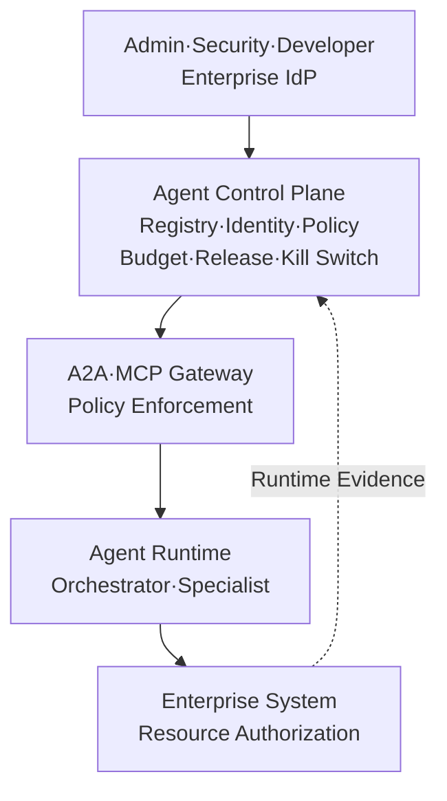
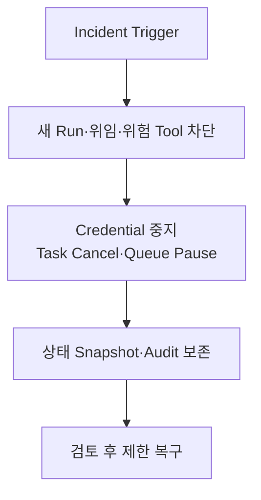

# AI Agent Control Plane 설계: Registry · Identity · Policy · Budget · Kill Switch 중앙 통제

Agent가 늘어나면 연결보다 통제가 먼저 무너집니다. 누가 어떤 Agent를 배포했고 무슨 권한으로 얼마를 쓰는지 중앙에서 답할 수 없게 되기 때문입니다. 이 글은 Agent 등록·승인·배포·격리·폐기와 사용자·Agent·Workload Identity, 실행 권한, 비용·시간·호출 Budget, Canary와 Kill Switch를 묶는 AI Agent Control Plane 아키텍처를 정리합니다.


<blockquote id="aiarchitect-toc" data-ke-style="box" style="background-color: #f6f9fc; color: #263746; font-family: Pretendard-Regular, AppleSDGothicNeo-Regular, sans-serif; font-weight: 400;" data-mce-style="background-color: #f6f9fc; color: #263746; font-family: Pretendard-Regular, AppleSDGothicNeo-Regular, sans-serif; font-weight: 400;">
<p style="color: #263746; font-weight: 700;" data-mce-style="color: #263746; font-weight: 700;"><b>목차</b></p>
<ol style="list-style-type: decimal; color: #555555; font-weight: 400;" data-mce-style="list-style-type: decimal; color: #555555; font-weight: 400;" data-ke-list-type="decimal">
<li style="color: #555555; font-weight: 400;" data-mce-style="color: #555555; font-weight: 400;"><a href="#1-agent">Agent가 늘어나면 연결보다 통제가 먼저 무너진다</a></li>
<li style="color: #555555; font-weight: 400;" data-mce-style="color: #555555; font-weight: 400;"><a href="#2-control-plane-data-plane">Control Plane과 Data Plane을 분리한다</a></li>
<li style="color: #555555; font-weight: 400;" data-mce-style="color: #555555; font-weight: 400;"><a href="#3-control-plane">Control Plane의 일곱 가지 책임을 정한다</a></li>
<li style="color: #555555; font-weight: 400;" data-mce-style="color: #555555; font-weight: 400;"><a href="#4-agent-registry">Agent Registry는 검색 목록이 아니라 승인된 상태 저장소다</a></li>
<li style="color: #555555; font-weight: 400;" data-mce-style="color: #555555; font-weight: 400;"><a href="#5-agent-card">Agent Card 서명과 조직의 신뢰 판단을 구분한다</a></li>
<li style="color: #555555; font-weight: 400;" data-mce-style="color: #555555; font-weight: 400;"><a href="#6-admission-pipeline">등록부터 폐기까지 Admission Pipeline을 만든다</a></li>
<li style="color: #555555; font-weight: 400;" data-mce-style="color: #555555; font-weight: 400;"><a href="#7-clientagentworkload-identity">사용자·Client·Agent·Workload Identity를 분리한다</a></li>
<li style="color: #555555; font-weight: 400;" data-mce-style="color: #555555; font-weight: 400;"><a href="#8-mcp-enterprise-managed-authorization">MCP Enterprise-Managed Authorization의 범위를 이해한다</a></li>
<li style="color: #555555; font-weight: 400;" data-mce-style="color: #555555; font-weight: 400;"><a href="#9-credential-broker-token">Credential Broker가 대상 제한 Token을 발급한다</a></li>
<li style="color: #555555; font-weight: 400;" data-mce-style="color: #555555; font-weight: 400;"><a href="#10-policy">Policy 결정과 실행을 분리하되 모든 호출을 중재한다</a></li>
<li style="color: #555555; font-weight: 400;" data-mce-style="color: #555555; font-weight: 400;"><a href="#11-mcp-header-gateway">MCP Header는 Gateway 통제를 돕지만 최종 인가를 대체하지 않는다</a></li>
<li style="color: #555555; font-weight: 400;" data-mce-style="color: #555555; font-weight: 400;"><a href="#12-allowlist">권한은 Allowlist 하나가 아니라 조건의 논리곱이다</a></li>
<li style="color: #555555; font-weight: 400;" data-mce-style="color: #555555; font-weight: 400;"><a href="#13-actionresource-digest">승인은 Action·Resource·인자 Digest에 결박한다</a></li>
<li style="color: #555555; font-weight: 400;" data-mce-style="color: #555555; font-weight: 400;"><a href="#14-budget">Budget은 비용뿐 아니라 행동량을 제한한다</a></li>
<li style="color: #555555; font-weight: 400;" data-mce-style="color: #555555; font-weight: 400;"><a href="#15-budget">병렬 실행의 Budget은 원자적으로 예약한다</a></li>
<li style="color: #555555; font-weight: 400;" data-mce-style="color: #555555; font-weight: 400;"><a href="#16-version-manifest">Version Manifest로 실제 실행 구성을 고정한다</a></li>
<li style="color: #555555; font-weight: 400;" data-mce-style="color: #555555; font-weight: 400;"><a href="#17-shadowcanaryrollback">Shadow·Canary·Rollback의 차이를 지킨다</a></li>
<li style="color: #555555; font-weight: 400;" data-mce-style="color: #555555; font-weight: 400;"><a href="#18-kill-switch">Kill Switch는 버튼 하나가 아니라 차단 계층이다</a></li>
<li style="color: #555555; font-weight: 400;" data-mce-style="color: #555555; font-weight: 400;"><a href="#19-task-side-effect">진행 중인 Task와 이미 발생한 Side Effect를 처리한다</a></li>
<li style="color: #555555; font-weight: 400;" data-mce-style="color: #555555; font-weight: 400;"><a href="#20-control-plane-fail-openfail-closed">Control Plane 장애의 Fail-open·Fail-closed를 미리 정한다</a></li>
<li style="color: #555555; font-weight: 400;" data-mce-style="color: #555555; font-weight: 400;"><a href="#21-desiredeffectiveobserved-state">Desired·Effective·Observed State를 비교한다</a></li>
<li style="color: #555555; font-weight: 400;" data-mce-style="color: #555555; font-weight: 400;"><a href="#22-traceauditevaluation">Trace·Audit·Evaluation을 하나의 증거 사슬로 연결한다</a></li>
<li style="color: #555555; font-weight: 400;" data-mce-style="color: #555555; font-weight: 400;"><a href="#23-control-plane">합성 장애 사례로 Control Plane을 검증한다</a></li>
<li style="color: #555555; font-weight: 400;" data-mce-style="color: #555555; font-weight: 400;"><a href="#24">단계적으로 도입한다</a></li>
<li style="color: #555555; font-weight: 400;" data-mce-style="color: #555555; font-weight: 400;"><a href="#25">흔한 안티패턴</a></li>
<li style="color: #555555; font-weight: 400;" data-mce-style="color: #555555; font-weight: 400;"><a href="#26">운영 체크리스트</a></li>
<li style="color: #555555; font-weight: 400;" data-mce-style="color: #555555; font-weight: 400;"><a href="#27">마무리</a></li>
<li style="color: #555555; font-weight: 400;" data-mce-style="color: #555555; font-weight: 400;"><a href="#28">공식 참고자료</a></li>
</ol>
</blockquote>


기업이 첫 번째 AI Agent를 만들 때는 Model, Prompt, RAG와 Tool 연결에 집중합니다. Agent가 한두 개라면 담당자가 설정 파일과 Dashboard를 직접 확인해도 운영할 수 있습니다.

하지만 Agent가 여러 조직으로 확산되면 질문이 달라집니다.

- 현재 운영이 허용된 Agent는 몇 개인가?
- 각 Agent의 소유자와 위험 등급은 무엇인가?
- 어떤 사용자 대신 어떤 Tool과 다른 Agent를 호출할 수 있는가?
- Agent Card, Prompt, Model, Policy와 Tool Schema 중 어떤 Version이 실행 중인가?
- 한 실행이 소비할 수 있는 시간, Token, 비용과 Tool 호출 수는 얼마인가?
- 문제가 생겼을 때 새 실행만 막을 것인가, 진행 중인 Task와 Credential도 중지할 것인가?
- 폐기된 Agent가 남긴 Queue Message와 장기 Task는 누가 정리하는가?

이 질문은 개별 Agent Runtime만으로 풀기 어렵습니다. 각 Agent가 자신의 권한과 예산을 스스로 선언하고 자신의 중지 여부까지 판단한다면, 손상된 Agent가 통제 수단도 함께 우회할 수 있기 때문입니다.

필요한 것은 **Agent의 등록·Identity·Policy·Budget·Version·수명주기와 긴급 중지를 중앙에서 관리하는 Control Plane**입니다.

이 글은 [AI Agent 관측성 설계](https://aiarchitect.tistory.com/72), [AI Agent 메모리 아키텍처](https://aiarchitect.tistory.com/73), [AI Agent 평가 아키텍처](https://aiarchitect.tistory.com/74)와 [MCP·A2A 엔터프라이즈 통합 아키텍처](https://aiarchitect.tistory.com/75)를 바탕으로, 연결된 Agent를 운영 가능한 자산으로 통제하는 다음 계층을 설명합니다.

> 이 글의 Agent, 사용자, Tenant, Policy, Token, URL, Version, 비용과 장애 수치는 모두 교육용 합성 예시입니다. 특정 회사·고객·제품·운영 환경이나 실제 성과를 나타내지 않습니다. 2026-08-11 현재 A2A 최신 공개 Version은 1.0이며, MCP 기준은 2026-07-28입니다. NIST의 Software and AI Agent Identity and Authorization 자료는 표준이 아니라 공개 의견 수렴을 거친 Concept Paper이므로, 확정 규격처럼 인용하지 않습니다. 실제 적용 시 사용하는 Protocol·Extension·SDK와 조직의 보안·개인정보·감사 요구사항을 다시 확인해야 합니다.

## 1. Agent가 늘어나면 연결보다 통제가 먼저 무너진다

Agent 수가 늘면 단순히 호출 경로만 증가하지 않습니다. Agent, Tool, 사용자, Credential과 Version의 조합이 곱셈으로 증가합니다.

```text
사용자 200명
× Agent 20개
× MCP Server 15개
× Agent별 Version 3개
× 읽기·쓰기·위험 작업 정책
```

실제 권한을 이 숫자의 단순 곱으로 미리 생성할 필요는 없지만, 운영자가 판단해야 할 조합과 변경 경로는 빠르게 커집니다.

개별 Agent 설정에만 통제를 넣으면 다음 문제가 생깁니다.

- 같은 `ticket.create` Tool을 Agent마다 다른 기준으로 승인합니다.
- 퇴사자 권한을 IdP에서 제거해도 Agent가 보유한 장기 Token이 남습니다.
- Agent Card는 갱신됐지만 Registry Cache에는 이전 Skill이 남습니다.
- Prompt만 바꿨는데 Model과 Tool 선택 행동이 달라집니다.
- 한 Agent의 반복 위임이 다른 Agent의 비용과 Queue까지 고갈시킵니다.
- “중지” 명령이 새 요청만 막고 이미 실행 중인 Side Effect는 계속됩니다.

따라서 Agent를 독립 애플리케이션으로만 보지 않고 **등록되고 정책이 적용되며 배포·격리·폐기되는 운영 자산**으로 봐야 합니다.

## 2. Control Plane과 Data Plane을 분리한다

Control Plane은 Agent가 업무를 수행하는 경로가 아닙니다. **무엇이 어떤 조건에서 실행될 수 있는지 결정하고 배포하는 관리 경로**입니다. Data Plane은 그 결정에 따라 실제 요청, 위임과 Tool 호출을 처리합니다.



*그림 1. Agent Control Plane과 실제 업무를 처리하는 Data Plane의 책임 분리*

Control Plane의 결정이 실제 요청마다 동기 호출돼야 한다는 뜻은 아닙니다. 정책 Bundle, 승인된 Registry Snapshot, Budget Lease와 Revocation 목록을 Gateway와 Runtime에 배포할 수 있습니다. 중요한 것은 **결정의 권위와 실행 지점을 분리하고, 배포 지연과 실패 조건을 계약으로 관리하는 것**입니다.

또한 Control Plane이라는 이름이 자동으로 신뢰를 만들지는 않습니다. Control Plane 자체가 고권한 시스템이므로 관리자 인증, 변경 승인, 감사, 복구와 공급망 보호가 필요합니다.

고위험 Agent에서는 등록 요청, 보안 검토, Policy 승인과 운영 배포를 한 계정이 모두 수행하지 않도록 직무를 분리합니다. 긴급 차단 권한은 빠르게 행사할 수 있어야 하지만, 복구와 권한 확대는 별도 승인과 사후 검토를 요구합니다. Break-glass 권한도 평상시 관리자 Token과 분리하고 사용 즉시 경보와 Audit을 남깁니다.

## 3. Control Plane의 일곱 가지 책임을 정한다

조직마다 구현은 달라도 다음 책임은 분리해서 관리하는 편이 좋습니다.

| 책임 | 답해야 하는 질문 | 대표 상태 |
|---|---|---|
| Registry | 어떤 Agent·Skill·MCP Server가 승인됐는가? | Owner, Risk Tier, Descriptor Digest, Status |
| Identity | 누가 누구를 대신해 실행하는가? | User, Client, Agent, Workload, Tenant |
| Policy | 어떤 조건에서 어떤 행동이 허용되는가? | Policy Version, Decision, Obligation |
| Budget | 한 실행이 얼마나 위임·호출·소비할 수 있는가? | Time, Token, Cost, Tool Call, Fan-out |
| Release | 어떤 구성 묶음이 운영 중인가? | Version Manifest, Shadow, Canary, Rollback |
| Lifecycle | 언제 활성화·중지·격리·폐기하는가? | State, Reason, Effective At, Revocation |
| Evidence | 결정과 실제 실행을 어떻게 증명하는가? | Decision ID, Trace ID, Audit Event, Evaluation |

한 Database와 한 Service로 시작할 수 있지만 개념적 책임까지 합치면 안 됩니다. 예를 들어 Registry의 `ACTIVE` 상태는 “존재하고 호출 후보로 노출할 수 있다”는 뜻이지, 모든 사용자에게 모든 Skill 실행 권한을 부여한다는 뜻이 아닙니다.

```text
Registered ≠ Trusted for every purpose
Signed ≠ Approved
Discovered ≠ Authorized
Authorized ≠ Approved for this action
Task completed ≠ Business outcome verified
Disabled ≠ Side effects rolled back
```

## 4. Agent Registry는 검색 목록이 아니라 승인된 상태 저장소다

A2A는 Agent Card를 통해 Agent의 Identity 설명, Endpoint, Protocol, Capability와 Skill을 표현합니다. 기업 환경에서는 Agent Card를 중앙 Curated Registry에 모아 검색·검토·배포할 수 있습니다.

하지만 2026-08-11 현재 A2A 명세는 Curated Registry 방식을 설명할 뿐 **Registry API 자체를 표준화하지 않습니다**. 따라서 다음 Schema와 운영 흐름은 조직이 설계해야 합니다.

```json
{
  "agent_id": "agent-fixture-work-planning",
  "owner_team": "operations-fixture",
  "provider": "provider-fixture-a",
  "risk_tier": "TIER_2_DRAFT_ONLY",
  "lifecycle_state": "ACTIVE",
  "card": {
    "version": "2.4.0",
    "digest": "sha256:fixture-card-digest",
    "signature_status": "VERIFIED",
    "protocol_version": "1.0"
  },
  "approved_skills": ["draft-work-plan"],
  "allowed_tenants": ["tenant-fixture-a"],
  "release_channel": "CANARY",
  "policy_bundle": "agent-policy-fixture-v8",
  "effective_from": "2026-08-11T01:00:00Z",
  "expires_at": "2026-09-10T01:00:00Z"
}
```

Registry에는 Agent Card 원문만 저장하지 않습니다.

- 조직 내부의 안정적인 `agent_id`
- 소유 조직과 운영 연락 경로
- Card 원문과 Canonical Digest
- 서명 검증 결과와 검증 Key
- 허용된 Endpoint·Protocol·Skill
- 데이터 등급과 위험 등급
- Tenant와 배포 환경 범위
- Policy·Evaluation·Release Version
- 활성화·격리·폐기 상태와 사유
- 만료와 재검토 시점

검색 결과는 호출 후보를 줄이는 입력입니다. 실제 호출 권한은 사용자, Agent, Tenant, 목적과 실행 시점 상태를 다시 평가해야 합니다.

## 5. Agent Card 서명과 조직의 신뢰 판단을 구분한다

A2A 1.0은 Agent Card에 JWS 형식의 서명을 넣을 수 있도록 정의합니다. 검증자는 명세의 Field Presence 규칙에 따라 서명 대상을 구성하고 `signatures` Field를 제외한 뒤, RFC 8785 방식으로 JSON을 정규화해 허용한 Algorithm과 신뢰할 수 있는 Key로 서명을 확인합니다.

서명은 다음을 증명하는 데 도움이 됩니다.

- Card가 서명 이후 변조되지 않았는가?
- 조직이 신뢰한 Key 중 하나가 이 Card에 서명했는가?
- 특정 Card Version과 Digest를 Release Evidence에 고정할 수 있는가?

하지만 서명만으로 다음을 증명하지는 못합니다.

- Agent 설명과 실제 행동이 일치하는가?
- Provider가 조직 정책상 승인됐는가?
- 이 사용자가 해당 Skill을 실행할 수 있는가?
- Agent 내부 Prompt·Model·Tool 구성이 검토본과 같은가?
- 현재 Key가 탈취되거나 운영자가 악의적이지 않은가?

따라서 Registry Admission은 서명 검증 뒤에도 계속됩니다.

```text
JWS 검증 PASS
  → Provider Trust 확인
  → Endpoint·DNS·TLS 정책 확인
  → Skill·데이터 등급 Review
  → Protocol Compatibility Test
  → Safety·Outcome Evaluation
  → 운영 승인
```

`jku`가 Card에 있다는 이유만으로 임의 URL에서 Key를 가져오면 SSRF나 공격자 Key 신뢰로 이어질 수 있습니다. 허용된 Domain, HTTPS, Redirect, DNS Rebinding, Key Rotation과 Revocation 정책을 별도로 적용합니다.

## 6. 등록부터 폐기까지 Admission Pipeline을 만든다

Agent 등록은 관리자가 JSON 한 개를 Upload하는 작업이 아닙니다. 코드와 Container를 배포할 때처럼 검증 가능한 Admission Pipeline을 둡니다.

```text
SUBMITTED
  → SCHEMA_VALIDATED
  → PROVENANCE_VERIFIED
  → SECURITY_REVIEWED
  → COMPATIBILITY_TESTED
  → EVALUATION_PASSED
  → APPROVED
  → CANARY
  → ACTIVE
  → SUSPENDED | QUARANTINED | RETIRED
```

각 상태의 의미를 분명히 합니다.

- **SUSPENDED**: 계획된 운영 중지입니다. 새 실행을 막고 재개를 예상합니다.
- **QUARANTINED**: 침해·오작동이 의심됩니다. 호출과 Credential을 강하게 차단하고 조사합니다.
- **REVOKED**: 특정 Card, Key, Version 또는 권한의 신뢰를 취소합니다.
- **RETIRED**: 정상 폐기입니다. 새 실행은 금지하고 보존·삭제 정책에 따라 잔여 데이터를 정리합니다.

상태 전이는 이유, 요청자, 승인자, 정책 Version, 발효 시각과 복구 조건을 Audit Event로 남깁니다. `ACTIVE=false` 하나로 모든 상황을 표현하면 사고 대응과 정상 점검을 구분할 수 없습니다.

## 7. 사용자·Client·Agent·Workload Identity를 분리한다

“Agent가 실행했다”는 기록만으로는 책임과 권한을 설명할 수 없습니다. 최소 네 주체를 분리합니다.

| Identity | 의미 | 예시 질문 |
|---|---|---|
| User Subject | 업무를 요청하거나 승인한 사람 | 누가 이 작업을 요청했는가? |
| Client Application | 사용자와 Control Plane을 연결한 애플리케이션 | 어떤 Host·채널이 요청을 만들었는가? |
| Logical Agent | Registry에 등록된 Agent 제품·역할 | 어떤 Agent Version이 계획했는가? |
| Workload Instance | 실제 요청을 실행한 Process·Pod·Service | 어느 Runtime Instance가 Token을 사용했는가? |

여기에 위임을 시작한 Parent Agent와 최종 Resource Owner가 추가될 수 있습니다.

```text
on_behalf_of_user = user-fixture-104
client_id          = client-fixture-portal
actor_agent_id     = agent-fixture-orchestrator
workload_id        = workload-fixture-7f3
target_agent_id    = agent-fixture-work-planning
target_resource    = ticket-fixture-project-a
```

Agent 이름, Prompt 속 `role`, A2A Agent Card의 `name`은 인증된 Workload Identity가 아닙니다. Workload는 짧은 수명의 인증서나 Token처럼 검증 가능한 자격 증명을 사용하고, Logical Agent와의 Binding은 Control Plane이 배포 상태와 함께 관리해야 합니다.

NIST의 2026 Concept Paper도 사람과 Software·AI Agent를 구분해 식별하고, 사용자와 Agent의 위임 관계, Authorization, Logging과 데이터 흐름 추적을 검토 영역으로 제시합니다. 다만 이는 구현을 확정한 표준이 아니라 향후 실증 방향을 제시한 문서입니다.

## 8. MCP Enterprise-Managed Authorization의 범위를 이해한다

MCP Enterprise-Managed Authorization(EMA) Extension은 기업 IdP를 중앙 권위로 사용해 조직이 승인한 MCP Server 접근을 관리하는 흐름을 제공합니다. 사용자가 MCP Server마다 개별 동의를 반복하는 대신, 기업 IdP 정책과 SSO를 활용할 수 있습니다.

개념 흐름은 다음과 같습니다.

```text
사용자 → MCP Client에서 기업 SSO
       → 기업 IdP가 Identity Assertion 확인
       → 대상 MCP Server용 ID-JAG 발급
       → MCP Authorization Server가 ID-JAG 검증
       → 대상 Resource용 Access Token 발급
       → MCP Server 호출
```

Control Plane 관점에서 EMA는 다음 문제를 줄입니다.

- 승인된 MCP Server 목록의 중앙 관리
- 입사·이동·퇴사에 따른 접근 정책 반영
- 사용자별 반복 Consent 마찰
- 조직 IdP의 Group·Role·Conditional Access 활용
- 중앙 Revocation과 감사 연결

하지만 EMA가 Agent Control Plane 전체를 제공하는 것은 아닙니다.

- A2A Agent 등록·배포·격리 상태를 관리하지 않습니다.
- Agent의 비용·시간·위임 Budget을 계산하지 않습니다.
- 고위험 Tool의 업무 승인과 인자 Digest를 대신하지 않습니다.
- MCP Server 내부의 Resource 수준 인가를 제거하지 않습니다.
- Extension 지원은 Client·Server·Authorization Server에 따라 다르며 Opt-in입니다.

따라서 EMA는 **기업 Identity Plane과 MCP Authorization을 연결하는 중요한 구성요소**이지, Agent 행동 통제의 단일 해답은 아닙니다.

## 9. Credential Broker가 대상 제한 Token을 발급한다

사용자 Access Token을 A2A Agent Chain과 모든 MCP Server에 그대로 전달하면 Audience와 Scope가 넓어지고 사고 범위가 커집니다.

권장 구조는 Control Plane의 Credential Broker 또는 기존 Identity Infrastructure가 다음 입력을 검증한 뒤 대상 제한 Credential을 발급하는 것입니다.

- 인증된 사용자와 Client
- 호출 Agent와 Workload Identity
- Parent Run·Delegation 관계
- 대상 Agent·MCP Server·Resource
- 허용 Action과 Scope
- Tenant와 데이터 등급
- 승인 ID와 인자 Digest
- 만료와 최대 사용 횟수

```json
{
  "iss": "https://idp.example.com",
  "sub": "workload-fixture-7f3",
  "act": {"sub": "user-fixture-104"},
  "aud": "https://mcp.example.com/tickets",
  "scope": "ticket.draft",
  "tenant": "tenant-fixture-a",
  "delegation_id": "delegation-fixture-882",
  "exp": 1786410600
}
```

이 Claim은 구조 설명용 예시이며 특정 표준 Profile을 완전하게 구현한 Token이 아닙니다. 실제 구현은 Authorization Server와 Resource Server가 합의한 Profile, OAuth Token Exchange, Resource Indicator, Sender-constrained Token과 조직 정책을 기준으로 설계해야 합니다.

핵심은 다음과 같습니다.

```text
사용자를 안다
  ≠ 모든 Agent가 사용자의 전체 권한을 상속한다

Agent가 등록됐다
  ≠ 모든 사용자를 대신해 모든 Resource를 호출한다
```

## 10. Policy 결정과 실행을 분리하되 모든 호출을 중재한다

Control Plane은 Policy를 작성·검토·배포하고, Policy Decision Point(PDP)는 요청 Context를 평가합니다. A2A Gateway, MCP Gateway, Agent Runtime과 업무 시스템의 Policy Enforcement Point(PEP)는 결정을 실제로 집행합니다.

```text
Policy Administration  → Policy 작성·승인·Version
Policy Information     → Identity·Registry·Risk·Budget·환경 신호
Policy Decision        → ALLOW | DENY | REQUIRE_APPROVAL | ALLOW_WITH_LIMIT
Policy Enforcement     → Gateway·Runtime·MCP Server·업무 시스템에서 집행
```

결정 입력은 Agent가 만든 자연어 설명이 아니라 검증된 구조화 Context여야 합니다.

```json
{
  "subject": "user-fixture-104",
  "client": "client-fixture-portal",
  "actor_agent": "agent-fixture-work-planning@2.4.0",
  "workload": "workload-fixture-7f3",
  "action": "ticket.create",
  "resource": "project-fixture-a",
  "tenant": "tenant-fixture-a",
  "risk": "WRITE_EXTERNAL",
  "approval": "approval-fixture-091",
  "budget_lease": "budget-fixture-551",
  "policy_version": "policy-fixture-v8"
}
```

Policy 결과에는 단순 Boolean보다 집행 의무를 포함할 수 있습니다.

```json
{
  "decision": "ALLOW_WITH_LIMIT",
  "decision_id": "decision-fixture-301",
  "obligations": {
    "max_items": 3,
    "mask_fields": ["requester_email"],
    "require_idempotency_key": true,
    "audit_level": "HIGH_RISK_WRITE"
  }
}
```

여러 Policy가 동시에 적용될 때의 충돌 규칙도 Version으로 고정합니다. 예를 들어 조직의 긴급 차단과 명시적 거부를 Agent별 허용보다 우선하고, `REQUIRE_APPROVAL`을 단순 `ALLOW`로 합치지 않는 식입니다. 어떤 우선순위를 사용할지는 조직이 정하되, 동일 입력이 Gateway·Runtime·MCP Server에서 서로 다른 결과를 만들지 않도록 Conformance Test를 둡니다.

Gateway에서 한 번 허용됐다고 하위 시스템이 검사를 생략하면 안 됩니다. 업무 시스템은 최종 Resource의 현재 상태와 실제 Side Effect를 아는 마지막 경계이므로 실행 시점에 다시 인가해야 합니다.

## 11. MCP Header는 Gateway 통제를 돕지만 최종 인가를 대체하지 않는다

MCP 2026-07-28의 Streamable HTTP 요청은 `Mcp-Method`와 필요한 경우 `Mcp-Name` Header를 사용합니다. Gateway, WAF와 Rate Limiter가 JSON Body를 깊게 파싱하지 않고도 `tools/call`과 Tool 이름을 기준으로 Routing·Metering·1차 Policy를 적용할 수 있습니다.

```http
POST /mcp HTTP/1.1
MCP-Protocol-Version: 2026-07-28
Mcp-Method: tools/call
Mcp-Name: ticket.create
Authorization: Bearer <access-token>
Content-Type: application/json
```

이 변화는 Control Plane 정책을 Gateway에 배포하기 쉽게 만듭니다.

- 폐기된 Tool을 Header 기준으로 즉시 차단
- 읽기·쓰기 Tool의 Rate Limit 분리
- Canary Agent Version의 Routing 분리
- Tool별 Metric과 비용 귀속
- Tenant·Agent별 Egress 정책 적용

하지만 Header는 요청의 일부일 뿐입니다.

- Server는 Header와 Body의 Method·Name 불일치를 거부해야 합니다.
- Tool 인자, 대상 Resource와 현재 업무 상태는 Body와 Backend에서 검증해야 합니다.
- 사용자가 그 Ticket·문서·계정에 접근 가능한지는 Resource Server가 판단해야 합니다.
- Header 값만으로 승인된 인자 Digest를 증명할 수 없습니다.

즉 Header 기반 PEP는 **빠른 공통 차단점**이고, MCP Server와 업무 시스템은 **세부 Resource 인가점**입니다.

## 12. 권한은 Allowlist 하나가 아니라 조건의 논리곱이다

Agent가 어떤 작업을 실행할 수 있는지는 하나의 Role이나 Tool Allowlist만으로 결정되지 않습니다.

```text
effective_allow =
    agent_is_active
AND workload_binding_is_valid
AND user_is_authorized
AND tenant_matches
AND target_agent_or_tool_is_approved
AND action_is_allowed
AND resource_filter_passes
AND input_schema_passes
AND approval_is_valid_if_required
AND budget_is_available
AND release_is_enabled
AND no_kill_switch_matches
```

이 조건들은 서로 다른 종류의 값이므로 수학적 집합 교집합으로 억지로 표현하기보다, Policy Engine이 검증하는 논리곱으로 모델링하는 편이 정확합니다.

또한 Agent가 `risk=LOW`, `tenant=tenant-fixture-a`, `approved=true`를 Payload에 넣었다고 신뢰하지 않습니다. Identity, Tenant, Risk, Approval과 Budget의 권위 상태는 신뢰된 Gateway·Token·Registry·Policy Store에서 가져옵니다.

## 13. 승인은 Action·Resource·인자 Digest에 결박한다

“이 Agent를 승인합니다”나 “이 Session을 승인합니다”처럼 넓은 승인은 후속 행동이 바뀌어도 재사용될 수 있습니다.

고위험 실행의 승인 Record는 최소한 다음을 고정합니다.

```json
{
  "approval_id": "approval-fixture-091",
  "requester": "user-fixture-104",
  "approver": "user-fixture-205",
  "actor_agent": "agent-fixture-work-planning@2.4.0",
  "action": "ticket.create",
  "resource": "project-fixture-a",
  "arguments_digest": "sha256:fixture-arguments-digest",
  "max_executions": 1,
  "expires_at": "2026-08-11T02:00:00Z",
  "policy_version": "policy-fixture-v8"
}
```

실행 직전에는 다음을 다시 확인합니다.

- 승인받은 Action과 실제 Tool 이름이 같은가?
- 대상 Resource와 Tenant가 같은가?
- 정규화한 인자의 Digest가 같은가?
- 승인과 Policy가 만료·취소되지 않았는가?
- 실행 횟수와 Budget이 남아 있는가?
- Agent·Tool Version이 승인 당시 허용 범위인가?

승인 UI의 설명을 Agent가 자유롭게 생성하게 두면 공격 입력이 위험 작업을 정상 작업처럼 보이게 할 수 있습니다. Action, Resource, 변경 전후 값과 위험 경고는 신뢰된 Schema와 Renderer가 표시하고, 외부 문서에서 온 문장은 별도 영역으로 구분합니다.

## 14. Budget은 비용뿐 아니라 행동량을 제한한다

Agent Budget을 원화나 달러 한도로만 보면 반복 위임, 외부 Side Effect와 지연 위험을 놓칩니다.

| Budget 종류 | 제한 대상 | 소진 시 동작 예시 |
|---|---|---|
| Wall-clock | 전체 Run 시간 | 새 Step 금지·안전 종료 |
| Model Token | 입력·출력 Token | 작은 Model·요약·실패 반환 |
| Model Cost | Provider 비용 | 낮은 비용 Route 또는 중단 |
| Tool Call | Tool 호출 횟수 | 추가 호출 차단 |
| Write Action | 외부 변경 횟수 | 반드시 중단·승인 재요청 |
| Delegation | Agent 위임 횟수 | 새 Agent 위임 차단 |
| Depth | 위임 Chain 깊이 | 순환·폭주 차단 |
| Fan-out | 병렬 Branch 수 | 병렬도 축소 |
| Data Egress | 외부 전송량·등급 | 전송 차단·Masking |
| Queue·Concurrency | 동시 실행과 대기열 | Admission 거부·지연 |

Budget에는 Scope와 수명을 둡니다.

```text
조직 월간 Budget
  └─ Tenant 일간 Budget
      └─ Agent Version Budget
          └─ User·업무 유형 Budget
              └─ Run Budget
                  └─ Step Reservation
```

하위 Budget이 남아 있어도 상위 Budget이 소진되면 실행할 수 없습니다. 반대로 상위 Budget이 크다고 한 Run이 전체 자원을 독점해서도 안 됩니다.

## 15. 병렬 실행의 Budget은 원자적으로 예약한다

각 Agent가 메시지에 남은 Budget 숫자를 복사해 전달하고 로컬에서 차감하면 병렬 Fan-out에서 초과 사용이 발생합니다.

```text
remaining_tool_calls = 2

Branch A가 2를 읽음
Branch B가 2를 읽음
Branch C가 2를 읽음
→ 세 Branch가 모두 호출하면 실제 사용량은 3
```

권위 상태는 중앙 또는 일관성을 보장하는 분산 Budget Store에 두고, **검사와 차감을 원자적인 예약 연산**으로 묶습니다.

```python
# 개념 예시: 실제 저장소의 Transaction·Lease·Idempotency가 필요하다.
reservation = budget_store.reserve(
    run_id="run-fixture-882",
    operation_id="operation-fixture-901",
    units={"tool_calls": 1, "write_actions": 1},
    ttl_seconds=30,
)

if not reservation.granted:
    raise BudgetExceeded(reservation.reason)

try:
    result = execute_tool()
    budget_store.commit(reservation.id)
except BeforeDispatchFailure:
    budget_store.release(reservation.id)
    raise
```

주의할 점은 Tool 호출이 실패했다고 항상 Budget을 반환할 수 없다는 것입니다. 요청이 외부 시스템에 전달된 뒤 응답만 유실됐다면 Side Effect가 발생했을 수 있습니다. 이 경우 멱등성 Key로 결과를 조회하고 `UNKNOWN` 상태를 해소하기 전까지 Write Budget을 다시 사용하지 않습니다.

## 16. Version Manifest로 실제 실행 구성을 고정한다

Agent의 행동은 Runtime 코드 하나로 결정되지 않습니다.

```text
Agent Runtime
+ Agent Card
+ Prompt Template
+ Model·Provider Route
+ Policy Bundle
+ Tool Schema·MCP Server
+ RAG Index
+ Memory Schema
+ Evaluation Dataset
```

따라서 배포 단위는 이 Version을 묶은 Manifest여야 합니다.

```yaml
release_id: release-fixture-2026-08-11-01
agent: agent-fixture-work-planning
runtime_image: sha256:fixture-runtime-digest
agent_card: 2.4.0+sha256:fixture-card-digest
prompt: prompt-fixture-v12
model_route: model-route-fixture-v6
policy_bundle: policy-fixture-v8
tools:
  meeting.search: schema-fixture-v5
  ticket.draft: schema-fixture-v3
rag_index: meeting-index-fixture-v21
memory_schema: memory-fixture-v4
evaluation_suite: control-plane-regression-v2
release_channel: canary
```

Runtime Trace와 Audit에는 전체 Manifest를 복제하지 않고 `release_id`와 필요한 Component Version을 남겨 재현 가능하게 합니다.

Agent Card만 Rollback했는데 Runtime은 새 Version을 유지하거나, Policy만 이전 Version으로 돌아가 새로운 Tool Schema와 충돌하면 “Rollback 완료”가 아닙니다. Control Plane은 Desired Manifest와 실제 Runtime 구성을 비교해야 합니다.

## 17. Shadow·Canary·Rollback의 차이를 지킨다

새 Agent Version은 바로 전체 Traffic에 적용하지 않습니다.

### Shadow

실제 또는 합성 입력을 복제해 새 Version에 전달하되 외부 쓰기와 사용자 응답을 차단합니다.

- Tool 선택과 Retrieval 차이 비교
- 비용·지연·위임 패턴 측정
- 기존 Version과 Outcome 후보 비교
- Credential은 읽기 전용·합성 환경으로 제한

Shadow에서 `ticket.create` 같은 쓰기 Tool을 실제 운영 Credential로 호출하면 Shadow가 아닙니다.

### Canary

제한된 사용자·Tenant·업무 유형에 실제 Version을 적용합니다.

- 대상과 Traffic 비율 명시
- 위험 작업 별도 제외 또는 더 강한 승인
- 중단 기준과 관찰 시간 고정
- 이전 Version으로 Routing을 되돌릴 경로 준비

### Rollback

향후 실행을 이전 Manifest로 되돌립니다. 이미 생성한 Ticket, 발송한 Message, 삭제한 File은 자동으로 복구하지 않습니다. Side Effect별 보상 작업, 수동 검토와 Audit 상태가 필요합니다.

## 18. Kill Switch는 버튼 하나가 아니라 차단 계층이다

Kill Switch의 목적은 “Agent Process 종료”가 아니라 **피해 확산을 제한하고 권위 상태를 안전하게 전환하는 것**입니다.



*그림 3. Kill Switch가 실행 경로와 Credential·Task·증거 보존에 적용되는 순서*

차단 Scope를 구분합니다.

- 전체 조직
- Tenant
- Agent 또는 Agent Version
- Skill·Tool
- 사용자·Workload
- 특정 Risk Tier
- Write Action만
- 특정 Provider·Model Route
- 특정 외부 Domain·Resource

그리고 동작을 구분합니다.

1. 새 Run Admission을 거부합니다.
2. 새로운 A2A 위임을 막습니다.
3. MCP Gateway에서 위험 Tool을 차단합니다.
4. Credential Broker가 새 Token과 갱신을 중지합니다.
5. 가능한 Token·Key를 폐기하고 Revocation 상태를 배포합니다.
6. Queue 소비를 중지하거나 격리 Queue로 이동합니다.
7. 협조 가능한 장기 Task에 Cancel을 요청합니다.
8. 진행 상태와 결정 증거를 보존합니다.
9. 운영자가 원인과 잔여 Side Effect를 확인합니다.

Agent Runtime 내부의 “멈춰” Prompt만으로는 Kill Switch가 아닙니다. 손상된 Runtime 밖의 Gateway, Credential, Queue와 업무 시스템 PEP에서 강제할 수 있어야 합니다.

## 19. 진행 중인 Task와 이미 발생한 Side Effect를 처리한다

중지 명령 시점에는 실행이 여러 상태에 있을 수 있습니다.

| 상태 | 필요한 처리 |
|---|---|
| 아직 Admission 전 | 새 Run 거부 |
| 계획·검색 중 | Runtime Cancel·Checkpoint 격리 |
| 승인 대기 | 승인 취소·만료 |
| Tool 전송 전 | Budget Reservation 해제 가능 |
| Tool 전송 후 응답 대기 | 결과 `UNKNOWN`, 멱등 조회 |
| Side Effect 완료 | Rollback이 아닌 보상·검토 |
| A2A 장기 Task 진행 | Cancel 요청 후 권위 상태 재조회 |
| Queue 대기 | 소비 중지·Message 만료·격리 |

`CANCEL_REQUESTED`와 `CANCELLED`를 구분합니다. Remote Agent가 Cancel을 받았다는 사실과 실제 업무 시스템 변경이 중단됐다는 사실은 다릅니다.

```text
Kill Switch 발동
  → 새 실행 차단
  → in-flight 목록 Snapshot
  → Task·Operation별 상태 조회
  → 완료된 Side Effect 분류
  → 보상 가능 / 수동 검토 / 되돌릴 수 없음
  → 사용자·운영자에게 정확한 상태 표시
```

중지 후 증거를 모두 지우면 사고 원인을 찾을 수 없습니다. 반대로 Prompt·Token·개인정보 원문을 무기한 보존해서도 안 됩니다. 사건 대응 목적, 접근 권한, Retention과 Legal Hold를 기존 Audit 정책에 연결합니다.

## 20. Control Plane 장애의 Fail-open·Fail-closed를 미리 정한다

모든 Data Plane 요청이 중앙 Policy Service에 동기 의존하면 Control Plane 장애가 전체 서비스 장애로 번질 수 있습니다. 반대로 오래된 허용 Cache를 무기한 사용하면 폐기된 권한과 Agent가 계속 실행됩니다.

Risk Tier별로 정책을 나눕니다.

| 작업 | Control Plane 장애 시 예시 정책 |
|---|---|
| 공개·저위험 읽기 | 짧은 TTL의 서명된 Policy Snapshot으로 제한 허용 |
| Tenant 내부 읽기 | Identity·Tenant Binding과 Freshness 충족 시 제한 허용 |
| 외부 쓰기 | Fail-closed, 새 실행 금지 |
| 삭제·송금·게시 | Fail-closed + 승인·Online Policy 필수 |
| 진행 중 장기 Task | 새 Step과 Side Effect 전 재평가 |
| Kill Switch·Revocation | 별도 고가용성 긴급 배포 경로 |

필요한 설계 요소는 다음과 같습니다.

- 서명되고 Version이 고정된 Policy·Registry Snapshot
- Risk Tier별 최대 Offline TTL
- Revocation Epoch 또는 최소 허용 Version
- Snapshot 만료 전 갱신과 만료 후 동작
- Gateway·Runtime의 마지막 적용 Version Metric
- Control Plane 복구 후 Reconciliation
- 긴급 차단을 위한 독립적이고 좁은 경로

Kill Switch가 평상시 Control Plane과 같은 단일 장애 지점에만 의존하면 정작 사고 때 사용할 수 없습니다. 권한은 좁지만 가용성이 높은 Emergency Path와 이중 승인을 검토합니다.

## 21. Desired·Effective·Observed State를 비교한다

운영자가 Registry에서 Agent를 `SUSPENDED`로 바꿨다고 실제 실행이 즉시 멈췄다고 가정할 수 없습니다.

- **Desired State**: Control Plane이 의도한 상태
- **Effective State**: Gateway·Runtime에 배포되어 실제 집행 중인 상태
- **Observed State**: Trace·Metric·Audit로 관찰한 실제 행동

```text
Desired:  agent-fixture-work-planning@2.4.0 SUSPENDED
Effective: gateway-a SUSPENDED, gateway-b ACTIVE(stale)
Observed:  gateway-b에서 ticket.draft 2건 계속 호출
```

Reconciler는 다음을 반복합니다.

1. Desired Version을 읽습니다.
2. Gateway·Runtime이 보고한 Applied Version과 비교합니다.
3. Stale Instance를 Traffic에서 제외하거나 강제 갱신합니다.
4. Observed Activity가 금지 상태와 충돌하면 Incident를 엽니다.
5. 일치가 확인될 때까지 `SUSPEND_PENDING`처럼 중간 상태를 표시합니다.

관리 UI가 요청 접수 직후 “중지 완료”로 표시하면 운영자는 잘못된 확신을 갖습니다. 완료 기준은 설정 저장이 아니라 **모든 필수 PEP의 적용 확인과 금지 행동의 중단 관찰**입니다.

## 22. Trace·Audit·Evaluation을 하나의 증거 사슬로 연결한다

Control Plane은 기록을 많이 남기는 시스템이 아니라 결정과 실제 결과를 연결하는 시스템이어야 합니다.

```text
release_id
  → registry_version
  → policy_decision_id
  → approval_id
  → budget_reservation_id
  → trace_id·workflow_id
  → A2A task_id
  → MCP tool_call_id
  → business operation_id
  → evaluation_id
  → incident_id
```

목적은 분리합니다.

- **Registry History**: 무엇이 언제 승인·변경·폐기됐는가?
- **Policy Decision Log**: 어떤 입력과 Version으로 허용·거부했는가?
- **Budget Ledger**: 누가 어떤 단위로 예약·확정·반환했는가?
- **Trace**: 한 실행이 어디를 지나 지연·실패했는가?
- **Audit Trail**: 누가 어떤 권한과 승인으로 무엇을 변경했는가?
- **Evaluation**: Release와 실행이 품질·안전 기준을 충족했는가?

이들을 하나의 거대한 Event에 모두 넣지 않습니다. 접근 권한, Sampling, 보존 기간과 완전성 요구가 다릅니다. 공통 식별자로 연결하되 Prompt·Tool Result·Token과 개인정보 원문은 기본 미수집을 우선합니다.

Control Plane 자체도 평가합니다.

- 미승인 Agent Card가 Discovery 결과에 포함되지 않는가?
- 서명은 맞지만 폐기된 Key인 Card를 차단하는가?
- Policy Version 배포 지연을 탐지하는가?
- 병렬 Branch가 Budget을 초과하지 못하는가?
- Kill Switch 후 금지 Tool 호출이 0건인가?
- Control Plane 장애 중 고위험 쓰기가 Fail-closed 되는가?

## 23. 합성 장애 사례로 Control Plane을 검증한다

합성 업무는 “회의 결정 사항에서 후속 업무 초안을 만들고, 승인된 항목만 Ticket으로 등록”입니다.

### 정상 경로

```text
1. Registry가 work-planning-agent@2.4.0을 CANARY 대상으로 반환
2. Gateway가 User·Agent·Tenant·Risk Policy 평가
3. Run Budget에서 위임 1회와 Tool 호출 4회 예약
4. Orchestrator가 A2A로 draft-work-plan Skill 위임
5. Remote Agent가 meeting.search MCP Tool 호출
6. 초안 Artifact 생성
7. 사용자가 Ticket 2건의 구조화 승인 화면 확인
8. Credential Broker가 ticket.create 대상 제한 Token 발급
9. MCP Server가 Approval Digest·Resource·Budget 재검증
10. 멱등 Operation ID로 Ticket 2건 생성
11. Trace·Audit·Evaluation이 Release ID로 연결
```

### 장애 경로

Agent Card `2.5.0`은 `draft-work-plan` Skill에 “필요하면 Ticket을 직접 등록”하는 기능을 추가했습니다. 서명은 유효했지만 조직 Review와 Evaluation은 끝나지 않았습니다. 동시에 한 Gateway가 Registry Cache 갱신에 실패했습니다.

```text
Signature Verification       PASS  승인된 Provider Key로 서명
Registry Admission           FAIL  2.5.0 미승인
Effective State Sync         FAIL  Gateway 하나가 Stale
Delegation Policy            FAIL  DRAFT_ONLY 제약 누락
Budget Reservation          PASS  호출 수는 한도 이내
MCP Gateway Write Policy     PASS  ticket.create 차단
Business Side Effect         PASS  실제 Ticket 0건
Final Response               FAIL  Agent가 "등록 완료"라고 응답
Outcome Evaluation           FAIL  실제 상태와 응답 불일치
```

여기서 MCP Gateway의 독립적인 Write Policy가 마지막 피해를 막았습니다. 서명 검증과 Budget이 통과해도 안전한 실행이라는 뜻은 아닙니다.

수정 후 다음 Negative Test를 고정합니다.

- 미승인 Card Version은 Registry 결과에서 제외합니다.
- Stale Gateway는 최대 허용 Version 지연을 넘으면 Traffic에서 제거합니다.
- `DRAFT_ONLY` Agent에는 Write Tool Credential을 발급하지 않습니다.
- Card Skill 설명이 바뀌면 기존 Evaluation을 재사용하지 않습니다.
- 최종 응답의 “등록 완료”를 업무 시스템 Outcome과 비교합니다.
- Kill Switch 발동 후 새 Run·위임·쓰기 Tool 호출이 0건인지 확인합니다.

## 24. 단계적으로 도입한다

### 1단계: Inventory와 정적 Allowlist

- Agent·MCP Server·Tool·Owner Inventory 작성
- Logical Agent와 Workload Identity 분리
- 읽기·쓰기·위험 작업 Risk Tier 지정
- 정적 Allowlist와 명시적 승인부터 시작
- Agent·Tool·Policy Version을 Trace에 기록

### 2단계: Registry와 중앙 Policy

- Agent Card 수집·서명·Digest·Version Registry
- Admission Review와 만료·재검토 흐름
- PDP와 Gateway·Runtime·업무 시스템 PEP 분리
- 사용자·Agent·Tenant·Resource 조건의 논리곱 적용
- Policy Decision ID와 Audit 연결

### 3단계: Budget·Credential·Release 통합

- 대상 제한 Credential Broker
- Run·위임·Tool·Write·비용 Budget Ledger
- 원자적 Reservation과 멱등 Operation
- Version Manifest와 Shadow·Canary
- Evaluation Gate와 자동 중단 기준

### 4단계: Lifecycle과 사고 대응

- Suspend·Quarantine·Revoke·Retire 상태 분리
- 다층 Kill Switch와 Emergency Path
- 진행 Task·Queue·Credential·Side Effect Runbook
- Desired·Effective·Observed State Reconciliation
- 정기 Drill과 Recovery 검증

처음부터 완전한 Agent Marketplace와 Dynamic Discovery를 열지 않습니다. 소유자가 분명한 저위험 Agent 한 개와 읽기 전용 Skill에서 시작해, 정책 배포와 중지 경로가 실제로 작동하는지 먼저 증명합니다.

## 25. 흔한 안티패턴

### Registry를 Agent Card 검색 DB로만 만든다

Owner, Risk, 승인, 만료, Policy와 Lifecycle 상태가 없어 “발견 가능”을 “운영 허용”으로 오해합니다.

### 서명된 Agent Card를 신뢰 증명서로 사용한다

서명은 무결성과 서명 Key의 관계를 증명하지만 Agent 행동, 조직 승인과 사용자 권한은 증명하지 않습니다.

### Agent 이름을 Workload Identity로 사용한다

Payload의 문자열을 실제 Process Identity로 믿어 Agent 사칭을 허용합니다.

### 사용자 Token을 Agent Chain 전체에 전달한다

Audience와 Scope가 확장되고 하위 Agent 침해가 사용자의 전체 권한 침해로 이어집니다.

### Gateway 허용만으로 인가를 끝낸다

Tool 인자와 최종 Resource 상태를 아는 MCP Server·업무 시스템 검사를 생략합니다.

### Budget을 메시지 Field로만 전달한다

병렬 Branch가 같은 잔여량을 읽어 한도를 초과합니다.

### Shadow에서 운영 쓰기 Credential을 제공한다

비교 실행이 실제 Side Effect를 만들 수 있어 Shadow의 안전 경계가 사라집니다.

### Rollback을 업무 복구로 표시한다

코드와 Routing은 되돌렸지만 이미 발생한 Ticket·발송·삭제가 남습니다.

### Kill Switch를 Agent Prompt로 구현한다

손상된 Agent가 중지 지시를 무시할 수 있고 Credential·Queue·하위 Tool은 계속 동작합니다.

### 설정 저장을 중지 완료로 표시한다

Stale Gateway와 진행 Task가 남았는데도 운영자가 안전하다고 오인합니다.

### Control Plane 장애 시 모든 작업을 같은 방식으로 처리한다

저위험 읽기까지 모두 중단하거나, 반대로 고위험 쓰기까지 오래된 Cache로 허용합니다.

## 26. 운영 체크리스트

### Registry와 수명주기

- [ ] 모든 Agent·MCP Server에 Owner와 운영 연락 경로가 있는가?
- [ ] Agent Card 원문, Canonical Digest, Signature와 검증 Key를 보존하는가?
- [ ] A2A Registry API가 조직 구현임을 명확히 문서화했는가?
- [ ] 공개 Card와 인증 후 Extended Card의 노출 범위를 구분했는가?
- [ ] Agent·Skill·Endpoint·Protocol Version의 Admission Gate가 있는가?
- [ ] Active·Suspended·Quarantined·Revoked·Retired 상태가 구분되는가?
- [ ] 승인과 Policy에 만료·재검토 시점이 있는가?
- [ ] 등록 요청·보안 검토·Policy 승인·운영 배포의 관리자 직무가 분리되는가?
- [ ] Break-glass 권한의 발급·사용·복구에 경보와 별도 Audit이 있는가?

### Identity와 Credential

- [ ] User, Client, Logical Agent와 Workload Identity를 분리하는가?
- [ ] Parent Agent와 위임받은 Agent를 Audit에서 구분하는가?
- [ ] Agent Card 이름을 인증 Identity로 신뢰하지 않는가?
- [ ] 사용자 Token을 Agent Chain 전체에 그대로 전달하지 않는가?
- [ ] 대상 Agent·MCP Server·Resource별 Audience와 최소 Scope를 사용하는가?
- [ ] Credential 발급·갱신·폐기와 Runtime 종료가 연결되는가?
- [ ] EMA Extension 지원 여부와 Fallback 정책을 Client별로 확인하는가?

### Policy와 승인

- [ ] Policy 작성·결정·정보·집행 책임이 구분되는가?
- [ ] Gateway뿐 아니라 MCP Server와 업무 시스템이 최종 인가하는가?
- [ ] 사용자·Agent·Tenant·Action·Resource·Risk 조건을 함께 평가하는가?
- [ ] Agent가 자체 선언한 Tenant·Risk·Approval을 권위 상태로 사용하지 않는가?
- [ ] 고위험 승인이 Action·Resource·Arguments Digest·만료에 결박되는가?
- [ ] 승인 UI가 신뢰된 Schema와 Renderer로 위험 정보를 표시하는가?
- [ ] Policy Decision ID와 Version을 Audit에 연결하는가?
- [ ] 긴급 차단·명시적 거부·승인 요구·허용의 충돌 우선순위가 고정됐는가?
- [ ] 같은 Policy 입력이 각 PEP에서 같은 결과를 내는지 검증하는가?

### Budget와 실행

- [ ] 시간·Token·비용·Tool·Write·위임·Depth·Fan-out Budget이 있는가?
- [ ] 조직·Tenant·Agent·User·Run Scope별 Budget이 계층화됐는가?
- [ ] 병렬 Branch의 검사와 차감이 원자적인 Reservation인가?
- [ ] Timeout·응답 유실 후 Side Effect를 `UNKNOWN`으로 처리하는가?
- [ ] Budget 소진 시 위험 작업이 자동 확대되지 않는가?
- [ ] Rate Limit, Concurrency와 누적 Budget을 서로 구분하는가?

### Release와 Kill Switch

- [ ] Runtime·Card·Prompt·Model·Policy·Tool·Index Version Manifest가 있는가?
- [ ] Shadow에서 외부 Write Side Effect가 차단되는가?
- [ ] Canary 대상·관찰 기간·중단 기준이 고정됐는가?
- [ ] Rollback과 이미 발생한 Side Effect 보상을 구분하는가?
- [ ] Kill Switch를 조직·Tenant·Agent·Version·Skill·Tool별로 적용할 수 있는가?
- [ ] 새 Run·위임·Credential·Queue·진행 Task를 각각 차단할 수 있는가?
- [ ] 긴급 차단 경로가 평상시 Control Plane 장애와 분리돼 있는가?
- [ ] Kill Switch와 복구 절차를 정기적으로 Drill하는가?

### 일관성·증거·복구

- [ ] Desired·Effective·Observed State를 비교하는가?
- [ ] Stale Gateway·Runtime을 탐지하고 Traffic에서 제외할 수 있는가?
- [ ] Risk Tier별 Offline Policy TTL과 Fail-open·Fail-closed 기준이 있는가?
- [ ] Registry·Policy·Budget·Trace·Audit·Evaluation의 저장 목적을 분리했는가?
- [ ] Release ID에서 업무 Operation Outcome까지 추적할 수 있는가?
- [ ] 미승인 Version·Budget 경쟁·Policy 지연·Kill Switch를 Negative Test하는가?
- [ ] 복구 완료를 설정 변경이 아니라 실제 금지 행동 0건으로 확인하는가?

## 27. 마무리

AI Agent Control Plane은 Agent를 한 화면에 나열하는 관리 Console이 아닙니다. **어떤 Agent가 누구를 대신해 어떤 Version과 권한·예산으로 실행되고, 문제가 생겼을 때 어디에서 확실히 멈출 수 있는지를 증명하는 운영 계층**입니다.

```text
등록: 누가 만들고 운영하는 Agent인가?
신뢰: 어떤 Card·Key·Provider·Version이 승인됐는가?
Identity: 사용자·Client·Agent·Workload는 누구인가?
Policy: 어떤 조건에서 어떤 Action·Resource를 허용하는가?
Budget: 시간·비용·호출·위임·Side Effect를 얼마나 허용하는가?
Release: 어떤 구성 묶음이 Shadow·Canary·운영 중인가?
중지: 새 실행·Credential·Queue·진행 Task를 어디에서 차단하는가?
증거: 결정부터 실제 업무 Outcome까지 어떻게 연결하는가?
```

핵심 원칙은 다음과 같습니다.

1. Control Plane은 정책과 수명주기의 권위 상태를 관리하고 Data Plane은 실제 업무를 실행합니다.
2. Registry의 발견, Card 서명, 조직 승인과 실행 권한을 서로 다른 Gate로 둡니다.
3. User·Client·Logical Agent·Workload Identity를 분리하고 대상 제한 Credential을 사용합니다.
4. MCP EMA를 중앙 Identity 연결에 활용하되 Agent Lifecycle과 Resource 인가를 별도로 유지합니다.
5. Policy 결정과 집행을 분리하고 모든 A2A·MCP·업무 시스템 경계에서 완전 중재합니다.
6. Budget을 비용뿐 아니라 Tool·Write·위임·Depth·Fan-out의 행동 한도로 설계하고 원자적으로 예약합니다.
7. Runtime·Card·Prompt·Model·Policy·Tool을 하나의 Release Manifest로 고정합니다.
8. Shadow·Canary·Rollback·Compensation을 구분하고 Kill Switch를 Runtime 밖에서 강제합니다.
9. Desired·Effective·Observed State를 비교해 설정과 실제 행동의 차이를 탐지합니다.
10. Registry·Policy·Budget·Trace·Audit·Evaluation을 공통 식별자로 연결하되 목적과 보존은 분리합니다.

좋은 Agent 플랫폼은 Agent를 많이 연결한 플랫폼이 아닙니다. **Agent가 늘어나도 권한·비용·변경과 사고 범위를 설명하고 제한할 수 있는 플랫폼**입니다.

## 28. 공식 참고자료

- A2A Protocol, [A2A Protocol](https://a2a-protocol.org/latest/)
- A2A Protocol, [Protocol specification](https://a2a-protocol.org/latest/specification/)
- A2A Protocol, [Agent discovery](https://a2a-protocol.org/latest/topics/agent-discovery/)
- A2A Protocol, [A2A Protocol v1.0 announcement](https://a2a-protocol.org/latest/announcing-1.0/)
- Model Context Protocol, [The 2026-07-28 Specification](https://blog.modelcontextprotocol.io/posts/2026-07-28/)
- Model Context Protocol, [Enterprise-Managed Authorization](https://modelcontextprotocol.io/extensions/auth/enterprise-managed-authorization)
- Model Context Protocol, [Enterprise-Managed Authorization announcement](https://blog.modelcontextprotocol.io/posts/enterprise-managed-auth/)
- NIST NCCoE, [New Concept Paper on Identity and Authority of Software Agents](https://www.nccoe.nist.gov/news-insights/new-concept-paper-identity-and-authority-software-agents)
- NIST NCCoE, [Accelerating the Adoption of Software and AI Agent Identity and Authorization Concept Paper](https://www.nccoe.nist.gov/sites/default/files/2026-02/accelerating-the-adoption-of-software-and-ai-agent-identity-and-authorization-concept-paper.pdf)
- NIST, [SP 800-207A: A Zero Trust Architecture Model for Access Control in Cloud-Native Applications](https://csrc.nist.gov/pubs/sp/800/207/a/final)
- OWASP GenAI Security Project, [LLM06:2025 Excessive Agency](https://genai.owasp.org/llmrisk/llm062025-excessive-agency/)
- OWASP Cheat Sheet Series, [AI Agent Security Cheat Sheet](https://cheatsheetseries.owasp.org/cheatsheets/AI_Agent_Security_Cheat_Sheet.html)
- RFC Editor, [RFC 7515: JSON Web Signature](https://www.rfc-editor.org/rfc/rfc7515.html)
- RFC Editor, [RFC 8785: JSON Canonicalization Scheme](https://www.rfc-editor.org/rfc/rfc8785.html)
- RFC Editor, [RFC 8693: OAuth 2.0 Token Exchange](https://www.rfc-editor.org/rfc/rfc8693.html)
- RFC Editor, [RFC 8707: Resource Indicators for OAuth 2.0](https://www.rfc-editor.org/rfc/rfc8707.html)
- RFC Editor, [RFC 9700: Best Current Practice for OAuth 2.0 Security](https://www.rfc-editor.org/rfc/rfc9700.html)
- W3C, [Trace Context](https://www.w3.org/TR/trace-context/)
