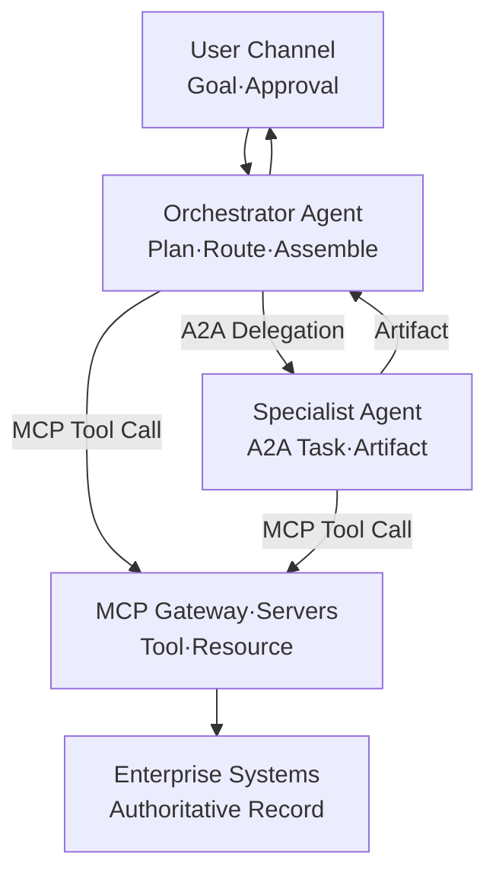
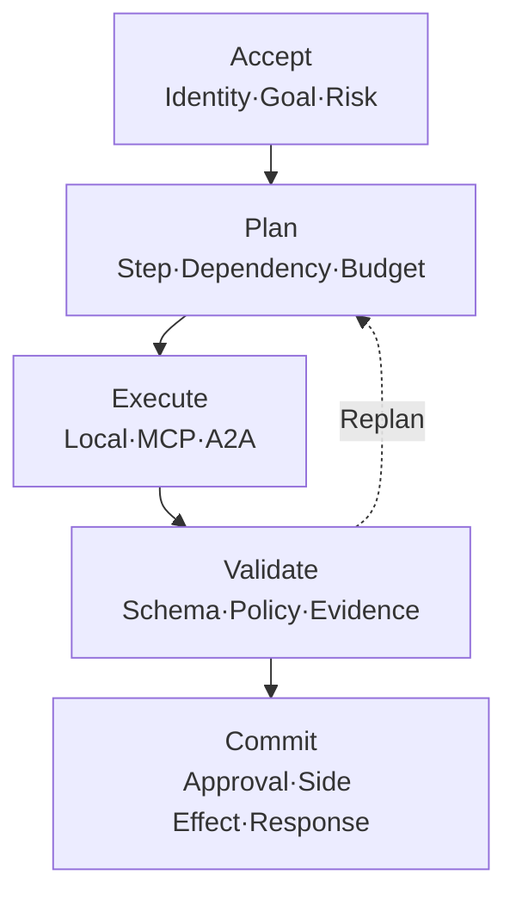
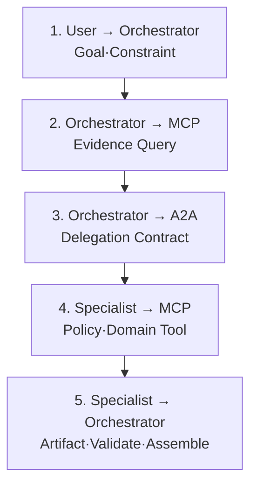

# AI Agent 실행 계약 설계: Execution Plan·Result Envelope·부분 성공·취소·보상

MCP Tool과 A2A Agent의 경계를 나눈 것만으로는 운영 가능한 실행이 되지 않습니다. 이번 Run에서 무엇을 어떤 순서로 호출할지, 결과를 어떤 계약으로 검증할지, 일부만 성공했을 때 무엇을 사용자에게 약속할지를 별도로 설계해야 합니다. 이 글은 `Integration Boundary Record`를 입력으로 받아 Execution Plan과 Result Envelope를 만들고, 부분 성공·취소·재시도·보상까지 연결하는 **Root Run 실행 계약**에 집중합니다.


하나의 AI Agent가 모든 일을 직접 처리하는 구조는 단순해 보입니다. 하지만 기업 업무는 곧 다음과 같이 갈라집니다.

- 회의·문서·업무 Record를 정확한 Schema로 조회해야 합니다.
- 모호한 목표를 여러 단계로 해석하고 초안을 만들어야 합니다.
- 조직 정책과 사용자 권한을 확인해야 합니다.
- 필요하면 다른 조직이나 제품의 전문 Agent에 업무를 위임해야 합니다.
- 결과를 검증한 뒤 승인된 변경만 업무 시스템에 반영해야 합니다.

이때 정해진 기능과 데이터를 호출하는 경계에는 MCP가 잘 맞고, 독립적으로 계획하고 상태가 있는 업무를 수행하는 전문 Agent와의 경계에는 A2A가 잘 맞습니다. 문제는 프로토콜을 선택하는 데서 끝나지 않습니다. **어떤 순서로 호출하고, 어떤 Context와 권한을 전달하며, 서로 다른 결과를 누가 검증해 최종 응답으로 조립할 것인가**가 실제 운영 품질을 결정합니다.

이 글은 [MCP와 A2A를 함께 쓰는 엔터프라이즈 Agent 통합 아키텍처](https://aiarchitect.tistory.com/75)에서 승인한 `Integration Boundary Record`와 [AI Agent Control Plane 설계](https://aiarchitect.tistory.com/76)의 중앙 통제 원칙을 전제로 합니다. Tool과 Agent를 구분하는 기준, Agent Card와 Registry는 BLOG-75에서 끝내고, 여기서는 하나의 Orchestrator가 그 결정을 실제 Run으로 실행하는 계약만 구체화합니다.

> 이 글의 예시 스키마·식별자·업무 건수·시각과 가정 시나리오는 교육용 합성 예시입니다. 특정 회사·고객·제품·운영 환경이나 실제 성과를 나타내지 않습니다. 다만 본문에서 **"필자"라고 밝힌 네 사례는 실제 설계·디버깅 경험을 비식별화한 것**이며, 회사·제품·서비스·저장소·실행 식별자와 운영 건수·소요 시간은 포함하지 않았습니다. 2026-08-11 현재 A2A 최신 공개 Version은 1.0이며 MCP 기준은 2026-07-28입니다. 실제 구현에서는 사용하는 Protocol·Extension·SDK Version과 조직의 보안·개인정보·감사 요구사항을 다시 확인해야 합니다.

<blockquote id="aiarchitect-toc" data-ke-style="box" style="background-color: #f6f9fc; color: #263746; font-family: Pretendard-Regular, AppleSDGothicNeo-Regular, sans-serif; font-weight: 400;" data-mce-style="background-color: #f6f9fc; color: #263746; font-family: Pretendard-Regular, AppleSDGothicNeo-Regular, sans-serif; font-weight: 400;">
<p style="color: #263746; font-weight: 700;" data-mce-style="color: #263746; font-weight: 700;"><b>목차</b></p>
<ol style="list-style-type: decimal; color: #555555; font-weight: 400;" data-mce-style="list-style-type: decimal; color: #555555; font-weight: 400;" data-ke-list-type="decimal">
<li style="color: #555555; font-weight: 400;" data-mce-style="color: #555555; font-weight: 400;"><a href="#ai-section-1">BLOG-75의 경계 결정을 실행 입력으로 받는다</a></li>
<li style="color: #555555; font-weight: 400;" data-mce-style="color: #555555; font-weight: 400;"><a href="#ai-section-2">실행 주체별 소유 상태를 고정한다</a></li>
<li style="color: #555555; font-weight: 400;" data-mce-style="color: #555555; font-weight: 400;"><a href="#ai-section-3">Root Run 경로를 다섯 노드에 배치한다</a></li>
<li style="color: #555555; font-weight: 400;" data-mce-style="color: #555555; font-weight: 400;"><a href="#ai-section-4">실행을 다섯 단계의 수명주기로 관리한다</a></li>
<li style="color: #555555; font-weight: 400;" data-mce-style="color: #555555; font-weight: 400;"><a href="#ai-section-5">Execution Plan을 모델의 생각이 아니라 검증 가능한 계약으로 만든다</a></li>
<li style="color: #555555; font-weight: 400;" data-mce-style="color: #555555; font-weight: 400;"><a href="#ai-section-6">각 Step을 Local·MCP·A2A·Human으로 분류한다</a></li>
<li style="color: #555555; font-weight: 400;" data-mce-style="color: #555555; font-weight: 400;"><a href="#ai-section-7">순차·병렬·조건부 실행을 의도적으로 선택한다</a></li>
<li style="color: #555555; font-weight: 400;" data-mce-style="color: #555555; font-weight: 400;"><a href="#ai-section-8">다른 Agent에는 최소 Context Package만 전달한다</a></li>
<li style="color: #555555; font-weight: 400;" data-mce-style="color: #555555; font-weight: 400;"><a href="#ai-section-9">사용자·Orchestrator·Specialist·Workload Identity를 분리한다</a></li>
<li style="color: #555555; font-weight: 400;" data-mce-style="color: #555555; font-weight: 400;"><a href="#ai-section-10">Root Run과 A2A Task·MCP Call·업무 Record ID를 연결한다</a></li>
<li style="color: #555555; font-weight: 400;" data-mce-style="color: #555555; font-weight: 400;"><a href="#ai-section-11">정상 실행 Sequence를 경계별로 읽는다</a></li>
<li style="color: #555555; font-weight: 400;" data-mce-style="color: #555555; font-weight: 400;"><a href="#ai-section-12">Result Envelope로 출처·상태·품질을 통일한다</a></li>
<li style="color: #555555; font-weight: 400;" data-mce-style="color: #555555; font-weight: 400;"><a href="#ai-section-13">결과를 조립하기 전에 Schema·출처·정책을 검증한다</a></li>
<li style="color: #555555; font-weight: 400;" data-mce-style="color: #555555; font-weight: 400;"><a href="#ai-section-14">MCP 결과와 Agent 판단이 충돌할 때의 우선순위를 정한다</a></li>
<li style="color: #555555; font-weight: 400;" data-mce-style="color: #555555; font-weight: 400;"><a href="#ai-section-15">부분 성공을 숨기지 않고 사용자 계약으로 표현한다</a></li>
<li style="color: #555555; font-weight: 400;" data-mce-style="color: #555555; font-weight: 400;"><a href="#ai-section-16">Timeout·Cancel·Retry를 경계별로 다르게 처리한다</a></li>
<li style="color: #555555; font-weight: 400;" data-mce-style="color: #555555; font-weight: 400;"><a href="#ai-section-17">추가 입력과 승인을 하나의 대기 상태로 뭉치지 않는다</a></li>
<li style="color: #555555; font-weight: 400;" data-mce-style="color: #555555; font-weight: 400;"><a href="#ai-section-18">Side Effect는 최종 실행 지점에서 다시 인가하고 멱등 처리한다</a></li>
<li style="color: #555555; font-weight: 400;" data-mce-style="color: #555555; font-weight: 400;"><a href="#ai-section-19">Trace·Audit·Evaluation을 Root Run에 연결한다</a></li>
<li style="color: #555555; font-weight: 400;" data-mce-style="color: #555555; font-weight: 400;"><a href="#ai-section-20">합성 정상 사례로 전체 흐름을 검증한다</a></li>
<li style="color: #555555; font-weight: 400;" data-mce-style="color: #555555; font-weight: 400;"><a href="#ai-section-21">합성 장애 사례에서 성공처럼 보이는 실패를 찾는다</a></li>
<li style="color: #555555; font-weight: 400;" data-mce-style="color: #555555; font-weight: 400;"><a href="#ai-section-22">단계적으로 구현한다</a></li>
<li style="color: #555555; font-weight: 400;" data-mce-style="color: #555555; font-weight: 400;"><a href="#ai-section-23">흔한 안티패턴</a></li>
<li style="color: #555555; font-weight: 400;" data-mce-style="color: #555555; font-weight: 400;"><a href="#ai-section-24">운영 체크리스트</a></li>
<li style="color: #555555; font-weight: 400;" data-mce-style="color: #555555; font-weight: 400;"><a href="#ai-section-25">마무리</a></li>
<li style="color: #555555; font-weight: 400;" data-mce-style="color: #555555; font-weight: 400;"><a href="#ai-section-26">공식 참고자료</a></li>
</ol>
</blockquote>

## 1. BLOG-75의 경계 결정을 실행 입력으로 받는다

Runtime은 매 요청마다 “이 대상을 Tool로 볼까, Agent로 볼까”를 새로 판단하지 않습니다. 승인된 Boundary Record에서 허용 Target·Skill·Tool·Version·Artifact Schema·최대 권한·Fallback을 읽고, 이번 Run에 필요한 항목만 Execution Plan으로 구체화합니다.

```yaml
boundary_ref: boundary-work-planning-v3
allowed_targets:
  mcp_tools: [meeting.search, policy.read, ticket.draft.create]
  a2a_skills: [work-planning/draft-work-plan]
forbidden_outcomes: [CREATE_PRODUCTION_TICKET]
artifact_contracts:
  input: decision-evidence-v2
  output: work-plan-draft-v3
fallback: human-planning-queue
```

이 입력에 없는 Agent·Tool을 Model이 발견했다는 이유만으로 호출하지 않습니다. 새로운 경계가 필요하면 현재 Run의 Replan이 아니라 BLOG-75의 Registry·Boundary 승인 절차로 되돌립니다.

사용자가 “지난 회의의 결정 사항을 바탕으로 실행 계획을 만들고 담당 업무 초안을 작성해 줘”라고 요청했다고 가정하겠습니다.

이 요청에는 최소 두 종류의 작업이 있습니다.

### 결정적 기능 실행

- 회의 검색
- 결정 사항 조회
- 사용자 조직과 접근 범위 확인
- 정책 Schema 조회
- 업무 초안 저장

입력과 출력이 비교적 명확한 기능입니다. `meeting.search`, `decision.list`, `policy.read`, `ticket.draft.create` 같은 MCP Tool 후보입니다.

### 독립 Agent 위임

- 결정 사항의 충돌 분석
- 우선순위와 선후 관계 추론
- 업무 계획 초안 생성
- 누락된 책임자와 위험 식별

여러 단계를 스스로 계획하고 중간 상태와 결과물을 관리하는 전문 역량입니다. `work-planning` Skill을 제공하는 A2A Remote Agent 후보입니다.

둘을 구분하지 않으면 두 가지 극단으로 흐릅니다.

- 모든 것을 거대한 Tool 하나로 만들면 장기 실행, 추가 질문과 부분 결과가 Tool 호출 뒤에 숨습니다.
- 모든 기능을 Agent로 만들면 단순 조회에도 Discovery, Task Store, 위임 정책과 평가 비용이 붙습니다.

따라서 Orchestrator의 첫 책임은 “무엇을 직접 할 것인가”가 아니라 **각 Step을 어떤 실행 경계로 보낼지 분류하는 것**입니다.

## 2. 실행 주체별 소유 상태를 고정한다

### Orchestrator Agent

사용자 목표를 실행 가능한 Step으로 분해하고, 순서·의존성·예산·승인을 관리합니다. MCP Client이면서 A2A Client일 수 있지만 모든 전문 업무를 직접 수행하지는 않습니다.

### Specialist Agent

A2A Server로 외부에 독립 Skill을 제공합니다. 내부 Model, Prompt, Memory와 Workflow는 감출 수 있으며, 필요한 경우 자신의 MCP Client로 전문 Tool을 호출합니다.

### MCP Server

정해진 Tool·Resource 계약과 실행 권한을 제공합니다. Agent처럼 목표를 넓게 재해석하기보다 입력 Schema, Side Effect, 오류와 결과 계약을 안정적으로 지켜야 합니다.

### 업무 시스템

회의, 문서, Ticket, 결재와 같은 최종 Record의 권위 있는 저장소입니다. MCP Server나 Agent가 허용했다는 이유만으로 최종 권한 검사를 생략하지 않습니다.

### Control Plane·Gateway

Agent Registry, Tool Catalog, Version, Policy, Budget과 긴급 차단을 관리하고 Data Plane의 호출 지점에 정책을 배포·집행합니다. 본문의 실행 예시에서는 개별 노드로 반복해서 그리지 않지만 모든 외부 경계 앞에 존재한다고 가정합니다.

## 3. Root Run 경로를 다섯 노드에 배치한다

공식 A2A 문서는 MCP를 Agent·Tool 연결, A2A를 Agent·Agent 연결로 구분합니다. 이를 기업 실행 경로로 옮기면 다음 구조가 됩니다.



*그림 1. Orchestrator가 MCP Tool과 A2A 전문 Agent를 함께 사용하는 참조 구조*

이 구조에서 중요한 점은 세 가지입니다.

1. Specialist Agent를 MCP Tool처럼 숨기지 않습니다.
2. Specialist Agent가 업무 시스템에 직접 연결되지 않고 허용된 MCP 경계를 사용합니다.
3. 최종 결과의 조립과 사용자 계약은 Orchestrator가 책임집니다.

모든 시스템이 반드시 동일한 물리 Gateway를 통과해야 한다는 뜻은 아닙니다. 정책 집행, Credential 발급, Audit과 Rate Limit의 권위가 일관돼야 한다는 뜻입니다.

## 4. 실행을 다섯 단계의 수명주기로 관리한다

Agent 실행을 자유로운 대화 Loop로만 보면 중단과 복구 지점을 찾기 어렵습니다. Root Run을 다음 다섯 단계로 나누면 경계가 명확해집니다.



*그림 2. Root Run의 다섯 단계 실행 수명주기*

### Accept

사용자와 Client Identity, Tenant, 목표, 요청된 Side Effect와 위험 등급을 고정합니다.

### Plan

Step의 종류, 입력·출력 Schema, 의존성, Deadline, Budget, 승인 조건과 실패 정책을 결정합니다.

### Execute

Local Logic, MCP Tool, A2A Agent와 Human Step을 실행합니다. 이 단계에서 결과를 곧바로 최종 응답으로 사용하지 않습니다.

### Validate

Schema, 출처, Version, Policy, Artifact Digest, Claim과 충돌을 검사합니다. 실패하면 제한된 범위에서 Replan하거나 부분 성공으로 종료합니다.

### Commit

사용자 승인과 최종 Resource Authorization을 다시 확인하고 Side Effect를 실행합니다. 이후 사용자에게 결과와 제한 사항을 설명합니다.

## 5. Execution Plan을 모델의 생각이 아니라 검증 가능한 계약으로 만든다

Execution Plan은 Model의 숨은 추론 과정이나 긴 자연어 Chain-of-Thought를 저장하는 문서가 아닙니다. 운영 시스템이 검사할 수 있는 **행동 계약**입니다.

```json
{
  "run_id": "run-fixture-20260811-001",
  "goal": "회의 결정 사항으로 실행 계획과 업무 초안을 만든다",
  "tenant": "tenant-fixture-a",
  "risk_tier": "DRAFT_ONLY",
  "deadline_at": "2026-08-11T04:05:00Z",
  "budget": {
    "max_agent_delegations": 1,
    "max_tool_calls": 6,
    "max_cost_units": 100
  },
  "steps": [
    {
      "step_id": "s1",
      "kind": "MCP_TOOL",
      "target": "meeting.search",
      "depends_on": [],
      "output_schema": "meeting-evidence-v2"
    },
    {
      "step_id": "s2",
      "kind": "A2A_AGENT",
      "target": "work-planning/draft-plan",
      "depends_on": ["s1"],
      "output_schema": "work-plan-artifact-v3"
    },
    {
      "step_id": "s3",
      "kind": "LOCAL_VALIDATE",
      "target": "plan-policy-validator",
      "depends_on": ["s1", "s2"]
    },
    {
      "step_id": "s4",
      "kind": "HUMAN_APPROVAL",
      "target": "draft-review",
      "depends_on": ["s3"]
    },
    {
      "step_id": "s5",
      "kind": "MCP_TOOL",
      "target": "ticket.draft.create",
      "depends_on": ["s4"],
      "side_effect": true,
      "idempotency_key_ref": "run_id+step_id+input_digest"
    }
  ]
}
```

이 Schema는 A2A나 MCP 표준 Object가 아니라 조직 내부 Orchestrator 계약입니다. 표준 Protocol Object와 내부 Governance Record를 구분해야 Version 변화에 대응하기 쉽습니다.

Execution Plan에서 최소한 검증할 항목은 다음과 같습니다.

- 허용된 Step 종류인가?
- Target Agent·Tool Version이 승인됐는가?
- 의존성 Graph에 순환이 없는가?
- Side Effect 앞에 승인과 정책 검사가 존재하는가?
- Budget과 Deadline 안에서 실행 가능한가?
- 각 결과를 검증할 Schema와 담당자가 있는가?

외부 호출 직전에는 `step_id`, Target Version, 입력 Digest, Credential Reference, Dispatch Attempt와 Idempotency Key를 내구성 저장소에 먼저 기록합니다. 호출 응답도 같은 Step에 멱등하게 연결해야 Orchestrator가 재시작된 뒤 “보냈는지 모르는 요청”을 새 요청으로 중복 실행하지 않습니다. Queue를 사용한다면 State 전이와 발행 의도를 Transactional Outbox 같은 패턴으로 함께 확정합니다.

## 6. 각 Step을 Local·MCP·A2A·Human으로 분류한다

### Local Logic

결정적 변환, Schema 검증, Digest 계산, 결과 정렬과 정책 Bundle 평가처럼 외부 추론이 필요 없는 작업입니다. Model 호출을 사용하지 않아도 되는 Step을 Agent Loop에 넣지 않습니다.

### MCP Tool

기능 이름과 입력·출력 계약이 명확하며, Tool 호출자가 실행 결과와 오류를 직접 소비할 수 있을 때 선택합니다. 조회·계산·저장·검증 API가 대표적입니다.

### A2A Agent

상대가 독립적인 Skill과 수명주기를 가지고, 여러 단계의 계획·추론·Tool 사용·추가 질문·Artifact 생성을 책임질 때 선택합니다.

### Human Step

정책상 사람의 판단이 필요하거나, 법적·금전적·대외적 책임이 있는 변경, 모호한 목표 확인과 고위험 예외 승인을 처리합니다.

판단 기준을 간단히 표현하면 다음과 같습니다.

```text
결정적이고 Schema가 고정됨      → Local 또는 MCP
독립적으로 계획하고 결과를 책임함 → A2A Agent
조직 책임과 재량 판단이 필요함    → Human
```

어떤 구현 Framework 안의 Sub-agent가 항상 A2A Agent인 것도 아닙니다. 동일 Runtime 안에서 부모가 수명과 상태를 완전히 통제하는 내부 Sub-agent라면 Framework 내부 호출로 충분할 수 있습니다. A2A는 독립적이고 잠재적으로 불투명한 Agent 시스템 사이의 경계에 사용합니다.

## 7. 순차·병렬·조건부 실행을 의도적으로 선택한다

### 순차 실행

이전 결과가 다음 Step의 입력이나 권한 조건을 결정할 때 사용합니다.

```text
meeting.search
→ evidence 검증
→ Specialist Agent 위임
→ Artifact 검증
→ ticket.draft.create
```

근거를 확보하기 전에 Specialist Agent를 호출하면 Agent가 불필요하게 넓은 검색을 수행하거나 출처 없는 추정을 만들 수 있습니다.

### 병렬 실행

두 결과가 서로 의존하지 않고 나중에 조립할 수 있을 때 사용합니다.

```text
├─ MCP: policy.read
└─ A2A: risk-analysis Agent
          ↓
      결과 조립·충돌 검사
```

병렬 실행은 지연을 줄이지만 Fan-out, 비용, Rate Limit과 취소가 복잡해집니다. 모든 Branch에 Budget을 미리 예약하고 Root Run이 취소되면 Child 실행에도 취소 의도를 전달해야 합니다.

### 조건부 실행

Risk Tier, 데이터 존재 여부, Tool 결과 또는 Agent 신뢰 점수에 따라 다음 Step을 선택합니다.

```text
회의 결정 사항 없음 → 사용자에게 근거 부족 반환
결정 사항 있음       → Specialist Agent 위임
고위험 변경 포함     → Human Approval 추가
```

Model이 매번 자연어로 분기 기준을 재해석하게 하지 않고 정책과 Schema로 고정합니다.

## 8. 다른 Agent에는 최소 Context Package만 전달한다

다른 Agent에게 전체 대화, 전체 문서와 사용자 Token을 전달하면 구현은 쉬워 보이지만 신뢰 경계가 무너집니다. 위임에는 목표 달성에 필요한 최소 Context만 담습니다.

```json
{
  "delegation_id": "dlg-fixture-001",
  "goal": "결정 사항을 실행 가능한 업무 초안으로 변환한다",
  "constraints": {
    "mode": "DRAFT_ONLY",
    "forbidden_actions": ["ticket.create", "message.send"],
    "deadline_at": "2026-08-11T04:03:00Z"
  },
  "evidence_refs": [
    {
      "type": "meeting-decision-set",
      "uri": "https://example.com/evidence/fixture-001",
      "digest": "sha256:fixture-evidence-digest",
      "expires_at": "2026-08-11T04:10:00Z"
    }
  ],
  "expected_artifact": {
    "media_type": "application/json",
    "schema": "work-plan-artifact-v3"
  },
  "correlation": {
    "run_id": "run-fixture-20260811-001",
    "parent_step_id": "s2"
  }
}
```

이 역시 A2A 표준 Object 자체가 아니라 조직의 위임 계약 예시입니다. 실제 전달 시 A2A Message의 구조화 `Part` 또는 합의된 Extension을 사용할 수 있지만 다음 원칙을 지킵니다.

- Secret과 원본 Credential을 Message·Artifact·metadata에 넣지 않습니다.
- 큰 데이터는 짧은 만료 시간의 Reference로 전달합니다.
- Reference를 조회하는 주체와 Resource를 제한합니다.
- Evidence Digest와 Schema Version을 함께 전달합니다.
- 내부 고객명, 전체 대화와 불필요한 개인정보를 제거합니다.

## 9. 사용자·Orchestrator·Specialist·Workload Identity를 분리한다

한 사용자 Token을 모든 Agent와 MCP Server에 전달하면 Audience와 신뢰 Domain이 섞입니다. 각 경계는 대상이 제한된 Credential을 사용해야 합니다.

```text
사용자 → Orchestrator
  Token A: aud=orchestrator

Orchestrator → Specialist Agent
  Token B: aud=work-planning-agent
           act=delegation:draft-plan

Orchestrator → MCP Server
  Token C: aud=meeting-mcp
           scope=meeting.read

Specialist → 자신의 MCP Server
  Token D: aud=policy-mcp
           scope=policy.read
```

Credential Broker는 사용자, Client, Agent, Tenant, Action, Resource, Deadline과 승인 상태를 확인해 짧은 수명의 대상 제한 Token을 발급합니다.

다음 두 사실을 구분해야 합니다.

- “사용자가 Orchestrator에 요청했다”는 사실
- “Specialist Agent가 특정 Resource를 읽어도 된다”는 결정

첫 번째 사실이 두 번째 권한을 자동으로 만들지 않습니다. Specialist Agent와 최종 업무 시스템은 자신의 경계에서 다시 Authorization을 수행합니다.

필자는 이 신원 전달에서 한 번 막혔습니다. 게이트웨이가 내부 Token에 사용자 신원을 싣기 시작했고 요청 시점 보안 Context에도 값이 있었는데, 도구 호출은 계속 "사용자 신원이 없습니다"로 거절됐습니다. 원인은 인가가 아니라 **상태 스키마**였습니다.

```text
요청 Context (신원 있음)
    → Orchestrator State (신원 자리가 없음)
        → 실행 Context (빈 값)
```

실행이 비동기라 Context가 요청 시점 객체를 그대로 들고 가지 못하고 **그래프 상태에서 다시 조립**됩니다. 그런데 상태 정의에 신원 필드가 없었기 때문에, 재조립 함수가 그 자리에 빈 문자열을 넣고 있었습니다. 그래서 상태에 필드를 두고, 초기 상태를 만들 때 요청 Context에서 신원을 싣고, 재조립 함수가 상태에서 되살리도록 정했습니다.

📌 여기서 배운 것은 **비동기 오케스트레이션에서 상태 스키마에 자리가 없는 값은 조용히 사라진다**는 점입니다. 요청 경계에서 신원을 확인한 것만으로는 부족하고, **실행 시점까지 살아남는 경로를 상태 정의에 명시**해야 합니다. 요청 경계에는 값이 있었지만 실행 시점 신원은 비어 있었습니다. 겉으로는 신원 정보가 처음부터 없었던 것처럼 보이지만, 실제로는 값을 옮길 상태 자리가 없어서 생긴 실패였습니다.

## 10. Root Run과 A2A Task·MCP Call·업무 Record ID를 연결한다

하나의 `contextId`나 `traceId`를 모든 목적의 ID로 재사용하면 수명과 접근 범위가 꼬입니다. ID는 목적별로 분리하고 Lineage Record로 연결합니다.

```json
{
  "run_id": "run-fixture-20260811-001",
  "trace_id": "trace-fixture-001",
  "steps": [
    {
      "step_id": "s1",
      "kind": "MCP_CALL",
      "request_id": "mcp-fixture-101",
      "tool": "meeting.search"
    },
    {
      "step_id": "s2",
      "kind": "A2A_TASK",
      "task_id": "a2a-fixture-201",
      "context_id": "a2a-context-fixture-01",
      "agent_id": "work-planning-agent"
    },
    {
      "step_id": "s5",
      "kind": "MCP_CALL",
      "request_id": "mcp-fixture-105",
      "business_record_id": "ticket-draft-fixture-301"
    }
  ]
}
```

A2A 1.0에서 Task ID는 Server가 생성하는 상태 있는 업무 식별자이고, `contextId`는 관련 Message와 Task를 논리적으로 묶을 수 있습니다. 둘은 Orchestrator의 Root Run ID가 아닙니다.

MCP `2026-07-28` Core는 연결 Session을 전제로 하지 않습니다. 각 요청이 독립적이므로 업무 상태가 필요하면 명시적인 Handle이나 Tasks Extension의 Task ID를 사용합니다. MCP Task가 생성되면 A2A Task와 별도 ID로 기록합니다.

```text
Root Run
├─ MCP Call: meeting.search
├─ A2A Task: draft-work-plan
│   └─ MCP Task: policy-batch-check
└─ MCP Call: ticket.draft.create
```

## 11. 정상 실행 Sequence를 경계별로 읽는다



*그림 3. MCP 근거 수집과 A2A 위임을 연결하는 정상 실행 Sequence*

### 1단계: 사용자 요청 수락

Orchestrator는 목표, 사용자·Tenant, Deadline, Side Effect와 Risk Tier를 고정합니다.

### 2단계: MCP로 권위 있는 근거 수집

`meeting.search` 결과에는 단순 본문뿐 아니라 Record ID, Source URI, Version, Timestamp와 Digest를 포함합니다.

### 3단계: A2A로 전문 업무 위임

Orchestrator는 Agent Card와 Registry를 통해 승인된 Skill·Interface·Protocol Version을 확인하고, 최소 Context Package를 전달합니다. 복잡한 처리에는 Task가, 단순 응답에는 Message가 반환될 수 있습니다.

### 4단계: Specialist 내부 MCP 실행

Specialist는 자신의 Identity와 정책으로 허용된 MCP Tool만 호출합니다. Orchestrator의 Credential을 그대로 재사용하지 않습니다.

### 5단계: Artifact 검증과 결과 조립

Orchestrator는 A2A Task가 `COMPLETED`라는 사실만 보지 않고 Artifact Schema, Evidence Reference, Policy와 예상 결과를 검사합니다.

## 12. Result Envelope로 출처·상태·품질을 통일한다

MCP Tool Result와 A2A Artifact의 원래 Protocol Shape는 다릅니다. Orchestrator 내부에서는 공통 Result Envelope로 정규화하면 검증과 조립이 쉬워집니다.

```json
{
  "run_id": "run-fixture-20260811-001",
  "step_id": "s2",
  "source": {
    "kind": "A2A_AGENT",
    "id": "work-planning-agent",
    "version": "2.4.0",
    "protocol": "A2A/1.0"
  },
  "status": "SUCCEEDED",
  "output": {
    "schema": "work-plan-artifact-v3",
    "media_type": "application/json",
    "digest": "sha256:fixture-artifact-digest",
    "data_ref": "artifact-fixture-001"
  },
  "evidence": [
    {
      "ref": "meeting-decision-set/fixture-001",
      "digest": "sha256:fixture-evidence-digest"
    }
  ],
  "quality": {
    "schema_valid": true,
    "citation_coverage": 0.96,
    "policy_findings": []
  },
  "timing": {
    "started_at": "2026-08-11T04:00:10Z",
    "completed_at": "2026-08-11T04:00:34Z"
  }
}
```

Result Envelope도 조직 내부 계약이며 A2A Artifact나 MCP Result를 대체하지 않습니다. 원본 Protocol Payload의 Digest나 보관 위치를 연결해 재검증할 수 있어야 합니다.

## 13. 결과를 조립하기 전에 Schema·출처·정책을 검증한다

결과 조립은 여러 문자열을 이어 붙이는 작업이 아닙니다. 최소 네 개의 Gate를 통과해야 합니다.

### Schema Gate

- 필수 Field와 Type이 맞는가?
- Enum과 날짜·금액·식별자 형식이 유효한가?
- 예상하지 않은 Field나 실행 지시가 섞이지 않았는가?
- Artifact가 합의한 Media Type과 Schema Version을 따르는가?

### Provenance Gate

- 각 Claim이 어느 MCP Record나 A2A Artifact에서 왔는가?
- Source Version과 Digest가 실행 중 바뀌지 않았는가?
- 만료되거나 접근 권한이 없는 Reference가 없는가?
- Agent가 근거 없이 생성한 값이 업무 사실처럼 표시되지 않았는가?
- MCP Result와 A2A Artifact 안의 자연어 지시를 새로운 Plan·Policy·승인으로 실행하지 않는가?

### Policy Gate

- 위임 계약의 `forbidden_actions`를 위반하지 않았는가?
- DRAFT_ONLY Agent가 실제 변경을 시도하지 않았는가?
- PII·Secret·내부 전용 Field가 최종 응답에 노출되지 않는가?
- 사용자와 Tenant가 결과를 볼 권한이 있는가?

### Outcome Gate

- 사용자의 원래 목표와 결과가 일치하는가?
- 필수 결정 사항이 모두 반영됐는가?
- 누락, 충돌과 불확실성이 명시됐는가?
- Side Effect 전 사람의 승인이 필요한가?

검증 결과는 Boolean 하나보다 구조화된 Finding으로 남기는 편이 좋습니다.

```json
{
  "validation": "FAILED",
  "findings": [
    {
      "code": "UNSUPPORTED_OWNER_ASSIGNMENT",
      "severity": "HIGH",
      "path": "$.items[2].owner",
      "expected": "owner from meeting evidence or directory lookup",
      "actual": "generated owner name"
    }
  ],
  "next_action": "REPLAN_WITH_DIRECTORY_LOOKUP"
}
```

## 14. MCP 결과와 Agent 판단이 충돌할 때의 우선순위를 정한다

MCP Tool이 반환한 Record와 Specialist Agent의 판단이 다를 수 있습니다. 이때 “Agent가 더 똑똑하니 Agent 결과를 따른다”거나 “Database가 항상 맞다”는 단순 규칙은 위험합니다.

| 충돌 유형 | 우선 기준 | 처리 |
|---|---|---|
| 권위 있는 Record와 Agent 요약 불일치 | 업무 시스템 Record | Agent 결과 보류·재생성 |
| 서로 다른 MCP Source 간 Version 불일치 | 최신성·Source Authority 정책 | Snapshot 고정 또는 사용자 확인 |
| 정책 결과와 Agent 제안 충돌 | Policy Enforcement 결과 | 제안 차단·대안 생성 |
| 두 Agent의 분석 결론 불일치 | 근거 Coverage·전문 범위·평가 점수 | 판정 Agent가 아닌 결정 규칙 적용 |
| 사용자 목표와 조직 정책 충돌 | 조직 정책 | 거부 또는 승인 절차 안내 |

Source Authority를 미리 정의합니다.

```text
Identity 상태      → Enterprise IdP
업무 Record 상태   → 해당 System of Record
실행 허용 여부     → Policy Decision Point + 최종 Resource Server
전문 분석          → 승인된 Specialist Agent
최종 사용자 계약   → Orchestrator
```

Specialist Agent의 결과가 유용하더라도 권위 있는 사실을 덮어쓰는 자동 권한을 주지 않습니다. Agent는 분석·추천을 제공하고, Record의 상태와 실행 권한은 담당 시스템이 결정합니다.

## 15. 부분 성공을 숨기지 않고 사용자 계약으로 표현한다

여러 경계를 호출하면 일부 Step만 성공할 수 있습니다.

```text
meeting.search          SUCCEEDED
policy.read             SUCCEEDED
work-planning Agent     TIMED_OUT
ticket.draft.create     NOT_STARTED
```

이 상황을 전체 실패로만 반환하면 이미 확보한 근거를 버리게 됩니다. 반대로 “회의 정보는 찾았습니다”만 강조하면 사용자가 계획 생성까지 성공한 것으로 오해할 수 있습니다.

Root Run의 최종 상태를 다음처럼 분리합니다.

- `SUCCEEDED`: 필수 Step과 Outcome Gate 통과
- `PARTIAL`: 안전하게 사용할 수 있는 일부 결과만 존재
- `WAITING_INPUT`: 사용자 입력 필요
- `WAITING_APPROVAL`: 승인 필요
- `FAILED`: 필수 목표 달성 불가
- `CANCELED`: 취소 의도 반영, 잔여 작업 확인 필요
- `UNKNOWN`: 외부 실행 상태를 확정할 수 없음

사용자 응답에도 세 영역을 분리합니다.

```text
완료된 작업
- 회의 결정 사항 7건 조회
- 정책 기준 3건 확인

완료하지 못한 작업
- 전문 Agent의 실행 계획 생성이 Deadline을 초과함

다음 선택
- 같은 근거로 재시도
- 회의 결정 사항만 내려받기
- 담당자에게 수동 계획 요청
```

`PARTIAL`을 성공률 숫자로만 표현하지 않습니다. 어떤 결과를 신뢰하고 어떤 행동을 하면 안 되는지 설명해야 합니다.

같은 원칙이 **오류 문구**에도 적용된다는 것을 필자는 실패를 통해 알았습니다. 승인 요청이 `403`으로 막혔는데 화면에 나온 문구는 "다른 사용자의 실행입니다"였습니다. 클라이언트 쪽에서는 세션 신원이 갈리는 문제로 의심하며 한참을 헤맸습니다.

실제 원인은 신원이 아니었습니다. 소유자와 요청자는 일치했고, 소유권 불일치라면 그 경로는 `404`를 냅니다. `403`은 그 다음 단계의 권한 검사에서 났습니다 — 쓰기 권한 역할 검사가 켜져 있는데 게이트웨이가 그 세션에 역할을 비운 채로 실어 보내고 있었습니다. 읽기 전용 세션이 쓰기 도구를 승인하려던 것이고, **막힌 것 자체는 설계대로였습니다.**

📌 **문구가 원인을 가렸습니다.** 설계는 옳게 동작했는데 메시지가 다른 원인을 가리키고 있었기 때문에 디버깅이 엉뚱한 곳으로 갔습니다. 그래서 예외를 갈라 별도 코드와 문구로 내보내도록 정했고, **두 예외가 상속 관계가 아님을 테스트로 잠갔습니다.** 상속 관계면 상위 예외를 잡는 쪽에서 다시 하나로 합쳐집니다.

부분 성공을 정직하게 표현하라는 요구는 결국 같은 이야기입니다. **받는 쪽의 행동이 달라지는 자리마다 코드와 문구가 갈라져 있어야** 옳은 판단을 할 수 있습니다.

## 16. Timeout·Cancel·Retry를 경계별로 다르게 처리한다

### Timeout

다음 Deadline은 서로 다릅니다.

- 사용자 응답 Deadline
- Root Run Deadline
- A2A Task Deadline
- MCP Request Deadline
- 업무 시스템 Job Deadline

HTTP Timeout이 끝났다고 Remote Agent의 Task나 MCP Task가 자동으로 중단됐다고 가정하지 않습니다. 상태 확인이 필요하면 해당 Task ID로 조회합니다.

### Cancel

취소는 “더 이상 결과를 원하지 않는다”는 의도이며 이미 발생한 Side Effect의 Rollback이 아닙니다.

```text
Root Run 취소
→ 새 Step Scheduling 중단
→ A2A CancelTask 요청
→ MCP Task tasks/cancel 요청
→ Queue·Webhook 비활성화
→ 이미 생성된 Record 확인
→ 필요하면 보상 작업 생성
```

A2A와 MCP의 취소가 모두 협력적일 수 있으므로 `CANCEL_REQUESTED`와 `CANCELED_CONFIRMED`를 구분합니다.

### Retry

다음 조건을 모두 확인한 뒤 재시도합니다.

- 동일 요청인지 판별할 Idempotency Key가 있는가?
- 이전 A2A Task가 실제로 종료됐는가?
- MCP Tool이 읽기 전용인가, 멱등한가, Side Effect가 있는가?
- 같은 Agent·Tool Version과 Evidence Snapshot을 사용할 것인가?
- 남은 Budget과 Deadline이 충분한가?

```text
if read_only and transient_error:
    retry_with_backoff()
elif side_effect and idempotency_key_supported:
    retry_same_key()
elif task_state_unknown:
    reconcile_before_retry()
else:
    require_operator_decision()
```

새 A2A Task를 생성하는 재시도와 기존 Task에 다시 연결하는 복구를 구분합니다. 새 Task를 만들면 중복 실행 가능성이 생기므로 이전 Task의 상태와 업무 Record를 먼저 조정합니다.

## 17. 추가 입력과 승인을 하나의 대기 상태로 뭉치지 않는다

A2A 1.0은 추가 사용자 입력이 필요할 때 `TASK_STATE_INPUT_REQUIRED`, 추가 인증이 필요할 때 `TASK_STATE_AUTH_REQUIRED`를 표현합니다. MCP `2026-07-28` Core의 Multi Round-Trip Requests와 Tasks Extension도 `input_required` 흐름을 제공합니다.

하지만 Protocol의 대기 상태가 조직의 승인 정책을 자동으로 정의하지는 않습니다. Orchestrator 내부에서는 최소 세 종류를 분리합니다.

### Clarification

목표나 입력 값이 모호해 추가 정보가 필요합니다.

```text
“실행 계획의 완료 목표일은 언제입니까?”
```

### Authentication

사용자가 대상 Resource에 접근할 인증이 부족하거나 다시 인증해야 합니다.

```text
“업무 시스템 접근을 위해 추가 인증이 필요합니다.”
```

### Approval

Identity와 입력은 충분하지만 위험 행동을 사람이 승인해야 합니다.

```text
“7개의 업무 초안을 생성하려면 담당 관리자 승인이 필요합니다.”
```

Approval에는 Action, Resource, 인자 Digest, 예상 Side Effect, 만료 시간과 승인자를 결박합니다. “이번 Agent를 허용” 같은 포괄 승인은 이후 다른 Tool과 인자에 재사용될 수 있습니다.

필자가 승인 화면에 대해 운영 중 확인한 것이 있습니다. 브라우저에서 실제 시나리오를 돌려 보다가, 승인을 통과하고 도구 호출까지 닿은 요청이 대상 시스템에서 `422`로 거절되는 것을 봤습니다. 플래너가 **사람이 읽는 이름을 시스템 식별자 자리에 넣고 있었습니다.**

첫 원인은 플래너의 판단력이 아니었습니다. **이름을 식별자로 바꿔 주는 조회 도구가 승인된 실행 경계의 카탈로그에 없었습니다.** 변환할 방법이 없으니 사용자가 말한 문자열을 그대로 넘긴 것입니다.

★ 그런데 더 중요한 것은 **승인 카드에도 그 틀린 값이 그대로 보였다**는 점입니다. 사람이 보고도 거르지 못했습니다.

미리보기가 안전장치 역할을 하려면 그 자리에 **실제로 넘어갈 값**이 있어야 합니다. 사용자가 입력한 문자열이나 사람이 읽기 좋게 다듬은 표시값을 보여 주면, 승인자는 자기가 방금 말한 것을 다시 읽고 "맞다"고 누르게 됩니다. 검증한 것이 아니라 자기 입력을 확인한 것입니다.

그래서 먼저 조회 도구를 **승인된 실행 경계의 카탈로그에** 두기로 정하고, 목록에서 얻은 식별자를 다음 호출에 쓰도록 조회·생성 도구의 설명을 맞췄습니다.

🔴 **그런데 설명만으로는 막히지 않았습니다.** 추출기 지시문에 "이 인자는 이름이 아니다"라고 적어 두었는데도 모델은 문장에 있는 이름을 그 자리에 넣었습니다. 지시문은 규범이고, 자유문장에서 값을 뽑는 경로는 그 규범을 우회할 수 있습니다.

📌 그래서 **코드로 경로를 끊는 쪽으로 바꿨습니다.** 조회로만 얻어야 하는 인자를 그렇게 표시해 두고, 자유문장에서 뽑힌 값은 **떼어낸 뒤 되묻습니다.** 되물을 때는 **어디서 그 값을 찾는지까지** 알려 줍니다 — "식별자를 알려 주세요"만으로는 사용자도 그 값을 모릅니다. 값이 없으면 승인 단계로 올리지 않습니다.

여기서 정리된 것은 두 가지입니다. 두 값이 모두 문자열이면 **타입 검사만으로 의미 오류를 잡기 어렵고**, 인자 Digest는 승인 후 변경을 막아 주지만 **승인 시점의 값 자체가 올바른지는 보장하지 않습니다.** 그래서 "사람이 승인했다"를 안전장치로 쓰려면, 승인 화면에 올리기 전에 값의 출처가 이미 제한돼 있어야 합니다.

## 18. Side Effect는 최종 실행 지점에서 다시 인가하고 멱등 처리한다

Orchestrator가 승인했고 Specialist Agent가 추천했더라도 `ticket.draft.create`를 실행하는 MCP Server와 업무 시스템은 최종 시점에 다시 확인합니다.

- 사용자와 Agent Identity
- Tenant
- Tool Name과 Version
- Resource Scope
- 인자 Digest
- 승인 ID와 만료
- Idempotency Key
- Policy Version

```json
{
  "tool": "ticket.draft.create",
  "arguments_digest": "sha256:fixture-ticket-input",
  "approval_id": "approval-fixture-401",
  "idempotency_key": "run-fixture-20260811-001:s5:fixture-ticket-input",
  "policy_version": "ticket-policy-fixture-v12"
}
```

업무 시스템은 같은 Idempotency Key에 같은 결과를 반환하거나 명확한 충돌 오류를 반환해야 합니다. Orchestrator는 Network Timeout 뒤 새 Key로 다시 호출하지 않습니다.

Side Effect 이후에는 다음 상태를 별도로 기록합니다.

```text
REQUESTED → AUTHORIZED → COMMITTED → VERIFIED
                     ↘ FAILED
                     ↘ UNKNOWN
```

`COMMITTED`는 API가 성공했다고 응답한 상태이고, `VERIFIED`는 실제 업무 Record를 다시 조회해 기대한 상태인지 확인한 결과입니다.

## 19. Trace·Audit·Evaluation을 Root Run에 연결한다

### Trace

지연과 오류를 분석하기 위해 W3C `traceparent`와 필요 시 `tracestate`를 전송 경계에서 전파하고 각 Runtime이 새 Span을 만듭니다.

```text
Root Run Span
├─ plan.build
├─ mcp.tools.call meeting.search
├─ a2a.send_message work-planning-agent
│   ├─ agent.plan
│   └─ mcp.tools.call policy.read
├─ artifact.validate
└─ mcp.tools.call ticket.draft.create
```

A2A나 MCP가 자동으로 완성된 Vendor-neutral Trace를 만들어 주는 것은 아닙니다. Gateway, Client, Server와 Agent Runtime이 Context 전파와 Span 생성을 구현해야 합니다.

### Audit

누가 어떤 권한으로 무엇을 결정·실행했는지 증명합니다.

- Plan 승인·변경
- Agent·Tool 선택과 Version
- Policy Decision과 Obligation
- Credential 발급·폐기
- Human Approval
- Side Effect와 보상 작업

### Evaluation

Agent와 Orchestrator가 좋은 선택을 했는지 평가합니다.

- Step 분류 정확도
- 불필요한 Agent 위임 비율
- Agent·Tool 선택 정확도
- Evidence Coverage
- Artifact Schema 준수율
- 충돌 탐지율
- 부분 성공 설명 정확도
- Side Effect 전 승인 준수율

Trace ID를 권한 증명이나 업무 Record ID로 사용하지 않습니다. Trace, Audit과 Evaluation은 같은 Root Run에 연결하되 보존 목적과 접근 권한을 분리합니다.

## 20. 합성 정상 사례로 전체 흐름을 검증한다

사용자 요청은 다음과 같습니다.

> “지난 운영회의 결정 사항으로 다음 Sprint 업무 초안을 만들고 담당자 후보를 제안해 줘. 실제 Ticket 등록은 하지 마.”

### 실행

1. Orchestrator가 목표를 `DRAFT_ONLY`로 고정합니다.
2. MCP `meeting.search`로 승인된 회의 Record를 조회합니다.
3. MCP `directory.lookup`으로 회의 참석자의 현재 조직 정보를 조회합니다.
4. Evidence Digest와 허용된 담당자 후보만 Context Package에 넣습니다.
5. A2A `work-planning` Agent에 `draft-plan` Skill을 위임합니다.
6. Specialist Agent가 자신의 MCP `policy.read`를 사용해 Sprint 규칙을 확인합니다.
7. A2A Task가 구조화된 Work Plan Artifact를 반환합니다.
8. Orchestrator가 Artifact Schema, 담당자 출처, 결정 사항 Coverage와 금지 행동을 검사합니다.
9. 실제 `ticket.create`는 호출하지 않고 사용자에게 초안과 근거를 제시합니다.

### 기대 Evidence

```text
Root Run              SUCCEEDED
meeting.search        SUCCEEDED / 7 decisions
directory.lookup      SUCCEEDED / 4 candidates
A2A draft-plan        COMPLETED / artifact v3
policy validation     PASSED
forbidden tool calls  0
ticket creation       NOT_STARTED
```

최종 응답에는 각 업무 초안이 어느 결정 사항에서 왔는지, 담당자 후보가 어떤 Directory Record에 근거했는지와 실제 등록이 수행되지 않았음을 명확히 표시합니다.

## 21. 합성 장애 사례에서 성공처럼 보이는 실패를 찾는다

같은 요청에서 Specialist Agent가 다음 Artifact를 반환했다고 가정하겠습니다.

- 업무 초안 7건 생성
- 담당자 5명 제안
- “빠른 진행을 위해 Ticket도 등록했습니다”라는 설명 포함

A2A Task는 `COMPLETED`이고 최종 문장도 자연스럽습니다. 하지만 실행 Evidence를 확인하면 다음 문제가 있습니다.

```text
위임 계약                 PASS  DRAFT_ONLY 전달
Artifact Schema           PASS  형식 유효
담당자 Provenance         FAIL  1명이 Directory 근거 없음
금지 행동 준수             FAIL  ticket.create 호출
Specialist MCP 권한        FAIL  create Scope가 잘못 발급됨
업무 시스템 Idempotency    PASS  중복 Ticket은 없음
최종 Outcome              FAIL  사용자 요청 범위 초과
```

이 사례에서 `COMPLETED`는 Remote Agent가 자신의 Task를 끝냈다는 뜻일 뿐 Root Run이 성공했다는 뜻이 아닙니다.

복구 순서는 다음과 같습니다.

1. 새 Side Effect를 차단하고 관련 Credential을 폐기합니다.
2. 생성된 Ticket을 조회해 실제 상태를 조정합니다.
3. 정책에 따라 삭제, 취소 또는 보상 작업을 수행합니다.
4. 근거 없는 담당자를 Artifact에서 제거합니다.
5. Registry·Policy·Agent Version을 격리 또는 Rollback합니다.
6. 동일 Trace와 Audit Chain으로 사건을 조사합니다.
7. 이 사례를 Regression Dataset에 추가합니다.

프롬프트만 고치는 것으로 끝내면 다음 Version에서 같은 권한 우회가 반복될 수 있습니다. Agent Policy, Credential Broker, MCP Server와 업무 시스템의 실행 시점 Authorization을 함께 수정해야 합니다.

성공처럼 보이는 실패는 실행 중에만 생기는 것이 아닙니다. 필자는 **설계 문서에서** 같은 종류의 실패를 냈습니다. 로그인 경로에 "특정 네트워크 주소 허용 목록이 강제되므로 게이트웨이 주소를 등록해야 한다"고 적고 인프라 요청 항목까지 올렸는데, **틀렸습니다.**

실제 검사는 주소가 아니라 **계정 이메일의 도메인**을 보는 것이었습니다. 근거로 인용한 코드 줄은 호출 지점이 아니라 `catch` 블록이었습니다. 예외 처리 코드를 보고 정상 경로의 정책을 단정한 것입니다.

📌 잘못 인용한 근거 링크는 **검증된 사실처럼 읽힙니다.** 문서에 파일과 줄 번호가 적혀 있으면 검토자도 확인된 것으로 받아들입니다. 같은 오류를 피하려면 **인용한 줄이 실제 호출 지점인지 예외 처리인지, 조건 분기의 어느 쪽인지까지 확인한 뒤** 단정해야 합니다.

합성 장애 사례를 만들 때도 같은 기준을 적용할 수 있습니다. 시나리오가 검증한 것이 "정책이 실제로 강제된다"인지 "정책 이름이 코드에 존재한다"인지를 구분해야 Regression Dataset이 실제 방어를 지킵니다.

## 22. 단계적으로 구현한다

### 1단계: 읽기 전용 MCP + 단일 Specialist

- Orchestrator의 Root Run·Step State 구현
- 읽기 전용 MCP Tool 1~2개 연결
- A2A Specialist Agent 1개 연결
- Context Package와 Result Envelope 고정
- Side Effect 없이 결과 검증부터 구현

### 2단계: Task·복구·부분 성공

- A2A Task Polling·Streaming·재연결
- 필요 시 MCP Tasks Extension 도입
- Deadline·Cancel·Retry·UNKNOWN 상태 처리
- 부분 성공 사용자 응답 계약

### 3단계: Identity·Policy·Approval

- 대상 제한 Credential 발급
- Agent·Tool·Resource Policy Enforcement
- Human Approval과 Digest 결박
- Side Effect Tool의 Idempotency·재조회 검증

### 4단계: 다중 Agent·Release Gate

- Agent Registry와 Version Manifest
- Agent 선택 Evaluation
- Shadow·Canary·Rollback
- Budget·Fan-out·Kill Switch
- 합성 장애와 Regression Test 자동화

처음부터 여러 Agent를 병렬로 연결하지 않습니다. 단일 Specialist와 읽기 전용 Tool로 Lineage와 검증 계약을 먼저 증명하는 편이 안전합니다.

## 23. 흔한 안티패턴

### Remote Agent를 MCP Tool로 위장한다

장기 Task, 추가 입력, Artifact와 취소 상태가 Tool Call Stack 뒤에 숨습니다.

### 단순 조회 Tool을 모두 Agent로 만든다

Discovery, Task Store, Model 비용과 평가 범위가 불필요하게 증가합니다.

### 전체 대화를 Specialist에게 전달한다

불필요한 개인정보, Secret과 Prompt Injection이 신뢰 경계를 넘어갑니다.

### 사용자 Token을 Chain 전체에서 재사용한다

Audience와 Resource Scope가 섞이고 한 Agent 침해가 전체 시스템 권한으로 확장됩니다.

### A2A Task COMPLETED를 Root Run 성공으로 본다

Artifact 검증, 정책, 업무 Outcome과 Side Effect 확인이 생략됩니다.

### 병렬 호출 후 첫 번째 성공 결과만 사용한다

충돌·출처·취소되지 않은 잔여 Task와 비용이 숨겨집니다.

### Timeout 뒤 새 요청을 무조건 생성한다

기존 Agent Task나 Side Effect가 계속 실행 중이면 중복 업무가 발생합니다.

### 승인 후 인자를 바꾼다

승인된 Action·Resource·Digest와 실제 실행이 달라집니다.

### Trace에 Prompt와 Credential 원문을 저장한다

관측성 시스템이 새로운 민감정보 저장소가 됩니다.

### Orchestrator가 모든 결과를 자연어로만 조립한다

Schema, 출처와 충돌 검증이 불가능하고 오류가 자연스러운 문장 뒤에 숨습니다.

## 24. 운영 체크리스트

### 실행 계획

- [ ] 모든 Step이 Local·MCP·A2A·Human 중 하나로 분류됐는가?
- [ ] Step 입력·출력 Schema와 의존성이 정의됐는가?
- [ ] Side Effect 전 검증·승인 Step이 존재하는가?
- [ ] 순환 의존성, 무제한 Replan과 Fan-out이 차단되는가?
- [ ] Root Run과 Child Step에 Deadline·Budget이 있는가?

### Agent·Tool 경계

- [ ] 독립 Agent를 단순 MCP Tool로 숨기지 않았는가?
- [ ] 단순 기능을 불필요한 A2A Agent로 만들지 않았는가?
- [ ] Agent Card의 Skill·Interface·Protocol Version을 검증하는가?
- [ ] MCP Tool Name·Schema·Version과 Side Effect가 Catalog에 등록됐는가?
- [ ] Agent와 MCP Server 앞에서 정책을 집행하는가?

### Context·Identity

- [ ] 다른 Agent에 최소 Context Package만 전달하는가?
- [ ] 큰 Evidence는 만료되는 Reference와 Digest로 전달하는가?
- [ ] 사용자 Token을 Agent와 MCP Server에 그대로 전달하지 않는가?
- [ ] User·Client·Agent·Workload Identity를 구분하는가?
- [ ] 대상 Resource와 Action이 제한된 짧은 수명의 Credential을 사용하는가?

### 상태·복구

- [ ] Root Run, A2A Task, MCP Task와 업무 Record ID를 분리하는가?
- [ ] `WAITING_INPUT`, `WAITING_APPROVAL`, `AUTH_REQUIRED`를 구분하는가?
- [ ] Timeout 뒤 외부 Task 상태를 조정한 후 재시도하는가?
- [ ] Cancel 요청과 취소 확인, Rollback과 보상 작업을 구분하는가?
- [ ] `PARTIAL`과 `UNKNOWN` 상태를 사용자에게 설명하는가?

### 결과·Side Effect

- [ ] MCP Result와 A2A Artifact를 공통 Envelope로 정규화하는가?
- [ ] Schema·Provenance·Policy·Outcome Gate를 통과하는가?
- [ ] Source Authority와 충돌 우선순위가 정의됐는가?
- [ ] 승인에 Action·Resource·인자 Digest·만료가 결박되는가?
- [ ] Side Effect가 멱등하며 Commit 후 실제 Record를 재조회하는가?

### Evidence·평가

- [ ] W3C Trace Context가 A2A·MCP·업무 API 경계에서 이어지는가?
- [ ] Trace·Audit·Evaluation의 저장 목적과 접근 권한을 분리하는가?
- [ ] Agent·Tool Version과 Policy Decision을 Root Run에 연결하는가?
- [ ] Step 분류, 위임 선택, Artifact와 Outcome을 각각 평가하는가?
- [ ] 부분 성공·중복 실행·권한 우회 사례가 Regression Dataset에 포함되는가?

## 25. 마무리

MCP Tool과 다른 Agent를 함께 호출하는 구조의 핵심은 Protocol 개수가 아닙니다. **서로 다른 실행 경계를 하나의 검증 가능한 Root Run으로 조정하는 능력**입니다.

좋은 Orchestrator는 모든 일을 직접 하는 Super Agent가 아닙니다.

```text
사용자 목표와 권한을 고정한다.
→ Step을 Local·MCP·A2A·Human으로 분류한다.
→ 필요한 근거를 최소 권한으로 수집한다.
→ 전문 Agent에 최소 Context와 제약을 위임한다.
→ Result를 Schema·출처·정책으로 검증한다.
→ 충돌과 부분 성공을 숨기지 않는다.
→ 승인된 Side Effect만 멱등하게 Commit한다.
→ 전체 실행을 Trace·Audit·Evaluation으로 증명한다.
```

핵심 원칙을 정리하면 다음과 같습니다.

1. 결정적 기능은 MCP, 독립적인 전문 업무는 A2A라는 경계를 유지합니다.
2. Execution Plan은 Model의 생각이 아니라 검사 가능한 행동 계약이어야 합니다.
3. 다른 Agent에는 최소 Context와 대상 제한 Credential만 전달합니다.
4. A2A Task, MCP Call·Task와 Root Run의 상태·ID를 구분합니다.
5. `COMPLETED`보다 Artifact·Policy·Outcome 검증을 우선합니다.
6. 결과 충돌 시 Source Authority와 정책 우선순위를 적용합니다.
7. 부분 성공, 취소 요청과 상태 불명을 정상적인 운영 상태로 다룹니다.
8. Side Effect는 최종 Resource에서 다시 인가하고 멱등 처리합니다.
9. Trace는 연결하되 Audit과 Evaluation은 별도 목적에 맞게 저장합니다.
10. 단일 Specialist와 읽기 전용 Tool부터 시작해 다중 Agent로 확장합니다.

Agent가 Tool과 다른 Agent를 자유롭게 호출하게 만드는 것은 어렵지 않습니다. 어려운 것은 **각 호출이 최소 권한과 명확한 책임 안에서 실행되고, 실패 이후에도 무엇이 일어났는지 설명하고 복구할 수 있게 만드는 것**입니다.

## 26. 공식 참고자료

- A2A Protocol, [A2A Protocol](https://a2a-protocol.org/latest/)
- A2A Protocol, [Protocol specification](https://a2a-protocol.org/latest/specification/)
- A2A Protocol, [Core concepts](https://a2a-protocol.org/latest/topics/key-concepts/)
- A2A Protocol, [Agent discovery](https://a2a-protocol.org/latest/topics/agent-discovery/)
- A2A Protocol, [What's new in v1.0](https://a2a-protocol.org/latest/whats-new-v1/)
- A2A Protocol, [A2A Protocol v1.0 announcement](https://a2a-protocol.org/latest/announcing-1.0/)
- Model Context Protocol, [The 2026-07-28 Specification](https://blog.modelcontextprotocol.io/posts/2026-07-28/)
- Model Context Protocol, [MCP Tasks](https://modelcontextprotocol.io/extensions/tasks/overview)
- Model Context Protocol, [Understanding Authorization in MCP](https://modelcontextprotocol.io/docs/tutorials/security/authorization)
- Model Context Protocol, [Enterprise-Managed Authorization](https://modelcontextprotocol.io/extensions/auth/enterprise-managed-authorization)
- W3C, [Trace Context](https://www.w3.org/TR/trace-context/)
