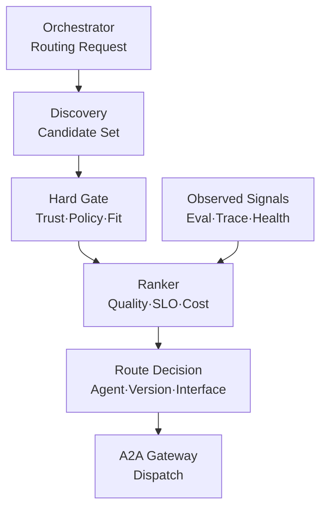
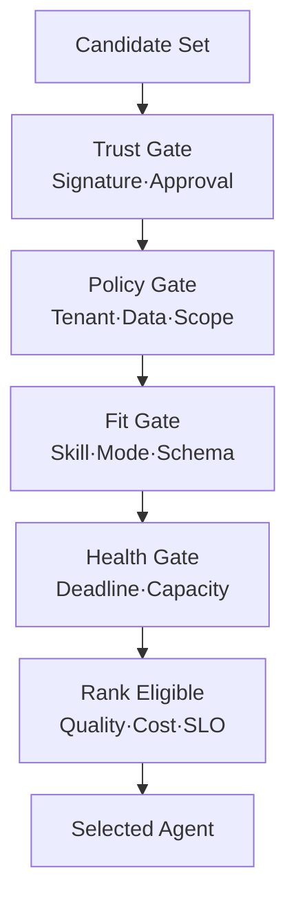
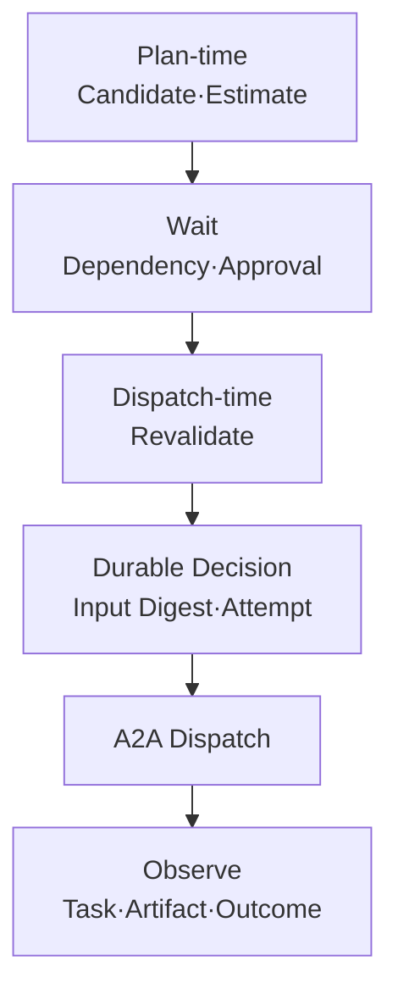

# Enterprise AI Agent Router 설계: Agent Card·정책·품질·비용으로 위임 대상 선택하기

여러 전문 AI Agent 중 어디로 위임할지 고르는 문제는 Agent Card의 자기 선언만으로 풀 수 없습니다. 선언한 기능과 실제 품질·지연·비용·가용성은 다르기 때문입니다. 이 글은 Discovery·Selection·Delivery를 분리한 엔터프라이즈 Agent Router 아키텍처와 Hard Gate·점수화, 결정적 Tie-break, Canary와 Fallback, 라우팅 판단의 감사 기록을 정리합니다.


<blockquote id="aiarchitect-toc" data-ke-style="box" style="background-color: #f6f9fc; color: #263746; font-family: Pretendard-Regular, AppleSDGothicNeo-Regular, sans-serif; font-weight: 400;" data-mce-style="background-color: #f6f9fc; color: #263746; font-family: Pretendard-Regular, AppleSDGothicNeo-Regular, sans-serif; font-weight: 400;">
<p style="color: #263746; font-weight: 700;" data-mce-style="color: #263746; font-weight: 700;"><b>목차</b></p>
<ol style="list-style-type: decimal; color: #555555; font-weight: 400;" data-mce-style="list-style-type: decimal; color: #555555; font-weight: 400;" data-ke-list-type="decimal">
<li style="color: #555555; font-weight: 400;" data-mce-style="color: #555555; font-weight: 400;"><a href="#ai-section-1">Agent Router는 Registry·Gateway·Orchestrator와 다르다</a></li>
<li style="color: #555555; font-weight: 400;" data-mce-style="color: #555555; font-weight: 400;"><a href="#ai-section-2">Discovery·Selection·Delivery를 세 단계로 분리한다</a></li>
<li style="color: #555555; font-weight: 400;" data-mce-style="color: #555555; font-weight: 400;"><a href="#ai-section-3">참조 아키텍처는 후보 생성과 실행을 분리한다</a></li>
<li style="color: #555555; font-weight: 400;" data-mce-style="color: #555555; font-weight: 400;"><a href="#ai-section-4">Routing Request를 검증 가능한 계약으로 만든다</a></li>
<li style="color: #555555; font-weight: 400;" data-mce-style="color: #555555; font-weight: 400;"><a href="#ai-section-5">Registry는 후보를 반환할 뿐 승자를 고르지 않는다</a></li>
<li style="color: #555555; font-weight: 400;" data-mce-style="color: #555555; font-weight: 400;"><a href="#ai-section-6">Agent Card는 Capability Claim이지 품질 증명이 아니다</a></li>
<li style="color: #555555; font-weight: 400;" data-mce-style="color: #555555; font-weight: 400;"><a href="#ai-section-7">공개·확장 Card와 서명·Version·Cache를 함께 검증한다</a></li>
<li style="color: #555555; font-weight: 400;" data-mce-style="color: #555555; font-weight: 400;"><a href="#ai-section-8">Hard Gate를 Score보다 먼저 적용한다</a></li>
<li style="color: #555555; font-weight: 400;" data-mce-style="color: #555555; font-weight: 400;"><a href="#ai-section-9">Tenant Routing과 Authorization을 혼동하지 않는다</a></li>
<li style="color: #555555; font-weight: 400;" data-mce-style="color: #555555; font-weight: 400;"><a href="#ai-section-10">Protocol·Mode·Extension·데이터 경계를 검사한다</a></li>
<li style="color: #555555; font-weight: 400;" data-mce-style="color: #555555; font-weight: 400;"><a href="#ai-section-11">Candidate Score는 설명 가능한 항목으로 분해한다</a></li>
<li style="color: #555555; font-weight: 400;" data-mce-style="color: #555555; font-weight: 400;"><a href="#ai-section-12">품질 평가는 요청 유형별로 분리한다</a></li>
<li style="color: #555555; font-weight: 400;" data-mce-style="color: #555555; font-weight: 400;"><a href="#ai-section-13">지연·비용·가용성은 같은 관측 창으로 비교한다</a></li>
<li style="color: #555555; font-weight: 400;" data-mce-style="color: #555555; font-weight: 400;"><a href="#ai-section-14">결정적 Tie-break와 안전한 탐색을 함께 설계한다</a></li>
<li style="color: #555555; font-weight: 400;" data-mce-style="color: #555555; font-weight: 400;"><a href="#ai-section-15">Plan-time Selection과 Dispatch-time Revalidation을 나눈다</a></li>
<li style="color: #555555; font-weight: 400;" data-mce-style="color: #555555; font-weight: 400;"><a href="#ai-section-16">Route Decision Record로 선택 근거를 남긴다</a></li>
<li style="color: #555555; font-weight: 400;" data-mce-style="color: #555555; font-weight: 400;"><a href="#ai-section-17">Stable·Canary·Shadow Routing을 구분한다</a></li>
<li style="color: #555555; font-weight: 400;" data-mce-style="color: #555555; font-weight: 400;"><a href="#ai-section-18">Fallback은 같은 Skill의 무조건 재호출이 아니다</a></li>
<li style="color: #555555; font-weight: 400;" data-mce-style="color: #555555; font-weight: 400;"><a href="#ai-section-19">Sticky Routing·Capacity·Circuit Breaker를 함께 본다</a></li>
<li style="color: #555555; font-weight: 400;" data-mce-style="color: #555555; font-weight: 400;"><a href="#ai-section-20">Routing Loop와 Delegation 폭발을 차단한다</a></li>
<li style="color: #555555; font-weight: 400;" data-mce-style="color: #555555; font-weight: 400;"><a href="#ai-section-21">Agent Card Poisoning과 Score Gaming을 방어한다</a></li>
<li style="color: #555555; font-weight: 400;" data-mce-style="color: #555555; font-weight: 400;"><a href="#ai-section-22">합성 정상 사례로 선택 과정을 검증한다</a></li>
<li style="color: #555555; font-weight: 400;" data-mce-style="color: #555555; font-weight: 400;"><a href="#ai-section-23">합성 장애 사례에서 안전한 실패를 확인한다</a></li>
<li style="color: #555555; font-weight: 400;" data-mce-style="color: #555555; font-weight: 400;"><a href="#ai-section-24">단계적으로 구현한다</a></li>
<li style="color: #555555; font-weight: 400;" data-mce-style="color: #555555; font-weight: 400;"><a href="#ai-section-25">흔한 안티패턴</a></li>
<li style="color: #555555; font-weight: 400;" data-mce-style="color: #555555; font-weight: 400;"><a href="#ai-section-26">운영 체크리스트</a></li>
<li style="color: #555555; font-weight: 400;" data-mce-style="color: #555555; font-weight: 400;"><a href="#ai-section-27">마무리</a></li>
<li style="color: #555555; font-weight: 400;" data-mce-style="color: #555555; font-weight: 400;"><a href="#ai-section-28">공식 참고자료</a></li>
</ol>
</blockquote>


전문 Agent가 하나뿐일 때 위임은 단순합니다. Orchestrator가 정해진 대상에게 A2A Task를 보내면 됩니다. 그러나 같은 Skill을 제공하는 Agent가 여러 Version·조직·지역·비용 등급으로 늘어나면 질문이 달라집니다.

- 어느 Agent가 요청한 입력·출력 형식을 지원하는가?
- 사용자의 Tenant와 데이터 등급으로 호출해도 되는가?
- Agent Card에 적힌 Capability를 실제 운영 품질로 믿을 수 있는가?
- 가장 높은 품질과 가장 낮은 비용 중 무엇을 우선할 것인가?
- 선택한 Agent가 Dispatch 직전에 과부하·격리 상태가 되면 어떻게 할 것인가?
- 첫 Agent의 결과가 불명확할 때 다른 Agent로 즉시 재시도해도 되는가?

A2A는 Agent Card를 통해 Agent의 Identity, Skill, Interface, Protocol, 입력·출력 Mode와 Security 요구사항을 설명합니다. Well-known URI, Registry와 직접 설정 같은 Discovery 방법도 제공합니다. 하지만 기업 Registry의 API나 “여러 후보 중 최적의 Agent를 고르는 알고리즘”까지 표준화하지는 않습니다.

따라서 기업 시스템에는 **발견된 후보를 신뢰·권한·호환성으로 걸러내고, 실제 품질·지연·비용·가용성으로 순위를 매기며, 선택 근거를 감사 가능하게 남기는 Agent Router**가 필요합니다.

이 글은 [MCP와 A2A의 책임 경계](https://aiarchitect.tistory.com/75), [AI Agent Control Plane](https://aiarchitect.tistory.com/76), [MCP Tool과 A2A Agent를 함께 실행하는 Orchestration](https://aiarchitect.tistory.com/77)을 전제로, 그 사이에 남은 “누구에게 위임할 것인가”를 독립된 실행 계약으로 설계합니다.

> 이 글의 Agent, Tenant, Skill, Token, URL, 점수, 비용과 운영 수치는 모두 교육용 합성 예시입니다. 특정 회사·고객·제품·운영 환경이나 실제 성과를 나타내지 않습니다. 2026-08-11 현재 A2A 최신 공개 Version은 1.0입니다. 실제 구현에서는 사용하는 Protocol·SDK Version과 조직의 보안·개인정보·감사 요구사항을 다시 확인해야 합니다.

## 1. Agent Router는 Registry·Gateway·Orchestrator와 다르다

네 구성요소는 함께 동작하지만 책임은 다릅니다.

| 구성요소 | 핵심 질문 | 주요 책임 |
|---|---|---|
| Registry | 어떤 Agent가 등록돼 있는가? | Agent Card, 승인 Version, Owner, 상태와 배포 정보 관리 |
| Router | 이번 요청을 누구에게 맡길 것인가? | 후보 생성, Hard Gate, Ranking, 선택과 재선택 |
| Gateway | 선택된 요청을 안전하게 전달할 수 있는가? | 인증, Rate Limit, Protocol·Tenant Routing, 정책 집행 |
| Orchestrator | 전체 목표를 어떤 Step으로 완수할 것인가? | 계획, 의존성, 예산, 실행 상태, 결과 검증·조립 |

Registry가 검색 결과 첫 번째 Agent를 반환한다고 해서 Router가 필요 없는 것은 아닙니다. Registry의 검색 순서는 검색 적합도일 수 있고, 실제 요청의 Tenant 권한·Deadline·품질·비용을 반영하지 못할 수 있습니다.

Gateway도 Router를 대체하지 않습니다. Gateway는 이미 선택된 대상에게 요청을 전달하면서 Policy를 집행합니다. 반면 Router는 후보 중 하나를 선택하는 Decision Point입니다.

Orchestrator 안에 Router Logic을 포함할 수는 있습니다. 그러나 여러 Orchestrator가 같은 선택 정책과 품질 신호를 사용해야 한다면 Router를 독립 Service나 공유 Library로 분리하는 편이 일관성과 감사에 유리합니다.

## 2. Discovery·Selection·Delivery를 세 단계로 분리한다

“Agent Routing”이라는 한 단어에 세 책임을 섞으면 장애 원인을 찾기 어렵습니다.

### Discovery

요청한 Skill과 호환 가능한 Agent Card 후보를 찾습니다. Well-known URI, Curated Registry와 직접 설정은 후보를 얻는 서로 다른 방법입니다.

### Selection

후보를 Trust, Policy, Capability와 운영 상태로 거르고 점수화해 하나의 Agent·Version·Interface를 고릅니다. 이 글의 핵심 범위입니다.

### Delivery

선택된 Interface의 URL·Protocol Binding·`tenant` 값에 맞춰 실제 A2A 요청을 전달합니다. 인증, 재시도, Rate Limit과 Network Routing이 적용됩니다.

세 단계의 실패도 구분해야 합니다.

```text
NO_CANDIDATE
  Discovery 결과가 없음

NO_ELIGIBLE_CANDIDATE
  후보는 있지만 Trust·Policy·호환성 Gate를 통과하지 못함

NO_HEALTHY_CANDIDATE
  적격 후보는 있지만 Deadline 안에 실행 가능한 대상이 없음

DELIVERY_FAILED
  대상은 선택됐지만 Gateway·Network·Remote Agent 전달에 실패
```

`NO_CANDIDATE`를 Timeout으로 표현하거나 `DELIVERY_FAILED`를 다른 Agent를 찾지 못한 문제로 기록하면 운영 지표가 왜곡됩니다.

## 3. 참조 아키텍처는 후보 생성과 실행을 분리한다

Agent Router는 Control Plane의 등록 정보와 Data Plane의 관측 신호를 함께 읽되, 최종 Dispatch와는 분리합니다.



*그림 1. Candidate 생성·검증·Ranking·Dispatch를 분리한 Agent Router 구조*

여기서 Registry Data는 승인된 후보의 범위를 제공하고, Evaluation·Trace·Health Data는 실제 성능을 제공합니다. Router가 Agent에게 “지금 품질이 좋은가?”라고 직접 물어보는 구조는 자기 선언을 다시 자기 평가로 사용하는 순환입니다.

Router가 출력해야 하는 것은 단순 URL이 아닙니다.

- 선택한 `agent_id`, Agent Version과 Skill ID
- 선택한 `AgentInterface`와 Protocol Version
- 적용한 Policy·Scorecard Version
- 후보와 탈락 이유
- 선택 점수와 Tie-break 근거
- Credential을 발급할 대상 Audience·Scope
- Decision 만료와 Dispatch 전 재검증 조건

## 4. Routing Request를 검증 가능한 계약으로 만든다

Router가 사용자 자연어 전체를 직접 읽고 Agent를 고르게 하면 Prompt 표현 변화가 Routing 변화로 이어집니다. Orchestrator가 먼저 목표를 구조화한 Routing Request를 만들어야 합니다.

```json
{
  "route_request_id": "route-fixture-20260811-001",
  "run_id": "run-fixture-20260811-010",
  "step_id": "s2",
  "required_skill": "work-planning/draft-plan",
  "required_input_modes": ["application/json"],
  "required_output_modes": ["application/json"],
  "required_schema": "work-plan-artifact-v3",
  "protocol": {
    "name": "A2A",
    "major_version": "1"
  },
  "execution": {
    "side_effect": false,
    "deadline_at": "2026-08-11T05:05:00Z",
    "max_cost_units": 40,
    "risk_tier": "DRAFT_ONLY"
  },
  "security": {
    "tenant": "tenant-fixture-a",
    "data_classification": "INTERNAL",
    "allowed_regions": ["kr-fixture-1"],
    "required_scopes": ["plan:draft"]
  },
  "selection_policy": "planner-router-v4"
}
```

Router는 이 계약을 넓게 재해석하지 않습니다. `DRAFT_ONLY` 요청을 “품질이 더 좋다”는 이유로 실제 Ticket을 생성하는 Agent에 보내면 안 됩니다.

Routing Request에는 Raw Prompt나 전체 대화 대신 선택에 필요한 최소 속성을 넣습니다. 사용자 Context, Evidence와 업무 Payload는 Agent가 최종 선택된 뒤 별도의 최소 Context Package로 전달합니다.

## 5. Registry는 후보를 반환할 뿐 승자를 고르지 않는다

A2A 공식 문서는 기업 환경에서 Curated Registry가 Skill, Tag, Provider와 Capability로 Agent Card를 찾는 방식을 설명합니다. 동시에 현재 A2A Specification이 Registry API 자체를 규정하지 않는다고 밝힙니다.

따라서 조직은 Registry Query 계약을 별도로 정의해야 합니다.

```json
{
  "query": {
    "skill_id": "work-planning/draft-plan",
    "protocol_major": "1",
    "lifecycle_states": ["ACTIVE", "CANARY"],
    "tenant_visibility": "tenant-fixture-a"
  },
  "result": {
    "candidate_refs": [
      "planner-stable@3.4.1",
      "planner-fast@2.8.0",
      "planner-canary@3.5.0-rc1"
    ],
    "registry_snapshot": "registry-snapshot-fixture-204",
    "policy_hint": "planner-router-v4"
  }
}
```

Registry Query 단계에서는 넓은 후보를 반환하되 다음을 지킵니다.

- 폐기·격리·승인 만료 Version은 반환하지 않습니다.
- 호출 주체가 볼 수 없는 Agent와 내부 Skill은 노출하지 않습니다.
- 검색 적합도와 실행 적합도를 구분합니다.
- 결과에 Snapshot이나 Revision을 넣어 Decision 재현성을 높입니다.
- 검색 결과가 비어도 임의의 범용 Agent를 Default로 반환하지 않습니다.

## 6. Agent Card는 Capability Claim이지 품질 증명이 아니다

Agent Card는 Agent가 무엇을 제공한다고 선언하는 계약입니다. `skills`, `supportedInterfaces`, `capabilities`, Security Scheme과 Input·Output Mode는 호환성 판단에 중요합니다.

그러나 다음 항목까지 자동으로 증명하지는 않습니다.

- 해당 Skill의 실제 정답률
- 특정 Tenant·언어·문서 유형에서의 품질
- 현재 P95 Latency와 Queue 대기
- 최근 오류율과 장애 상태
- 요청당 실제 비용
- 업무 Outcome 달성률

따라서 Candidate Model은 Claim과 Observed Evidence를 분리해야 합니다.

```json
{
  "candidate": "planner-stable@3.4.1",
  "claims": {
    "source": "signed-agent-card",
    "skill": "work-planning/draft-plan",
    "input_modes": ["application/json"],
    "output_modes": ["application/json"],
    "protocol_version": "1.0"
  },
  "governance": {
    "approval_state": "ACTIVE",
    "owner": "team-fixture-planning",
    "allowed_data_classes": ["PUBLIC", "INTERNAL"]
  },
  "observed": {
    "evaluation_window": "eval-window-fixture-30d",
    "quality_score": 0.91,
    "success_rate": 0.995,
    "p95_latency_ms": 2800,
    "cost_units_p50": 24
  }
}
```

`quality_score`도 Agent Card에 넣지 않습니다. Agent가 자신의 품질 점수를 직접 광고하면 평가 Version·Dataset·표본 수와 독립성이 사라집니다. 품질은 별도 Evaluation Store가 관리하고 Router가 승인된 Snapshot을 읽습니다.

## 7. 공개·확장 Card와 서명·Version·Cache를 함께 검증한다

A2A 1.0은 공개 Agent Card 외에 인증된 Client에게 더 많은 Skill·Quota·조직별 정보를 제공하는 Extended Agent Card를 지원합니다. Router는 Card를 많이 읽는 것보다 **호출 주체에게 허용된 Card만 읽는 것**을 우선해야 합니다.

### 공개 Card

외부에 공개해도 되는 Identity, 일반 Skill, Interface와 인증 요구사항을 담습니다.

### Extended Card

인증·인가된 Client에만 조직별 Skill, Rate Limit, 상세 Capability를 제공합니다. Extended Card 조회 Credential을 Runtime Task Credential과 재사용하지 않습니다.

Extended Card Cache Key에는 Agent ID뿐 아니라 인증된 Client·Tenant·권한 등급과 Card Version을 포함합니다. 권한이 다른 두 Client가 같은 Cache Entry를 공유하면 한 Client에게만 허용된 Skill·Quota·내부 Endpoint가 다른 Client에게 노출될 수 있습니다. Logout·Session 종료·권한 철회 시에는 해당 권한 Context의 Cache를 폐기합니다.

### 서명 검증

A2A 1.0 Agent Card Signature는 JWS 형식을 사용합니다. 검증 시 승인된 Trust Store의 Key인지, Key가 만료·폐기되지 않았는지, Canonicalized Payload와 Signature가 일치하는지 확인합니다. JWS Header의 `jku`를 사용할 때는 Registry에 등록된 JWKS Origin·TLS·Key ID와 일치하는지 먼저 검증하고, Card가 지정한 임의 URL을 그대로 조회하지 않습니다. Signature가 유효하다는 사실은 “이 Key 소유자가 Card를 서명했다”는 뜻이지, 운영 품질이 좋거나 현재 호출 권한이 있다는 뜻은 아닙니다.

### Version과 Cache

Agent Card Endpoint는 `Cache-Control`, `ETag`와 조건부 요청을 사용할 수 있습니다. Router는 Cache를 사용하되 다음 사건에서는 만료 전에도 무효화해야 합니다.

- Agent Version 폐기·격리
- Signing Key 폐기
- Security Scheme·Interface 변경
- Kill Switch 발동
- 중대한 Policy 변경

오래된 Card가 품질을 조금 낮추는 문제보다 폐기된 Endpoint·Scope를 계속 사용하는 문제가 더 위험합니다. Governance Event는 일반 TTL보다 우선합니다.

## 8. Hard Gate를 Score보다 먼저 적용한다

점수가 아무리 높아도 호출하면 안 되는 Candidate가 있습니다. Score에서 감점하는 것으로 표현하지 말고 Eligibility에서 제거해야 합니다.



*그림 2. Candidate를 Hard Gate로 줄인 뒤 적격 후보만 Ranking하는 Funnel*

대표 Hard Gate는 다음과 같습니다.

| Gate | 탈락 조건 예시 |
|---|---|
| Trust | Card 서명 불명, Key 폐기, Provider 미승인 |
| Lifecycle | `DISABLED`, `QUARANTINED`, 승인 만료 |
| Authorization | Tenant·Action·Resource Scope 불일치 |
| Data Boundary | 데이터 등급·지역·망 경계 위반 |
| Capability | Skill·Input/Output Mode·Schema 불일치 |
| Protocol | A2A Major Version·필수 Extension 비호환 |
| Side Effect | 요청 위험 등급보다 강한 쓰기 Capability |
| Deadline | 예상 Queue+실행 시간이 남은 Deadline 초과 |
| Budget | 최소 예상 비용이 남은 Budget 초과 |

Candidate가 모두 탈락하면 Score Threshold를 낮추지 않습니다. `NO_ELIGIBLE_CANDIDATE`로 종료하고 어떤 Gate에서 몇 개가 탈락했는지 설명합니다.

## 9. Tenant Routing과 Authorization을 혼동하지 않는다

A2A 1.0의 `AgentInterface.tenant`는 여러 Agent나 Tenant를 하나의 Endpoint 뒤에서 구분하기 위한 불투명 Routing 값입니다. Client는 선택한 Interface에 `tenant`가 있으면 요청에 같은 값을 포함해야 합니다.

하지만 `tenant: "billing"` 같은 값은 권한 증명이 아닙니다.

```text
AgentInterface.tenant
  → Gateway가 어느 Backend로 전달할지 정하는 Routing Hint

Authenticated Subject + Scope + Resource Policy
  → 그 Subject가 실제 Tenant Resource에 접근할 수 있는지 정하는 Authorization 근거
```

Router는 Interface의 `tenant`를 정확히 전달하되, 다음 검사를 별도로 수행합니다.

- 인증된 사용자·Orchestrator가 대상 Tenant를 호출할 수 있는가?
- 선택된 Agent가 그 Tenant의 해당 Skill을 수행하도록 승인됐는가?
- 최종 MCP Tool·업무 System도 같은 Tenant 권한을 다시 검사하는가?
- URL·Header·Body의 Routing 정보가 충돌하면 Fail-closed 하는가?

Routing 값이 맞다는 이유로 Authorization을 통과시키면 교차 Tenant Task 노출이 발생합니다.

## 10. Protocol·Mode·Extension·데이터 경계를 검사한다

Skill 이름이 같아도 상호 운용 가능한 Agent라는 보장은 없습니다.

### Interface 호환성

Router는 `supportedInterfaces`의 선호 순서를 그대로 따르기 전에 Client·Gateway가 해당 Protocol Binding과 Version을 지원하는지 확인합니다. 운영에서 HTTPS가 필요한데 개발용 주소만 광고한 Candidate는 제거합니다.

### Input·Output Mode

요청이 구조화 JSON Artifact를 요구하는데 Candidate가 `text/plain`만 반환하면 자연어를 억지로 Parsing하지 않습니다. Schema Adapter가 승인돼 있을 때만 별도 Candidate Path로 취급합니다.

### 필수 Extension

Agent가 필수로 요구하는 Extension을 Client가 지원하지 않으면 호출 전에 탈락시킵니다. 실행 후 오류를 받아 Fallback하는 것보다 Candidate Gate에서 제거하는 편이 비용과 지연을 줄입니다.

### 데이터 경계

Data Classification과 Allowed Region은 Score 항목이 아니라 Policy Gate입니다. 더 높은 품질의 외부 Agent라도 Restricted Data를 받을 수 없다면 Candidate가 아닙니다.

```json
{
  "candidate": "planner-fast@2.8.0",
  "eligibility": "INELIGIBLE",
  "reasons": [
    {
      "code": "OUTPUT_MODE_MISMATCH",
      "required": "application/json",
      "offered": ["text/plain"]
    },
    {
      "code": "DATA_REGION_DENIED",
      "required": ["kr-fixture-1"],
      "offered": ["global-fixture"]
    }
  ]
}
```

## 11. Candidate Score는 설명 가능한 항목으로 분해한다

Hard Gate를 통과한 Candidate만 Score를 계산합니다. 하나의 Model이 이름과 설명을 보고 0~100점을 즉흥적으로 주게 하지 않습니다.

합성 예시 Scorecard는 다음과 같습니다.

```json
{
  "scorecard": "planner-router-v4",
  "weights": {
    "quality": 0.45,
    "reliability": 0.20,
    "latency_utility": 0.15,
    "cost_utility": 0.10,
    "context_affinity": 0.10
  },
  "minimums": {
    "quality": 0.80,
    "reliability": 0.98
  },
  "tie_break": [
    "higher_reliability",
    "lower_estimated_cost",
    "lexicographic_agent_version_id"
  ]
}
```

이 숫자는 보편적 정답이 아닙니다. 중요한 것은 다음 조건입니다.

- Weight·정규화 함수·최소 기준에 Version이 있습니다.
- 각 입력 신호의 출처와 관측 창을 알 수 있습니다.
- Score가 같을 때 결과가 결정적입니다.
- 품질·신뢰성 최소 기준은 가중 평균으로 덮지 않습니다.
- Policy 변경 없이 운영자가 임의로 Weight를 바꿀 수 없습니다.

각 Utility는 같은 방향과 범위로 정규화해야 합니다. 예를 들어 낮을수록 좋은 지연·비용 원값을 그대로 더하지 않고, 승인된 SLO·Budget 구간을 기준으로 `0.0~1.0` Utility로 변환합니다. 범위를 벗어난 값을 조용히 잘라 유리하게 만들지 말고 원값·정규화 함수 Version과 Clamp 여부를 Decision Evidence에 남깁니다.

관측 Evidence가 오래됐거나 표본이 부족하면 높은 점수를 허용하지 않습니다. Scorecard에 `minimum_sample_count`, `max_signal_age`와 불확실성 처리 규칙을 넣고, 기준을 충족하지 못한 Candidate는 `UNKNOWN`으로 분리합니다. 평균 점수가 높더라도 신뢰 구간 하한이 최소 품질보다 낮으면 Stable Traffic에서 제외하거나 제한된 Canary·Shadow로 보냅니다.

## 12. 품질 평가는 요청 유형별로 분리한다

하나의 전역 품질 점수로 모든 요청을 Routing하면 Simpson's Paradox와 표본 편향이 숨어들 수 있습니다. Agent A는 회의 계획에 강하고 Agent B는 기술 조사에 강할 수 있습니다.

품질 Key를 최소한 다음 축으로 분리합니다.

```text
skill_id
× task_class
× language
× input_complexity_bucket
× data_domain
× agent_version
× evaluation_dataset_version
```

품질 Evidence는 [운영 Trace를 Dataset과 Regression Gate로 연결하는 평가 아키텍처](https://aiarchitect.tistory.com/74)의 원칙을 따릅니다.

- Offline Regression Score
- Canary Online Quality
- Human Review 결과
- Schema·Policy 위반률
- 업무 Outcome 달성률
- 표본 수와 신뢰 구간

표본이 부족한 새 Agent를 `quality=1.0`으로 두지 않습니다. `UNKNOWN`으로 표시하고 Stable Traffic에서 제외하거나 Shadow·제한된 Canary로 학습합니다.

LLM-as-a-Judge 점수 하나만 사용하지도 않습니다. Judge Version·Bias·Position Effect가 Routing 결과 전체를 바꿀 수 있으므로 구조 검사, Reference 기반 평가, Human Review와 실제 Outcome을 함께 사용합니다.

## 13. 지연·비용·가용성은 같은 관측 창으로 비교한다

Agent A의 30일 평균 지연과 Agent B의 최근 5분 P95를 비교하면 Score가 의미를 잃습니다. Signal마다 목적에 맞는 창을 쓰되 Candidate끼리는 동일한 정의를 적용해야 합니다.

### Latency

Network 시간만 보지 않고 Queue 대기, Agent 실행, Artifact 생성까지 포함한 End-to-End 지연을 사용합니다. Streaming 첫 Token 시간이 중요한 요청과 최종 Artifact 완료 시간이 중요한 요청도 분리합니다.

### Cost

광고 단가가 아니라 관측된 요청당 비용을 사용합니다. Model Token, Tool Call, Retrieval, Network와 실패 재시도 비용을 합친 Cost Unit으로 비교할 수 있습니다.

### Availability

Health Check 성공만으로 가용성을 판단하지 않습니다. 실제 Skill 요청의 성공률, Timeout, Policy 거부, Invalid Artifact와 Queue 포화를 분리합니다.

| Signal | 짧은 창 | 긴 창 |
|---|---|---|
| P95 Latency | 현재 과부하 감지 | 평상시 SLO 비교 |
| Error Rate | Circuit·격리 판단 | 안정성 Ranking |
| Cost | 급격한 사용량 변화 | Version별 단가·효율 비교 |
| Quality | Online 회귀 감지 | 검토된 Dataset 기반 비교 |

짧은 창은 빠르게 반응하지만 Noise가 크고, 긴 창은 안정적이지만 장애 반영이 늦습니다. Router는 둘을 섞어 하나의 숫자로 숨기기보다 Gate와 Score에 각각 사용합니다.

## 14. 결정적 Tie-break와 안전한 탐색을 함께 설계한다

같은 입력과 같은 Candidate Snapshot에서 Router가 매번 다른 Agent를 고르면 장애 재현과 비용 예측이 어려워집니다.

```python
def select_candidate(eligible, scorecard):
    scored = [score(candidate, scorecard) for candidate in eligible]
    return sorted(
        scored,
        key=lambda item: (
            -item.total_score,
            -item.reliability,
            item.estimated_cost_units,
            item.agent_version_id,
        ),
    )[0]
```

Production 기본 경로는 결정적으로 선택합니다. 다만 새 Agent의 품질을 영원히 알 수 없게 만드는 Exploitation-only 문제도 해결해야 합니다.

안전한 탐색 방법은 다음과 같습니다.

- Side Effect를 차단한 Shadow Traffic
- 읽기 전용·낮은 위험 요청의 제한된 Canary
- Tenant·사용자 동의가 있는 실험 Cohort
- Budget·최대 Traffic 비율·즉시 중단 기준
- Stable 결과와 비교하되 Canary 결과를 자동 Commit하지 않음

고위험 쓰기 요청에서 무작위 Agent 선택으로 탐색하지 않습니다.

## 15. Plan-time Selection과 Dispatch-time Revalidation을 나눈다

Orchestrator가 Plan을 만들 때 선택한 Agent가 실제 Dispatch 시점에도 적격이라는 보장은 없습니다. 승인 대기나 선행 Step 때문에 수분이 지날 수 있습니다.

### Plan-time Selection

- 예상 Candidate와 비용을 계산합니다.
- 전체 Workflow의 Deadline·Budget 가능성을 검토합니다.
- 승인 화면에 예정된 Agent Class와 데이터 경계를 설명합니다.
- 실제 Side Effect는 발생시키지 않습니다.

### Dispatch-time Revalidation

- Agent Version이 여전히 `ACTIVE`인가?
- Policy·Tenant Scope가 변하지 않았는가?
- Card·Signing Key·Interface가 폐기되지 않았는가?
- Circuit과 Capacity가 열려 있는가?
- 남은 Deadline·Budget으로 실행 가능한가?



*그림 3. 계획 시점 선택과 실제 전송 직전 재검증을 분리한 실행 흐름*

재검증 결과 다른 Agent를 선택했다면 승인 계약이 허용한 동등 Candidate 범위 안인지 확인합니다. Agent 변경으로 데이터 지역·Provider·위험이 달라지면 새 승인이 필요할 수 있습니다.

## 16. Route Decision Record로 선택 근거를 남긴다

운영자는 “왜 Agent A가 아니라 B였는가?”를 재현할 수 있어야 합니다. 최종 Agent ID만 저장하면 답할 수 없습니다.

```json
{
  "route_decision_id": "decision-fixture-20260811-001",
  "route_request_id": "route-fixture-20260811-001",
  "request_digest": "sha256:route-request-fixture-digest",
  "decided_at": "2026-08-11T05:00:01Z",
  "expires_at": "2026-08-11T05:01:01Z",
  "registry_snapshot": "registry-snapshot-fixture-204",
  "policy_version": "agent-routing-policy-v7",
  "scorecard_version": "planner-router-v4",
  "evidence_snapshots": {
    "evaluation": "eval-snapshot-fixture-031",
    "telemetry": "telemetry-window-fixture-120",
    "capacity": "capacity-snapshot-fixture-411"
  },
  "candidates": [
    {
      "agent_version_id": "planner-stable@3.4.1",
      "eligibility": "ELIGIBLE",
      "card_digest": "sha256:planner-stable-card-fixture",
      "score": 0.887,
      "score_components": {
        "quality": 0.91,
        "reliability": 0.995,
        "latency_utility": 0.82,
        "cost_utility": 0.76,
        "context_affinity": 0.80
      }
    },
    {
      "agent_version_id": "planner-fast@2.8.0",
      "eligibility": "INELIGIBLE",
      "reason_codes": ["OUTPUT_MODE_MISMATCH"]
    },
    {
      "agent_version_id": "planner-canary@3.5.0-rc1",
      "eligibility": "ELIGIBLE",
      "score": 0.864,
      "traffic_class": "CANARY"
    }
  ],
  "selected": {
    "agent_version_id": "planner-stable@3.4.1",
    "skill_id": "work-planning/draft-plan",
    "interface_index": 0,
    "protocol_binding": "HTTP+JSON",
    "protocol_version": "1.0"
  },
  "trace_id": "trace-fixture-router-001"
}
```

Decision Record는 Trace와 연결하되 Audit 목적에 맞게 보존합니다. Raw Prompt, Credential, 전체 Agent Card와 개인 데이터를 그대로 넣지 않습니다. Card Digest, Snapshot ID와 Reason Code로 재현에 필요한 최소 Evidence를 남깁니다.

## 17. Stable·Canary·Shadow Routing을 구분한다

새 Agent Version을 평가하는 세 경로는 Side Effect와 사용자 영향이 다릅니다.

### Stable

기본 Production Traffic을 받습니다. 승인된 품질·신뢰성 기준과 Rollback 경로가 있어야 합니다.

### Canary

실제 일부 Traffic과 사용자 Outcome에 영향을 줄 수 있습니다. Cohort, 최대 비율, Budget, 중단 Threshold와 Kill Switch가 필요합니다.

### Shadow

같은 입력을 복제해 실행하지만 결과를 사용자 응답이나 Side Effect에 사용하지 않습니다. Secret·개인정보를 무조건 복제하지 않고 Shadow 대상의 데이터 권한을 별도로 검사합니다.

```text
Stable  → 사용자 응답 가능, 승인된 Side Effect 가능
Canary  → 제한된 사용자 응답 가능, 위험도에 따른 Side Effect 제한
Shadow  → 평가 전용, 사용자 응답·Side Effect 금지
```

Router가 Canary Score가 조금 높다는 이유로 Canary Traffic 한도를 무시하면 Control Plane의 Release Gate가 무력화됩니다.

## 18. Fallback은 같은 Skill의 무조건 재호출이 아니다

첫 Agent 호출이 실패했다고 다음 Candidate를 즉시 호출하면 중복 Task와 Side Effect가 생길 수 있습니다.

Fallback 전에 다음을 확인합니다.

1. 첫 호출이 전송되지 않았는가, 전송됐지만 응답만 잃었는가?
2. A2A Task ID나 Operation Reference로 상태를 조회할 수 있는가?
3. 기존 Task를 취소해야 하는가, 취소가 확인됐는가?
4. 두 번째 Candidate가 같은 Input·Output·Policy 계약을 만족하는가?
5. 남은 Deadline·Budget과 Delegation 횟수가 충분한가?
6. 동일 `step_id`·Input Digest와 Attempt Lineage를 유지하는가?

Fallback 정책은 실패 유형별로 다릅니다.

| 실패 | 기본 동작 |
|---|---|
| Candidate가 Dispatch 전에 격리됨 | 재선택 가능 |
| 인증 Scope 발급 실패 | 다른 Agent보다 Policy·Identity 문제 해결 |
| 연결 거부, Task 미생성 확인 | 제한된 재선택 가능 |
| Timeout, Task 생성 여부 불명 | 상태 조정 후 결정 |
| Task 실행 중 Agent 장애 | Task 상태·복구 계약 확인 |
| Invalid Artifact | 품질 실패로 기록하고 정책에 따라 재선택 |
| Side Effect 결과 불명 | 자동 Fallback 금지, Reconciliation 필요 |

“다음 Agent 호출”은 Retry가 아니라 새로운 원격 실행입니다. Root Run에서는 두 Attempt를 하나의 Step Lineage로 연결해야 합니다.

## 19. Sticky Routing·Capacity·Circuit Breaker를 함께 본다

긴 A2A 대화나 Stateful Task는 같은 Agent·Version에 붙어야 할 수 있습니다. `contextId`나 Task 상태가 Remote Agent 내부에만 있으면 다른 Agent로 바꾸는 순간 Context가 사라집니다.

### Sticky Routing이 필요한 경우

- 기존 A2A Task 후속 Message
- Agent 내부 Context를 이어가는 Multi-turn 업무
- Version별 Artifact Schema가 다른 장기 작업
- 동일 Provider 내 Cache·Session Affinity가 필요한 작업

### Sticky를 깨야 하는 경우

- Agent·Key·Version 격리
- Tenant 권한 철회
- Deadline 내 완료 불가능
- 사용자가 명시적으로 취소·재시작
- Context Export·Migration 계약을 통해 안전한 이동 가능

Capacity도 단순 CPU 사용률이 아닙니다. Router는 Queue 예상 시간, 동시 Task 제한, Tenant별 Quota와 Deadline 가능성을 봅니다. Circuit Breaker가 열린 Candidate는 품질 Score가 높아도 일시적으로 제거합니다.

Sticky Agent의 Circuit이 열렸다고 조용히 다른 Agent로 이동하지 않습니다. Context 연속성을 보장할 수 없으면 `RESTART_REQUIRED` 또는 `WAIT_FOR_RECOVERY`처럼 사용자 계약으로 표현합니다.

## 20. Routing Loop와 Delegation 폭발을 차단한다

Orchestrator가 Agent A를 선택하고, Agent A가 다시 Agent B에 위임하며, Agent B가 Agent A를 선택하면 Loop가 생깁니다. 각 Agent가 자신의 Router를 가지면 중앙 Router만으로 전체 Graph를 볼 수 없습니다.

Context Package에 다음 Budget을 포함합니다.

```json
{
  "delegation": {
    "root_run_id": "run-fixture-20260811-010",
    "route_path": [
      "orchestrator-fixture",
      "planner-stable@3.4.1"
    ],
    "visited_agent_classes": ["orchestrator", "planner"],
    "max_depth": 3,
    "remaining_depth": 2,
    "max_total_delegations": 4,
    "remaining_delegations": 3,
    "allowed_next_agent_classes": ["policy-reviewer"]
  }
}
```

Router는 현재 Path에 있는 Agent·Class로의 재진입, 허용되지 않은 Peer 호출과 Budget 초과를 거부합니다. `route_path`는 Client가 임의로 쓰는 문자열이 아니라 각 Gateway·Agent Identity로 검증해 Append합니다.

Fan-out도 제한합니다. 후보 세 개의 결과를 비교한다는 이유로 모든 Production Agent를 동시에 호출하면 비용·Rate Limit·데이터 노출 범위가 세 배로 늘어납니다. Ensemble은 명시된 Plan Step과 Budget 안에서만 실행합니다.

## 21. Agent Card Poisoning과 Score Gaming을 방어한다

Agent Router는 Metadata와 관측 신호를 신뢰하므로 새로운 공격 표면이 됩니다.

### Agent Card Poisoning

공격자가 과장된 Skill, 악성 Endpoint나 Prompt Injection 문구를 Card에 넣을 수 있습니다. Signature, Provider Trust, URL Allowlist와 Registry 승인 Workflow를 적용합니다. Card의 자연어 Description·Example을 Raw Prompt에 그대로 삽입하지 않고 정규화된 Allowlist Field로 Candidate를 생성합니다.

### Endpoint 공격

Card URL과 Agent Interface를 따라가며 내부 Metadata Service나 임의 Network로 요청하면 SSRF가 됩니다. HTTPS, 승인 Domain·Network, DNS 재검증, Redirect 제한과 Egress Policy를 적용합니다.

### Score Gaming

Agent가 쉬운 요청만 수락하거나 실패를 사용자 취소로 분류해 성공률을 높일 수 있습니다. Router가 수락률, 거부 이유, 전체 Outcome과 독립 Telemetry를 함께 봅니다.

### Telemetry Poisoning

Agent가 직접 전송한 “Latency=10ms, Success=true”를 그대로 사용하지 않습니다. Gateway와 Orchestrator의 관측 Span, 검증된 Artifact와 업무 Record Outcome을 권위 있는 신호로 사용합니다.

### Downgrade·Canary 우회

낮은 Protocol Version이나 오래된 Agent Version이 더 저렴하다는 이유로 Security Requirement를 낮추지 않습니다. Canary Traffic 비율, Tenant Allowlist와 Kill Switch는 Score보다 우선하는 Gate입니다.

## 22. 합성 정상 사례로 선택 과정을 검증한다

사용자가 “회의 결정 사항을 바탕으로 한국어 실행 계획 초안을 만들어 줘”라고 요청했다고 가정합니다.

### 후보 생성

Registry가 같은 Skill을 제공하는 세 Candidate를 반환합니다.

| Candidate | Card Claim | 운영 Evidence | 상태 |
|---|---|---|---|
| `planner-stable@3.4.1` | JSON·한국어·A2A 1.0 | 품질 0.91, P95 2.8s | Stable |
| `planner-fast@2.8.0` | Text·한국어·A2A 1.0 | 품질 0.84, P95 1.2s | Stable |
| `planner-canary@3.5.0-rc1` | JSON·한국어·A2A 1.0 | 품질 0.93, 표본 부족 | Canary 5% |

### Hard Gate

`planner-fast`는 필수 Output Mode가 `application/json`이 아니므로 탈락합니다. 자연어를 Parsing해 통과시키지 않습니다.

### Cohort Gate

요청 Tenant가 Canary Allowlist에 없으므로 `planner-canary`는 Production 선택에서 제외됩니다. Shadow 실행도 별도 동의·Budget이 없으므로 하지 않습니다.

### Selection

`planner-stable`이 선택됩니다. Router는 Candidate Snapshot, Gate Reason과 Scorecard Version을 Decision Record에 남깁니다.

### Dispatch

Dispatch 직전 Version·Policy·Circuit·Deadline을 재검증하고 대상 Audience로 짧은 수명의 Credential을 발급합니다. Orchestrator는 Agent가 반환한 Artifact를 Schema·Provenance·Policy Gate로 다시 검증합니다.

이 사례에서 가장 빠른 Agent나 Offline 품질이 가장 높은 Agent가 아니라 **현재 요청 계약을 통과한 Agent**가 선택됐다는 점이 중요합니다.

## 23. 합성 장애 사례에서 안전한 실패를 확인한다

이번에는 `planner-stable` 선택 후 A2A 요청을 보냈지만 Client가 응답을 받기 전에 연결이 끊겼다고 가정합니다.

### 잘못된 처리

Router가 즉시 `planner-canary`를 선택해 같은 요청을 새 Task로 보냅니다. 실제로 첫 Task가 생성돼 계속 실행 중이면 비용이 중복되고 서로 다른 두 Artifact가 도착합니다.

### 안전한 처리

```text
1. Dispatch Attempt와 Request Digest 확인
2. A2A Task ID 확보 여부 확인
3. Task ID가 있으면 상태 조회
4. Task ID가 없으면 Gateway Dispatch Ledger 조회
5. 결과가 여전히 불명이면 UNKNOWN_OUTCOME
6. Side Effect 가능성이 있으면 자동 Fallback 중단
7. 읽기 전용이며 중복 허용 계약이 있을 때만 새 Attempt 승인
```

합성 결과가 다음과 같다고 가정합니다.

```json
{
  "step_id": "s2",
  "attempts": [
    {
      "attempt": 1,
      "agent_version_id": "planner-stable@3.4.1",
      "dispatch_state": "ACK_UNKNOWN",
      "remote_task_id": null
    }
  ],
  "step_state": "UNKNOWN_OUTCOME",
  "automatic_fallback": false,
  "next_action": "RECONCILE_GATEWAY_LEDGER"
}
```

Router의 책임은 항상 다른 Agent를 찾아 성공처럼 보이게 만드는 것이 아닙니다. 불명확한 실행을 숨기지 않고 안전한 상태로 멈추는 것도 올바른 Routing 결과입니다.

## 24. 단계적으로 구현한다

처음부터 실시간 품질 학습과 다중 목적 최적화를 구현할 필요는 없습니다.

### 1단계: 정적 Allowlist

- Skill별 승인 Agent·Version 목록
- Trust·Tenant·Protocol·Mode Hard Gate
- 결정적 우선순위
- Route Decision Log

### 2단계: 운영 상태 반영

- Health·Circuit·Capacity Gate
- Deadline 가능성
- 수동 Fallback Policy
- Card Cache·ETag·폐기 Event

### 3단계: 검증된 Scorecard

- Versioned Evaluation Snapshot
- Latency·Cost·Reliability Utility
- 요청 유형별 품질
- Score 설명과 재현 Test

### 4단계: 안전한 Release Routing

- Shadow·Canary Cohort
- 자동 중단 Threshold
- Stable Rollback
- Tenant별 실험 승인

### 5단계: 제한된 적응형 Routing

- Drift 감지
- Scorecard 재학습·승인
- 읽기 전용 저위험 Traffic의 제한된 Exploration
- Offline Replay와 Counterfactual Evaluation

각 단계는 이전 단계의 결정 재현성과 Fail-closed 동작을 유지해야 합니다.

## 25. 흔한 안티패턴

### Agent 설명을 LLM에 넣고 알아서 고르게 한다

자연어 Description 편향과 Prompt Injection이 Routing 정책이 됩니다. 구조화 Gate와 Versioned Scorecard를 사용합니다.

### Registry 검색 1위를 곧바로 호출한다

Tenant·Deadline·품질·비용과 현재 Health가 반영되지 않습니다.

### 보안 위반도 점수 감점으로 처리한다

고품질 Agent가 Data Region 위반을 상쇄하게 됩니다. Trust·Policy는 Hard Gate입니다.

### Agent Card의 품질 점수를 믿는다

자기 선언과 독립 평가를 혼동합니다. 품질은 Versioned Evaluation Evidence에서 가져옵니다.

### 모든 신호를 실시간 하나의 점수로 합친다

짧은 창 Noise와 긴 창 품질이 섞여 Routing이 흔들립니다. Gate·Score·Release Signal을 분리합니다.

### Tie에서 Random 선택한다

비용·장애 재현성이 무너집니다. Production은 결정적 Tie-break를 사용하고 탐색은 별도 Cohort로 제한합니다.

### Timeout이면 즉시 다음 Agent를 호출한다

첫 Task의 결과가 불명확하면 중복 실행이 됩니다. 상태 조정 후 Fallback합니다.

### Sticky Session을 무시하고 Agent를 바꾼다

Remote Context와 Task Lineage가 끊깁니다. Migration 계약이 없으면 재시작으로 표현합니다.

### Canary가 점수가 높으면 제한 없이 보낸다

Release Gate와 Traffic Budget을 우회합니다. Canary 상태는 Score보다 우선합니다.

### Card Description과 Example을 실행 지시로 사용한다

Metadata가 Plan·Policy를 변경하는 Prompt Injection 경로가 됩니다. 정규화된 Claim으로만 사용합니다.

## 26. 운영 체크리스트

### 책임·계약

- [ ] Registry·Router·Gateway·Orchestrator의 책임이 분리돼 있는가?
- [ ] Routing Request에 Skill·Mode·Schema·Deadline·Budget·Risk가 있는가?
- [ ] Discovery·Selection·Delivery 실패 코드가 구분되는가?
- [ ] Router 출력에 Agent·Version·Interface와 Decision 만료가 있는가?

### Card·Trust

- [ ] 공개 Card와 Extended Card 접근 권한을 구분하는가?
- [ ] Agent Card Signature와 Trust Store·Key 폐기를 검증하는가?
- [ ] Card Cache가 Governance Event로 즉시 무효화되는가?
- [ ] Card Description·Example을 Raw Prompt에 삽입하지 않는가?
- [ ] Endpoint URL·Redirect·DNS·Egress Policy를 검증하는가?

### Hard Gate

- [ ] Trust·Lifecycle·Tenant·Data Boundary가 Score보다 먼저 적용되는가?
- [ ] Skill·Input/Output Mode·Schema가 호환되는가?
- [ ] Protocol Major Version과 필수 Extension이 호환되는가?
- [ ] Deadline·Budget·Capacity로 실행 가능성을 확인하는가?
- [ ] Candidate가 없을 때 Fail-closed 하는가?

### Score·Evaluation

- [ ] Claim과 Observed Evidence를 분리하는가?
- [ ] Scorecard·Weight·정규화 함수에 Version이 있는가?
- [ ] 품질이 Skill·Task Class·Language·Version별로 분리되는가?
- [ ] 평가 Dataset·표본 수·관측 창을 기록하는가?
- [ ] Tie-break가 결정적이고 Test 가능한가?

### Release·Fallback

- [ ] Stable·Canary·Shadow의 사용자 영향과 Side Effect가 다른가?
- [ ] Canary Cohort·최대 비율·중단 기준·Kill Switch가 있는가?
- [ ] Dispatch 직전에 Policy·Version·Circuit·Deadline을 재검증하는가?
- [ ] Timeout 뒤 원래 Task 상태를 조정한 후 Fallback하는가?
- [ ] Agent 변경이 승인·데이터 경계를 바꾸면 재승인하는가?

### 운영·보안

- [ ] Route Decision Record에 후보와 탈락 Reason Code가 있는가?
- [ ] Raw Prompt·Credential·개인정보 없이 Decision을 재현할 수 있는가?
- [ ] Sticky Context와 Re-selection 조건을 구분하는가?
- [ ] Delegation Depth·Visited Path·Fan-out Budget이 있는가?
- [ ] Score Gaming·Telemetry Poisoning·Downgrade를 탐지하는가?

## 27. 마무리

Agent가 늘어날수록 문제는 Discovery보다 Selection으로 이동합니다. Agent Card를 찾는 것과 이번 요청을 맡길 Agent를 선택하는 것은 다른 책임입니다.

좋은 Agent Router는 가장 똑똑해 보이는 Agent를 고르는 Model이 아닙니다.

```text
요청 계약을 고정한다
  → 승인된 Candidate를 발견한다
  → Trust·Policy·호환성 Hard Gate를 적용한다
  → 독립된 품질·SLO·비용 Evidence로 Ranking한다
  → 결정적 규칙과 Release Cohort로 대상을 선택한다
  → Dispatch 직전에 다시 검증한다
  → 선택 근거와 Attempt를 내구성 있게 기록한다
  → Task·Artifact·Outcome을 관측해 다음 평가로 되돌린다
```

핵심 원칙을 정리하면 다음과 같습니다.

1. Registry는 후보를 관리하고 Router는 요청별 승자를 선택합니다.
2. Agent Card는 Capability Claim이며 실제 품질과 현재 Health는 별도 Evidence입니다.
3. Trust·Authorization·Data Boundary·호환성은 Score가 아니라 Hard Gate입니다.
4. Scorecard는 Versioned·설명 가능·재현 가능해야 합니다.
5. Stable·Canary·Shadow Traffic의 권한과 Side Effect를 분리합니다.
6. Plan-time 선택을 Dispatch-time에 다시 검증합니다.
7. Timeout·결과 불명 상태에서는 무조건 다른 Agent를 호출하지 않습니다.
8. Sticky Context, Circuit, Capacity와 Deadline을 함께 봅니다.
9. Route Decision과 전체 후보·탈락 이유를 Trace·Audit에 연결합니다.
10. Card Poisoning, Score Gaming과 Delegation Loop를 정상 위협으로 다룹니다.

Agent Router의 목표는 매 요청마다 최고 점수의 Agent를 호출하는 것이 아닙니다. **허용된 후보 중 현재 요청 계약을 만족하는 Agent를 설명 가능하게 선택하고, 상황이 바뀌면 안전하게 멈추거나 재선택하는 것**입니다.

## 28. 공식 참고자료

- A2A Protocol, [A2A Protocol](https://a2a-protocol.org/latest/)
- A2A Protocol, [Protocol specification](https://a2a-protocol.org/latest/specification/)
- A2A Protocol, [Agent discovery](https://a2a-protocol.org/latest/topics/agent-discovery/)
- A2A Protocol, [Multi-tenancy and multi-agent routing](https://a2a-protocol.org/latest/topics/multi-tenancy/)
- A2A Protocol, [Core concepts](https://a2a-protocol.org/latest/topics/key-concepts/)
- A2A Protocol, [What's new in v1.0](https://a2a-protocol.org/latest/whats-new-v1/)
- IETF, [RFC 7515: JSON Web Signature](https://www.rfc-editor.org/rfc/rfc7515.html)
- IETF, [RFC 8785: JSON Canonicalization Scheme](https://www.rfc-editor.org/rfc/rfc8785.html)
- IETF, [RFC 9111: HTTP Caching](https://www.rfc-editor.org/rfc/rfc9111.html)
- W3C, [Trace Context](https://www.w3.org/TR/trace-context/)
