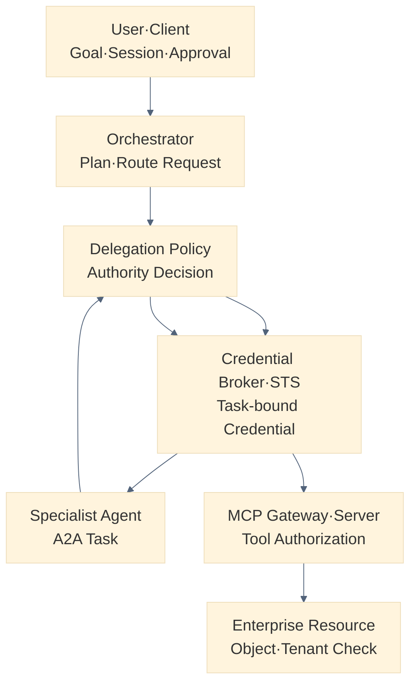
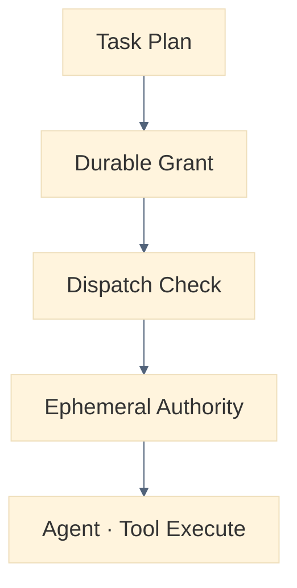
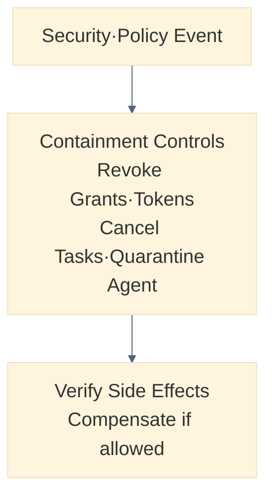

# AI Agent Identity와 위임 인가 설계: 사용자·Agent·Workload 권한을 안전하게 전달하는 법

AI Agent가 사용자를 대신해 여러 시스템을 넘나들 때 사용자 토큰을 그대로 넘기면 권한이 조용히 증폭됩니다. Identity와 Authority를 분리하지 않으면 누가 무엇을 근거로 실행했는지도 남지 않습니다. 이 글은 User·Agent·Workload·Client Identity를 함께 모델링하고 Delegation과 Impersonation을 구분해, 권한 증폭 없는 Delegation Chain과 Task-bound Credential, 재인가·철회·감사를 설계하는 방법을 정리합니다.


<blockquote id="aiarchitect-toc" data-ke-style="box" style="background-color: #f6f9fc; color: #263746; font-family: Pretendard-Regular, AppleSDGothicNeo-Regular, sans-serif; font-weight: 400;" data-mce-style="background-color: #f6f9fc; color: #263746; font-family: Pretendard-Regular, AppleSDGothicNeo-Regular, sans-serif; font-weight: 400;">
<p style="color: #263746; font-weight: 700;" data-mce-style="color: #263746; font-weight: 700;"><b>목차</b></p>
<ol style="list-style-type: decimal; color: #555555; font-weight: 400;" data-mce-style="list-style-type: decimal; color: #555555; font-weight: 400;" data-ke-list-type="decimal">
<li style="color: #555555; font-weight: 400;" data-mce-style="color: #555555; font-weight: 400;"><a href="#ai-section-1" style="color: #0070d1; text-decoration: underline; text-underline-offset: 2px;">Identity와 Authority를 먼저 분리한다</a></li>
<li style="color: #555555; font-weight: 400;" data-mce-style="color: #555555; font-weight: 400;"><a href="#ai-section-2" style="color: #0070d1; text-decoration: underline; text-underline-offset: 2px;">다중 Agent의 위임은 일반 Service 호출보다 어렵다</a></li>
<li style="color: #555555; font-weight: 400;" data-mce-style="color: #555555; font-weight: 400;"><a href="#ai-section-3" style="color: #0070d1; text-decoration: underline; text-underline-offset: 2px;">User·Agent·Workload·Client Identity를 함께 모델링한다</a></li>
<li style="color: #555555; font-weight: 400;" data-mce-style="color: #555555; font-weight: 400;"><a href="#ai-section-4" style="color: #0070d1; text-decoration: underline; text-underline-offset: 2px;">Delegation과 Impersonation을 구분한다</a></li>
<li style="color: #555555; font-weight: 400;" data-mce-style="color: #555555; font-weight: 400;"><a href="#ai-section-5" style="color: #0070d1; text-decoration: underline; text-underline-offset: 2px;">참조 아키텍처는 판단·발급·실행을 분리한다</a></li>
<li style="color: #555555; font-weight: 400;" data-mce-style="color: #555555; font-weight: 400;"><a href="#ai-section-6" style="color: #0070d1; text-decoration: underline; text-underline-offset: 2px;">Authority Envelope를 검증 가능한 계약으로 만든다</a></li>
<li style="color: #555555; font-weight: 400;" data-mce-style="color: #555555; font-weight: 400;"><a href="#ai-section-7" style="color: #0070d1; text-decoration: underline; text-underline-offset: 2px;">자식 권한은 부모 권한보다 넓어질 수 없다</a></li>
<li style="color: #555555; font-weight: 400;" data-mce-style="color: #555555; font-weight: 400;"><a href="#ai-section-8" style="color: #0070d1; text-decoration: underline; text-underline-offset: 2px;">Task-bound Credential은 실행 직전에 발급한다</a></li>
<li style="color: #555555; font-weight: 400;" data-mce-style="color: #555555; font-weight: 400;"><a href="#ai-section-9" style="color: #0070d1; text-decoration: underline; text-underline-offset: 2px;">Agent Card와 MCP 인증 선언은 업무 권한이 아니다</a></li>
<li style="color: #555555; font-weight: 400;" data-mce-style="color: #555555; font-weight: 400;"><a href="#ai-section-10" style="color: #0070d1; text-decoration: underline; text-underline-offset: 2px;">Token Exchange와 Actor Chain을 연결한다</a></li>
<li style="color: #555555; font-weight: 400;" data-mce-style="color: #555555; font-weight: 400;"><a href="#ai-section-11" style="color: #0070d1; text-decoration: underline; text-underline-offset: 2px;">Audience·Scope·객체·목적을 함께 제한한다</a></li>
<li style="color: #555555; font-weight: 400;" data-mce-style="color: #555555; font-weight: 400;"><a href="#ai-section-12" style="color: #0070d1; text-decoration: underline; text-underline-offset: 2px;">Credential을 Workload와 Sender에 결속한다</a></li>
<li style="color: #555555; font-weight: 400;" data-mce-style="color: #555555; font-weight: 400;"><a href="#ai-section-13" style="color: #0070d1; text-decoration: underline; text-underline-offset: 2px;">Tenant는 위임 과정에서 바뀌지 않는 불변값이다</a></li>
<li style="color: #555555; font-weight: 400;" data-mce-style="color: #555555; font-weight: 400;"><a href="#ai-section-14" style="color: #0070d1; text-decoration: underline; text-underline-offset: 2px;">Human Approval은 권한을 새로 만들지 않는다</a></li>
<li style="color: #555555; font-weight: 400;" data-mce-style="color: #555555; font-weight: 400;"><a href="#ai-section-15" style="color: #0070d1; text-decoration: underline; text-underline-offset: 2px;">재위임은 깊이·대상·목적을 제한한다</a></li>
<li style="color: #555555; font-weight: 400;" data-mce-style="color: #555555; font-weight: 400;"><a href="#ai-section-16" style="color: #0070d1; text-decoration: underline; text-underline-offset: 2px;">장기 실행은 Credential보다 Durable Grant를 보존한다</a></li>
<li style="color: #555555; font-weight: 400;" data-mce-style="color: #555555; font-weight: 400;"><a href="#ai-section-17" style="color: #0070d1; text-decoration: underline; text-underline-offset: 2px;">Revocation·Cancellation·Quarantine을 구분한다</a></li>
<li style="color: #555555; font-weight: 400;" data-mce-style="color: #555555; font-weight: 400;"><a href="#ai-section-18" style="color: #0070d1; text-decoration: underline; text-underline-offset: 2px;">Fallback과 재선택은 권한을 다시 평가한다</a></li>
<li style="color: #555555; font-weight: 400;" data-mce-style="color: #555555; font-weight: 400;"><a href="#ai-section-19" style="color: #0070d1; text-decoration: underline; text-underline-offset: 2px;">Audit Lineage로 위임과 실행을 재구성한다</a></li>
<li style="color: #555555; font-weight: 400;" data-mce-style="color: #555555; font-weight: 400;"><a href="#ai-section-20" style="color: #0070d1; text-decoration: underline; text-underline-offset: 2px;">Confused Deputy와 Identity Laundering을 방어한다</a></li>
<li style="color: #555555; font-weight: 400;" data-mce-style="color: #555555; font-weight: 400;"><a href="#ai-section-21" style="color: #0070d1; text-decoration: underline; text-underline-offset: 2px;">합성 정상 사례로 최소 권한 위임을 검증한다</a></li>
<li style="color: #555555; font-weight: 400;" data-mce-style="color: #555555; font-weight: 400;"><a href="#ai-section-22" style="color: #0070d1; text-decoration: underline; text-underline-offset: 2px;">합성 공격 사례에서 권한 증폭을 차단한다</a></li>
<li style="color: #555555; font-weight: 400;" data-mce-style="color: #555555; font-weight: 400;"><a href="#ai-section-23" style="color: #0070d1; text-decoration: underline; text-underline-offset: 2px;">단계적으로 구현한다</a></li>
<li style="color: #555555; font-weight: 400;" data-mce-style="color: #555555; font-weight: 400;"><a href="#ai-section-24" style="color: #0070d1; text-decoration: underline; text-underline-offset: 2px;">흔한 안티패턴</a></li>
<li style="color: #555555; font-weight: 400;" data-mce-style="color: #555555; font-weight: 400;"><a href="#ai-section-25" style="color: #0070d1; text-decoration: underline; text-underline-offset: 2px;">운영 체크리스트</a></li>
<li style="color: #555555; font-weight: 400;" data-mce-style="color: #555555; font-weight: 400;"><a href="#ai-section-26" style="color: #0070d1; text-decoration: underline; text-underline-offset: 2px;">마무리</a></li>
<li style="color: #555555; font-weight: 400;" data-mce-style="color: #555555; font-weight: 400;"><a href="#ai-section-27" style="color: #0070d1; text-decoration: underline; text-underline-offset: 2px;">공식 참고자료</a></li>
</ol>
</blockquote>


Agent Router가 이번 요청을 처리할 전문 Agent를 선택했습니다. 이제 Orchestrator는 선택된 Agent에게 A2A Task를 보내고, Specialist Agent는 다시 MCP Tool로 기업 시스템을 호출하려 합니다.

여기서 가장 위험한 질문이 남습니다.

```text
선택된 Agent는 누구의 권한으로 실행하는가?
사용자의 전체 권한을 그대로 넘겨도 되는가?
Specialist Agent가 또 다른 Agent에 재위임해도 되는가?
실행 중 사용자의 권한이 철회되면 이미 발급된 Credential은 어떻게 되는가?
최종 업무 시스템은 사용자와 실제 호출 Workload를 모두 식별할 수 있는가?
```

단순한 구현은 사용자 Access Token을 Orchestrator, Specialist Agent와 MCP Server에 연속으로 전달합니다. 그러나 하나의 Bearer Token이 여러 Audience와 실행 주체를 돌아다니면 권한 경계가 사라지고, 어느 Agent가 실제 행동했는지 증명하기 어렵습니다.

안전한 구조는 Token을 전달하는 대신 **사용자·Agent·Workload Identity와 허용된 Authority를 분리하고, 각 실행 경계에서 더 좁은 Task-bound Credential로 교환**합니다.

이 글은 [사용자·Tenant·Tool 인가와 감사](https://aiarchitect.tistory.com/19), [Credential Broker와 단기 Token](https://aiarchitect.tistory.com/24), [MCP·A2A 통합 경계](https://aiarchitect.tistory.com/75), [AI Agent 실행 Orchestration](https://aiarchitect.tistory.com/77), [Agent Router](https://aiarchitect.tistory.com/78)를 전제로 합니다. 기존 글의 인증 흐름이나 Secret 저장법을 반복하지 않고, 다중 Agent의 **Delegation Chain·Privilege Amplification 방지·재인가·철회**에 집중합니다.

> 이 글의 사용자, Tenant, Agent, Workload, Token Claim, URL, 정책과 운영 수치는 모두 교육용 합성 예시입니다. 특정 회사·고객·제품·운영 환경을 나타내지 않습니다. NIST의 2026 Agent Identity and Authorization 자료는 표준이 아니라 공개 의견 수렴을 위한 Concept Paper와 Initiative입니다. 실제 구현에서는 사용하는 Identity Provider, A2A·MCP Version과 조직의 법무·보안·개인정보 요구사항을 다시 확인해야 합니다.

<a id="ai-section-1"></a>
## 1. Identity와 Authority를 먼저 분리한다

Identity는 “누구인가”에 답하고 Authority는 “무엇을 할 수 있는가”에 답합니다.

| 구분 | 질문 | 예시 |
|---|---|---|
| Identity | 누구인가? | 사용자, Orchestrator Agent, 실행 Pod |
| Authentication | 그 신원을 어떻게 검증했는가? | Session, mTLS, 서명된 Workload Token |
| Authority | 무엇을 할 수 있는가? | 특정 회의 읽기, 업무 초안 생성 |
| Delegation | 누구의 어떤 권한을 누구에게 맡겼는가? | 사용자의 읽기 권한 일부를 Specialist에 위임 |
| Authorization | 이 구체적 요청을 지금 허용할 것인가? | Policy Decision Allow·Deny |
| Approval | 사용자가 이 특정 Side Effect에 동의했는가? | 확정된 업무 생성 승인 |

Agent가 인증됐다는 사실은 사용자의 데이터에 접근할 권한을 만들지 않습니다.

Agent Card가 OAuth Scope를 선언했다는 사실도 현재 사용자의 Entitlement를 증명하지 않습니다.

사용자가 넓은 조직 권한을 가졌다고 해서 Agent가 그 모든 권한을 받아야 하는 것도 아닙니다.

```text
실행 가능한 Authority
  = 사용자 Entitlement
  ∩ 현재 Client·Session 허용 범위
  ∩ Agent·Workload 허용 범위
  ∩ Task 목적과 입력 객체
  ∩ Tenant·데이터 등급 정책
  ∩ 필요한 경우 구체적 Approval
```

이 교집합을 계산하지 않고 “유효한 Token이 있다”만 확인하면 인증 성공이 곧 권한 과다 부여로 이어집니다.

<a id="ai-section-2"></a>
## 2. 다중 Agent의 위임은 일반 Service 호출보다 어렵다

Microservice 호출도 On-Behalf-Of 권한이 필요하지만 Agent 시스템에는 추가 변수가 있습니다.

- Model이 실행 계획과 대상 Agent를 동적으로 제안합니다.
- Retrieved Content나 다른 Agent의 Artifact가 재위임을 유도할 수 있습니다.
- 같은 Skill을 여러 Agent·Version·Tenant가 제공합니다.
- A2A Task는 비동기로 오래 실행되고 중간에 추가 입력이나 인증을 요구할 수 있습니다.
- Specialist Agent가 자신의 MCP Tool이나 하위 Agent를 호출할 수 있습니다.
- Router의 Fallback으로 실행 대상이 바뀔 수 있습니다.
- Human Approval 전후로 허용되는 Side Effect가 달라집니다.

따라서 최초 로그인 시점에 발급한 Token 하나로 전체 Workflow를 끝까지 실행하는 모델은 부족합니다.

```text
User Login
  ≠ 모든 Agent에 대한 신뢰
  ≠ 모든 재위임에 대한 동의
  ≠ 모든 Tool과 객체에 대한 권한
  ≠ 미래 Side Effect에 대한 승인
  ≠ 장기 Task 종료 시점까지 유효한 권한
```

NIST는 2026년 Agent Identity and Authorization Concept Paper에서 Agent를 기존 Software와 비교했을 때의 Identity·Authentication·Authorization·Audit·Non-repudiation 문제를 공개 논의 과제로 제시했습니다. 이는 완성된 표준을 뜻하지 않지만, 기업 Agent 도입에서 Identity와 Authority가 독립 설계 영역이 됐다는 신호로 볼 수 있습니다.

<a id="ai-section-3"></a>
## 3. User·Agent·Workload·Client Identity를 함께 모델링한다

하나의 A2A 호출에는 최소한 다음 신원이 참여할 수 있습니다.

| 역할 | 의미 | 예시 |
|---|---|---|
| Subject | 권한의 원래 주체 | 요청 사용자 |
| Client | 사용자가 선택한 Application | 사내 AI Portal |
| Logical Agent | 등록·정책·평가의 대상 | Planning Agent `v3` |
| Actor | 현재 사용자를 대신해 판단·호출하는 Agent | Orchestrator Agent |
| Workload | Network에서 실제 Credential을 제시하는 실행체 | 서명된 Pod·Service Identity |
| Target Agent | 위임을 받는 A2A Server | Specialist Agent |
| Executor | 최종 Tool·업무 API를 실행하는 Service | Ticket MCP Server |
| Approver | 구체적 Side Effect를 승인한 사람 | 요청자 또는 관리자 |

Logical Agent Identity와 Workload Identity를 하나로 합치면 안 됩니다.

```text
Logical Agent
  agent_id = planning-agent
  version = 3.4.1
  owner = workflow-platform
  approved_skill = work-planning

Workload Instance
  workload_id = spiffe://example.test/ns/agent/sa/planning
  deployment_digest = sha256:fixture-digest
  region = region-fixture-a
  instance = ephemeral-runtime
```

하나의 Logical Agent는 여러 Workload Instance로 실행될 수 있습니다. 반대로 잘못 구성된 하나의 Workload Identity가 여러 Agent Version을 실행하면 어떤 Version이 권한을 행사했는지 모호해집니다.

정책은 둘을 함께 검사해야 합니다.

```text
등록된 Agent Version인가?
승인된 Artifact Digest인가?
허용된 Workload Identity에서 실행 중인가?
현재 Tenant·Region·데이터 등급과 호환되는가?
```

<a id="ai-section-4"></a>
## 4. Delegation과 Impersonation을 구분한다

RFC 8693 OAuth 2.0 Token Exchange는 Delegation과 Impersonation을 구분합니다.

### Delegation

Actor가 Subject를 대신해 행동하지만 두 Identity가 모두 보존됩니다.

```text
subject = user-fixture-001
actor = orchestrator-agent
executor = planning-agent-workload
```

### Impersonation

제한된 권한 Context에서 Actor가 Subject처럼 행동합니다. Downstream이 Actor를 별도로 보지 못할 수 있습니다.

기업 Agent 실행에서는 기본적으로 Delegation이 감사와 책임 분리에 유리합니다. Impersonation이 필요한 Legacy API가 있다면 내부 Delegation Record를 별도로 보존하고, 최종 Adapter에서만 제한적으로 변환해야 합니다.

다음 로그는 부족합니다.

```json
{
  "subject": "user-fixture-001",
  "action": "ticket.create"
}
```

사용자가 직접 실행했는지 Agent가 대신 실행했는지 알 수 없기 때문입니다.

다음처럼 Subject와 Actor Chain을 분리해야 합니다.

```json
{
  "subject": "user-fixture-001",
  "actor_chain": [
    "client-fixture-portal",
    "agent-fixture-orchestrator",
    "agent-fixture-planning"
  ],
  "executor_workload": "workload-fixture-ticket-mcp",
  "action": "ticket.draft.create"
}
```

<a id="ai-section-5"></a>
## 5. 참조 아키텍처는 판단·발급·실행을 분리한다

위임 인가를 Agent Runtime 내부의 Token 복사 Logic으로 구현하지 않습니다.



*그림 1. 계획·권한 판단·Credential 발급·최종 업무 실행을 분리한 위임 인가 구조*

각 구성요소의 책임은 다음과 같습니다.

| 구성요소 | 책임 | 하지 않는 일 |
|---|---|---|
| Orchestrator | Task와 대상·목적 제안 | Token Claim을 임의 생성 |
| Delegation Policy | 부모 Authority와 정책의 교집합 계산 | Credential 원문 보관 |
| Credential Broker·STS | 검증된 결정으로 단기 Credential 발급·교환 | 자연어 목표 해석 |
| Specialist Agent | 허용된 Task 실행 | 사용자 전체 Token 보유 |
| MCP Gateway·Server | Tool·Scope·Schema·Actor 검사 | A2A Agent 선택 |
| Enterprise Resource | 최종 객체·Tenant·업무 상태 인가 | 상위 허용을 무조건 신뢰 |

Model과 Agent가 제안한 Scope, Audience, Tenant와 위임 대상은 모두 **Untrusted Proposal**입니다. Policy 계층이 Registry·Identity·현재 권한을 조회해 확정해야 합니다.

<a id="ai-section-6"></a>
## 6. Authority Envelope를 검증 가능한 계약으로 만든다

Access Token은 전송 수단이지 전체 업무 계약이 아닙니다. Workflow에는 Token보다 수명이 길고 감사 가능한 Authority Envelope가 필요합니다.

```json
{
  "grant_id": "grant-fixture-20260811-001",
  "parent_grant_id": "grant-fixture-root-001",
  "subject": {
    "user_id": "user-fixture-001",
    "tenant_id": "tenant-fixture-a"
  },
  "actor": {
    "agent_id": "agent-fixture-orchestrator",
    "agent_version": "3.4.1",
    "workload_id": "workload-fixture-orchestrator"
  },
  "target": {
    "agent_id": "agent-fixture-planning",
    "agent_version": "2.8.0",
    "audience": "https://planning-agent.example.test"
  },
  "task": {
    "run_id": "run-fixture-001",
    "step_id": "step-fixture-02",
    "purpose": "WORK_PLAN_DRAFT",
    "allowed_actions": ["meeting.read", "plan.draft"],
    "allowed_objects": ["meeting-fixture-017"],
    "side_effect": false
  },
  "constraints": {
    "data_classification_max": "INTERNAL",
    "delegation_depth_remaining": 1,
    "expires_at": "2026-08-11T06:10:00Z"
  },
  "evidence": {
    "policy_version": "delegation-policy-fixture-v4",
    "route_decision_id": "route-fixture-022",
    "approval_grant_id": null
  }
}
```

Envelope에는 Secret이나 Access Token 원문을 넣지 않습니다.

너무 큰 Context를 JWT Claim에 모두 넣는 것도 피합니다. Object 목록, 목적과 정책 증거가 크면 Server-side Grant Store에 보관하고 Credential에는 다음과 같은 최소 참조만 넣을 수 있습니다.

```json
{
  "sub": "user-fixture-001",
  "aud": "https://planning-agent.example.test",
  "act": {"sub": "agent-fixture-orchestrator"},
  "scope": "meeting.read plan.draft",
  "authorization_context_id": "grant-fixture-20260811-001",
  "run_id": "run-fixture-001",
  "exp": 1786428600
}
```

Resource Server는 `authorization_context_id`를 현재 Policy Decision과 연결하고, 단순히 Claim이 존재한다는 이유만으로 허용하지 않습니다.

<a id="ai-section-7"></a>
## 7. 자식 권한은 부모 권한보다 넓어질 수 없다

재위임의 핵심 불변식은 Monotonic Narrowing입니다.

```text
Child Authority
  ⊆ Parent Authority
  ∩ Current User Entitlement
  ∩ Target Agent Allowlist
  ∩ Tenant·Data Policy
  ∩ Task Purpose
  ∩ Approval Constraint
```

실제 비교 항목은 다음과 같습니다.

| 항목 | 자식 Grant 규칙 |
|---|---|
| Tenant | 부모와 동일해야 함 |
| Audience | 새 대상 하나로 좁힘 |
| Action·Scope | 부모의 부분집합 |
| Object | 부모가 허용한 객체 또는 더 좁은 Query 결과 |
| Data Classification | 부모 상한 이하 |
| Lifetime | 부모 만료보다 짧거나 같음 |
| Delegation Depth | 최소 1 감소 |
| Side Effect | 부모가 허용하고 필요한 Approval이 있을 때만 가능 |
| Region·Egress | 부모보다 같거나 더 제한적 |

정책 구현은 “요청 Scope를 허용 목록과 비교”하는 수준을 넘어 부모·자식 관계를 검사해야 합니다.

```python
def derive_child_authority(parent, proposal, policy):
    assert proposal.tenant_id == parent.tenant_id
    assert proposal.actions <= parent.actions
    assert proposal.objects <= parent.objects
    assert proposal.expires_at <= parent.expires_at
    assert parent.delegation_depth_remaining > 0

    return intersect(parent, proposal, policy).with_depth(
        parent.delegation_depth_remaining - 1
    )
```

이 코드는 개념 예시입니다. 실제 Object 범위는 단순 Set 비교가 아니라 Query Constraint·Label·조직 계층·업무 상태를 포함할 수 있습니다.

<a id="ai-section-8"></a>
## 8. Task-bound Credential은 실행 직전에 발급한다

Durable Workflow State에 Access Token을 저장하면 안 됩니다. Queue에서 대기하는 동안 만료될 수 있고, Snapshot·Backup·오류 Log로 복제될 수 있습니다.

권장 흐름은 다음과 같습니다.



*그림 2. Durable Grant만 저장하고 실제 Credential은 Dispatch 직전에 발급하는 흐름*

Task-bound Credential은 최소한 다음 속성을 가져야 합니다.

- 대상 Agent·MCP Server 하나에 대한 Audience
- 필요한 Action·Scope만 포함
- 특정 Run·Step·Grant와의 연결
- 짧은 만료시간
- 가능하면 Sender Constraint
- 재위임 허용 여부와 Depth
- Tenant·데이터 등급 Context
- Token ID와 발급 정책 Version

“단기”의 정확한 시간은 위험·Network·Task 특성에 따라 다릅니다. Model이 만료시간을 정하지 않고 조직 정책이 상한을 결정해야 합니다.

<a id="ai-section-9"></a>
## 9. Agent Card와 MCP 인증 선언은 업무 권한이 아니다

A2A Agent Card의 `securitySchemes`와 `security`는 Client가 어떤 방식으로 인증해야 하는지 알려줍니다. Extended Agent Card도 인증된 Client에게 더 많은 Skill 정보를 제공할 수 있습니다.

그러나 다음은 서로 다른 질문입니다.

```text
Agent Card
  “이 Agent는 OAuth2 Bearer Token을 받는다.”

Authorization Policy
  “이 사용자·Tenant·Task·객체를 이 Agent Version에 맡겨도 된다.”
```

Agent Card에서 Scope 이름을 발견했다고 사용자의 Token에 그 Scope를 추가하면 안 됩니다. Card는 Capability·인증 요구사항에 대한 Claim이며, 실제 Grant는 Identity Provider·Policy Engine·업무 시스템이 결정합니다.

MCP Authorization도 HTTP Transport에서 Resource Owner를 대신하는 OAuth 흐름과 Resource Server 경계를 정의하지만, 기업의 Tool·객체·Tenant 업무 정책을 대신하지 않습니다.

MCP Server가 `insufficient_scope`와 필요한 Scope를 제시하더라도 Agent가 이를 자동 승인된 권한으로 해석하면 안 됩니다. MCP Client는 Protocol의 Step-up 흐름을 따르되, Orchestrator는 새 Scope가 현재 Task·Parent Authority·사용자 Entitlement 안에 있는지 확인하고 필요한 사용자 Interaction을 거쳐야 합니다. 이전 Session에서 받았던 넓은 Scope를 이번 Task-bound Credential에 관성적으로 합치지 않습니다.

따라서 A2A와 MCP 양쪽에서 요청마다 다음을 다시 검사합니다.

- 발급자·서명·Audience·만료
- Client·Actor·Workload Identity
- Tenant와 Resource
- Tool·Operation·Object 권한
- Task·Purpose·Approval Context
- Agent·Protocol·Policy Version

<a id="ai-section-10"></a>
## 10. Token Exchange와 Actor Chain을 연결한다

RFC 8693 Token Exchange는 `subject_token`, 선택적 `actor_token`, `resource`·`audience`·`scope`를 사용해 새 Token을 요청하는 표준 구조를 제공합니다.

Agent 시스템에 대응시키면 다음과 같습니다.

```text
subject_token
  사용자의 현재 Authority를 나타내는 표준에서 허용된 보안 Token
  내부 Durable Grant ID를 임의 Token Type으로 넣는다는 뜻은 아님

actor_token
  현재 행동하는 Orchestrator Workload Identity

resource·audience
  선택된 Specialist Agent 또는 MCP Resource Server

scope
  이번 Step에 필요한 제한 Action
```

JWT의 `act` Claim은 Actor를 표현할 수 있고 중첩된 Actor Chain도 나타낼 수 있습니다. `act`는 누가 행동하는지 표현할 뿐, 그 Actor에게 권한을 새로 부여하는 Claim은 아닙니다. Resource Server는 `act`의 존재만 믿지 않고 발급자·Audience·Scope와 현재 Grant Policy를 함께 검사해야 합니다. 또한 긴 Chain을 Token 하나에 끝없이 넣는 것은 크기·개인정보·해석 복잡성을 키웁니다.

권장 방식은 다음 두 층을 함께 쓰는 것입니다.

1. Credential에는 현재 Subject·직접 Actor·Audience·Grant ID를 넣습니다.
2. 전체 Actor Chain은 변경 불가능한 Audit·Grant Store에서 `parent_grant_id`로 연결합니다.

Token Exchange 자체가 자동으로 안전한 재위임을 보장하지는 않습니다. RFC 8693도 입력 Token의 교환이 출력 Token과 지속적인 강한 연결을 자동 생성하지 않으며, 철회 전파는 구현·배포 정책이라고 설명합니다. 따라서 Parent Grant 철회와 Child Grant 무효화를 별도 계약으로 설계해야 합니다.

<a id="ai-section-11"></a>
## 11. Audience·Scope·객체·목적을 함께 제한한다

Scope만 좁히면 충분하지 않습니다.

```text
meeting.read
```

이 Scope가 모든 Tenant·모든 회의·모든 Agent에서 유효하다면 여전히 넓습니다.

권한을 다음 축으로 분해합니다.

| 축 | 예시 |
|---|---|
| Resource·Audience | Planning Agent 한 곳 |
| Action·Scope | `meeting.read`, `plan.draft` |
| Object | `meeting-fixture-017` |
| Tenant | `tenant-fixture-a` |
| Purpose | `WORK_PLAN_DRAFT` |
| Data Class | `INTERNAL` 이하 |
| Time | 현재 Step의 짧은 실행 창 |
| Environment | Production Read-only |

RFC 8707 Resource Indicators는 Token이 사용될 대상 Resource를 구체적으로 지정해 Audience를 제한하는 기반을 제공합니다. 여러 Resource용 Token 하나보다 대상별 Token을 발급하는 편이 다른 Resource에서의 재사용을 줄입니다.

RFC 9396 Rich Authorization Requests의 `authorization_details`는 단순 Scope보다 세밀한 권한 정보를 표현하는 표준 수단입니다. 다만 Agent 전용 필드가 자동으로 표준화되는 것은 아니므로 조직 Profile과 Schema Version을 정의해야 합니다. 아래 `agent_task` Type과 `tenant`·`objects`·`purpose`·`run_id`는 등록된 범용 표준이 아니라 교육용 조직 Profile 예시입니다.

```json
{
  "type": "agent_task",
  "actions": ["meeting.read"],
  "locations": ["https://meeting-api.example.test"],
  "tenant": "tenant-fixture-a",
  "objects": ["meeting-fixture-017"],
  "purpose": "WORK_PLAN_DRAFT",
  "run_id": "run-fixture-001"
}
```

URL이나 Object ID를 Model이 자유롭게 생성한 뒤 그대로 Authorization Detail에 넣지 않습니다. Registry와 업무 시스템이 Canonical Resource를 해석하고 Policy가 허용 범위를 확정합니다.

<a id="ai-section-12"></a>
## 12. Credential을 Workload와 Sender에 결속한다

Bearer Token은 가진 사람이 사용할 수 있습니다. Agent Runtime, Trace, Proxy나 오류 처리에서 Token이 유출되면 다른 Workload가 재사용할 수 있습니다.

RFC 9700 OAuth 2.0 Security BCP는 Access Token의 Sender Constraint를 권고하며 대표 방법으로 mTLS와 DPoP를 제시합니다.

### mTLS Certificate-bound Token

Token을 Client Certificate와 결속합니다. Service Mesh·기업 PKI와 강하게 통합된 Workload 환경에 적합할 수 있습니다.

### DPoP-bound Token

Client가 요청별 DPoP Proof를 제시하고 Token을 해당 공개키에 결속합니다. Token 원문만 탈취한 공격자의 재사용을 어렵게 합니다.

Sender Constraint가 업무 권한 검사를 대신하지는 않습니다.

```text
Sender Constraint
  “이 Credential을 제시한 Workload가 발급 대상과 같은가?”

Authorization
  “그 Workload가 이 사용자를 대신해 이 작업을 수행해도 되는가?”
```

키 관리가 불가능한 환경에서 DPoP를 형식적으로 추가하거나, 모든 Agent가 같은 Private Key를 공유하면 Workload 결속의 의미가 사라집니다. Key는 Agent Runtime의 모델 Context와 분리하고 Workload 수명에 맞춰 관리해야 합니다.

<a id="ai-section-13"></a>
## 13. Tenant는 위임 과정에서 바뀌지 않는 불변값이다

A2A Agent Interface의 `tenant`는 Protocol Routing에 사용할 수 있지만 사용자의 실제 Tenant Authorization과 동일하지 않습니다.

다음 변환은 금지해야 합니다.

```text
Parent Grant tenant-fixture-a
  → Child Proposal tenant-fixture-b
  → “Target Agent가 b를 지원하므로 허용”
```

Agent Card의 Tenant·Endpoint 정보는 어디로 요청을 보낼지 알려줄 뿐, 사용자가 그 Tenant에 접근할 권한을 만들지 않습니다.

Tenant Context는 다음 순서로 확정합니다.

1. 인증된 Subject의 조직 Membership을 조회합니다.
2. 현재 Session·Client에서 선택된 Tenant를 확인합니다.
3. Parent Grant의 Tenant와 일치하는지 검사합니다.
4. Target Agent·Resource가 해당 Tenant를 처리하도록 승인됐는지 검사합니다.
5. Child Grant의 Tenant를 서버가 주입합니다.

Cross-tenant 업무가 필요하다면 Tenant 값을 바꾸는 것이 아니라 각 Tenant의 독립 Authority와 명시적 업무 계약을 만들어야 합니다.

Cache도 Subject·Client·Tenant·Authorization Version별로 분리하고 Logout, Membership 변경, 권한 철회 시 무효화해야 합니다.

<a id="ai-section-14"></a>
## 14. Human Approval은 권한을 새로 만들지 않는다

Approval은 “이 구체적 실행을 지금 진행해도 된다”는 동의입니다. 원래 없는 Entitlement를 생성하지 않습니다.

```text
승인됨
  ∩ 사용자의 현재 업무 권한
  ∩ Agent·Workload 허용 정책
  ∩ Target Resource의 현재 상태
  = 실행 가능
```

Approval Grant는 다음에 결속해야 합니다.

- 요청 사용자와 필요한 Approver
- Agent Run·Step
- Action과 대상 Object
- 금액·수신자·데이터 범위 같은 중요 인자 Digest
- 선택 Agent·Execution Zone이 중요하면 그 Identity
- 만료시간과 1회 사용 여부
- 승인 화면에 표시한 Human-readable Summary

```json
{
  "approval_grant_id": "approval-fixture-008",
  "subject": "user-fixture-001",
  "action": "ticket.create",
  "object_digest": "sha256:fixture-action-digest",
  "target_resource": "https://ticket-api.example.test",
  "max_uses": 1,
  "expires_at": "2026-08-11T06:20:00Z"
}
```

승인 뒤 Action 인자, Tenant, 대상 Resource나 Side Effect가 바뀌면 기존 Approval을 재사용하지 않습니다. Router Fallback으로 데이터 처리 주체나 Zone이 바뀌는 경우도 재평가 대상입니다.

<a id="ai-section-15"></a>
## 15. 재위임은 깊이·대상·목적을 제한한다

Specialist Agent가 다른 Agent에게 Task를 넘길 수 있다고 해서 무제한 재위임을 허용하면 안 됩니다.

Policy에 최소한 다음 제한을 둡니다.

```json
{
  "delegation": {
    "allowed": true,
    "depth_remaining": 1,
    "allowed_target_agents": [
      "agent-fixture-domain-reviewer"
    ],
    "allowed_purposes": [
      "PLAN_REVIEW"
    ],
    "allowed_actions": [
      "plan.read",
      "plan.comment"
    ],
    "side_effect": false,
    "external_egress": false
  }
}
```

다음 조건에서는 기본 거부합니다.

- Parent Grant에 재위임 권한이 없음
- Depth가 0임
- Registry에서 승인되지 않은 Target Agent임
- 다른 Tenant·Region·Data Zone으로 이동함
- Parent보다 넓은 Scope·Object·Lifetime을 요청함
- Draft Task가 Side Effect 권한을 요청함
- Target Agent가 다시 범용 Token을 요구함

재위임 결정은 모델의 자연어 설명이 아니라 구조화된 Proposal과 Policy Evidence로 남깁니다.

<a id="ai-section-16"></a>
## 16. 장기 실행은 Credential보다 Durable Grant를 보존한다

A2A Task는 비동기로 오래 실행될 수 있습니다. 작업이 Token 수명보다 길다는 이유로 장기 Token을 발급하면 위험 시간이 늘어납니다.

장기 실행에서는 다음을 분리합니다.

| 수명 | 보존 대상 |
|---|---|
| 사용자 Session | Root Authorization과 현재 참여 가능 여부 |
| Workflow | Durable Grant ID·Parent 관계·정책 Evidence |
| Agent Task | A2A Task ID·상태·Artifact Lineage |
| Credential | 각 Dispatch·Callback·Tool 호출의 짧은 수명 |

재개 시점에는 저장된 Token을 꺼내지 않고 다시 판단합니다.

```text
Resume
  → Root Grant가 아직 유효한가?
  → Subject의 Tenant·Role이 변하지 않았는가?
  → Agent Version과 Workload가 여전히 승인 상태인가?
  → 현재 Step과 Artifact가 변경되지 않았는가?
  → 필요한 Approval이 남아 있는가?
  → 새 Task-bound Credential 발급
```

A2A의 `AUTH_REQUIRED`나 추가 입력 상태를 “기존 Token을 다시 보내라”로 해석하지 않습니다. Orchestrator가 사용자 Interaction을 재개하고, 새 Policy Decision과 Credential 발급을 수행해야 합니다.

<a id="ai-section-17"></a>
## 17. Revocation·Cancellation·Quarantine을 구분한다

세 동작은 서로 다른 대상을 제어합니다.

| 통제 | 대상 | 의미 |
|---|---|---|
| Revocation | Grant·Token·Session | 더 이상 권한을 행사할 수 없음 |
| Cancellation | Run·Task·Tool Call | 현재 실행을 중단하도록 요청 |
| Quarantine | Agent·Version·Workload | 신규 Routing·Credential 발급에서 격리 |

Task를 취소해도 이미 발급된 Credential이 자동 철회되는 것은 아닙니다. Token을 철회해도 Remote Agent의 CPU 작업이 즉시 중단되는 것도 아닙니다. Agent Version을 격리해도 이미 Commit된 업무 변경이 되돌아가지는 않습니다.



*그림 3. 보안 Event 이후 권한 철회·Task 취소·Agent 격리와 Side Effect 검증·보상으로 이어지는 흐름*

RFC 7009는 OAuth Token Revocation Endpoint를, RFC 7662는 Token의 현재 Active 상태를 확인하는 Introspection을 정의합니다. 하지만 Token Exchange의 부모 철회가 모든 자식 Token에 자동 전파되는 일반 속성은 아닙니다.

기업 구현에는 별도 Revocation Graph가 필요합니다.

```text
root_grant_id
  → child_grant_id
    → token_jti_hash
    → a2a_task_id
    → mcp_call_id
    → side_effect_record_id
```

고위험 작업은 짧은 Token 수명과 함께 Dispatch·Commit 시 Introspection 또는 최신 Grant 상태 확인을 사용할 수 있습니다. 가용성·지연 Trade-off는 위험 등급별로 결정합니다.

<a id="ai-section-18"></a>
## 18. Fallback과 재선택은 권한을 다시 평가한다

Agent Router가 장애 Agent를 다른 Agent로 바꾸면 Capability가 같아도 Security Context는 달라질 수 있습니다.

```text
Agent A
  internal region
  confidential data approved
  audience A

Agent B
  external provider
  internal data only
  audience B
```

Agent A용 Credential을 Agent B에 전달하면 Audience 검증에서 실패해야 합니다. 실패하지 않는다면 Token이 지나치게 넓게 발급된 것입니다.

Fallback 시 다음을 다시 수행합니다.

1. 새 Agent·Version·Interface의 Trust와 Data Zone을 확인합니다.
2. Parent Authority 안에서 새 Child Grant를 계산합니다.
3. 기존 Child Grant와 Credential을 폐기하거나 만료시킵니다.
4. 새 Audience와 Workload에 결속된 Credential을 발급합니다.
5. 기존 Approval이 새 실행 주체에도 유효한지 검사합니다.
6. 중복 Side Effect가 없는지 Idempotency Record를 확인합니다.

“같은 Skill”은 “같은 권한 경계”를 뜻하지 않습니다.

<a id="ai-section-19"></a>
## 19. Audit Lineage로 위임과 실행을 재구성한다

감사 로그는 Token 원문이 아니라 결정과 연결 관계를 보존해야 합니다.

```json
{
  "event_type": "DELEGATION_DISPATCHED",
  "timestamp": "2026-08-11T06:02:14Z",
  "subject_id": "user-fixture-001",
  "client_id": "client-fixture-portal",
  "actor_agent_id": "agent-fixture-orchestrator",
  "actor_workload_id": "workload-fixture-orchestrator",
  "target_agent_id": "agent-fixture-planning",
  "target_workload_id": "workload-fixture-planning",
  "tenant_id": "tenant-fixture-a",
  "run_id": "run-fixture-001",
  "step_id": "step-fixture-02",
  "grant_id": "grant-fixture-20260811-001",
  "parent_grant_id": "grant-fixture-root-001",
  "route_decision_id": "route-fixture-022",
  "policy_version": "delegation-policy-fixture-v4",
  "credential_id_hash": "hmac-sha256:fixture-token-id",
  "decision": "ALLOW"
}
```

연결해야 할 Record는 다음과 같습니다.

```text
User Request
  → Root Run
    → Route Decision
      → Delegation Grant
        → Credential Issuance
          → A2A Task
            → Child Grant
              → MCP Tool Call
                → Side Effect Record
```

보존 원칙은 다음과 같습니다.

- Access Token·Refresh Token·Private Key 원문을 기록하지 않습니다.
- 사용자 자연어 전체보다 정규화된 목적·Action·Object Digest를 우선합니다.
- Allow뿐 아니라 Deny와 이유 Code를 남깁니다.
- Actor Chain의 중간 Hop을 생략하지 않습니다.
- Policy·Agent·Schema Version을 기록합니다.
- 업무 결과와 Authorization Decision을 분리합니다.

성공 로그만 있으면 “허용됐지만 실행 실패”와 “실행됐지만 결과 검증 실패”를 구분할 수 없습니다.

<a id="ai-section-20"></a>
## 20. Confused Deputy와 Identity Laundering을 방어한다

다중 Agent의 대표 위협은 다음과 같습니다.

### Confused Deputy

권한이 큰 Agent가 권한이 없는 사용자의 요청을 대신 실행합니다. User Context와 Actor Context를 함께 검사하고, Agent 자체 권한만으로 사용자 객체에 접근하지 못하게 합니다.

### Identity Laundering

중간 Agent가 Actor Chain을 제거하고 최종 호출을 사용자 직접 요청처럼 보이게 만듭니다. `sub`만 남긴 Token을 기본 위임 방식으로 사용하지 않고 Grant Lineage를 검증합니다.

### Privilege Amplification

자식 Agent가 부모보다 넓은 Scope·Object·Lifetime·Delegation Depth를 요청합니다. Monotonic Narrowing 불변식으로 거부합니다.

### Token Replay

유출된 Bearer Token을 다른 Workload나 Endpoint에서 재사용합니다. Audience 제한, 짧은 수명, mTLS·DPoP 같은 Sender Constraint와 Replay Detection을 적용합니다.

### Cross-tenant Delegation

Agent Card의 Tenant Routing 값이나 Tool 인자로 Tenant를 바꿉니다. Root Grant의 Tenant를 불변값으로 사용하고 Resource Server에서 다시 확인합니다.

### Approval Laundering

Draft 승인을 실제 전송·삭제·결제 권한으로 재사용합니다. Approval을 Action·Object·중요 인자 Digest·1회 사용에 결속합니다.

### Prompt-driven Scope Escalation

Retrieved Content나 다른 Agent Artifact가 “관리자 Scope를 요청하라”고 지시합니다. Model 출력은 권한 Proposal일 뿐이며 Policy Engine이 허용 목록과 Parent Grant로 제한합니다.

<a id="ai-section-21"></a>
## 21. 합성 정상 사례로 최소 권한 위임을 검증한다

사용자가 특정 회의의 결정 사항으로 업무 계획 초안을 요청했다고 가정합니다.

### Root Authority

```json
{
  "subject": "user-fixture-001",
  "tenant": "tenant-fixture-a",
  "actions": ["meeting.read", "plan.draft"],
  "objects": ["meeting-fixture-017"],
  "side_effect": false,
  "delegation_depth_remaining": 2
}
```

### Orchestrator에서 Planning Agent로 위임

Router가 승인된 Planning Agent를 선택합니다. Delegation Policy는 부모 권한 안에서 `meeting.read`와 `plan.draft`만 허용하고 새 Child Grant를 만듭니다.

```text
ALLOW
reason = AUTHORITY_NARROWED
audience = planning-agent
depth = 1
side_effect = false
```

### Planning Agent의 MCP 조회

Planning Agent는 회의 원문이 아니라 필요한 결정 사항만 조회합니다. Credential Broker는 Meeting MCP Server Audience용 새 Credential을 발급합니다.

```text
subject = user-fixture-001
direct_actor = planning-agent
action = meeting.read
object = meeting-fixture-017
purpose = WORK_PLAN_DRAFT
depth = 0
```

### 결과

Planning Agent는 Draft Artifact만 반환합니다. Ticket 생성 권한은 없으므로 실제 Side Effect가 발생하지 않습니다.

검증 항목은 다음과 같습니다.

- 사용자 Token 원문이 Specialist Agent에 전달되지 않았는가?
- 두 Credential의 Audience가 서로 다른가?
- Child Grant의 Action·Object·Lifetime이 부모보다 좁은가?
- Actor Chain과 Route Decision이 연결되는가?
- Draft Artifact가 Side Effect를 만들지 않았는가?

<a id="ai-section-22"></a>
## 22. 합성 공격 사례에서 권한 증폭을 차단한다

Planning Agent가 외부 Summary Agent에 재위임하면서 다음 Proposal을 만들었다고 가정합니다.

```json
{
  "target_agent": "agent-fixture-external-summary",
  "tenant": "tenant-fixture-b",
  "actions": [
    "meeting.read",
    "ticket.create"
  ],
  "objects": ["*"],
  "delegation_depth_requested": 3,
  "external_egress": true
}
```

Parent Grant는 Tenant A의 회의 하나, Draft 전용, Depth 1, 외부 반출 금지였습니다.

Policy Engine은 점수 감점이 아니라 Hard Deny를 반환해야 합니다.

```json
{
  "decision": "DENY",
  "reason_codes": [
    "TENANT_CONTEXT_MISMATCH",
    "ACTION_NOT_SUBSET",
    "OBJECT_SCOPE_EXPANDED",
    "DELEGATION_DEPTH_EXCEEDED",
    "TARGET_AGENT_NOT_APPROVED",
    "EXTERNAL_EGRESS_DENIED"
  ]
}
```

이후 Orchestrator는 다음 중 정책에 맞는 결과를 선택합니다.

- 내부 승인 Agent로 제한된 Replan
- 사용자에게 데이터 범위 축소 요청
- Draft 없이 안전한 실패 반환
- Security Signal을 생성하고 Agent Version Quarantine 검토

다른 Agent로 몰래 Fallback하거나 범용 Service Account로 직접 호출해서는 안 됩니다.

<a id="ai-section-23"></a>
## 23. 단계적으로 구현한다

### 1단계: Subject·Actor 분리

- 모든 Tool·A2A 호출에 Subject와 직접 Actor를 기록합니다.
- 사용자 Token을 Agent Prompt·Memory·Queue에서 제거합니다.
- Tenant를 인증 Context에서 서버가 확정합니다.

### 2단계: Audience별 단기 Credential

- Credential Broker 또는 STS를 둡니다.
- A2A Agent와 MCP Resource마다 Audience를 분리합니다.
- Dispatch 직전에 Credential을 발급합니다.

### 3단계: Durable Grant와 Monotonic Narrowing

- Parent·Child Grant Schema를 정의합니다.
- Action·Object·Lifetime·Depth 부분집합 검사를 자동화합니다.
- Deny Reason Code를 표준화합니다.

### 4단계: Approval·Fallback·Revocation 연결

- Approval을 구체적 Action Digest에 결속합니다.
- Reroute 시 Child Grant와 Credential을 재발급합니다.
- Root·Child Grant·Token·Task의 Revocation Graph를 구축합니다.

### 5단계: Sender Constraint와 지속적 재인가

- 위험 경계부터 mTLS 또는 DPoP를 적용합니다.
- 장기 Task의 Resume·Commit 시 최신 권한을 다시 확인합니다.
- Agent Version·Workload Quarantine을 Router·Credential Broker에 동시에 반영합니다.

처음부터 모든 Token 형식과 Policy Engine을 교체할 필요는 없습니다. Subject·Actor 구분과 Audience 분리만으로도 범용 Token 전달보다 큰 개선을 얻을 수 있습니다.

<a id="ai-section-24"></a>
## 24. 흔한 안티패턴

### 사용자 Access Token을 모든 Agent에 전달한다

Audience·Scope·Actor 경계가 사라지고 Token이 Prompt·Trace·Queue로 복제될 수 있습니다.

### Agent Service Account만 기록한다

누구의 요청을 대신했는지 알 수 없어 Confused Deputy와 책임 추적 문제가 생깁니다.

### `sub`를 사용자로 바꾸면 위임이 끝났다고 본다

직접 Actor가 사라져 Identity Laundering이 발생합니다.

### Agent Card Scope를 그대로 Token에 부여한다

Capability 선언을 실제 User Entitlement로 오해한 것입니다.

### Scope만 부분집합이면 안전하다고 본다

Tenant·Audience·Object·Purpose·Lifetime·Depth가 넓어질 수 있습니다.

### Task가 길어서 장기 Token을 발급한다

Durable Grant와 짧은 실행 Credential을 분리해야 합니다.

### 승인되면 사용자의 원래 권한을 생략한다

Approval은 없는 권한을 생성하지 않습니다.

### Fallback Agent에 기존 Token을 재사용한다

새 대상의 Audience·Data Zone·Workload를 다시 검증해야 합니다.

### Task 취소를 Token 철회로 간주한다

Cancellation·Revocation·Quarantine은 별도 통제입니다.

### 모든 Actor Chain을 평문 Token에 넣는다

Token 크기와 개인정보 노출이 커집니다. 현재 Actor와 Grant ID만 전달하고 전체 Lineage는 보호된 Store에 둡니다.

<a id="ai-section-25"></a>
## 25. 운영 체크리스트

### Identity

- [ ] Subject·Client·Logical Agent·Workload·Executor를 구분했는가?
- [ ] Agent Version과 승인된 Workload Artifact가 연결되는가?
- [ ] Service Account만으로 사용자 Context를 덮어쓰지 않는가?

### Authority

- [ ] Child Authority가 Parent Authority의 부분집합인가?
- [ ] Tenant·Audience·Action·Object·Purpose·Lifetime을 함께 제한하는가?
- [ ] Delegation Depth와 허용 Target Agent를 검사하는가?

### Credential

- [ ] 사용자 Token 원문이 Agent·Prompt·Memory·Queue에 들어가지 않는가?
- [ ] Credential을 Dispatch 직전에 발급하는가?
- [ ] Resource별 Audience와 짧은 수명을 사용하는가?
- [ ] 위험 경계에서 mTLS·DPoP 같은 Sender Constraint를 검토했는가?

### A2A·MCP

- [ ] Agent Card의 인증 선언과 업무 Authorization을 분리했는가?
- [ ] A2A Operation과 MCP Tool마다 최종 권한을 다시 검사하는가?
- [ ] `AUTH_REQUIRED`에서 기존 Token을 무조건 재사용하지 않는가?

### Approval·Long-running Task

- [ ] Approval이 Action·Object·중요 인자 Digest에 결속되는가?
- [ ] Resume·Commit 시 User·Policy·Agent 상태를 다시 확인하는가?
- [ ] Fallback 시 새 Grant와 Credential을 발급하는가?

### Revocation·Audit

- [ ] Root Grant에서 Child Grant·Token·Task를 찾을 수 있는가?
- [ ] Revocation·Cancellation·Quarantine을 각각 실행할 수 있는가?
- [ ] Token 원문 없이 Subject·Actor Chain·정책·실행 결과를 재구성할 수 있는가?
- [ ] Deny Decision과 Reason Code도 보존하는가?

<a id="ai-section-26"></a>
## 26. 마무리

Agent Router가 좋은 Agent를 선택하는 것만으로 안전한 위임이 완성되지는 않습니다. 선택된 Agent가 누구의 어떤 권한으로 행동하며, 그 권한이 다음 Hop에서 어떻게 좁아지고, 언제 철회되는지가 명확해야 합니다.

핵심 원칙은 다음과 같습니다.

1. User·Agent·Workload Identity를 분리합니다.
2. Impersonation보다 Actor가 보존되는 Delegation을 기본으로 합니다.
3. Access Token이 아니라 Durable Authority Envelope를 실행 계약으로 관리합니다.
4. 자식 권한은 부모보다 절대 넓어지지 않게 합니다.
5. Credential은 대상 Audience와 Workload에 결속해 실행 직전에 발급합니다.
6. Agent Card·MCP 인증 선언과 실제 업무 Authorization을 분리합니다.
7. 장기 Task는 Resume·Commit 시 재인가합니다.
8. Revocation·Cancellation·Quarantine을 함께 연결합니다.
9. Subject부터 Side Effect까지 Actor Chain과 Grant Lineage를 남깁니다.

이를 한 문장으로 정리하면 다음과 같습니다.

> Agent에게 사용자의 Token을 넘기지 말고, 검증된 Task에 필요한 최소 Authority만 새로 위임하라.

<a id="ai-section-27"></a>
## 27. 공식 참고자료

- [NIST AI Agent Standards Initiative](https://www.nist.gov/artificial-intelligence/ai-agent-standards-initiative)
- [NIST NCCoE — Accelerating the Adoption of Software and AI Agent Identity and Authorization Concept Paper](https://www.nccoe.nist.gov/sites/default/files/2026-02/accelerating-the-adoption-of-software-and-ai-agent-identity-and-authorization-concept-paper.pdf)
- [A2A Protocol Specification](https://a2a-protocol.org/latest/specification/)
- [A2A Agent Discovery](https://a2a-protocol.org/latest/topics/agent-discovery/)
- [Model Context Protocol — 2026-07-28 Specification](https://blog.modelcontextprotocol.io/posts/2026-07-28/)
- [Model Context Protocol — Authorization](https://modelcontextprotocol.io/specification/2026-07-28/basic/authorization)
- [Model Context Protocol — Security Best Practices](https://modelcontextprotocol.io/docs/tutorials/security/security_best_practices)
- [RFC 8693 — OAuth 2.0 Token Exchange](https://www.rfc-editor.org/rfc/rfc8693.html)
- [RFC 8707 — Resource Indicators for OAuth 2.0](https://www.rfc-editor.org/rfc/rfc8707.html)
- [RFC 9396 — OAuth 2.0 Rich Authorization Requests](https://www.rfc-editor.org/rfc/rfc9396.html)
- [RFC 9700 — Best Current Practice for OAuth 2.0 Security](https://www.rfc-editor.org/rfc/rfc9700.html)
- [RFC 9449 — OAuth 2.0 Demonstrating Proof of Possession](https://www.rfc-editor.org/rfc/rfc9449.html)
- [RFC 8705 — OAuth 2.0 Mutual-TLS Client Authentication and Certificate-Bound Access Tokens](https://www.rfc-editor.org/rfc/rfc8705.html)
- [RFC 7662 — OAuth 2.0 Token Introspection](https://www.rfc-editor.org/rfc/rfc7662.html)
- [RFC 7009 — OAuth 2.0 Token Revocation](https://www.rfc-editor.org/rfc/rfc7009.html)
