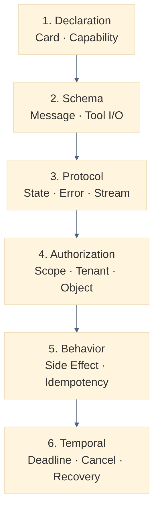
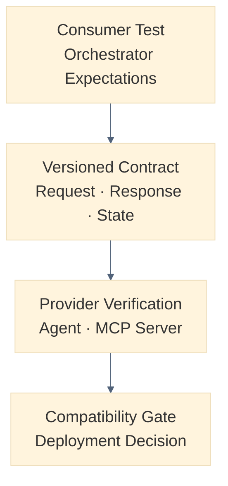
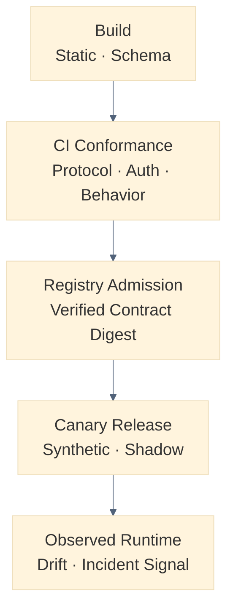

# AI Agent Contract Testing 설계: Agent Card·A2A Task·MCP Tool 선언과 실제 동작을 검증하는 법

AI Agent 통합에서는 API 응답이 스키마에 맞는지 확인하는 것만으로 부족합니다. Agent Card와 MCP Tool이 선언한 기능, Task 상태 전이, 권한, 실제 Side Effect가 함께 어긋날 수 있기 때문입니다. 이 글은 Contract Bundle과 Consumer-driven Test, Registry·CI Gate, Runtime Drift Detection으로 선언과 실제를 검증하는 방법을 설명합니다.


<blockquote id="aiarchitect-toc" data-ke-style="box" style="background-color: #f6f9fc; color: #263746; font-family: Pretendard-Regular, AppleSDGothicNeo-Regular, sans-serif; font-weight: 400;" data-mce-style="background-color: #f6f9fc; color: #263746; font-family: Pretendard-Regular, AppleSDGothicNeo-Regular, sans-serif; font-weight: 400;">
<p style="color: #263746; font-weight: 700;" data-mce-style="color: #263746; font-weight: 700;"><b>목차</b></p>
<ol style="list-style-type: decimal; color: #555555; font-weight: 400;" data-mce-style="list-style-type: decimal; color: #555555; font-weight: 400;" data-ke-list-type="decimal">
<li style="color: #555555; font-weight: 400;" data-mce-style="color: #555555; font-weight: 400;"><a href="#ai-section-1" style="color: #0070d1; text-decoration: underline; text-underline-offset: 2px;">Agent 통합에는 API 테스트보다 넓은 계약이 필요하다</a></li>
<li style="color: #555555; font-weight: 400;" data-mce-style="color: #555555; font-weight: 400;"><a href="#ai-section-2" style="color: #0070d1; text-decoration: underline; text-underline-offset: 2px;">Contract Test와 AI Evaluation을 분리한다</a></li>
<li style="color: #555555; font-weight: 400;" data-mce-style="color: #555555; font-weight: 400;"><a href="#ai-section-3" style="color: #0070d1; text-decoration: underline; text-underline-offset: 2px;">검증 범위를 6계층으로 나눈다</a></li>
<li style="color: #555555; font-weight: 400;" data-mce-style="color: #555555; font-weight: 400;"><a href="#ai-section-4" style="color: #0070d1; text-decoration: underline; text-underline-offset: 2px;">Contract Bundle을 단일 검증 단위로 만든다</a></li>
<li style="color: #555555; font-weight: 400;" data-mce-style="color: #555555; font-weight: 400;"><a href="#ai-section-5" style="color: #0070d1; text-decoration: underline; text-underline-offset: 2px;">Version과 Digest로 검증 대상을 고정한다</a></li>
<li style="color: #555555; font-weight: 400;" data-mce-style="color: #555555; font-weight: 400;"><a href="#ai-section-6" style="color: #0070d1; text-decoration: underline; text-underline-offset: 2px;">Agent Card의 정적 선언을 먼저 검사한다</a></li>
<li style="color: #555555; font-weight: 400;" data-mce-style="color: #555555; font-weight: 400;"><a href="#ai-section-7" style="color: #0070d1; text-decoration: underline; text-underline-offset: 2px;">A2A Interface와 Capability를 실제 호출로 대조한다</a></li>
<li style="color: #555555; font-weight: 400;" data-mce-style="color: #555555; font-weight: 400;"><a href="#ai-section-8" style="color: #0070d1; text-decoration: underline; text-underline-offset: 2px;">Skill과 Content Mode 계약을 예제로 고정한다</a></li>
<li style="color: #555555; font-weight: 400;" data-mce-style="color: #555555; font-weight: 400;"><a href="#ai-section-9" style="color: #0070d1; text-decoration: underline; text-underline-offset: 2px;">A2A Task를 상태 머신으로 검증한다</a></li>
<li style="color: #555555; font-weight: 400;" data-mce-style="color: #555555; font-weight: 400;"><a href="#ai-section-10" style="color: #0070d1; text-decoration: underline; text-underline-offset: 2px;">Streaming·Push·Cancel은 별도 시나리오로 검증한다</a></li>
<li style="color: #555555; font-weight: 400;" data-mce-style="color: #555555; font-weight: 400;"><a href="#ai-section-11" style="color: #0070d1; text-decoration: underline; text-underline-offset: 2px;">Error Contract는 Code·Condition·Retry를 함께 본다</a></li>
<li style="color: #555555; font-weight: 400;" data-mce-style="color: #555555; font-weight: 400;"><a href="#ai-section-12" style="color: #0070d1; text-decoration: underline; text-underline-offset: 2px;">MCP Tool 목록과 Schema Snapshot을 대조한다</a></li>
<li style="color: #555555; font-weight: 400;" data-mce-style="color: #555555; font-weight: 400;"><a href="#ai-section-13" style="color: #0070d1; text-decoration: underline; text-underline-offset: 2px;">Input·Output을 JSON Schema로 양방향 검증한다</a></li>
<li style="color: #555555; font-weight: 400;" data-mce-style="color: #555555; font-weight: 400;"><a href="#ai-section-14" style="color: #0070d1; text-decoration: underline; text-underline-offset: 2px;">Tool Annotation은 실행 관찰로 검증한다</a></li>
<li style="color: #555555; font-weight: 400;" data-mce-style="color: #555555; font-weight: 400;"><a href="#ai-section-15" style="color: #0070d1; text-decoration: underline; text-underline-offset: 2px;">Authorization과 Tenant 격리를 계약에 포함한다</a></li>
<li style="color: #555555; font-weight: 400;" data-mce-style="color: #555555; font-weight: 400;"><a href="#ai-section-16" style="color: #0070d1; text-decoration: underline; text-underline-offset: 2px;">Side Effect·멱등성·승인을 결과와 함께 검증한다</a></li>
<li style="color: #555555; font-weight: 400;" data-mce-style="color: #555555; font-weight: 400;"><a href="#ai-section-17" style="color: #0070d1; text-decoration: underline; text-underline-offset: 2px;">시간과 복구 동작도 계약이다</a></li>
<li style="color: #555555; font-weight: 400;" data-mce-style="color: #555555; font-weight: 400;"><a href="#ai-section-18" style="color: #0070d1; text-decoration: underline; text-underline-offset: 2px;">호환성 변경을 유형별로 판정한다</a></li>
<li style="color: #555555; font-weight: 400;" data-mce-style="color: #555555; font-weight: 400;"><a href="#ai-section-19" style="color: #0070d1; text-decoration: underline; text-underline-offset: 2px;">Consumer-driven Contract로 실제 기대를 보존한다</a></li>
<li style="color: #555555; font-weight: 400;" data-mce-style="color: #555555; font-weight: 400;"><a href="#ai-section-20" style="color: #0070d1; text-decoration: underline; text-underline-offset: 2px;">Negative Test를 정상 사례만큼 중요하게 다룬다</a></li>
<li style="color: #555555; font-weight: 400;" data-mce-style="color: #555555; font-weight: 400;"><a href="#ai-section-21" style="color: #0070d1; text-decoration: underline; text-underline-offset: 2px;">Fixture와 Test Double의 경계를 통제한다</a></li>
<li style="color: #555555; font-weight: 400;" data-mce-style="color: #555555; font-weight: 400;"><a href="#ai-section-22" style="color: #0070d1; text-decoration: underline; text-underline-offset: 2px;">Contract Matrix로 조합 폭발을 관리한다</a></li>
<li style="color: #555555; font-weight: 400;" data-mce-style="color: #555555; font-weight: 400;"><a href="#ai-section-23" style="color: #0070d1; text-decoration: underline; text-underline-offset: 2px;">Registry Admission과 Release Gate를 연결한다</a></li>
<li style="color: #555555; font-weight: 400;" data-mce-style="color: #555555; font-weight: 400;"><a href="#ai-section-24" style="color: #0070d1; text-decoration: underline; text-underline-offset: 2px;">Runtime Drift를 탐지하고 격리한다</a></li>
<li style="color: #555555; font-weight: 400;" data-mce-style="color: #555555; font-weight: 400;"><a href="#ai-section-25" style="color: #0070d1; text-decoration: underline; text-underline-offset: 2px;">합성 정상·실패 사례로 전체 흐름을 검증한다</a></li>
<li style="color: #555555; font-weight: 400;" data-mce-style="color: #555555; font-weight: 400;"><a href="#ai-section-26" style="color: #0070d1; text-decoration: underline; text-underline-offset: 2px;">단계적으로 구현한다</a></li>
<li style="color: #555555; font-weight: 400;" data-mce-style="color: #555555; font-weight: 400;"><a href="#ai-section-27" style="color: #0070d1; text-decoration: underline; text-underline-offset: 2px;">운영 체크리스트와 마무리</a></li>
<li style="color: #555555; font-weight: 400;" data-mce-style="color: #555555; font-weight: 400;"><a href="#ai-section-28" style="color: #0070d1; text-decoration: underline; text-underline-offset: 2px;">공식 참고자료</a></li>
</ol>
</blockquote>


Agent Registry에 새 Specialist Agent가 등록됐습니다. Agent Card에는 `work-planning` Skill, JSON 입력·출력, Streaming, OAuth가 선언돼 있습니다. 이 Agent가 실제로 같은 계약을 지키는지는 어떻게 확인할까요?

연결 성공만 확인하는 테스트는 다음 문제를 놓칩니다.

```text
Agent Card는 JSON 출력을 약속하지만 실제 Artifact는 자유 텍스트다.
Streaming을 지원한다고 선언했지만 중간 Event 없이 연결이 끊긴다.
완료된 A2A Task가 다시 working 상태로 돌아간다.
MCP Tool의 outputSchema와 structuredContent가 다르다.
readOnlyHint=true인 Tool이 외부 업무 Record를 변경한다.
새 Version에서 Enum 값이 조용히 삭제돼 기존 Orchestrator가 실패한다.
권한 없는 Tenant의 Task ID를 조회해도 같은 결과가 반환된다.
```

이 문제는 Model 답변의 품질만 평가해서 해결되지 않습니다. **선언된 계약과 관찰된 Protocol·업무 동작이 일치하는지 결정적으로 검증하는 Agent Contract Testing**이 필요합니다.

이 글은 [자연어에서 MCP Tool Call까지의 통합 테스트](https://aiarchitect.tistory.com/13), [AI Agent 평가 아키텍처](https://aiarchitect.tistory.com/74), [MCP·A2A 통합 경계](https://aiarchitect.tistory.com/75), [AI Agent Control Plane](https://aiarchitect.tistory.com/76), [실행 Orchestration](https://aiarchitect.tistory.com/77), [Enterprise Agent Router](https://aiarchitect.tistory.com/78), [Agent Identity와 위임 인가](https://aiarchitect.tistory.com/79)를 전제로 합니다. Prompt가 올바른 Tool을 선택하는 비율이나 답변 품질을 반복하지 않고, **Agent Card·A2A Task·MCP Tool의 선언과 실제 동작 사이의 적합성**에 집중합니다.

> 이 글의 Agent, Tenant, URL, Payload, Version, 지연 시간과 판정 결과는 모두 교육용 합성 예시입니다. 특정 회사·고객·제품·운영 환경을 나타내지 않습니다. A2A와 MCP는 계속 진화하므로 실제 구현에서는 고정한 Protocol Version의 공식 Specification과 SDK Conformance Test를 다시 확인해야 합니다.

<a id="ai-section-1"></a>
## 1. Agent 통합에는 API 테스트보다 넓은 계약이 필요하다

일반 API Contract Test는 요청 Method, Path, Header, Body와 응답 Schema를 확인합니다. Agent 통합도 이 기반이 필요하지만, 계약의 범위가 더 넓습니다.

- Agent Card가 제공한다고 선언한 Skill과 Capability
- A2A Message·Task·Artifact와 상태 전이
- Streaming·Push Notification·Cancel 같은 비동기 동작
- MCP Tool의 `inputSchema`·`outputSchema`와 실제 결과
- Protocol Error와 업무 Error의 구분
- 인증 요구사항, Tenant 격리와 객체 권한
- Side Effect, Approval, 멱등성과 재시도
- Version 변경 전후의 Consumer 호환성

즉 Agent Contract는 JSON 문서 한 장이 아니라 **발견부터 실행·실패·복구까지의 관찰 가능한 약속**입니다.

```text
Agent Contract
  = Discovery Declaration
  + Message Schema
  + Protocol State Machine
  + Error Semantics
  + Authorization Boundary
  + Side-effect Invariants
  + Temporal Behavior
```

HTTP 200만 확인하면 Protocol 연결성은 알 수 있지만 업무 호환성은 증명하지 못합니다.

<a id="ai-section-2"></a>
## 2. Contract Test와 AI Evaluation을 분리한다

두 검증은 목적과 판정 방식이 다릅니다.

| 구분 | Contract Test | AI Evaluation |
|---|---|---|
| 질문 | 약속한 형식·상태·불변식을 지켰는가? | 결과가 충분히 정확하고 유용한가? |
| 판정 | 결정적 Pass·Fail | 점수·분포·Threshold |
| 입력 | Fixture, Schema, 상태 시나리오 | Dataset, 실제·합성 질의 |
| 예시 | `completed` 후 `working` 금지 | 업무 계획 완성도 0.87 |
| Gate | Registry·Build·Release 차단 | Regression·Canary 품질 판정 |

예를 들어 Agent가 올바른 JSON Artifact를 반환했지만 계획 내용이 부정확할 수 있습니다.

```text
Contract PASS + Evaluation FAIL
  → 통합은 가능하지만 품질이 부족하다.

Contract FAIL + Evaluation PASS
  → 내용이 좋아 보여도 자동화 경계에 연결하면 안 된다.
```

따라서 Contract Gate를 먼저 통과한 실행만 품질 Evaluation 대상으로 승격하는 것이 안전합니다.

<a id="ai-section-3"></a>
## 3. 검증 범위를 6계층으로 나눈다

계약을 한 종류의 Schema Test로 축소하지 않습니다.



그림 1. Agent Contract Test의 6계층 검증 모델

각 계층은 서로 다른 실패를 찾습니다.

| 계층 | 대표 실패 | 차단 위치 |
|---|---|---|
| Declaration | Card에 없는 Interface 호출 | Registry Admission |
| Schema | 필수 필드 누락, 잘못된 Enum | CI |
| Protocol | 불가능한 Task 상태 전이 | CI·Canary |
| Authorization | Cross-tenant 조회 | Security Gate |
| Behavior | Read-only 선언 후 실제 변경 | Release Gate |
| Temporal | Cancel 후 Side Effect 지속 | Resilience Gate |

이 분류를 사용하면 “테스트가 실패했다”가 아니라 **어떤 계약 계층이 깨졌는지** 운영자가 바로 판단할 수 있습니다.

<a id="ai-section-4"></a>
## 4. Contract Bundle을 단일 검증 단위로 만든다

Agent Card, Schema와 Test Case를 각 Repository에 흩어 두면 어떤 조합이 배포됐는지 재구성하기 어렵습니다. 검증 입력을 Versioned Contract Bundle로 묶습니다.

```yaml
contract_bundle:
  contract_id: planning-agent-contract
  contract_version: 3.4.0
  protocol:
    a2a: "1.0"
    mcp: "2026-07-28"
    json_schema: "2020-12"
  producer:
    agent_id: agent-fixture-planning
    artifact_digest: sha256:fixture-producer-digest
  declarations:
    agent_card: agent-card.json
    mcp_tools: mcp-tools.snapshot.json
  models:
    task_state_machine: a2a-task-machine.yaml
    invariants: behavior-invariants.yaml
  examples:
    consumer_pacts: pacts/
    positive_cases: cases/positive/
    negative_cases: cases/negative/
  expected_results:
    reason_codes: reason-codes.yaml
```

Bundle에는 Secret이나 실제 고객 Payload를 넣지 않습니다. 합성 Fixture와 구조화된 Expectation만 저장합니다.

검증 결과도 Bundle Digest와 연결합니다.

```json
{
  "bundle_digest": "sha256:fixture-contract-digest",
  "producer_digest": "sha256:fixture-producer-digest",
  "harness_version": "2.1.0",
  "result": "PASS",
  "verified_at": "2026-08-11T06:00:00Z"
}
```

<a id="ai-section-5"></a>
## 5. Version과 Digest로 검증 대상을 고정한다

`latest`를 대상으로 한 테스트 결과는 재현할 수 없습니다. 최소 네 Version을 고정해야 합니다.

```text
Protocol Version
Agent Contract Version
Agent·MCP Server Artifact Digest
Contract Harness Version
```

Agent Card URL이 같아도 응답 내용은 바뀔 수 있습니다. 검증 시점의 Canonical Document Digest와 HTTP Cache 식별자를 보존합니다.

```yaml
agent_card_snapshot:
  url: https://agent.example.test/.well-known/agent-card.json
  protocol_version: "1.0"
  etag: '"fixture-card-v34"'
  canonical_digest: sha256:fixture-card-digest
  fetched_at: 2026-08-11T05:55:00Z
```

Registry가 승인한 Card Digest와 Dispatch 시 관찰한 Digest가 다르면 Router는 새 선언을 자동 신뢰하지 않고 재검증 상태로 전환해야 합니다.

<a id="ai-section-6"></a>
## 6. Agent Card의 정적 선언을 먼저 검사한다

A2A Agent Card는 Agent의 Identity, Capability, Skill, Interface와 인증 요구사항을 기술하는 발견 문서입니다. 정적 검사는 다음을 확인합니다.

- 필수 필드와 형식이 고정한 A2A Version에 맞는가?
- Production HTTP Interface가 HTTPS Absolute URL인가?
- `protocolBinding`과 `protocolVersion` 조합을 Harness가 지원하는가?
- Skill ID가 Card 안에서 유일한가?
- Default Input·Output Mode와 Skill별 Mode가 모순되지 않는가?
- Security Scheme 이름과 Requirement 참조가 일치하는가?
- 서명된 Card라면 승인된 Issuer·Key와 Canonicalization으로 검증되는가?
- Extension이 `required`이면 Consumer가 이를 명시적으로 지원하는가?

```yaml
case: agent-card-required-extension
given:
  card_extension:
    uri: urn:example:test:approval-context
    required: true
  consumer_extensions: []
expect:
  admission: REJECT
  reason_code: REQUIRED_EXTENSION_UNSUPPORTED
```

Schema가 유효하다는 사실만으로 Agent가 선언을 실제 지원한다는 뜻은 아닙니다. 정적 검사는 다음 동적 Test의 입력을 확정하는 첫 단계입니다.

<a id="ai-section-7"></a>
## 7. A2A Interface와 Capability를 실제 호출로 대조한다

Agent가 세 Interface를 선언했다면 모든 조합을 무조건 테스트하지 않고, Registry가 활성화할 Interface마다 최소 Conformance Scenario를 실행합니다.

```text
AgentInterface
  ├─ JSONRPC / protocol 1.0 / tenant fixture-a
  ├─ HTTP+JSON / protocol 1.0 / tenant fixture-a
  └─ GRPC / protocol 1.0 / tenant fixture-a
```

검증 항목은 다음과 같습니다.

- Endpoint와 Binding이 실제로 일치하는가?
- HTTP 기반 요청이 `A2A-Version`을 `Major.Minor` 형식으로 보내고, Interface의 Version Semantics로 처리되는가?
- 지원하지 않는 Protocol Version을 요청하면 `VersionNotSupportedError`를 반환하는가?
- Card의 `tenant` 값이 필요한 Interface에서 모든 요청에 같은 Routing 값을 요구하는가?
- `streaming=false`이면 Streaming 요청을 성공처럼 처리하지 않고 적절히 거부하는가?
- `pushNotifications=false`이면 Push 설정 Operation을 거부하는가?
- `extendedAgentCard=false`이면 확장 Card 조회를 지원한다고 가장하지 않는가?

Card 선언과 실제 응답이 다르면 “문서 오류”로 낮춰 보지 않습니다. Router의 선택과 Client 동작을 바꾸는 **호환성 결함**입니다.

<a id="ai-section-8"></a>
## 8. Skill과 Content Mode 계약을 예제로 고정한다

Skill Description은 자연어라서 Schema만으로 검증하기 어렵습니다. 따라서 대표 요청·응답 Example과 금지 사례를 함께 둡니다.

```yaml
skill_contract:
  skill_id: work-planning
  input_modes:
    - application/json
  output_modes:
    - application/json
  examples:
    - name: create-draft-plan
      input_fixture: work-request-valid.json
      expected_artifact_schema: work-plan.schema.json
  forbidden:
    - direct_ticket_commit
    - cross_tenant_reference
```

검증은 “문장이 정확히 같은가”가 아니라 다음처럼 나눕니다.

```text
결정적 계약
  Content Type, 필수 필드, Enum, Artifact 구조, 금지 Side Effect

확률적 품질
  계획의 타당성, 설명의 명료성, 우선순위 품질
```

자연어 Skill 설명을 기계적 권한 근거로 사용해서는 안 됩니다. 권한·Side Effect는 별도 구조화된 정책과 Invariant로 검증합니다.

<a id="ai-section-9"></a>
## 9. A2A Task를 상태 머신으로 검증한다

A2A Task는 상태를 가진 Protocol 객체입니다. 각 응답 JSON이 유효해도 불가능한 순서로 전이하면 Consumer는 복구할 수 없습니다.

```yaml
task_machine:
  initial:
    - TASK_STATE_SUBMITTED
    - TASK_STATE_WORKING
  allowed:
    TASK_STATE_SUBMITTED:
      - TASK_STATE_WORKING
      - TASK_STATE_REJECTED
      - TASK_STATE_CANCELED
    TASK_STATE_WORKING:
      - TASK_STATE_INPUT_REQUIRED
      - TASK_STATE_AUTH_REQUIRED
      - TASK_STATE_COMPLETED
      - TASK_STATE_FAILED
      - TASK_STATE_CANCELED
    TASK_STATE_INPUT_REQUIRED:
      - TASK_STATE_WORKING
      - TASK_STATE_CANCELED
    TASK_STATE_AUTH_REQUIRED:
      - TASK_STATE_WORKING
      - TASK_STATE_CANCELED
  terminal:
    - TASK_STATE_COMPLETED
    - TASK_STATE_FAILED
    - TASK_STATE_CANCELED
    - TASK_STATE_REJECTED
```

위 표는 글의 교육용 내부 Profile이며 A2A 1.0이 모든 상태 간 Edge를 규정한 범용 전이표가 아닙니다. 표준이 명시한 Terminal·Interrupted State 의미와 Operation 제약은 그대로 검사하고, 나머지 허용 Edge는 해당 Agent의 Versioned Contract로 선언해 검증해야 합니다.

핵심 Negative Case는 다음과 같습니다.

```text
completed → working
canceled → completed
terminal Task에 추가 Message 전송
다른 Tenant가 Task ID로 Get·Cancel
완료됐지만 필수 Artifact 없음
timestamp 역행 또는 동일 Event 중복 처리 실패
```

<a id="ai-section-10"></a>
## 10. Streaming·Push·Cancel은 별도 시나리오로 검증한다

동기 Send Message가 성공해도 비동기 Capability가 같은 계약을 지킨다고 가정할 수 없습니다.

### Streaming

- Stream의 첫 응답이 Task 또는 단일 Message 규칙을 지키는가?
- Task Stream이 Status·Artifact Update만 내보내는가?
- Terminal 상태에 도달하면 Stream이 닫히는가?
- Event 중복·재연결 시 Consumer가 식별할 Cursor나 ID가 있는가?

### Push Notification

- 등록한 Callback 외 Destination으로 전송하지 않는가?
- Callback URL이 HTTPS·승인 Host·DNS/IP 재검증 정책을 통과해 SSRF와 내부망 접근을 막는가?
- Callback 인증과 서명을 검증할 수 있는가?
- 동일 Event 재전송을 멱등 처리할 수 있는가?
- 삭제한 설정으로 더 이상 전송하지 않는가?

### Cancel

- Cancel 가능 상태와 불가능 상태를 구분하는가?
- Cancel 응답 뒤 새로운 Side Effect가 시작되지 않는가?
- 이미 Commit된 Side Effect를 Canceled로 숨기지 않는가?
- 보상 필요 상태를 별도 Outcome으로 노출하는가?

비동기 계약은 최종 상태만 보지 않고 **Event 순서와 종료 후 부작용**까지 관찰해야 합니다.

<a id="ai-section-11"></a>
## 11. Error Contract는 Code·Condition·Retry를 함께 본다

오류 계약은 `message` 문자열 일치가 아닙니다.

```yaml
error_contract:
  condition: terminal_task_received_new_message
  protocol_error: UnsupportedOperationError
  retryable: false
  expected_http_class: 4xx
  data_schema: a2a-error-data.schema.json
  sensitive_fields_forbidden:
    - stack_trace
    - access_token
    - internal_host
```

검증할 항목은 네 가지입니다.

1. 어떤 조건에서 발생하는가?
2. Protocol Binding별 Code가 고정한 Specification과 일치하는가?
3. Consumer가 Retry·Fallback·사용자 입력 중 무엇을 선택해야 하는가?
4. Error Data가 민감정보를 노출하지 않는가?

MCP에서는 Tool 실행 중 발생한 업무 오류와 Tool 자체를 찾지 못한 Protocol 오류를 구분해야 합니다. 업무 오류를 모두 JSON-RPC Internal Error로 반환하면 Model과 Orchestrator가 수정 가능한 입력 오류인지 인프라 장애인지 판단하기 어렵습니다.

<a id="ai-section-12"></a>
## 12. MCP Tool 목록과 Schema Snapshot을 대조한다

MCP Client가 관찰한 `tools/list` 결과를 Contract Bundle의 Snapshot과 비교합니다.

MCP `2026-07-28`에서는 요청별 Credential에 따라 호출자가 볼 수 있는 Tool 집합이 달라질 수 있습니다. 따라서 Server 전체에 Snapshot 하나를 두지 않고 `Client Profile·Authorization Profile·Tenant Class`를 함께 고정합니다. 동일 Profile 안에서만 Tool 목록과 순서·Digest를 비교해야 정상적인 권한 필터링을 Drift로 오판하지 않습니다.

또한 각 요청의 `MCP-Protocol-Version`과 필수 `_meta`에 포함되는 Protocol Version·Client Identity·Client Capability가 고정한 Profile과 일치하는지 확인합니다. Header에 노출되는 Method·Tool Name·Routing Parameter와 JSON-RPC Body가 서로 다르면 요청을 거부하는 Negative Case도 포함합니다.

```json
{
  "name": "work_plan_create_draft",
  "description": "Create a synthetic work-plan draft",
  "inputSchema": {
    "$schema": "https://json-schema.org/draft/2020-12/schema",
    "type": "object",
    "required": ["tenant_id", "request_id", "items"],
    "properties": {
      "tenant_id": {"type": "string"},
      "request_id": {"type": "string"},
      "items": {
        "type": "array",
        "minItems": 1,
        "items": {"$ref": "#/$defs/item"}
      }
    },
    "$defs": {
      "item": {
        "type": "object",
        "required": ["title"],
        "properties": {
          "title": {"type": "string", "minLength": 1}
        },
        "additionalProperties": false
      }
    },
    "additionalProperties": false
  }
}
```

비교 대상은 Tool 이름만이 아닙니다.

- Tool 추가·삭제·이름 변경
- 필수 입력과 Type·Range·Enum 변경
- `additionalProperties` 정책
- `outputSchema` 유무와 구조
- Annotation과 Description의 보안 관련 변화
- Protocol Version과 Extension 조합
- Client·Authorization Profile별 Tool 가시성

Schema Snapshot의 순서나 Description 공백처럼 의미 없는 차이는 정규화하고, 실제 Consumer 호환성에 영향을 주는 Semantic Diff를 별도 계산합니다.

<a id="ai-section-13"></a>
## 13. Input·Output을 JSON Schema로 양방향 검증한다

MCP `2026-07-28`은 Tool `inputSchema`와 `outputSchema`에 JSON Schema Draft 2020-12를 사용할 수 있습니다. Contract Test는 두 방향을 모두 검사해야 합니다.

### Consumer → Provider

```text
유효 입력은 수락한다.
필수 필드 누락은 거부한다.
잘못된 Type·Enum·Range는 거부한다.
허용하지 않은 필드는 정책대로 거부한다.
과도한 중첩·배열·문자열은 제한한다.
```

### Provider → Consumer

```text
structuredContent가 outputSchema를 만족한다.
content와 structuredContent가 서로 모순되지 않는다.
성공 결과에 필수 Business Key가 존재한다.
오류 결과를 성공 Payload로 위장하지 않는다.
```

```yaml
case: output-contract-mismatch
when:
  call: work_plan_create_draft
then:
  isError: false
  structuredContent:
    plan_id: 12345
expect:
  result: FAIL
  reason_code: OUTPUT_SCHEMA_VIOLATION
  detail: plan_id_must_be_string
```

외부 `$ref`를 검증 시 임의 Network로 자동 조회하면 SSRF와 재현성 문제가 생길 수 있습니다. Bundle 안에 허용된 Schema를 함께 넣고, Reference 깊이·검증 시간·Payload 크기를 제한합니다.

<a id="ai-section-14"></a>
## 14. Tool Annotation은 실행 관찰로 검증한다

MCP Tool Annotation의 `readOnlyHint`, `destructiveHint`, `idempotentHint`, `openWorldHint`는 이름 그대로 Hint입니다. 특히 신뢰하지 않는 Server의 Annotation만으로 실행 허용을 결정하면 안 됩니다.

Contract Test는 선언과 실제 Side Effect를 대조합니다.

```yaml
case: readonly-claim-verification
given:
  annotation:
    readOnlyHint: true
  fixture_state:
    records: 7
when:
  tool: work_plan_lookup
then:
  fixture_state:
    records: 7
  outbound_writes: 0
  external_messages: 0
```

다음 불일치는 Release를 차단해야 합니다.

```text
readOnlyHint=true + DB Write 발생
idempotentHint=true + 같은 Key 재호출 시 Record 증가
destructiveHint=false + 기존 데이터 삭제
openWorldHint=false + 허용 목록 밖 Network 호출
```

Annotation은 Policy 입력 후보일 뿐이며, 신뢰 등급·Publisher·관찰 증거를 함께 평가해야 합니다.

<a id="ai-section-15"></a>
## 15. Authorization과 Tenant 격리를 계약에 포함한다

인증 성공만 테스트하지 않습니다. 각 Operation의 권한 경계를 Matrix로 만듭니다.

| 주체 | Tenant | 객체 | Operation | 기대 |
|---|---|---|---|---|
| 허용 사용자 | A | A 소유 Task | Get | Allow |
| 허용 사용자 | A | B 소유 Task | Get | Deny·Not Found 정책 |
| 만료 Credential | A | A 소유 Task | Cancel | Re-auth |
| Agent Workload | A | A Draft | Commit | Approval Required |
| 미등록 Workload | A | A Draft | Read | Deny |

오류 응답은 객체 존재 여부를 다른 Tenant에 노출하지 않도록 조직 정책에 맞춰 설계합니다.

```yaml
case: cross-tenant-task-probe
subject_tenant: tenant-fixture-a
target_task_tenant: tenant-fixture-b
operation: a2a.get_task
expect:
  result: DENY
  externally_visible_reason: TASK_NOT_ACCESSIBLE
  leaked_fields: []
```

Agent Card의 `tenant` Routing 값은 업무 데이터 인가를 대신하지 않습니다. Routing과 Authorization을 별도 Test로 검증해야 합니다.

<a id="ai-section-16"></a>
## 16. Side Effect·멱등성·승인을 결과와 함께 검증한다

Tool이나 Agent가 반환한 JSON만 확인하면 실제 업무 상태를 놓칩니다. Contract Harness는 격리된 업무 Store, Outbox와 외부 호출 기록을 함께 관찰합니다.

```text
Response Contract
  + Database State
  + Outbox Event
  + External Call Ledger
  + Approval Record
  = Side-effect Contract
```

예를 들어 `create_draft`는 다음 불변식을 가져야 합니다.

```yaml
invariants:
  - no_commit_without_approval
  - same_idempotency_key_same_business_result
  - duplicate_delivery_at_most_one_draft
  - tenant_id_immutable
  - response_plan_id_matches_persisted_record
```

같은 멱등 Key로 재시도했을 때 HTTP 상태만 같고 실제 Record가 두 개 생기면 실패입니다. 승인 필요한 Commit을 Draft 생성으로 위장해 실행해도 실패입니다.

A2A 1.0에서 Send Message의 중복 검출은 `messageId`를 활용할 수 있지만 Operation 자체의 멱등성은 선택적입니다. 따라서 Protocol 중복 검출과 업무 Side Effect의 멱등성을 같은 것으로 보지 않고, 쓰기 Tool·업무 API에는 별도의 Business Idempotency Key와 결과 Ledger를 계약으로 둡니다.

<a id="ai-section-17"></a>
## 17. 시간과 복구 동작도 계약이다

Agent 통합은 시간이 흐르면서 상태가 바뀝니다. 다음도 검증 가능한 계약으로 선언합니다.

- Acknowledgement Deadline
- 전체 Task Deadline과 Step Deadline
- Heartbeat 또는 Progress Update 최대 간격
- Retry Backoff와 최대 시도 횟수
- Cancel 전파 시간
- Credential 만료 시 `AUTH_REQUIRED` 또는 재인가 흐름
- 재연결·재구독 후 Event 중복 허용 범위
- Terminal 상태 보존 기간

```yaml
temporal_contract:
  acknowledge_within_ms: 1000
  first_progress_within_ms: 5000
  cancellation_effect_within_ms: 2000
  no_new_side_effect_after_cancel_ack: true
  duplicate_event_window: 10
```

수치는 교육용 예시이며 실제 SLO와 실행 특성에 맞게 정합니다. 중요한 것은 평균 시간만 보는 것이 아니라 **시간 초과 후의 상태와 부작용**을 함께 판정하는 것입니다.

<a id="ai-section-18"></a>
## 18. 호환성 변경을 유형별로 판정한다

모든 JSON 변경이 Breaking Change는 아니며, 필드 추가가 항상 안전한 것도 아닙니다.

| 변경 | 기본 판정 | 확인 사항 |
|---|---|---|
| Optional 출력 필드 추가 | 대체로 호환 | Consumer의 엄격 역직렬화 여부 |
| Required 입력 필드 추가 | Breaking | 기존 Consumer Fixture 실패 |
| Enum 값 삭제 | Breaking | 저장 데이터·Fallback 영향 |
| Enum 값 추가 | 조건부 | Consumer의 Unknown 처리 |
| Type 확대 | 조건부 | Validator·SDK 지원 |
| Skill ID 변경 | Breaking | Registry·Router 참조 |
| Capability false→true | 기능 추가 | 실제 Conformance 통과 |
| Annotation 변경 | 위험 재분류 | Approval·Policy Gate 재검증 |
| Error Code 변경 | Breaking 가능 | Retry·Fallback 분기 영향 |

호환성 판정은 Schema Diff만으로 끝내지 않고 현재 배포된 Consumer Contract를 재생해야 합니다.

```text
Candidate Producer
  × Production Consumer Contracts
  × Supported Protocol Profiles
  = Deployable 여부
```

<a id="ai-section-19"></a>
## 19. Consumer-driven Contract로 실제 기대를 보존한다

Provider가 작성한 Agent Card와 Schema만 검사하면 실제 Orchestrator가 의존하는 세부 조건을 놓칠 수 있습니다. Consumer-driven Contract는 Consumer Test가 기대하는 Interaction을 기록하고 Provider에서 재생합니다.



그림 2. Consumer 기대를 Provider 배포 검증으로 연결하는 흐름

Agent 통합에서는 Pact 개념을 그대로 복사하기보다 다음까지 확장한 Profile이 필요합니다.

- 단일 HTTP Interaction뿐 아니라 Task Event Sequence
- A2A Message·Artifact와 MCP Tool Result
- 인증 상태와 Provider State Setup
- Side Effect Ledger
- Deadline·Cancel·Retry Expectation

Contract는 Consumer가 실제 사용하는 Interaction만 보존하므로, Provider의 모든 기능을 대신하는 기능 테스트가 아닙니다. Protocol Conformance Suite와 함께 사용해야 합니다.

<a id="ai-section-20"></a>
## 20. Negative Test를 정상 사례만큼 중요하게 다룬다

Happy Path만 통과한 Agent는 운영에 충분하지 않습니다. 특히 보안과 복구 계약은 실패 입력에서 드러납니다.

```yaml
negative_cases:
  - invalid_json_rpc_envelope
  - unsupported_protocol_version
  - undeclared_streaming_request
  - terminal_task_message_append
  - malformed_artifact_part
  - mcp_unknown_tool
  - input_schema_boundary_overflow
  - output_schema_violation
  - cross_tenant_task_access
  - expired_task_credential
  - cancel_during_side_effect
  - duplicate_idempotency_key
  - readonly_tool_mutation
  - required_extension_not_supported
```

Negative Test는 “오류가 났는가”만 보지 않습니다.

```text
예상한 계층에서 차단됐는가?
오류가 안정된 Code와 구조로 반환됐는가?
민감정보가 노출되지 않았는가?
재시도 가능한지 명확한가?
부분 Side Effect가 남지 않았는가?
Audit Event가 생성됐는가?
```

<a id="ai-section-21"></a>
## 21. Fixture와 Test Double의 경계를 통제한다

Contract Test는 빠르고 결정적이어야 하지만, 모든 의존성을 Mock으로 바꾸면 실제 Provider 동작과 멀어집니다.

### Test Double로 대체하기 좋은 대상

- 외부 결제·메시지 전송처럼 실제 호출하면 안 되는 System
- Clock, Random ID와 Deadline 제어
- Identity Provider의 합성 Token·Claim 발급
- 장애·지연을 주입할 Network Adapter

### 실제 구현을 사용해야 하는 대상

- Agent Card와 MCP Tool을 내보내는 Serialization Code
- 실제 Request Handler와 State Machine
- Schema Validator와 Error Mapper
- Authorization Policy Integration
- 멱등 저장·Outbox 경계

Fixture는 Tenant별 Namespace와 고유 Test Run ID를 사용하고, 병렬 실행이 서로의 상태를 읽지 못해야 합니다.

```text
tenant-fixture-a / run-fixture-001
tenant-fixture-b / run-fixture-002
```

실제 고객 Data와 Production Credential을 Test Fixture로 복사하지 않습니다.

<a id="ai-section-22"></a>
## 22. Contract Matrix로 조합 폭발을 관리한다

모든 조합의 전체 E2E Test는 비용이 큽니다. 위험 기반 Matrix를 만듭니다.

```text
Producer Version
× Consumer Profile
× Protocol Binding
× Authentication Mode
× Tenant Class
× Operation Risk
× Execution Mode
```

전체 조합 대신 다음 방식으로 줄입니다.

1. 모든 지원 조합에 Static·Schema Test를 수행합니다.
2. Binding별 대표 정상·표준 오류 Scenario를 수행합니다.
3. 고위험 쓰기 Operation은 Auth·Tenant·Approval 전체 Matrix를 수행합니다.
4. 읽기 Operation은 Pairwise와 경계값 중심으로 줄입니다.
5. 과거 장애 조합은 영구 Regression Case로 승격합니다.

```yaml
coverage_policy:
  protocol_core: all_supported_bindings
  destructive_operations: exhaustive_security_matrix
  read_only_operations: pairwise_plus_boundaries
  prior_incidents: always
  deprecated_versions: production_consumers_only
```

테스트 수보다 중요한 것은 **어떤 위험을 어떤 조합이 커버하는지 추적 가능하게 만드는 것**입니다.

<a id="ai-section-23"></a>
## 23. Registry Admission과 Release Gate를 연결한다

Contract Test는 개발팀 보고서로 끝나지 않고 Control Plane의 상태 전이와 연결해야 합니다.



그림 3. Contract 검증을 Registry와 Runtime까지 연결하는 Release Gate

권장 상태는 다음과 같습니다.

```text
DRAFT
  → STATIC_VALIDATED
  → CONFORMANCE_VERIFIED
  → SECURITY_VERIFIED
  → REGISTRY_ADMITTED
  → CANARY
  → ACTIVE

실패 시
  → REJECTED | QUARANTINED | DEPRECATED
```

Registry에는 단순 `verified=true` 대신 다음 증거를 연결합니다.

```json
{
  "agent_version": "3.4.1",
  "card_digest": "sha256:fixture-card-digest",
  "contract_digest": "sha256:fixture-contract-digest",
  "producer_digest": "sha256:fixture-producer-digest",
  "profiles_passed": ["a2a-jsonrpc-1.0", "mcp-2026-07-28"],
  "verified_at": "2026-08-11T06:00:00Z",
  "expires_at": "2026-08-18T06:00:00Z"
}
```

Artifact나 Card Digest가 바뀌면 기존 증거를 재사용하지 않습니다.

<a id="ai-section-24"></a>
## 24. Runtime Drift를 탐지하고 격리한다

CI를 통과한 뒤에도 Configuration, Feature Flag, Dependency와 Model 경로 때문에 실제 동작이 달라질 수 있습니다.

Runtime에서는 Raw Payload 전체를 저장하지 않고 Contract 관련 신호를 관찰합니다.

- Card·Tool Schema Digest 변화
- Schema Validation 실패율
- 미등록 Error Code
- 불가능한 Task 상태 전이
- Annotation과 Side Effect 불일치
- Consumer별 Decode 실패
- Cancel 후 새로운 Write 발생
- Cross-tenant Deny 감소 또는 Allow 증가

```yaml
drift_policy:
  card_digest_mismatch: quarantine
  unknown_error_code_rate:
    threshold: synthetic-0.5-percent
    action: canary_stop
  output_schema_violation:
    threshold: 1
    action: route_disable
  impossible_task_transition:
    threshold: 1
    action: incident_open
```

운영 수치는 합성 예시입니다. 자동 조치는 오탐 위험과 업무 중요도에 맞춰 단계화합니다.

```text
Observe → Warn → Stop Canary → Disable Route → Quarantine Version
```

<a id="ai-section-25"></a>
## 25. 합성 정상·실패 사례로 전체 흐름을 검증한다

### 정상 사례: 업무 계획 Draft 생성

```text
1. Registry가 검증된 Agent Card Digest를 반환한다.
2. Orchestrator가 application/json Message를 보낸다.
3. Agent가 submitted → working Task를 반환한다.
4. Agent가 MCP Tool의 유효한 입력을 호출한다.
5. Tool이 outputSchema에 맞는 structuredContent를 반환한다.
6. Agent가 Contract에 맞는 Artifact와 completed를 반환한다.
7. Draft Record 하나와 Outbox Event 하나가 남는다.
8. 같은 Idempotency Key 재시도는 같은 Business Result를 반환한다.
```

판정:

```yaml
contract: PASS
evaluation_eligible: true
side_effect_count: 1
schema_violations: 0
state_machine_violations: 0
```

### 실패 사례 1: 선언과 Output 불일치

```text
Agent Card: application/json 출력 선언
실제 Artifact: text/plain 자유 텍스트
판정: CONTENT_MODE_MISMATCH
조치: Registry Admission 거부
```

### 실패 사례 2: 잘못된 Task 전이

```text
working → completed → working
판정: TERMINAL_STATE_REOPENED
조치: Canary 중지, Version Quarantine
```

### 실패 사례 3: Read-only 위장

```text
Tool Annotation: readOnlyHint=true
관찰 결과: 외부 업무 Record 1건 생성
판정: SIDE_EFFECT_DECLARATION_MISMATCH
조치: 보안 실패, Route 비활성화
```

### 실패 사례 4: 조용한 Breaking Change

```text
v3.4 output enum: draft | ready | rejected
v3.5 output enum: ready | rejected
Production Consumer: draft 분기 사용 중
판정: BREAKING_ENUM_REMOVAL
조치: Expand-and-Contract 없이 배포 차단
```

<a id="ai-section-26"></a>
## 26. 단계적으로 구현한다

### 1단계: 계약 수집

- Agent Card와 MCP `tools/list` Snapshot 저장
- Protocol·Artifact Digest 고정
- 기존 Consumer의 대표 Interaction 수집

### 2단계: 결정적 검증

- JSON Schema Input·Output Validation
- A2A Task 상태 머신
- Error Code와 Capability Scenario
- Static Negative Test

### 3단계: 보안·Side Effect

- Auth·Tenant·Object Matrix
- Approval·멱등성·Cancel 불변식
- 외부 호출 Ledger와 민감정보 검사

### 4단계: Delivery Gate

- Provider Verification을 CI에 연결
- Contract Digest를 Registry Admission에 연결
- Production Consumer Contract로 후보 Version 검증

### 5단계: 운영 폐루프

- Canary Synthetic Test
- Runtime Schema·상태 Drift 탐지
- 자동 Route Disable·Quarantine과 Incident 연결

처음부터 모든 Binding과 Skill을 완벽히 덮으려 하지 말고, 고위험 Side Effect와 현재 Production Consumer부터 시작합니다.

<a id="ai-section-27"></a>
## 27. 운영 체크리스트와 마무리

### 선언·Version

- [ ] A2A·MCP·JSON Schema Version을 고정했는가?
- [ ] Agent Card·Tool Schema·Artifact·Harness Digest를 기록하는가?
- [ ] Card의 Capability와 Interface를 실제 호출로 검증하는가?

### Protocol·Schema

- [ ] A2A Task 상태 전이와 Terminal 불변식을 검사하는가?
- [ ] Streaming·Push·Cancel을 동기 호출과 별도 검증하는가?
- [ ] MCP Input과 `structuredContent` Output을 모두 검증하는가?
- [ ] Protocol Error와 Tool 업무 Error를 구분하는가?

### 보안·행동

- [ ] Auth·Tenant·Object·Operation Negative Matrix가 있는가?
- [ ] Tool Annotation과 실제 Side Effect를 대조하는가?
- [ ] 멱등 Key 재시도 후 업무 Record 수까지 확인하는가?
- [ ] Cancel·Timeout 후 새로운 Side Effect를 차단하는가?
- [ ] 실제 고객 Data·Credential이 Fixture에 없는가?

### Delivery·운영

- [ ] Production Consumer Contract로 후보 Provider를 재생하는가?
- [ ] 검증된 Contract Digest만 Registry에 Admission하는가?
- [ ] Card·Schema·Error·상태 Drift를 Runtime에서 탐지하는가?
- [ ] 실패 시 Canary Stop·Route Disable·Quarantine이 연결되는가?
- [ ] Contract PASS와 Evaluation PASS를 별도 증거로 보존하는가?

AI Agent Contract Testing의 핵심은 “응답이 왔다”가 아닙니다.

```text
선언한 기능을 실제로 제공하는가?
약속한 Schema와 상태를 지키는가?
오류와 권한 경계가 예측 가능한가?
Side Effect와 복구 동작이 선언과 일치하는가?
현재 Consumer가 다음 Version과 계속 통신할 수 있는가?
```

이 질문에 결정적 증거로 답할 수 있어야 Registry와 Router가 Agent를 안전하게 선택할 수 있습니다. Contract Test가 통합 가능성을 지키고, Evaluation이 결과 품질을 지키며, 두 Gate가 함께 운영 가능한 Agent 생태계를 만듭니다.

<a id="ai-section-28"></a>
## 28. 공식 참고자료

- A2A Protocol Specification: https://a2a-protocol.org/latest/specification/
- A2A Agent Discovery: https://a2a-protocol.org/latest/topics/agent-discovery/
- Model Context Protocol `2026-07-28` Release: https://blog.modelcontextprotocol.io/posts/2026-07-28/
- Model Context Protocol `2026-07-28` Release Candidate 상세: https://blog.modelcontextprotocol.io/posts/2026-07-28-release-candidate/
- Model Context Protocol `2026-07-28` Tools: https://modelcontextprotocol.io/specification/2026-07-28/server/tools
- Model Context Protocol `2026-07-28` Schema Reference: https://modelcontextprotocol.io/specification/2026-07-28/schema
- JSON Schema Draft 2020-12: https://json-schema.org/draft/2020-12
- JSON-RPC 2.0 Specification: https://www.jsonrpc.org/specification
- Pact Contract Testing Introduction: https://docs.pact.io/
- Pact Specification: https://docs.pact.io/implementation_guides/pact_specification
- Pact Consumer Tests: https://docs.pact.io/implementation_guides/go/docs/consumer
