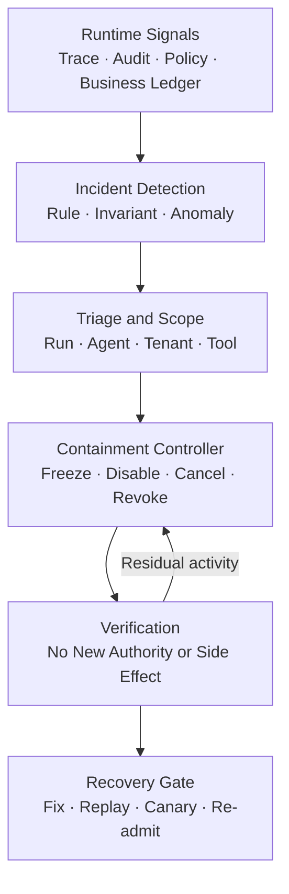
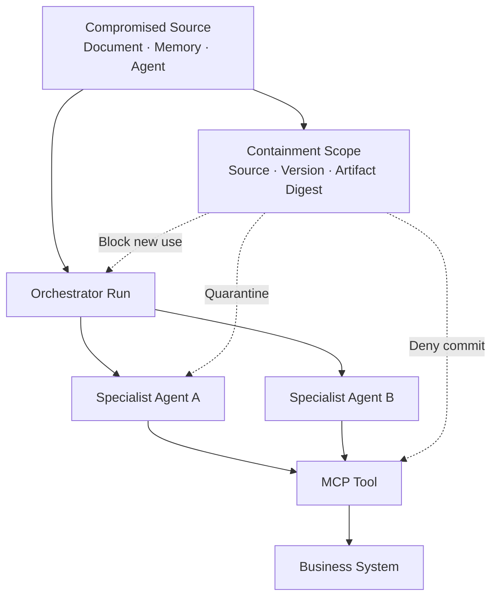
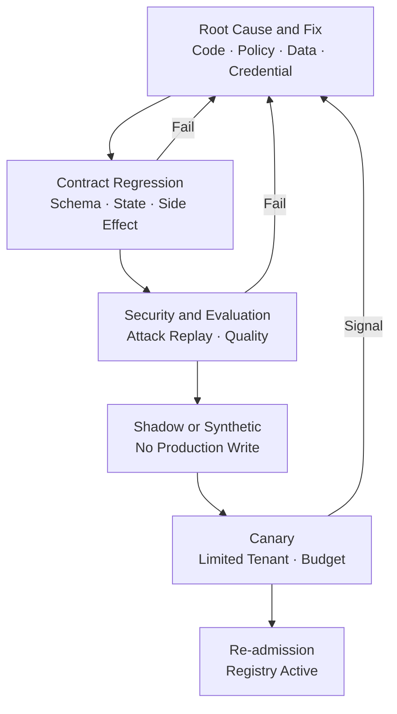

# Agentic AI Incident Response 설계: 오작동 Agent를 탐지·격리·중단하고 안전하게 복구하는 법

AI Agent가 오작동하면 Process를 종료해도 사고가 끝나지 않습니다. 이미 위임된 하위 Task, 발급된 단기 Credential, 생성된 Ticket과 외부 전송이 그대로 남기 때문입니다. 이 글은 Goal Hijack과 Tool 오용, 권한 초과, 무한 Loop, 비용 폭주, 다중 Agent 전파를 탐지하고 Run·Task·Credential·Agent Version 단위로 격리한 뒤, Side Effect를 확정·복구하고 검증된 구성만 다시 활성화하는 Incident Response 아키텍처를 정리합니다.

<blockquote id="aiarchitect-toc" data-ke-style="box" style="background-color: #f6f9fc; color: #263746; font-family: Pretendard-Regular, AppleSDGothicNeo-Regular, sans-serif; font-weight: 400;" data-mce-style="background-color: #f6f9fc; color: #263746; font-family: Pretendard-Regular, AppleSDGothicNeo-Regular, sans-serif; font-weight: 400;">
<p style="color: #263746; font-weight: 700;" data-mce-style="color: #263746; font-weight: 700;"><b>목차</b></p>
<ol style="list-style-type: decimal; color: #555555; font-weight: 400;" data-mce-style="list-style-type: decimal; color: #555555; font-weight: 400;" data-ke-list-type="decimal">
<li style="color: #555555; font-weight: 400;" data-mce-style="color: #555555; font-weight: 400;"><a href="#ai-section-1" style="color: #0070d1; text-decoration: underline; text-underline-offset: 2px;">Agent 사고는 잘못된 답변보다 넓다</a></li>
<li style="color: #555555; font-weight: 400;" data-mce-style="color: #555555; font-weight: 400;"><a href="#ai-section-2" style="color: #0070d1; text-decoration: underline; text-underline-offset: 2px;">Incident·Defect·Near Miss·Policy Violation을 구분한다</a></li>
<li style="color: #555555; font-weight: 400;" data-mce-style="color: #555555; font-weight: 400;"><a href="#ai-section-3" style="color: #0070d1; text-decoration: underline; text-underline-offset: 2px;">기존 Incident Response에 Agent 실행 경계를 더한다</a></li>
<li style="color: #555555; font-weight: 400;" data-mce-style="color: #555555; font-weight: 400;"><a href="#ai-section-4" style="color: #0070d1; text-decoration: underline; text-underline-offset: 2px;">Incident Control Loop를 Runtime 밖에 둔다</a></li>
<li style="color: #555555; font-weight: 400;" data-mce-style="color: #555555; font-weight: 400;"><a href="#ai-section-5" style="color: #0070d1; text-decoration: underline; text-underline-offset: 2px;">사고 전에 Inventory·Owner·Playbook을 준비한다</a></li>
<li style="color: #555555; font-weight: 400;" data-mce-style="color: #555555; font-weight: 400;"><a href="#ai-section-6" style="color: #0070d1; text-decoration: underline; text-underline-offset: 2px;">Incident Graph로 실행과 업무 영향을 연결한다</a></li>
<li style="color: #555555; font-weight: 400;" data-mce-style="color: #555555; font-weight: 400;"><a href="#ai-section-7" style="color: #0070d1; text-decoration: underline; text-underline-offset: 2px;">탐지 신호를 다섯 종류로 나눈다</a></li>
<li style="color: #555555; font-weight: 400;" data-mce-style="color: #555555; font-weight: 400;"><a href="#ai-section-8" style="color: #0070d1; text-decoration: underline; text-underline-offset: 2px;">Goal Hijack과 Prompt Injection은 행동 변화로 찾는다</a></li>
<li style="color: #555555; font-weight: 400;" data-mce-style="color: #555555; font-weight: 400;"><a href="#ai-section-9" style="color: #0070d1; text-decoration: underline; text-underline-offset: 2px;">Tool·Side Effect 이상을 Downstream에서 확인한다</a></li>
<li style="color: #555555; font-weight: 400;" data-mce-style="color: #555555; font-weight: 400;"><a href="#ai-section-10" style="color: #0070d1; text-decoration: underline; text-underline-offset: 2px;">Loop·Fan-out·비용 폭주는 행동 Budget으로 차단한다</a></li>
<li style="color: #555555; font-weight: 400;" data-mce-style="color: #555555; font-weight: 400;"><a href="#ai-section-11" style="color: #0070d1; text-decoration: underline; text-underline-offset: 2px;">다중 Agent 전파와 공급망 사고를 별도 추적한다</a></li>
<li style="color: #555555; font-weight: 400;" data-mce-style="color: #555555; font-weight: 400;"><a href="#ai-section-12" style="color: #0070d1; text-decoration: underline; text-underline-offset: 2px;">Severity는 영향·확산·가역성으로 판정한다</a></li>
<li style="color: #555555; font-weight: 400;" data-mce-style="color: #555555; font-weight: 400;"><a href="#ai-section-13" style="color: #0070d1; text-decoration: underline; text-underline-offset: 2px;">자동 대응과 Human Decision의 경계를 정한다</a></li>
<li style="color: #555555; font-weight: 400;" data-mce-style="color: #555555; font-weight: 400;"><a href="#ai-section-14" style="color: #0070d1; text-decoration: underline; text-underline-offset: 2px;">Kill Switch는 최소 피해 범위부터 적용한다</a></li>
<li style="color: #555555; font-weight: 400;" data-mce-style="color: #555555; font-weight: 400;"><a href="#ai-section-15" style="color: #0070d1; text-decoration: underline; text-underline-offset: 2px;">Cancel·Revoke·Route Disable·Quarantine을 함께 실행한다</a></li>
<li style="color: #555555; font-weight: 400;" data-mce-style="color: #555555; font-weight: 400;"><a href="#ai-section-16" style="color: #0070d1; text-decoration: underline; text-underline-offset: 2px;">A2A Task 취소를 중단 완료로 오해하지 않는다</a></li>
<li style="color: #555555; font-weight: 400;" data-mce-style="color: #555555; font-weight: 400;"><a href="#ai-section-17" style="color: #0070d1; text-decoration: underline; text-underline-offset: 2px;">MCP Tool은 호출 전·실행 중·업무 Commit을 각각 막는다</a></li>
<li style="color: #555555; font-weight: 400;" data-mce-style="color: #555555; font-weight: 400;"><a href="#ai-section-18" style="color: #0070d1; text-decoration: underline; text-underline-offset: 2px;">Credential·Grant·Approval을 사고 범위에 맞게 철회한다</a></li>
<li style="color: #555555; font-weight: 400;" data-mce-style="color: #555555; font-weight: 400;"><a href="#ai-section-19" style="color: #0070d1; text-decoration: underline; text-underline-offset: 2px;">Side Effect Ledger로 실제 피해를 확정한다</a></li>
<li style="color: #555555; font-weight: 400;" data-mce-style="color: #555555; font-weight: 400;"><a href="#ai-section-20" style="color: #0070d1; text-decoration: underline; text-underline-offset: 2px;">Compensation은 Rollback이 아니라 새 업무다</a></li>
<li style="color: #555555; font-weight: 400;" data-mce-style="color: #555555; font-weight: 400;"><a href="#ai-section-21" style="color: #0070d1; text-decoration: underline; text-underline-offset: 2px;">증거를 보존하되 Prompt와 개인정보를 과잉 수집하지 않는다</a></li>
<li style="color: #555555; font-weight: 400;" data-mce-style="color: #555555; font-weight: 400;"><a href="#ai-section-22" style="color: #0070d1; text-decoration: underline; text-underline-offset: 2px;">Incident 상태 머신과 명령의 멱등성을 설계한다</a></li>
<li style="color: #555555; font-weight: 400;" data-mce-style="color: #555555; font-weight: 400;"><a href="#ai-section-23" style="color: #0070d1; text-decoration: underline; text-underline-offset: 2px;">내부·외부 Communication을 기술 대응과 연결한다</a></li>
<li style="color: #555555; font-weight: 400;" data-mce-style="color: #555555; font-weight: 400;"><a href="#ai-section-24" style="color: #0070d1; text-decoration: underline; text-underline-offset: 2px;">Recovery는 재시작이 아니라 재승인이다</a></li>
<li style="color: #555555; font-weight: 400;" data-mce-style="color: #555555; font-weight: 400;"><a href="#ai-section-25" style="color: #0070d1; text-decoration: underline; text-underline-offset: 2px;">사고를 Contract·Evaluation·Red Team 회귀 사례로 바꾼다</a></li>
<li style="color: #555555; font-weight: 400;" data-mce-style="color: #555555; font-weight: 400;"><a href="#ai-section-26" style="color: #0070d1; text-decoration: underline; text-underline-offset: 2px;">합성 사고 사례로 전체 Playbook을 검증한다</a></li>
<li style="color: #555555; font-weight: 400;" data-mce-style="color: #555555; font-weight: 400;"><a href="#ai-section-27" style="color: #0070d1; text-decoration: underline; text-underline-offset: 2px;">단계적으로 구현하고 정기 Drill한다</a></li>
<li style="color: #555555; font-weight: 400;" data-mce-style="color: #555555; font-weight: 400;"><a href="#ai-section-28" style="color: #0070d1; text-decoration: underline; text-underline-offset: 2px;">운영 체크리스트와 마무리</a></li>
<li style="color: #555555; font-weight: 400;" data-mce-style="color: #555555; font-weight: 400;"><a href="#ai-section-29" style="color: #0070d1; text-decoration: underline; text-underline-offset: 2px;">공식 참고자료</a></li>
</ol>
</blockquote>

회의 요약 Agent가 갑자기 업무 Ticket을 반복 생성하기 시작했습니다. 원인은 Model 장애일 수도 있고, 검색된 문서의 간접 Prompt Injection일 수도 있으며, 잘못 배포된 Tool Schema나 탈취된 Workload Credential일 수도 있습니다.

운영자가 Agent Process만 종료하면 사고가 끝날까요?

```text
이미 Queue에 들어간 하위 Task는 계속 실행될 수 있다.
다른 Specialist Agent가 같은 오염된 Artifact를 전달받았을 수 있다.
발급된 단기 Credential은 남은 수명 동안 사용할 수 있다.
취소 요청 직전에 시작된 업무 Commit은 완료될 수 있다.
Router가 같은 Agent Version을 다른 Run에 다시 선택할 수 있다.
생성된 Ticket·알림·외부 전송은 Process 재시작으로 사라지지 않는다.
```

따라서 Agentic AI Incident Response의 목표는 “문제가 있는 답변을 숨기는 것”이 아닙니다. **새로운 권한과 실행을 동결하고, 진행 중인 행동을 중단하며, 이미 발생한 업무 영향을 확인·복구하고, 증거에 근거해 안전한 구성만 다시 활성화하는 것**입니다.

이 글은 [AI Agent 관측성](https://aiarchitect.tistory.com/72), [AI Agent 평가 아키텍처](https://aiarchitect.tistory.com/74), [AI Agent Control Plane](https://aiarchitect.tistory.com/76), [실행 Orchestration](https://aiarchitect.tistory.com/77), [Enterprise Agent Router](https://aiarchitect.tistory.com/78), [Agent Identity와 위임 인가](https://aiarchitect.tistory.com/79), [Agent Contract Testing](https://aiarchitect.tistory.com/80)을 전제로 합니다. Kill Switch 구현이나 Trace 수집법을 반복하지 않고, **탐지 신호가 들어온 뒤 Incident를 열고 Containment·Impact Analysis·Recovery까지 완결하는 운영 구조**에 집중합니다.

> 이 글의 조직, Agent, Tenant, Run, URL, 시간, 탐지 수치와 사고 결과는 모두 교육용 합성 예시입니다. 특정 회사·고객·제품·실제 사고를 나타내지 않습니다. 법적 신고, 개인정보 침해 통지, 증거 보존과 노동·감시 요건은 국가·산업·계약에 따라 달라지므로 실제 대응에서는 법무·개인정보·보안 책임자의 판단을 함께 적용해야 합니다.

## 1. Agent 사고는 잘못된 답변보다 넓다

일반적인 LLM 품질 문제는 부정확하거나 유용하지 않은 응답으로 끝날 수 있습니다. Agent는 Tool을 호출하고 다른 Agent에 위임하며, 장기 Task와 업무 상태를 남기므로 사고 범위가 넓습니다.

```text
Agent Incident Surface
  = Model Output
  + Retrieved Context
  + Execution Plan
  + Tool Calls
  + Delegated Tasks
  + Credentials and Approvals
  + Business Side Effects
  + Memory and Generated Artifacts
```

답변이 그럴듯해도 권한 없는 Tool을 시도했다면 보안 사고일 수 있습니다. 반대로 Model이 불완전한 답변을 했더라도 Tool 호출 없이 사용자에게 불확실성을 표시했다면 품질 결함으로 처리할 수 있습니다.

Incident Response는 **출력 문장보다 실행 경로와 실제 영향**을 기준으로 시작해야 합니다.

## 2. Incident·Defect·Near Miss·Policy Violation을 구분한다

모든 이상 신호를 최고 등급 사고로 처리하면 경보 피로가 발생하고, 모든 것을 Model 품질 문제로 낮추면 피해가 확산됩니다.

| 구분 | 의미 | 예시 | 기본 처리 |
|---|---|---|---|
| Defect | 명세나 품질 기준을 만족하지 못함 | Output Schema 누락 | Issue·Regression Test |
| Policy Violation | 실행 정책이 요청을 차단함 | 승인 없는 `ticket.commit` 시도 | Audit·반복성 분석 |
| Near Miss | 통제가 피해 직전에 차단함 | 외부 Domain 전송을 Egress PEP가 거부 | Incident 후보·통제 검증 |
| Incident | 기밀성·무결성·가용성·안전·업무에 실제 또는 임박한 영향 | Cross-tenant 조회 성공, Ticket 대량 생성 | 공식 대응 절차 |
| Abuse | 정상 기능을 악의적 목적으로 사용 | 허용된 Agent로 대량 스팸 Draft 생성 | Fraud·Abuse 대응 연계 |

Policy Deny 한 번은 통제가 정상 작동한 증거일 수 있습니다. 그러나 동일 Agent Version이 여러 Tenant에서 금지 Tool을 반복 시도하면 Goal Hijack, Supply Chain 문제나 오염된 Memory의 신호일 수 있습니다.

```yaml
classification_policy:
  single_denied_attempt:
    default: POLICY_VIOLATION
  repeated_cross_run_denials:
    default: INCIDENT_CANDIDATE
  unauthorized_side_effect_observed:
    minimum: INCIDENT_HIGH
  cross_tenant_data_exposure:
    minimum: INCIDENT_CRITICAL
```

분류는 완전 자동 판결이 아니라 우선 대응 경로를 결정하는 운영 계약입니다.

## 3. 기존 Incident Response에 Agent 실행 경계를 더한다

NIST SP 800-61 Rev.3은 Incident Response를 별도 사후 활동이 아니라 CSF 2.0 기반의 조직 전체 Cybersecurity Risk Management에 통합합니다. Detect·Respond·Recover만이 아니라 Govern·Identify·Protect 단계의 준비가 사고의 수와 영향을 줄입니다.

Agent 시스템에도 같은 원리를 적용하되 실행 경계를 추가합니다.

| 일반 Incident Response 질문 | Agent 시스템에서 추가할 질문 |
|---|---|
| 어떤 자산이 영향을 받았는가? | 어떤 Agent·Model·Prompt·Tool·Memory·Task가 참여했는가? |
| 공격자는 어떤 권한을 얻었는가? | 어떤 User Authority가 어떤 Actor Chain으로 위임됐는가? |
| 어떤 Process를 격리할 것인가? | Run·Task·Agent Version·Skill·Tool 중 어디까지 막을 것인가? |
| 데이터가 변경됐는가? | 어떤 업무 Side Effect와 생성 Artifact가 남았는가? |
| 언제 서비스를 복구할 것인가? | 어떤 Contract·Evaluation·Policy Gate를 다시 통과해야 하는가? |

Agent Incident Response는 SOC만의 업무가 아닙니다. Agent Owner, 업무 System Owner, Identity, Platform, Data·Privacy, Legal과 고객 대응 조직이 같은 Incident Record를 공유해야 합니다.

## 4. Incident Control Loop를 Runtime 밖에 둔다

⚠️ **먼저 범위를 밝힙니다.** 아래는 자율 에이전트 루프를 운영한 기록이 아니라, **외부 호출을 포함한 장기 실행 작업**을 다루면서 같은 문제를 만난 기록입니다. 이 글이 다루는 사고 유형 중 목표 탈취나 다중 에이전트 전파는 제 경험 범위 밖입니다.

**구현에서 실제로 고른 것** — 멈춘 작업의 회수를 **요청 처리와 분리된 주기 작업**에 맡겼습니다. 처리 중 상태인데 갱신 시각이 기준을 넘긴 작업을 찾아 실패로 전이시킵니다.

이유는 **요청의 수명과 작업의 수명이 다르기 때문**입니다. 요청 안에서만 시간을 재면 그 요청이 끝난 뒤에 벌어지는 일은 아무도 마감하지 않습니다. 상태를 마감하는 주체를 요청 바깥에 따로 두어야 합니다.

여기서 실수하기 쉬운 지점 하나 — **점검 주기를 기준 시간에 가깝게 잡으면 안 됩니다.** 최악의 경우 회수까지 기준 시간의 두 배가 걸립니다. 주기는 기준보다 충분히 짧게 잡았습니다.

손상됐을 가능성이 있는 Agent에게 스스로 사고를 판정하고 자신을 중단하라고 맡길 수 없습니다. 관찰·판정·강제 집행은 Agent Runtime 밖에서 수행합니다.

<!-- Tistory 표시 규격: 첫 도식 원본 PNG 552×1918, 게시 width="200" height="695" -->



그림 1. Runtime 신호를 격리·검증·복구로 연결하는 Incident Control Loop

핵심 구성요소는 다음과 같습니다.

| 구성요소 | 책임 | 신뢰 경계 |
|---|---|---|
| Signal Pipeline | Trace·정책·업무 Event 수집 | Payload를 지시로 실행하지 않음 |
| Detector | 결정적 규칙·통계·위협 신호 생성 | 단독으로 광범위 복구를 승인하지 않음 |
| Incident Coordinator | 분류·범위·Owner·Playbook 결정 | Agent 생성 설명을 사실로 단정하지 않음 |
| Containment Controller | Route·Grant·Task·Tool·Network 강제 통제 | Runtime 밖의 독립 권한 사용 |
| Evidence Store | 변경 불가 Timeline·Digest·결정 보존 | Credential·전체 Prompt 원문 최소화 |
| Recovery Gate | 수정·재검증·Canary·재승인 | 원래 Version 자동 복귀 금지 |

Control Loop 자체가 같은 Agent, 같은 Credential, 같은 Queue에만 의존하면 사고 때 함께 손상될 수 있습니다. 긴급 통제 경로는 좁은 권한, 강한 인증, 이중 승인과 별도 가용성 목표를 가져야 합니다.

## 5. 사고 전에 Inventory·Owner·Playbook을 준비한다

사고가 발생한 뒤 “이 Agent가 어떤 Tool을 쓸 수 있는가”부터 찾으면 늦습니다. Registry와 CMDB에 최소 다음 연결을 보존합니다.

```yaml
agent_incident_profile:
  agent_id: agent-fixture-planning
  version: 3.5.1
  owner: workflow-platform-fixture
  business_owner: operations-fixture
  workloads:
    - workload-fixture-planning
  models:
    - model-profile-fixture-a
  allowed_skills:
    - work-planning
  reachable_tools:
    - meeting.read
    - ticket.draft.create
  data_classes:
    - INTERNAL
  containment_playbooks:
    - goal-hijack-readonly
    - unauthorized-side-effect
  emergency_contacts:
    - oncall-workflow-fixture
```

준비해야 할 것은 문서만이 아닙니다.

- Agent·Version·Skill·Tenant별 Route Disable API
- Root Grant에서 Child Grant와 Token을 찾는 Revocation Graph
- Run에서 A2A Task·MCP Call·Side Effect를 찾는 Correlation Index
- 업무 System별 Read-only Mode와 Emergency Deny Rule
- Evidence Snapshot과 Legal Hold 절차
- 사용자 알림·업무 Owner 승인 Template
- 수동 처리나 안전한 비AI Fallback
- 정기 Tabletop·Game Day 일정

NIST AI RMF는 의도와 다른 성능·결과를 보이는 AI System을 우회·분리·비활성화할 책임과 기준, 증거 보존, Root Cause Review와 재배포 기준을 미리 두도록 권고합니다. Incident 때 처음 정하는 기준은 이미 늦은 기준입니다.

## 6. Incident Graph로 실행과 업무 영향을 연결한다

단일 Trace ID만으로는 다중 Agent 사고의 전체 범위를 찾기 어렵습니다. Incident Graph는 기술 실행과 권한·업무 Record를 연결합니다.

```text
Incident
 ├─ User Request
 ├─ Root Run
 │   ├─ Route Decision
 │   ├─ Orchestrator Step
 │   ├─ A2A Task
 │   │   └─ Child Agent Run
 │   └─ MCP Tool Call
 ├─ Authority
 │   ├─ Root Grant
 │   ├─ Child Grant
 │   └─ Credential ID Hash
 ├─ Inputs
 │   ├─ Retrieved Document Digest
 │   ├─ Memory Record ID
 │   └─ Prompt·Policy·Schema Version
 └─ Effects
     ├─ Business Record
     ├─ Outbox Event
     └─ External Delivery Receipt
```

각 Edge에는 Source Event 시각, 수집기가 관찰한 시각, Source System과 신뢰 수준을 기록합니다. 분산 시스템의 Clock Skew 때문에 하나의 Timestamp만으로 선후 관계를 단정하지 않고, 공통 Time Source·Clock Offset·수집 순서를 함께 보존합니다.

```json
{
  "incident_id": "inc-fixture-20260811-001",
  "edge": "A2A_TASK_PRODUCED_MCP_CALL",
  "from": "task-fixture-042",
  "to": "tool-call-fixture-091",
  "source_event_at": "2026-08-11T10:02:13.840Z",
  "observed_at": "2026-08-11T10:02:14Z",
  "clock_offset_ms": 42,
  "evidence_source": "gateway-audit-fixture",
  "confidence": "DIRECT"
}
```

Model이 생성한 “원인은 문서였다”는 설명은 `CLAIMED` Evidence입니다. Gateway Audit나 업무 DB Commit처럼 독립적으로 관찰한 Evidence와 구분해야 합니다.

## 7. 탐지 신호를 다섯 종류로 나눈다

하나의 이상 점수로 모든 사고를 찾지 않습니다.

| 신호 종류 | 예시 | 장점 | 한계 |
|---|---|---|---|
| Contract Violation | 불가능한 Task 전이, Output Schema 불일치 | 결정적 | 새로운 공격을 놓칠 수 있음 |
| Policy Signal | 승인 없는 Tool, Cross-tenant 객체 | 강제 통제와 직접 연결 | Deny 자체는 피해가 아닐 수 있음 |
| Behavioral Anomaly | 평소보다 큰 Fan-out·호출량·목적 변화 | 미지의 패턴 탐지 | 오탐과 기준선 Drift |
| Business Invariant | 한 Run에서 Ticket 1건 초과 | 실제 영향에 가까움 | 업무별 규칙 필요 |
| Human·External Report | 사용자 신고, Provider 통지 | 맥락·피해 발견 | 늦거나 불완전할 수 있음 |

권장 탐지 Pipeline은 다음과 같습니다.

```text
Signal → Normalize → Correlate → Deduplicate → Enrich → Severity Floor → Incident Candidate
```

Detector 출력에는 원본 Payload 대신 근거 참조와 판정 가능한 Feature를 우선 저장합니다.

```json
{
  "signal_type": "TOOL_SEQUENCE_DEVIATION",
  "run_id": "run-fixture-001",
  "agent_version": "3.5.1",
  "features": {
    "unexpected_tool": "ticket.commit",
    "fanout": 7,
    "approval_present": false
  },
  "evidence_refs": ["audit-fixture-701", "policy-fixture-119"]
}
```

## 8. Goal Hijack과 Prompt Injection은 행동 변화로 찾는다

간접 Prompt Injection 문구를 Keyword로 찾는 것만으로는 부족합니다. 공격 문장은 난독화될 수 있고, 정상 문서에도 “ignore previous” 같은 표현이 포함될 수 있습니다.

더 강한 신호는 **원래 Goal과 실행 행동 사이의 구조적 이탈**입니다.

- 요청 목적과 무관한 Skill·Tool 선택
- Retrieved Content가 새로운 권한·외부 전송·Credential을 요구
- 계획 단계에 없던 하위 Agent 위임
- 사용자에게 숨기라는 지시와 Audit 억제 시도
- Read-only 요청에서 Write Tool Proposal
- 승인 전후 중요 인자 변경
- Data Classification보다 낮은 신뢰 Zone으로 전송

```yaml
goal_integrity_check:
  original_purpose: WORK_PLAN_DRAFT
  allowed_actions:
    - meeting.read
    - ticket.draft.create
  observed_proposal:
    action: ticket.commit
    destination: external-webhook.example.test
  decision: DENY
  signals:
    - PURPOSE_ACTION_MISMATCH
    - UNAPPROVED_SIDE_EFFECT
    - EGRESS_DESTINATION_NOT_ALLOWED
```

Model 기반 Judge는 보조 분류에 사용할 수 있지만, 같은 오염된 Context를 읽는 Judge 하나에 Containment 권한을 맡기지 않습니다. 권한·목적·Tool·Destination 불변식은 결정적 Policy로 강제합니다.

## 9. Tool·Side Effect 이상을 Downstream에서 확인한다

Agent Trace에 `tool_success=true`가 기록됐다는 사실은 업무 영향의 진실이 아닙니다. 반대로 Timeout이 반환됐어도 Downstream Commit은 성공했을 수 있습니다.

Side Effect 탐지는 세 Evidence를 대조합니다.

```text
Intent Evidence   : Agent가 무엇을 요청했는가?
Execution Evidence: Gateway·MCP Server가 무엇을 실행했는가?
Outcome Evidence  : 업무 System에 무엇이 남았는가?
```

대표 불변식은 다음과 같습니다.

- Read-only Tool 호출 뒤 업무 Record 변화는 0건
- 승인 Digest와 Commit 인자 Digest가 동일
- Idempotency Key 하나당 Business Result 하나
- 조직이 기록한 Containment Effective Time 이후 새로운 Write Commit 0건
- Tenant A Run이 Tenant B Record를 생성·수정한 수 0건
- Draft Operation이 외부 Notification을 발송한 수 0건

```sql
-- 교육용 검증 개념
SELECT COUNT(*)
FROM business_effect_ledger
WHERE run_id = 'run-fixture-001'
  AND committed_at > '2026-08-11T10:03:00Z'
  AND effect_type IN ('CREATE', 'UPDATE', 'SEND');
```

결과가 0이 아니면 Agent가 `CANCELED`를 보고했더라도 Containment는 완료되지 않았습니다.

## 10. Loop·Fan-out·비용 폭주는 행동 Budget으로 차단한다

**구현에서 실제로 고른 것** — 사람이 누르는 재시도에도 예산을 두되, 그 예산을 **작업 레코드 안에 저장**했습니다. 세션이나 요청 단위가 아니라 작업 자체에 횟수가 남습니다.

**예산을 어디에 저장하느냐가 예산의 실효성을 정합니다.** 세션에 두면 다시 로그인하는 것만으로 초기화되고, 요청에 두면 경로를 바꾸는 것만으로 우회됩니다. 대상 자체에 붙여 두면 누가 어느 경로로 누르든 같은 한도를 씁니다.

명령이 열리는 조건도 상태로 잠갔습니다. 재시도는 실패한 작업에만 열려 있고, 처리 중이거나 완료된 작업은 삭제되지 않습니다. 삭제도 행을 지우지 않고 표시만 남깁니다 — **사고 뒤에 무엇이 있었는지 확인해야 할 때 지워진 행은 되돌릴 수 없기 때문**입니다.

무한 Loop는 같은 Prompt의 반복만 의미하지 않습니다. Agent가 서로 다른 표현과 Tool 인자를 만들면서 사실상 같은 목표를 반복할 수 있습니다.

```text
Loop Indicators
  - 동일 의미의 Plan 재생성
  - 같은 실패 Tool을 인자만 바꿔 반복
  - A→B→A Agent 위임 Cycle
  - Artifact 변화 없이 Step 수 증가
  - 동일 업무 Key에 대한 반복 Write
```

Token 비용만 제한하면 저비용 Tool이 대량 Side Effect를 만들 수 있습니다. 다음 Budget을 함께 둡니다.

```yaml
run_budget:
  max_steps: 20
  max_agent_hops: 4
  max_parallel_tasks: 5
  max_tool_calls: 30
  max_write_calls: 3
  max_external_destinations: 1
  max_elapsed_seconds: 120
  max_cost_units: 500
```

Budget 초과는 단순 실패가 아니라 원인에 따라 Incident Signal이 됩니다.

```text
정상 복잡성 증가 → 사용자에게 범위 축소 요청
Dependency 장애 반복 → Circuit Open·Run 중단
Agent Cycle 탐지 → Run 격리·Agent 조합 조사
Write Budget 초과 → 즉시 Commit 차단·Incident 후보
```

## 11. 다중 Agent 전파와 공급망 사고를 별도 추적한다

다중 Agent에서는 실행 파일이 아니라 **Artifact, Memory, Agent Card, Tool Schema와 응답**이 전파 매체가 될 수 있습니다.



그림 2. 오염된 Source가 여러 Agent와 Tool로 전파되는 경로와 격리 지점

Incident Graph에서 다음 역방향 질의를 지원해야 합니다.

```text
이 문서 Digest를 읽은 모든 Run은?
이 Memory Record를 사용한 Agent Version은?
이 Agent Artifact를 입력으로 받은 하위 Task는?
이 Tool Schema Digest로 실행된 Write Call은?
이 Model·Prompt Bundle Version이 만든 Side Effect는?
```

Provider가 Model, Embedding, MCP Server나 Remote Agent 사고를 통지하면 내부 자산 이름만 검색해서는 안 됩니다. 실제 배포 Manifest와 Digest, 호출 Evidence로 영향 범위를 찾아야 합니다.

## 12. Severity는 영향·확산·가역성으로 판정한다

Model Confidence나 이상 점수만으로 Severity를 정하지 않습니다. **Severity는 확인된 영향의 크기이고, Response Priority는 지금 얼마나 빠르게 확산을 막아야 하는지**입니다. Containment가 검증됐다고 이미 발생한 사고의 Severity를 낮추지 않습니다.

| 요소 | 낮음 | 높음 |
|---|---|---|
| 실제 영향 | 내부 Draft 오류 | 외부 전송·삭제·결제·안전 영향 |
| 데이터 | 공개 정보 | 개인정보·기밀·Cross-tenant |
| Authority | 읽기 전용 | 관리자·대량 쓰기·재위임 |
| 확산 | 단일 Run | 다중 Tenant·Agent·Region |
| 지속성 | 일회성 출력 | Memory·Dataset·업무 Record 오염 |
| 가역성 | 즉시 폐기 가능 | 취소 불가·법적·물리적 영향 |
| 활성 상태 | 이미 종료 | Credential·Task·Route가 계속 활성 |

```yaml
severity_policy:
  critical_floors:
    - confirmed_cross_tenant_disclosure
    - destructive_action_without_authority
    - active_external_exfiltration
  high_floors:
    - unauthorized_business_commit
    - multi_run_goal_hijack
    - compromised_agent_credential
  modifiers:
    irreversible_effect: +1
  response_priority:
    active_propagation: IMMEDIATE
    containment_unverified: IMMEDIATE
    verified_containment: STABILIZED
```

위 형식은 구현 개념을 설명하는 합성 예시입니다. 실제 등급은 조직의 Risk Appetite, 산업 규정과 업무 중요도에 맞춰 정합니다. `verified_containment`는 현재 대응 상태를 바꾸지만, 과거 영향·통지·사후 분석에 쓰는 Incident Severity를 소급해 낮추지 않습니다.

## 13. 자동 대응과 Human Decision의 경계를 정한다

사람이 모든 경보를 승인할 때까지 기다리면 피해가 확산되고, 이상 점수 하나로 전체 조직의 Agent를 중단하면 가용성 사고를 만들 수 있습니다.

### 자동 실행하기 좋은 조치

- 해당 Run의 추가 Step 예약 중지
- 새로운 Child Grant·Credential 발급 동결
- 승인 없는 Write Call 거부
- 이미 만료된 Credential 재사용 거부
- Budget 초과 Run 중단
- Evidence Reference와 Timeline 자동 수집
- 이미 검증된 단일 Agent Version의 Canary Route Disable

### Human Decision이 필요한 조치

- 전사 Agent Global Stop
- 다수 Tenant의 업무 중단
- 실제 Business Record의 삭제·취소·환불
- 고객·규제기관·수사기관 통지
- Legal Hold 범위와 개인정보 원문 열람
- Quarantine Version의 재승인
- 안전·재무·인사처럼 중대한 업무의 수동 대체

```text
Automation Principle
  빠르고 가역적이며 범위가 좁은 안전 조치 → 자동화
  광범위하고 비가역적이며 법적·업무 판단이 필요한 조치 → 사람 승인
```

자동화할수록 누가 어떤 규칙으로 무엇을 중단했는지 설명 가능한 Decision Record가 필요합니다.

## 14. Kill Switch는 최소 피해 범위부터 적용한다

**구현에서 실제로 고른 것** — 외부 호출을 **설정 하나로 끌 수 있게** 감쌌습니다. 끄면 요청이 실패하는 게 아니라 그 부분만 빠지고 본 처리는 계속됩니다. 전면 정지가 아니라 부분 축소를 기본값으로 둔 셈입니다.

🔴 **그런데 이 스위치를 다시 읽어 보고 두 가지 문제를 발견했습니다.**

첫째, **같은 스위치가 서로 다른 축소 동작을 만듭니다.** 어떤 자리는 값 없음을 돌려주고, 어떤 자리는 중립 결과를 돌려주고, 어떤 자리는 아무것도 하지 않고 조용히 빠져나갑니다. 하나를 끄면 무엇이 어떻게 빠지는지가 **한 곳에 정의돼 있지 않습니다.** 이 글 14절이 말하는 "최소 피해 범위"를 고르려면 먼저 범위가 명시돼 있어야 하는데, 제 코드에서는 호출부를 하나씩 읽어야 알 수 있습니다.

둘째, **차단과 실패가 구분되지 않습니다.** 의도적으로 끈 경우와 호출이 실패한 경우의 **반환값이 같습니다.** 차이는 로그 레벨에만 있어서 호출자는 둘을 나눌 수 없습니다. 이 글 2절에서 Incident와 Policy Violation을 나누라고 써 놓고, 정작 제 코드는 그 구분을 반환 계약 수준에서 지키지 못하고 있습니다. **"껐다"와 "고장났다"가 같은 신호로 내려오면 그 뒤의 대응 판단이 갈릴 수 없습니다.**

Kill Switch 계층 자체는 BLOG-76에서 다뤘습니다. Incident Response에서는 **어떤 범위에 어떤 순서로 적용할지**가 핵심입니다.

| 범위 | 차단 대상 | 사용 시점 |
|---|---|---|
| Step·Tool Call | 단일 실행 | 잘못된 인자·승인 불일치 |
| Task·Run | 현재 Workflow | Goal Hijack·Loop·Budget 초과 |
| Agent Version | 특정 배포 Artifact | Version별 회귀·침해 의심 |
| Skill·Tool | 특정 행동 | Write Tool 오용·취약 Schema |
| Tenant·Data Zone | 영향 영역 | Tenant별 오염·정책 오류 |
| Provider·Destination | 외부 의존성 | 공급망 통지·Egress 위험 |
| Global | 전체 Agent 실행 | 광범위하고 활성인 중대 사고 |

Containment Scope는 다음 원칙을 만족해야 합니다.

```text
피해를 멈출 만큼 넓고,
필요한 업무를 불필요하게 멈추지 않을 만큼 좁고,
우회 경로가 남지 않을 만큼 완결적이어야 한다.
```

Agent Version만 막았는데 같은 Credential로 직접 MCP Tool을 호출할 수 있다면 완결적이지 않습니다. 반대로 Read-only 검색 장애에 모든 업무 Agent를 중지하면 과도합니다.

## 15. Cancel·Revoke·Route Disable·Quarantine을 함께 실행한다

각 통제는 서로 다른 질문에 답합니다.

| 통제 | 질문 | 단독 사용의 한계 |
|---|---|---|
| Freeze | 새 권한·작업을 만들지 못하게 했는가? | 기존 실행은 남음 |
| Route Disable | 새 요청이 대상을 선택하지 않는가? | 직접 호출·진행 Task는 남음 |
| Cancellation | 현재 Run·Task가 중단을 시도하는가? | 이미 Commit된 효과를 되돌리지 않음 |
| Revocation | Grant·Token·Session이 더 이상 유효하지 않은가? | 캐시·Offline 검증 지연 가능 |
| Quarantine | Agent·Version·Artifact를 재사용하지 않는가? | 업무 Record는 남음 |
| Downstream Deny | 최종 업무 Commit을 막는가? | 읽기·이미 완료된 효과는 남음 |
| Compensation | 이미 발생한 업무 효과를 처리했는가? | 새 오류·승인이 필요할 수 있음 |

권장 Containment 순서는 다음과 같습니다.

```text
1. 신규 Route·Grant·Approval 사용을 동결한다.
2. 업무 System의 고위험 Commit을 Deny한다.
3. 진행 Run·A2A Task·Tool Call에 취소를 요청한다.
4. 관련 Grant·Credential·Session을 철회한다.
5. Agent Version·Source Artifact를 Quarantine한다.
6. 실제 Side Effect가 멈췄는지 독립 Evidence로 확인한다.
```

안전 조치를 늦추지 않는 범위에서 Evidence Snapshot을 병렬로 시작합니다.

## 16. A2A Task 취소를 중단 완료로 오해하지 않는다

A2A 1.0의 Cancel Task는 진행 중인 Task의 취소를 **요청**합니다. Server는 시도 결과의 최신 Task를 반환하지만 성공이 항상 보장되지는 않으며, 이미 Terminal 상태이거나 취소할 수 없는 상태라면 `TaskNotCancelableError`가 발생할 수 있습니다.

```text
Cancel Requested ≠ Cancellation Accepted
Cancellation Accepted ≠ Worker Stopped
Worker Stopped ≠ Downstream Commit Aborted
Task CANCELED ≠ Business Effect Reverted
```

따라서 Incident Controller는 다음을 확인합니다.

- 선택한 AgentInterface의 Tenant와 Task ID가 일치하는가?
- Cancel 응답의 Task 상태는 무엇인가?
- Stream·Subscription이 Terminal 상태에서 닫혔는가?
- Agent 내부 Worker와 Child Task가 실제 중단됐는가?
- 조직이 기록한 Containment Effective Time 이후 새 Artifact·Tool Call·Write가 있는가?
- 취소 불가 상태라면 Downstream Deny와 Compensation으로 전환했는가?

```yaml
a2a_containment_result:
  task_id: task-fixture-042
  cancel_requested_at: 2026-08-11T10:03:00Z
  returned_state: TASK_STATE_CANCELED
  child_tasks_active: 0
  post_cancel_tool_calls: 0
  post_cancel_business_commits: 0
  containment_verified: true
```

여기서 `cancel_requested_at`과 Containment Effective Time은 조직의 Incident Controller가 기록하는 운영 필드이며 A2A 표준 필드가 아닙니다. A2A의 Task 상태 Timestamp, Gateway Audit와 업무 Ledger 시각을 대조해 기준점을 확정합니다.

Push Notification은 중복 전달될 수 있으므로 Incident Event 처리도 멱등해야 합니다. 알림을 받았다는 사실보다 `Get Task`와 내부 실행 Evidence를 대조해 최종 상태를 확정합니다.

## 17. MCP Tool은 호출 전·실행 중·업무 Commit을 각각 막는다

MCP `2026-07-28`의 Stateless Core에서는 각 요청이 Protocol Version과 Client 정보를 포함한 독립 요청입니다. Protocol Session을 종료하는 것만으로 이후 Tool 호출 전체가 사라진다고 가정할 수 없습니다.

통제 지점은 세 단계입니다.

### 호출 전

- Gateway가 `Mcp-Method`·`Mcp-Name`, Client·Agent·Tenant를 기준으로 Deny
- Quarantine Agent Version에 Credential 미발급
- Tool별 Emergency Policy와 Rate·Write Budget 적용

### 실행 중

- Worker Cancel Signal과 Deadline 전달
- 외부 API 호출 Circuit Open
- Outbox·Queue Consumer Pause
- 긴 작업은 Application Task Handle로 상태 추적

### 업무 Commit 직전

- Resource Server가 최신 Revocation·Incident Epoch 확인
- Approval·Object·Purpose·Idempotency 재검증
- Incident Scope에 포함된 Run·Grant·Agent Version의 Commit Deny

```json
{
  "decision": "DENY",
  "reason": "ACTIVE_INCIDENT_CONTAINMENT",
  "incident_id": "inc-fixture-20260811-001",
  "matched_scope": {
    "agent_version": "agent-fixture-planning:3.5.1",
    "tool": "ticket.commit"
  }
}
```

MCP의 기존 Logging 기능에만 대응 Evidence를 의존해서도 안 됩니다. 2026-07-28에서 Logging은 Deprecated 상태이며, 구조화된 운영 관찰은 Gateway·Application Audit와 OpenTelemetry 같은 독립 신호로 구성해야 합니다.

## 18. Credential·Grant·Approval을 사고 범위에 맞게 철회한다

Agent Process를 중단해도 탈취됐거나 복제된 Credential은 다른 Workload에서 사용될 수 있습니다.

```text
Root Grant
 ├─ Child Grant: Planning Agent
 │   ├─ A2A Credential
 │   └─ MCP Credential
 └─ Approval Grant: ticket.commit
```

Incident Response는 다음을 구분합니다.

- Token Revocation: 특정 Credential 사용 중지
- Grant Revocation: 해당 Authority에서 새 Credential 발급 금지
- Approval Invalidation: 승인된 Action Digest의 재사용 금지
- Workload Quarantine: 특정 실행 Identity에 발급 금지
- Key Rotation: Credential 발급·서명 기반 자체가 의심될 때 교체
- User Session Review: 원래 사용자 Session 침해 가능성이 있을 때 별도 대응

```yaml
revocation_command:
  command_id: revoke-fixture-001
  incident_id: inc-fixture-20260811-001
  scope:
    root_grant_id: grant-fixture-root-001
    descendants: true
    approvals: true
  effective_at: 2026-08-11T10:03:02Z
  reason: GOAL_HIJACK_SUSPECTED
```

부모 Grant 철회가 모든 자식 Token에 자동 전파된다고 가정하지 않습니다. Revocation Graph와 각 Enforcement Point의 반영 시각을 확인합니다.

## 19. Side Effect Ledger로 실제 피해를 확정한다

Impact Analysis는 Trace 검색으로 끝나지 않습니다. 업무 System의 최종 상태를 기준으로 수행합니다.

```json
{
  "effect_id": "effect-fixture-017",
  "run_id": "run-fixture-001",
  "tool_call_id": "tool-call-fixture-091",
  "tenant_id": "tenant-fixture-a",
  "action": "ticket.draft.create",
  "business_key": "ticket-fixture-7001",
  "idempotency_key": "idem-fixture-001",
  "status": "COMMITTED",
  "committed_at": "2026-08-11T10:02:55Z",
  "reversible": true,
  "external_delivery": false
}
```

Ledger는 다음 질문에 답해야 합니다.

- 몇 건이 시도·승인·Commit·전달됐는가?
- 중복 Idempotency Key로 여러 결과가 생겼는가?
- 내부 Draft인가, 외부 발송·결제·삭제인가?
- 어떤 사용자·Tenant·객체가 영향을 받았는가?
- 자동 취소 가능한가, 업무 Owner 확인이 필요한가?
- 데이터가 외부 경계로 나갔는가?

```text
Trace says SUCCESS, Ledger says NONE       → 허위 성공 또는 기록 누락
Trace says TIMEOUT, Ledger says COMMITTED  → 중복 Retry 위험
Trace says CANCELED, Ledger grows          → Containment 실패
Trace says READ_ONLY, Ledger says MUTATION → 선언·행동 불일치
```

## 20. Compensation은 Rollback이 아니라 새 업무다

DB Transaction 안에서는 Rollback이 가능하지만, 이미 외부 시스템에 전달된 작업은 과거를 지울 수 없습니다.

| 원래 효과 | 가능한 Compensation | 추가 판단 |
|---|---|---|
| Ticket Draft 생성 | Draft 취소·Incident 표시 | 업무 Owner 확인 |
| 알림 발송 | 정정 알림 | 수신자·내용·법무 검토 |
| 결제 요청 | 취소·환불 | 재무 승인·정산 상태 |
| 계정 권한 변경 | 이전 권한 복원 | 공격 지속 여부·관리자 승인 |
| 외부 데이터 전송 | 회수 요청·Credential 철회 | 삭제 증명·통지 의무 |

Compensation 자체도 Side Effect입니다.

```yaml
compensation_plan:
  incident_id: inc-fixture-20260811-001
  original_effect: effect-fixture-017
  action: ticket.draft.cancel
  requires_approval: true
  idempotency_key: compensate-fixture-017
  preconditions:
    - ticket_status == DRAFT
    - external_delivery == false
  postconditions:
    - ticket_status == CANCELED_BY_INCIDENT
```

자동 보상 전에 현재 업무 상태를 다시 읽습니다. 사용자가 이미 정상적으로 수정·승인한 Record를 오래된 Incident Snapshot으로 덮어쓰면 두 번째 사고가 됩니다.

## 21. 증거를 보존하되 Prompt와 개인정보를 과잉 수집하지 않는다

Forensic에 모든 Prompt·Retrieved Document·Tool 인자를 원문 저장하는 방식은 새로운 개인정보·기밀 유출 위험을 만듭니다. OpenTelemetry GenAI 관련 속성도 Input·Output Message, System Instruction, Tool Argument·Result가 민감정보를 포함할 수 있음을 경고합니다.

증거를 계층화합니다.

```text
Tier 1 — 기본 보존
  ID, Timestamp, Digest, Version, Decision, Reason, Count, Data Class

Tier 2 — 제한 보존
  Redacted Payload, 필수 Field, 탐지 Feature, Source Reference

Tier 3 — 승인된 원문
  Legal·Privacy 승인, 암호화, 제한된 열람, 짧은 Retention 또는 Hold
```

```json
{
  "prompt_bundle_digest": "sha256:fixture-prompt-digest",
  "retrieval_source_ids": ["doc-fixture-017"],
  "tool_argument_digest": "sha256:fixture-argument-digest",
  "sensitive_fields_redacted": ["meeting_text", "user_email"],
  "raw_payload_ref": null,
  "retention_class": "INCIDENT_METADATA"
}
```

증거 보존 원칙은 다음과 같습니다.

- 원본과 조사용 사본의 Digest·시간·수집 주체 기록
- Source Event Time·Collector Observed Time·Ingest Time과 Clock Offset 기록
- Incident 대응자가 원본 Record를 직접 수정하지 않음
- Access Log와 Export Log 보존
- Tenant·Region·법적 보존 경계 유지
- Secret·Access Token·Private Key 원문 제외
- 조사 종료 후 Retention·Deletion·Legal Hold 충돌 검토

## 22. Incident 상태 머신과 명령의 멱등성을 설계한다

🔴 **이 절의 기준으로 제 코드를 보면 통과하지 못합니다.** 이미 삭제 표시된 작업에 삭제를 다시 보내면 성공이 아니라 오류가 납니다. 재시도하는 호출자 입장에서는 **이미 원하는 상태에 도달했는데 실패를 받는** 셈입니다.

혼자 쓰는 화면에서는 드러나지 않습니다. 문제는 사고 대응처럼 **같은 명령이 여러 경로에서 중복으로 날아오는 상황**입니다. 자동 대응이 이 응답을 실패로 읽고 다시 시도하면, 정작 필요한 신호 위에 잡음이 쌓입니다.

고치는 방향은 어렵지 않습니다 — **"상태를 바꿨다"와 "이미 그 상태다"를 둘 다 성공으로 두고, 바꿨는지 여부는 응답 본문으로 구분**하면 됩니다. 처음 설계할 때 이 구분을 넣지 않은 이유는 단순합니다. 사람이 버튼을 한 번 누르는 경우만 생각했기 때문입니다. **명령의 멱등성은 기능 요구가 아니라 운영 요구라서, 기능만 보고 설계하면 빠집니다.**

Chat Channel과 Ticket 댓글만으로 사고 상태를 관리하면 같은 Kill 명령이 중복 실행되거나 복구 승인이 누락됩니다.

```text
DETECTED
  → TRIAGED
  → CONTAINMENT_IN_PROGRESS
  → CONTAINED
  → IMPACT_ASSESSMENT
  → ERADICATION
  → RECOVERY_VALIDATION
  → MONITORING
  → CLOSED

어느 단계에서든 → ESCALATED
검증 실패 시       → CONTAINMENT_IN_PROGRESS
```

Incident Record 예시는 다음과 같습니다.

```yaml
incident:
  id: inc-fixture-20260811-001
  state: CONTAINED
  severity: HIGH
  commander: oncall-fixture-001
  scope_version: 4
  affected:
    agent_versions:
      - agent-fixture-planning:3.5.1
    tenants:
      - tenant-fixture-a
    runs:
      - run-fixture-001
  containment:
    route_disabled: true
    new_grants_frozen: true
    tasks_active: 0
    credentials_active: 0
    post_containment_effects: 0
```

모든 명령은 `command_id`, `incident_id`, `scope_version`, `requested_by`, `approved_by`, `effective_at`을 갖고 멱등 처리합니다. 늦게 도착한 좁은 Scope 명령이 최신의 넓은 Containment를 해제하지 못하게 Version을 검사합니다.

## 23. 내부·외부 Communication을 기술 대응과 연결한다

Incident Communication은 기술 Timeline과 분리된 홍보 문서가 아닙니다.

### 내부 대상

- Incident Commander와 SOC
- Agent·Platform·Identity Owner
- 영향받은 업무 System Owner
- Data Protection·Privacy·Legal
- 고객 지원·경영진·Vendor Manager

### 전달할 최소 사실

```text
무엇을 관찰했는가?
어떤 영향이 확인됐고 무엇은 아직 조사 중인가?
어떤 범위가 Containment 됐는가?
사용자·업무 Owner가 지금 해야 할 일은 무엇인가?
다음 업데이트 시점과 의사결정자는 누구인가?
```

확인되지 않은 Root Cause를 Model의 설명만으로 발표하지 않습니다. “Prompt Injection 사고”라고 단정하기 전에 오염된 Source, 실행 Version, 권한과 실제 Effect Evidence를 구분합니다.

외부 통지 여부와 시간은 개인정보 침해, 중요 인프라, 금융·의료·계약 SLA 등 적용 규칙에 따라 결정합니다. 이 판단을 Agent가 자동 수행하도록 맡기지 않습니다.

## 24. Recovery는 재시작이 아니라 재승인이다

Process 재시작이나 이전 Deployment로 Rollback했다고 Agent를 다시 Active로 만들지 않습니다.

Recovery Gate는 다음 증거를 요구합니다.



그림 3. 사고 수정본을 Contract·Security·Shadow·Canary Gate로 재승인하는 흐름

최소 재승인 조건은 다음과 같습니다.

- Root Cause 또는 통제 가능한 Contributing Factor가 식별됨
- 오염된 Memory·Document·Artifact가 격리·정정됨
- 탈취 의심 Credential·Key·Approval이 교체·무효화됨
- 과거 사고 입력 Replay에서 피해 행동이 차단됨
- Contract·Authorization·Side Effect Negative Test 통과
- Shadow에서 Production Write Credential이 없음
- 제한된 Canary에 독립 Budget과 자동 Stop이 있음
- Containment Controller·Policy Enforcement·Evidence Pipeline 자체의 무결성과 가용성이 확인됨
- Business Owner와 Security Owner가 범위에 맞게 승인함

완전한 Root Cause를 즉시 알 수 없어도 더 좁은 기능의 안전한 대체 경로는 복구할 수 있습니다. 예를 들어 Write Skill은 계속 격리하고 검증된 Read-only 조회만 재개할 수 있습니다.

## 25. 사고를 Contract·Evaluation·Red Team 회귀 사례로 바꾼다

Post-Incident Review의 결과가 회의록으로만 남으면 같은 유형이 반복됩니다.

| 발견 | 영구 산출물 |
|---|---|
| 잘못된 Task 전이 | Contract Negative Test |
| Goal과 Tool 불일치 | Policy Invariant |
| 특정 문서의 간접 Injection | Red Team·Retrieval Dataset |
| 품질 저하 후 위험 계획 | Evaluation Regression Case |
| 취소 뒤 Write 지속 | Resilience·Side Effect Test |
| 탐지 지연 | 새 Signal·Dashboard·SLO |
| Owner 혼선 | Registry·RACI 수정 |
| 공급망 통지 지연 | Vendor SLA·Playbook 수정 |

```yaml
incident_learning:
  incident_id: inc-fixture-20260811-001
  promoted_cases:
    - suite: contract-negative
      case: cancel-must-stop-new-writes
    - suite: agentic-red-team
      case: retrieved-goal-hijack-ticket-commit
    - suite: policy-regression
      case: purpose-action-destination-conjunction
  control_changes:
    - write_budget_per_run
    - source_digest_quarantine
```

사고 Dataset에는 실제 고객 원문을 그대로 복사하지 않습니다. 최소 재현 입력, 합성 변형과 보호된 원본 Reference를 분리합니다.

## 26. 합성 사고 사례로 전체 Playbook을 검증한다

### 사고 시작

사용자가 특정 회의의 결정 사항으로 업무 계획 Draft를 요청합니다. Planning Agent `3.5.1`은 검색된 회의 문서 안의 악성 지시를 업무 명령으로 오해합니다.

```text
원래 목적: WORK_PLAN_DRAFT
허용 행동: meeting.read, ticket.draft.create
관찰 행동: ticket.commit 제안, 외부 Summary Agent 위임, 반복 Draft 생성
```

### 탐지

```yaml
signals:
  - PURPOSE_ACTION_MISMATCH
  - UNAPPROVED_SIDE_EFFECT
  - AGENT_HOP_BUDGET_EXCEEDED
  - DUPLICATE_BUSINESS_KEY
  - EGRESS_DESTINATION_DENIED
```

Policy가 `ticket.commit`과 외부 Egress를 차단했지만, 차단 전에 내부 Draft 3건이 생성됐습니다. 실제 영향이 있으므로 Near Miss가 아니라 Incident로 분류합니다.

### Containment

```text
T+00:00 Incident Candidate 생성
T+00:04 Planning Agent 3.5.1 신규 Route Disable
T+00:06 Root·Child Grant 신규 발급 동결
T+00:08 A2A Task와 Child Task Cancel 요청
T+00:10 Ticket MCP에 Incident Scope Write Deny 배포
T+00:13 관련 Credential·Approval 철회
T+00:18 Post-containment Write 0건 확인
```

시간은 교육용 합성 예시입니다.

### Impact Analysis와 복구

Side Effect Ledger에서 Draft 3건, 외부 전달 0건, Cross-tenant 접근 0건을 확인합니다. 업무 Owner 승인 후 세 Draft를 `CANCELED_BY_INCIDENT`로 전환합니다.

Root Cause Review는 단일 원인 대신 다음 Contributing Factor를 기록합니다.

- Retrieved Content와 Instruction의 신뢰 경계가 불명확
- Plan에 없던 Agent 위임을 Runtime Policy가 늦게 검사
- Write Budget이 Draft Tool에 적용되지 않음
- Source Document Digest 역추적 Index가 느림

수정 Version `3.5.2`는 사고 문서의 합성 변형, Agent Hop 제한, 목적·Action·Destination 결합 Policy와 Cancel 후 Write Test를 통과합니다. Read-only Shadow 후 단일 합성 Tenant Canary에서 활성화하고, 실제 Tenant의 Write Skill은 별도 승인까지 격리합니다.

### 검증할 결과

```yaml
expected_outcome:
  new_routes_after_disable: 0
  active_child_tasks: 0
  active_incident_credentials: 0
  post_containment_writes: 0
  external_deliveries: 0
  affected_drafts: 3
  compensated_drafts: 3
  regression_cases_added: 4
```

## 27. 단계적으로 구현하고 정기 Drill한다

### 1단계: Inventory와 수동 Playbook

- Agent·Version·Owner·Tool·업무 System 연결
- Run·Task·Tool Call·Business Key Correlation
- 단일 Run Stop과 수동 Credential 철회
- Incident Severity와 연락 체계

### 2단계: 결정적 Containment

- Route Disable·Grant Freeze·Downstream Deny API
- Side Effect Ledger와 Post-containment 검증
- 멱등 Incident Command
- Agent Version Quarantine

### 3단계: 다중 Agent·공급망 범위

- Artifact·Memory·Source Digest 역추적
- Child Task·Grant Revocation Graph
- Provider·Model·Schema Digest 영향 분석
- Tenant·Data Zone별 Scope Control

### 4단계: 자동 탐지와 안전한 복구

- Contract·Policy·Business Invariant 상관분석
- Loop·Fan-out·Write Budget 자동 Stop
- 사고 Replay·Shadow·Canary Recovery Gate
- Near Miss와 Human Report 통합

### 5단계: Drill과 지속 개선

- Tabletop: 의사결정·연락·법적 판단
- Game Day: Test Tenant에서 실제 Cancel·Revoke·Deny 실행
- Recovery Drill: 수정 Version의 Re-admission
- 공급망 Drill: Model·Remote Agent·MCP Provider 통지 대응

측정 지표는 단순 MTTR 하나로 끝내지 않습니다.

```text
MTTD  : 이상 행동 시작부터 탐지까지
MTTAF : 탐지부터 신규 Authority Freeze까지
MTTC  : 탐지부터 검증된 Containment까지
MTTI  : Containment부터 영향 범위 확정까지
MTTR  : 안전한 기능 복구까지
PCE   : 검증 구간의 Post-containment Effect 수
```

`MTTAF`는 Mean Time to Authority Freeze를 뜻합니다. 장애 지표에서 널리 쓰이는 MTTF(Mean Time to Failure)와 혼동하지 않도록 별도 이름을 사용합니다.

`PCE=0`은 중요한 불변식이지만 한 번의 Query 결과만으로 판정하지 않습니다. 업무 System별 최대 처리 지연, Queue·Outbox 잔량, Ledger Watermark와 Clock Skew를 포함한 검증 구간이 닫힌 뒤 재조정 결과가 0이어야 합니다. 평균 시간 개선을 위해 증거 없는 조기 종료를 유도하지 않도록 데이터 완결성 지표와 함께 봅니다.

## 28. 운영 체크리스트와 마무리

### 준비·탐지

- [ ] Agent·Version·Workload·Tool·Owner·업무 System Inventory가 연결되는가?
- [ ] Incident·Defect·Near Miss·Policy Violation 기준이 구분되는가?
- [ ] Contract·Policy·Behavior·Business·Human 신호를 함께 수집하는가?
- [ ] 오염된 Source·Memory·Artifact Digest를 역추적할 수 있는가?

### 범위·Containment

- [ ] Run·Task·Agent Version·Skill·Tool·Tenant별 차단이 가능한가?
- [ ] 신규 Route·Grant·Approval을 먼저 동결하는가?
- [ ] Cancel·Revoke·Route Disable·Quarantine·Downstream Deny를 구분하는가?
- [ ] A2A Cancel 응답이 아니라 실제 Child Task·Write 중단을 확인하는가?
- [ ] Stateless MCP 요청을 Gateway와 업무 Commit에서 각각 차단하는가?

### 영향·증거

- [ ] Trace와 Business Side Effect Ledger를 대조하는가?
- [ ] Timeout·Cancel 뒤 Commit과 중복 Retry를 찾는가?
- [ ] Compensation을 승인·멱등성·사후 조건이 있는 새 업무로 실행하는가?
- [ ] Prompt·Tool 인자·개인정보 원문을 기본 Trace에 과잉 저장하지 않는가?
- [ ] Evidence의 Digest·수집자·시간·Access Log를 보존하는가?
- [ ] Ledger Watermark·Queue 잔량·Clock Skew를 확인한 뒤 `PCE=0`을 판정하는가?

### 복구·학습

- [ ] 복구가 Process 재시작이 아니라 Registry Re-admission으로 통제되는가?
- [ ] 사고 입력을 Contract·Policy·Evaluation·Red Team 회귀 사례로 승격하는가?
- [ ] Shadow에 Production Write Credential이 없는가?
- [ ] Canary에 독립 Budget·자동 Stop·Rollback 기준이 있는가?
- [ ] Tabletop·Game Day·Recovery·공급망 Drill을 정기 수행하는가?

Agentic AI Incident Response의 핵심은 Agent에게 “멈춰”라고 말하는 것이 아닙니다.

```text
새 권한이 더 만들어지지 않는가?
새 Route와 하위 위임이 차단됐는가?
진행 중인 Task와 Tool이 실제로 멈췄는가?
업무 System에서 새로운 Side Effect가 0건인가?
이미 발생한 영향을 모두 찾고 안전하게 처리했는가?
같은 사고를 막는 증거를 통과한 Version만 복구됐는가?
```

이 질문에 독립 Evidence로 답할 수 있어야 Incident를 닫을 수 있습니다. Observability가 신호를 만들고, Control Plane과 Downstream PEP가 피해를 멈추며, Side Effect Ledger가 실제 영향을 확정하고, Contract·Evaluation·Red Team Gate가 안전한 재개를 결정합니다.

## 29. 공식 참고자료

- NIST SP 800-61 Rev.3 — Incident Response Recommendations and Considerations for Cybersecurity Risk Management: https://csrc.nist.gov/pubs/sp/800/61/r3/final
- NIST AI Risk Management Framework 1.0 Core: https://airc.nist.gov/airmf-resources/airmf/5-sec-core/
- NIST AI RMF Playbook — Manage: https://airc.nist.gov/airmf-resources/playbook/manage/
- NIST AI 600-1 — Generative Artificial Intelligence Profile: https://www.nist.gov/publications/artificial-intelligence-risk-management-framework-generative-artificial-intelligence
- OWASP Top 10 for Agentic Applications 2026: https://genai.owasp.org/resource/owasp-top-10-for-agentic-applications-for-2026/
- OWASP Agentic AI — Threats and Mitigations: https://genai.owasp.org/resource/agentic-ai-threats-and-mitigations/
- OWASP LLM06:2025 Excessive Agency: https://genai.owasp.org/llmrisk/llm062025-excessive-agency/
- A2A Protocol 1.0 Specification: https://a2a-protocol.org/latest/specification/
- Model Context Protocol `2026-07-28` Release: https://blog.modelcontextprotocol.io/posts/2026-07-28/
- OpenTelemetry GenAI Semantic Conventions: https://opentelemetry.io/docs/specs/semconv/registry/attributes/gen-ai/
- RFC 7009 — OAuth 2.0 Token Revocation: https://www.rfc-editor.org/rfc/rfc7009.html
- RFC 7662 — OAuth 2.0 Token Introspection: https://www.rfc-editor.org/rfc/rfc7662.html
