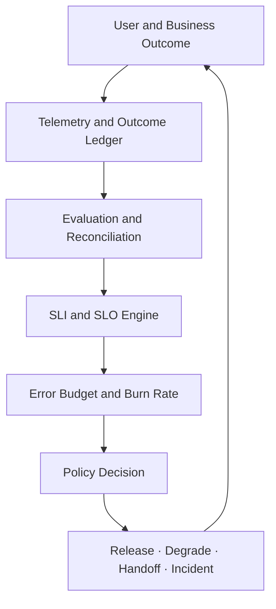
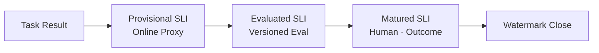
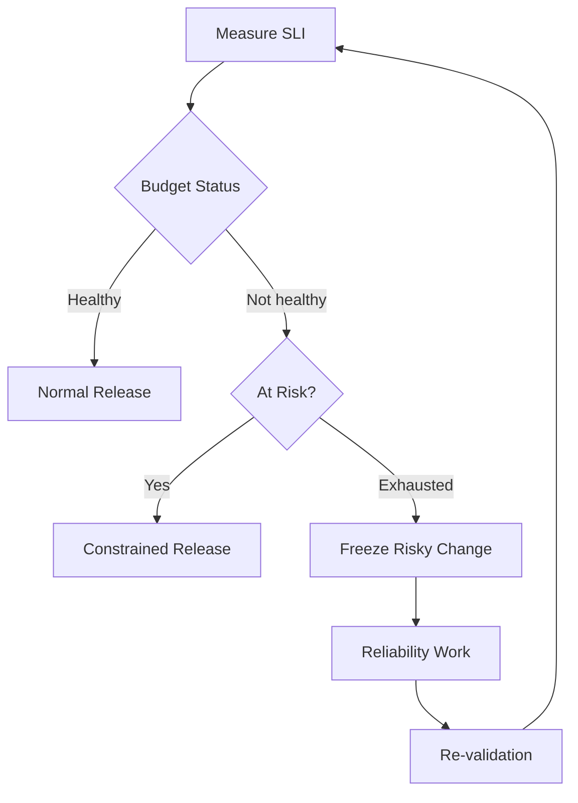

# Agentic AI SRE 설계: 성공률·정확성·지연·비용·Side Effect를 SLO와 Error Budget으로 운영하는 법

AI Agent 운영에서 HTTP 200은 성공을 뜻하지 않습니다. 응답은 돌아왔지만 업무가 틀렸거나 부작용이 어긋났을 수 있어서 가용성 지표만으로는 장애가 보이지 않습니다. 이 글은 Task 성공률과 품질, Side Effect 무결성, 지연, 비용, Human Handoff를 SLI·SLO와 Error Budget으로 정의하고 Burn Rate 경보와 배포·기능 축소 정책으로 잇는 Agentic AI SRE 설계를 정리합니다.

<blockquote id="aiarchitect-toc" data-ke-style="box" style="background-color: #f6f9fc; color: #263746; font-family: Pretendard-Regular, AppleSDGothicNeo-Regular, sans-serif; font-weight: 400;" data-mce-style="background-color: #f6f9fc; color: #263746; font-family: Pretendard-Regular, AppleSDGothicNeo-Regular, sans-serif; font-weight: 400;">
<p style="color: #263746; font-weight: 700;" data-mce-style="color: #263746; font-weight: 700;"><b>목차</b></p>
<ol style="list-style-type: decimal; color: #555555; font-weight: 400;" data-mce-style="list-style-type: decimal; color: #555555; font-weight: 400;" data-ke-list-type="decimal">
<li style="color: #555555; font-weight: 400;" data-mce-style="color: #555555; font-weight: 400;"><a href="#ai-section-1">Agentic AI SRE는 HTTP 가용성보다 넓다</a></li>
<li style="color: #555555; font-weight: 400;" data-mce-style="color: #555555; font-weight: 400;"><a href="#ai-section-2">SLI·SLO·SLA·Invariant·Gate를 구분한다</a></li>
<li style="color: #555555; font-weight: 400;" data-mce-style="color: #555555; font-weight: 400;"><a href="#ai-section-3">관측·평가·사고 대응을 하나의 운영 Loop로 연결한다</a></li>
<li style="color: #555555; font-weight: 400;" data-mce-style="color: #555555; font-weight: 400;"><a href="#ai-section-4">서비스 경계를 End-to-End 업무 결과로 정한다</a></li>
<li style="color: #555555; font-weight: 400;" data-mce-style="color: #555555; font-weight: 400;"><a href="#ai-section-5">Task Class와 위험 등급별로 목표를 나눈다</a></li>
<li style="color: #555555; font-weight: 400;" data-mce-style="color: #555555; font-weight: 400;"><a href="#ai-section-6">Good Event 계약을 먼저 정의한다</a></li>
<li style="color: #555555; font-weight: 400;" data-mce-style="color: #555555; font-weight: 400;"><a href="#ai-section-7">분모·제외·Unknown 정책을 고정한다</a></li>
<li style="color: #555555; font-weight: 400;" data-mce-style="color: #555555; font-weight: 400;"><a href="#ai-section-8">SLI를 여섯 가지 신뢰성 축으로 나눈다</a></li>
<li style="color: #555555; font-weight: 400;" data-mce-style="color: #555555; font-weight: 400;"><a href="#ai-section-9">Task Success는 Terminal 상태와 다르다</a></li>
<li style="color: #555555; font-weight: 400;" data-mce-style="color: #555555; font-weight: 400;"><a href="#ai-section-10">품질 SLI는 지연된 Evidence와 불확실성을 가진다</a></li>
<li style="color: #555555; font-weight: 400;" data-mce-style="color: #555555; font-weight: 400;"><a href="#ai-section-11">Side Effect 무결성은 평균 점수로 상쇄하지 않는다</a></li>
<li style="color: #555555; font-weight: 400;" data-mce-style="color: #555555; font-weight: 400;"><a href="#ai-section-12">동기 응답과 장기 Task의 지연을 분리한다</a></li>
<li style="color: #555555; font-weight: 400;" data-mce-style="color: #555555; font-weight: 400;"><a href="#ai-section-13">비용은 성공한 업무 결과당 계산한다</a></li>
<li style="color: #555555; font-weight: 400;" data-mce-style="color: #555555; font-weight: 400;"><a href="#ai-section-14">Human Handoff를 실패와 안전 성공으로 구분한다</a></li>
<li style="color: #555555; font-weight: 400;" data-mce-style="color: #555555; font-weight: 400;"><a href="#ai-section-15">전체 평균보다 Slice SLO를 먼저 본다</a></li>
<li style="color: #555555; font-weight: 400;" data-mce-style="color: #555555; font-weight: 400;"><a href="#ai-section-16">의존 서비스 SLO와 Agent 결과 SLO를 분리한다</a></li>
<li style="color: #555555; font-weight: 400;" data-mce-style="color: #555555; font-weight: 400;"><a href="#ai-section-17">SLO 문서를 실행 가능한 계약으로 만든다</a></li>
<li style="color: #555555; font-weight: 400;" data-mce-style="color: #555555; font-weight: 400;"><a href="#ai-section-18">목표값은 기준선·위험·비용에서 정한다</a></li>
<li style="color: #555555; font-weight: 400;" data-mce-style="color: #555555; font-weight: 400;"><a href="#ai-section-19">측정 Window와 Evidence 성숙 시점을 구분한다</a></li>
<li style="color: #555555; font-weight: 400;" data-mce-style="color: #555555; font-weight: 400;"><a href="#ai-section-20">Error Budget을 한 개의 종합 점수로 만들지 않는다</a></li>
<li style="color: #555555; font-weight: 400;" data-mce-style="color: #555555; font-weight: 400;"><a href="#ai-section-21">Burn Rate로 빠른 소진과 느린 악화를 찾는다</a></li>
<li style="color: #555555; font-weight: 400;" data-mce-style="color: #555555; font-weight: 400;"><a href="#ai-section-22">SLO Dashboard와 원인 진단 Dashboard를 나눈다</a></li>
<li style="color: #555555; font-weight: 400;" data-mce-style="color: #555555; font-weight: 400;"><a href="#ai-section-23">Error Budget Policy를 배포와 우선순위에 연결한다</a></li>
<li style="color: #555555; font-weight: 400;" data-mce-style="color: #555555; font-weight: 400;"><a href="#ai-section-24">기능 축소는 안전한 상태 머신으로 운영한다</a></li>
<li style="color: #555555; font-weight: 400;" data-mce-style="color: #555555; font-weight: 400;"><a href="#ai-section-25">Release·Canary·Configuration 변경을 Budget과 연결한다</a></li>
<li style="color: #555555; font-weight: 400;" data-mce-style="color: #555555; font-weight: 400;"><a href="#ai-section-26">합성 운영 사례로 SRE Loop를 검증한다</a></li>
<li style="color: #555555; font-weight: 400;" data-mce-style="color: #555555; font-weight: 400;"><a href="#ai-section-27">단계적으로 구현하고 반복 보정한다</a></li>
<li style="color: #555555; font-weight: 400;" data-mce-style="color: #555555; font-weight: 400;"><a href="#ai-section-28">운영 체크리스트와 마무리</a></li>
<li style="color: #555555; font-weight: 400;" data-mce-style="color: #555555; font-weight: 400;"><a href="#ai-section-29">공식 참고자료</a></li>
</ol>
</blockquote>

회의 요약 Agent의 API 가용성은 `99.99%`입니다. 그런데 사용자는 결과를 신뢰하지 않습니다.

```text
HTTP 200 응답은 빠르게 돌아온다.
그러나 필요한 회의를 찾지 못하는 경우가 늘었다.
요약은 생성됐지만 결정 사항 일부가 누락된다.
Ticket Draft가 중복 생성돼 사람이 정리한다.
실패 Retry가 늘어 성공한 한 건의 비용이 세 배가 됐다.
어려운 요청은 Human에게 넘기지 않고 그럴듯한 답을 만든다.
```

인프라 Dashboard만 보면 정상이고, 업무 결과를 보면 신뢰성 장애입니다.

Agentic AI SRE의 목표는 Agent를 항상 응답하게 만드는 것이 아닙니다. **사용자가 의도한 업무가 허용된 권한과 비용 안에서 정확하고 제때 완료되며, 확신할 수 없을 때 안전하게 멈추거나 사람에게 넘겨지는 상태를 측정하고 운영하는 것**입니다.

이 글은 [AI 프로젝트 성공 기준](https://aiarchitect.tistory.com/20), [AI Agent 관측성](https://aiarchitect.tistory.com/72), [AI Agent 평가 아키텍처](https://aiarchitect.tistory.com/74), [AI Agent Control Plane](https://aiarchitect.tistory.com/76), [Enterprise Agent Router](https://aiarchitect.tistory.com/78), [Agent Contract Testing](https://aiarchitect.tistory.com/80), [Agentic AI Incident Response](https://aiarchitect.tistory.com/81)를 전제로 합니다. Metric 수집법이나 평가 Dataset 작성법을 반복하지 않고, **운영 Evidence를 SLI·SLO·Error Budget과 배포·기능 축소 결정으로 바꾸는 계약**에 집중합니다.

> 이 글의 조직, Agent, Tenant, Task, 수치, Threshold, 비용, 시간과 결과는 모두 교육용 합성 예시입니다. 특정 회사·고객·제품의 실제 SLO나 운영 데이터를 나타내지 않습니다. 실제 목표는 사용자 기대, 업무 위험, 법적·계약 요건, 기준선, 의존 서비스와 조직의 대응 능력을 확인해 합의해야 합니다.

## 1. Agentic AI SRE는 HTTP 가용성보다 넓다

전통적인 온라인 서비스의 대표 SLI는 가용성, 오류율과 지연입니다. Agent는 여기에 비결정적 추론, RAG, 여러 Tool, 장기 Task, Human Approval과 실제 업무 Side Effect를 더합니다.

```text
Agent Service Reliability
  = Request Availability
  + Task Completion
  + Outcome Quality
  + Authorization and Side-effect Integrity
  + Timeliness
  + Cost Sustainability
  + Safe Escalation and Recovery
```

Agent가 `COMPLETED`를 반환해도 잘못된 회의를 요약했다면 사용자 관점에서 실패입니다. 반대로 위험한 Write를 차단하고 Human Approval을 요청했다면 자동 완료는 아니지만 안전한 성공일 수 있습니다.

따라서 SRE 대상은 Model Endpoint 하나가 아니라 **사용자 의도에서 검증된 업무 결과까지의 End-to-End 서비스**입니다.

## 2. SLI·SLO·SLA·Invariant·Gate를 구분한다

비슷하게 쓰이는 용어를 섞으면 Dashboard는 있어도 운영 결정이 나오지 않습니다.

| 용어 | 의미 | Agent 예시 |
|---|---|---|
| SLI | 실제 서비스 수준을 나타내는 측정값 | 검증된 Task 성공 비율 |
| SLO | 일정 Window에서 달성할 목표 | 28일간 Read-only Task 성공률 99.0% 이상 |
| SLA | 목표 미달 시 결과까지 포함한 대외 약정 | 계약상 지원·보상·통지 조건 |
| Invariant | 한 건도 허용하지 않을 안전·무결성 조건 | Cross-tenant Write 0건 |
| Release Gate | 변경본을 배포할지 판정하는 사전 기준 | Critical Eval 실패 0건 |
| Alert | 운영자가 지금 또는 곧 행동해야 한다는 신호 | 1시간 Burn Rate 14배 초과 |

`99% 정확도`라는 한 줄은 불완전합니다. 무엇을 분모로 하고, 언제 정답을 알며, 어떤 Slice에 적용하고, 미달하면 누가 무엇을 하는지가 빠져 있기 때문입니다.

안전 Invariant는 Error Budget으로 거래하지 않습니다.

```text
허용되지 않은 Cross-tenant Write 1건
  ≠ 느린 응답 여러 건과 평균내어 통과
  → Incident + 해당 Capability 즉시 격리
```

## 3. 관측·평가·사고 대응을 하나의 운영 Loop로 연결한다

관측성은 신호를 만들고, 평가는 의미를 판정하며, SRE는 목표와 행동을 연결합니다. 사고 대응은 이미 피해가 발생했거나 임박했을 때 별도 절차를 실행합니다.



그림 1. 운영 Evidence를 SLO와 실행 정책으로 연결하는 Agentic AI SRE Loop

각 단계는 다른 질문에 답합니다.

| 단계 | 질문 |
|---|---|
| Telemetry | 어떤 실행이 있었는가? |
| Evaluation | 결과가 기준을 만족했는가? |
| SLI | 사용자 경험이 어느 수준인가? |
| SLO | 어느 수준을 지키기로 했는가? |
| Error Budget | 허용된 실패 여유를 얼마나 사용했는가? |
| Policy | 배포·확대·축소·중단 중 무엇을 할 것인가? |
| Incident | 실제 또는 임박한 피해를 어떻게 격리·복구할 것인가? |

SLO가 Incident Severity를 대신하거나, Offline Eval이 운영 SLI를 대신하지 않습니다.

## 4. 서비스 경계를 End-to-End 업무 결과로 정한다

먼저 사용자가 실제로 의존하는 경로를 그립니다.

```text
User Request
  → Gateway Acceptance
  → Agent Planning
  → RAG Retrieval
  → Model Inference
  → MCP Tool Read
  → A2A Specialist Task
  → Approval
  → Business Commit
  → Result Visible to User
```

Provider 호출 성공률만 측정하면 Retrieval 누락, Approval 정체, Commit 실패와 결과 표시 지연이 빠집니다. 반대로 모든 내부 Span을 하나의 SLO로 만들면 사용자가 느끼지 못한 내부 Retry까지 동일한 실패로 셉니다.

서비스 경계는 다음 세 가지로 나눕니다.

- **Request Boundary**: 요청을 수락하고 Task ID 또는 직접 응답을 돌려주는 지점
- **Outcome Boundary**: 사용자가 요구한 Artifact나 업무 상태가 검증되는 지점
- **Effect Boundary**: Downstream 업무 변경이 Commit·전달·보상되는 지점

긴 작업은 Request와 Outcome 사이가 수분 또는 수시간일 수 있습니다. 접수 가용성과 완료 신뢰성을 별도 SLI로 둬야 합니다.

## 5. Task Class와 위험 등급별로 목표를 나눈다

모든 Agent 요청에 같은 SLO를 적용하지 않습니다.

| Task Class | 예시 | 주된 위험 | 우선 SLI |
|---|---|---|---|
| Answer | 정책 질문 답변 | 근거 누락·환각 | Grounded Quality·Latency |
| Draft | 회의 요약·Ticket 초안 | 누락·중복 | Task Success·Quality·Cost |
| Read | 업무 상태 조회 | 권한 초과·오래된 결과 | Authorization·Freshness |
| Write | Ticket Commit·권한 변경 | 잘못된 Side Effect | Integrity·Approval·Idempotency |
| Long-running | 대량 문서 분석 | 정체·중복·부분 실패 | Completion·Freshness·Recovery |
| Multi-agent | 전문 Agent 위임 | 전파·Fan-out·계약 불일치 | End-to-End Success·Hop Budget |

위험 등급도 분리합니다.

```yaml
task_classes:
  meeting_summary_draft:
    risk: MEDIUM
    write_effect: DRAFT_ONLY
  ticket_commit:
    risk: HIGH
    write_effect: IRREVERSIBLE_AFTER_DELIVERY
  account_role_change:
    risk: CRITICAL
    write_effect: SECURITY_SENSITIVE
```

Read-only Answer의 일부 품질 실패와 보안 민감 Write의 권한 실패는 같은 오류 예산을 공유할 수 없습니다.

## 6. Good Event 계약을 먼저 정의한다

SLO 계산은 `good / valid` 형태가 많습니다. 어려운 부분은 수식이 아니라 Good Event의 의미입니다.

회의 요약 Draft의 Good Event 예시는 다음과 같습니다.

```yaml
good_event_contract:
  task_class: meeting_summary_draft
  version: 4
  valid_when:
    - request_accepted == true
    - synthetic_or_load_test == false
    - user_canceled_before_execution == false
  good_when:
    - terminal_state == COMPLETED
    - required_sections_present == true
    - source_citation_coverage >= 0.95
    - unsupported_claims == 0
    - duplicate_business_effects == 0
    - completion_latency_ms <= 120000
  evidence_maturity: 24h
```

`good_when`이 너무 많은 조건을 포함하면 어떤 축이 악화됐는지 알 수 없습니다. End-to-End Good Event와 함께 품질·지연·무결성 SLI를 별도로 유지합니다.

```text
End-to-End Good
  = Task Completed
  AND Quality Passed
  AND Side Effect Valid
  AND Within Deadline

하지만 운영 원인 분석은 각 조건의 SLI를 따로 본다.
```

계약 Version을 기록하지 않으면 조건 변경 전후의 추세를 같은 시계열로 잘못 비교합니다.

## 7. 분모·제외·Unknown 정책을 고정한다

실패율을 낮추는 가장 쉬운 잘못된 방법은 불편한 요청을 분모에서 빼는 것입니다.

다음 상태를 명시적으로 구분합니다.

```text
VALID_GOOD
VALID_BAD
VALID_UNKNOWN
EXCLUDED_USER_CANCEL
EXCLUDED_AUTHORIZED_TEST
INVALID_TELEMETRY
```

기본 원칙은 다음과 같습니다.

- 시스템이 수락한 뒤 실패한 Task는 분모에 포함합니다.
- Agent가 지원하지 않는 요청을 명확히 거절한 경우 Product 계약에 따라 별도 Class로 셉니다.
- 사용자 취소는 실행 전에 취소했는지, 시스템 지연 때문에 취소했는지 구분합니다.
- Evaluation이 아직 끝나지 않은 결과는 `GOOD`으로 가정하지 않습니다.
- Trace 누락이나 Ledger 불일치는 관측 불가능성 SLI를 소비합니다.
- Load Test·Red Team은 사전 등록된 식별자로만 제외합니다.

```yaml
denominator_policy:
  accepted_task: INCLUDE
  system_timeout: INCLUDE_BAD
  user_cancel_before_start: EXCLUDE
  user_cancel_after_slo_deadline: INCLUDE_BAD
  evaluation_pending: INCLUDE_UNKNOWN
  missing_outcome_evidence: INCLUDE_UNKNOWN
  registered_synthetic_test: EXCLUDE
```

Unknown을 조용히 제외하면 평가 Pipeline 장애가 품질 향상처럼 보입니다. `Evidence Coverage SLO`를 별도로 둡니다.

## 8. SLI를 여섯 가지 신뢰성 축으로 나눈다

Agent SLO를 하나의 Score로 시작하지 않습니다.

| 신뢰성 축 | 대표 SLI | 사용자 질문 |
|---|---|---|
| Availability·Completion | 수락률·완료율 | 요청을 맡기고 결과를 받을 수 있는가? |
| Quality·Correctness | 근거·정확성·완결성 | 결과를 믿고 사용할 수 있는가? |
| Safety·Integrity | 권한·Side Effect 위반 수 | 해서는 안 될 행동을 하지 않는가? |
| Timeliness·Freshness | p95 완료 시간·결과 최신성 | 필요한 때 결과가 준비되는가? |
| Cost·Efficiency | 성공 결과당 총비용 | 지속 가능한 비용으로 운영되는가? |
| Human Experience | Handoff 성공·재작업률 | 불확실할 때 안전하게 도움받는가? |

운영 Dashboard 상단에는 축별 상태를 나란히 놓습니다.

```text
Completion  GREEN
Quality     YELLOW
Integrity   GREEN
Timeliness  RED
Cost        YELLOW
Handoff     GREEN
```

다섯 개가 Green이라고 하나의 Red를 평균으로 숨기지 않습니다.

## 9. Task Success는 Terminal 상태와 다르다

A2A의 Task는 상태를 가진 작업 단위이고 `TASK_STATE_COMPLETED`, `TASK_STATE_FAILED`, `TASK_STATE_CANCELED`, `TASK_STATE_REJECTED` 같은 Terminal 상태를 가질 수 있습니다. 아래 예시의 `COMPLETED`는 내부 정규화 값이며, A2A 경계에서는 표준 Enum 원문과 Mapping Version을 함께 보존합니다. Protocol 상태는 업무 성공 판정의 전체가 아닙니다.

```text
A2A Task COMPLETED
  + Artifact Schema Valid
  + Required Evidence Present
  + Business Postcondition True
  + No Duplicate Side Effect
  = Verified Task Success
```

예를 들어 Specialist Agent가 빈 Artifact를 반환하고 `COMPLETED`로 끝났다면 Protocol 실행은 종료됐지만 업무는 실패입니다.

```json
{
  "task_id": "task-fixture-sre-042",
  "protocol_terminal_state": "COMPLETED",
  "artifact_count": 1,
  "contract_valid": true,
  "business_postcondition": false,
  "verified_outcome": "BAD",
  "reason": "REQUIRED_DECISION_ITEMS_MISSING"
}
```

Task Success SLI는 Agent Runtime이 아니라 Outcome Reconciler가 확정하는 것이 안전합니다.

## 10. 품질 SLI는 지연된 Evidence와 불확실성을 가진다

HTTP 오류는 즉시 알 수 있지만 요약의 정확성은 Reviewer, 후속 업무 결과나 지연된 Label이 필요할 수 있습니다.

품질 Evidence를 세 층으로 나눕니다.

```text
T0 — Online Proxy
  Schema, Citation Coverage, Policy, Deterministic Invariant

T+1h — Automated Evaluation
  Versioned Grader, Retrieval·Answer·Trajectory Evaluation

T+24h — Matured Outcome
  Human Review, User Correction, Business Reconciliation
```



그림 2. 즉시 신호에서 성숙한 품질 Evidence로 진행하는 SLI 확정 흐름

Online Proxy가 좋아졌다고 최종 정확성이 좋아졌다고 단정하지 않습니다. Grader 변경도 품질 변화와 분리합니다.

```yaml
quality_sli:
  provisional:
    value: 0.982
    coverage: 1.0
  evaluated:
    value: 0.947
    coverage: 0.91
    grader_version: grader-fixture-7
  matured:
    value: 0.938
    coverage: 0.73
    watermark: 2026-08-11T00:00:00Z
```

불확실성이 큰 SLI는 값과 함께 Coverage·표본 수·Confidence Interval·Evidence Version을 보여줍니다.

## 11. Side Effect 무결성은 평균 점수로 상쇄하지 않는다

업무 변경 Agent의 핵심 신뢰성은 답변 문체보다 Side Effect입니다.

```text
Unauthorized Effect Count     = 0
Cross-tenant Effect Count     = 0
Duplicate Commit Count        = 0
Commit without Approval Count = 0
Canceled Task New Write Count = 0
```

이 항목은 목표가 `99.9%`라는 이유로 임의의 위반 여유를 주지 않습니다. 조직이 위험 평가를 통해 허용한 업무 실패와 금지된 보안·안전 위반을 구분합니다.

| 결과 | 처리 |
|---|---|
| 일시적 조회 실패 | Availability Budget 소비 |
| 승인된 Draft 생성 실패 | Completion Budget 소비 |
| 승인 없는 Commit 시도 차단 | Near Miss·통제 검증 |
| 승인 없는 Commit 성공 | Invariant 위반·Incident |
| 중복 Commit 자동 보상 완료 | Integrity 실패·영향 평가 |

Side Effect Ledger와 Audit Evidence가 없으면 무결성 SLI를 계산할 수 없습니다. `0건`이라는 Query 결과와 Evidence 완결성은 같은 말이 아닙니다.

## 12. 동기 응답과 장기 Task의 지연을 분리한다

Agent 지연은 한 숫자로 표현하기 어렵습니다.

```text
Time to Accept
Time to First Meaningful Progress
Queue Wait
Active Execution
Human Approval Wait
Time to Terminal State
Time to Verified Outcome
Time to Business Visibility
```

Human Approval 대기를 Agent 계산 지연과 섞으면 잘못된 최적화를 유도합니다. 반대로 사용자가 기다리는 전체 시간을 숨겨서도 안 됩니다.

```yaml
latency_slos:
  request_acceptance:
    target: "99.9% <= 2s"
  first_progress:
    target: "95% <= 5s"
  automated_execution:
    target: "95% <= 90s"
  end_to_end_with_approval:
    target: "95% <= 4h"
  outcome_visibility_after_commit:
    target: "99% <= 30s"
```

수치는 합성 예시입니다. p95 하나만 보지 않고 Deadline 초과율과 완료 분포를 함께 봅니다.

## 13. 비용은 성공한 업무 결과당 계산한다

요청당 Token 비용은 Retry·RAG·Tool·Remote Agent·관측·Human Review를 반영하지 못합니다.

```text
Cost per Verified Outcome
  = Model Inference
  + Embedding and Retrieval
  + MCP and A2A Calls
  + Retry and Fallback
  + Storage and Telemetry
  + Allocated Human Review
  + Compensation Cost
  ------------------------------------------------
  Verified Successful Outcomes
```

실패한 요청의 비용도 분자에 남겨야 합니다. 그래야 성공률 하락과 Retry 폭주가 단위 비용에 드러납니다.

```json
{
  "window": "2026-08-11",
  "task_class": "meeting_summary_draft",
  "accepted_tasks": 1200,
  "verified_successes": 1080,
  "total_cost_fixture_usd": 324.00,
  "cost_per_accepted_task": 0.27,
  "cost_per_verified_success": 0.30,
  "retry_cost_ratio": 0.12
}
```

가격표 변경, 환율과 공용 인프라 배부 기준은 Version으로 기록합니다. 품질을 낮춰 비용 SLO만 맞추는 변경은 허용하지 않습니다.

## 14. Human Handoff를 실패와 안전 성공으로 구분한다

Human에게 넘겼다는 사실만으로 성공이나 실패를 정하지 않습니다.

| Handoff 상황 | 판정 예시 |
|---|---|
| 정책상 고위험 Write 승인이 필요 | 예상된 안전 경로 |
| 낮은 Confidence를 감지하고 근거와 함께 이관 | 안전 성공 |
| Agent 장애 때문에 모든 요청을 사람에게 전가 | 자동화 신뢰성 실패 |
| 사람이 다시 처음부터 조사해야 함 | Handoff 품질 실패 |
| Human Queue가 SLO를 넘어 방치됨 | End-to-End 지연 실패 |
| 위험 요청을 이관하지 않고 자동 실행 | 안전 Invariant 위반 |

Handoff SLI 예시는 다음과 같습니다.

```text
Appropriate Handoff Rate
Handoff Acceptance Latency
Context Package Completeness
Human Rework Rate
Automation Escape Rate
User Abandonment after Handoff
```

자동화율을 무조건 높이면 위험한 자동 완료가 증가할 수 있습니다. Human Handoff는 제거 대상이 아니라 위험에 맞게 설계할 서비스 경로입니다.

## 15. 전체 평균보다 Slice SLO를 먼저 본다

전체 성공률 `99%`는 중요한 사용자 집단의 실패를 숨길 수 있습니다.

필수 Slice 예시는 다음과 같습니다.

- Tenant·Data Zone
- Task Class·Risk Tier
- Agent·Prompt·Model Version
- Language·Document Type
- Tool·Remote Agent·Provider
- 신규 사용자·반복 사용자
- 동기·비동기·Human Approval 경로
- 정상·Fallback·Degraded Mode

```text
Overall Success       99.1%
Korean Meeting Draft  99.4%
English Long Meeting  91.8%  ← 전체 평균이 숨긴 실패
High-risk Write       98.9%
Read-only Query       99.8%
```

Metric Label에 사용자 ID나 무제한 Prompt 값을 넣지 않습니다. 승인된 낮은 Cardinality Slice와 보호된 분석 Dataset을 사용합니다.

표본이 작은 Slice는 단기 변동성이 큽니다. 최소 표본, Confidence Interval과 장기 Window를 함께 사용하되 심각한 Invariant 위반은 표본이 작다는 이유로 무시하지 않습니다.

## 16. 의존 서비스 SLO와 Agent 결과 SLO를 분리한다

Model, Vector DB, MCP Server와 Remote Agent가 모두 자체 SLO를 지켜도 End-to-End Agent SLO가 깨질 수 있습니다.

```text
Model 99.9%
Retrieval 99.9%
MCP Tool 99.9%
Remote Agent 99.9%

각 호출이 독립이고 모두 한 번씩 필요하다고 단순 가정해도
End-to-End는 개별 수치보다 낮아진다.

실제 Agent는 Retry·분기·Fan-out·공통 장애가 있어 단순 곱셈도 정확하지 않다.
```

의존성은 세 종류로 분류합니다.

| 의존성 | 실패 시 경로 | SRE 정책 |
|---|---|---|
| Hard | 결과를 만들 수 없음 | 강한 SLO·Fallback·Capacity 계약 |
| Soft | 낮은 품질로 계속 가능 | Degraded Mode·품질 표시 |
| Optional | 부가 기능만 손실 | 기능 생략·사용자 고지 |

Provider 원인이라는 사실이 사용자 영향 SLI를 지우지 않습니다. **Budget 소비와 원인 귀속을 분리**합니다. 다만 변경 동결과 개선 Action은 실제 통제 가능한 범위에 맞게 적용합니다.

## 17. SLO 문서를 실행 가능한 계약으로 만든다

SLO 문서에는 숫자뿐 아니라 계산과 행동이 있어야 합니다.

```yaml
slo:
  id: slo-fixture-meeting-draft-quality-v3
  service: agent-fixture-meeting
  task_class: meeting_summary_draft
  owner: team-fixture-agent-platform
  business_owner: team-fixture-operations
  sli:
    numerator: verified_good_outcomes
    denominator: valid_accepted_tasks
    unknown_policy: count_separately_and_fail_coverage_slo
  objective:
    target: 0.97
    window: rolling_28d
  slices:
    - language
    - document_size_class
    - agent_version
  evidence:
    maturity: 24h
    grader_version: grader-fixture-7
    ledger_watermark_required: true
  policy_ref: policy-fixture-error-budget-v2
  approved_by:
    - business-owner-fixture
    - sre-owner-fixture
    - risk-owner-fixture
  review_at: 2026-09-30
```

반드시 포함할 항목은 다음과 같습니다.

- 사용자와 서비스 경계
- SLI 계산식과 Data Source
- Good·Bad·Unknown·Excluded 정의
- Target·Window·Slice
- Evidence 지연과 수정 정책
- Owner·승인자·Review Date
- Error Budget Policy와 예외 승인
- Dashboard·Alert·Runbook 링크

문서와 실제 Query가 다르면 Query Version과 결과 Digest를 감사할 수 있어야 합니다.

## 18. 목표값은 기준선·위험·비용에서 정한다

`99.9%`를 관습적으로 선택하지 않습니다.

목표값 결정 순서는 다음과 같습니다.

```text
1. 사용자가 완료로 인식하는 결과를 정의한다.
2. 현재 기준선과 Slice 분포를 측정한다.
3. 실패 영향과 복구 가능성을 분류한다.
4. 의존 서비스와 운영 대응 능력을 확인한다.
5. 더 높은 목표의 비용과 Toil을 계산한다.
6. 내부 SLO와 대외 기대 사이 Safety Margin을 둔다.
7. 미달 시 실행할 정책을 함께 승인한다.
```

현재 성능이 `97.3%`라고 목표를 그대로 `97.3%`로 복사하지 않습니다. 반대로 측정 근거 없이 `99.99%`를 약속하지 않습니다.

고위험 Write는 높은 평균 성공률보다 Invariant, Approval과 Reconciliation이 중요할 수 있습니다. Read-only Answer는 품질·지연·가용성의 균형이 중요합니다.

## 19. 측정 Window와 Evidence 성숙 시점을 구분한다

SLO Window는 Calendar Month, Rolling 28 days, 최근 7일 등으로 정할 수 있습니다. Agent 품질에는 Evidence가 늦게 도착하므로 Window 종료와 판정 종료가 다를 수 있습니다.

```text
Event Window End        2026-08-11 23:59
Evaluation Watermark   2026-08-12 03:00
Human Label Cutoff     2026-08-12 23:59
Final SLO Publication  2026-08-13 01:00
```

운영 중에는 Provisional Burn Rate로 빠르게 대응하고, 성숙한 Evidence로 최종 Budget을 조정합니다. 과거 값 수정은 덮어쓰지 않고 Revision으로 남깁니다.

```json
{
  "slo_window": "2026-08-11",
  "revision": 2,
  "status": "FINAL",
  "watermark": "2026-08-12T23:59:00Z",
  "good": 1042,
  "bad": 31,
  "unknown": 7,
  "previous_revision": 1,
  "adjustment_reason": "MATURED_HUMAN_LABELS"
}
```

Clock Skew, 늦은 Queue Event와 중복 전달도 Watermark 정책에 포함합니다.

## 20. Error Budget을 한 개의 종합 점수로 만들지 않는다

SLO가 `99%`라면 허용 실패 비율은 `1%`입니다. 하지만 Agent의 여러 축을 가중 평균한 하나의 Budget으로 만들면 위험한 상쇄가 발생합니다.

```text
Completion Budget  : 1.0%
Quality Budget     : 3.0%
Latency Budget     : 5.0%
Evidence Gap Budget: 0.5%

Safety Invariant   : 예산 없음, 위반 0건
```

각 Budget은 다른 행동을 촉발합니다.

| Budget | 주된 개선 행동 |
|---|---|
| Completion | Queue·Dependency·Workflow 안정화 |
| Quality | Retrieval·Prompt·Model·Evaluation 회귀 수정 |
| Latency | Critical Path·Capacity·Deadline 개선 |
| Cost | Retry·Fan-out·Model Tier·Cache 최적화 |
| Handoff | Context Package·Staffing·Escalation 개선 |
| Evidence | Telemetry·Ledger·Evaluation Pipeline 복구 |

Cost는 일반적인 `good/bad` 비율보다 상한·분포·단위 비용 Budget이 적합할 수 있습니다. 모든 것을 `1 - SLO` 수식에 억지로 넣지 않습니다.

## 21. Burn Rate로 빠른 소진과 느린 악화를 찾는다

Burn Rate는 현재 실패 비율이 허용 실패 비율을 몇 배 속도로 소비하는지 보여줍니다.

```text
Burn Rate
  = Observed Bad Fraction
    ---------------------
      Allowed Bad Fraction

SLO 99% → Allowed Bad = 1%
최근 실패 5% → Burn Rate = 5x
```

짧은 Window 하나는 순간 Noise에 민감하고 긴 Window 하나는 급격한 장애를 늦게 찾습니다. 빠른 Page와 느린 Ticket을 분리합니다.

```yaml
burn_rate_policy_fixture:
  page_fast:
    long_window: 1h
    short_window: 5m
    threshold: 14.0
  page_sustained:
    long_window: 6h
    short_window: 30m
    threshold: 6.0
  ticket_slow:
    long_window: 3d
    threshold: 1.0
```

수치와 Window는 교육용 예시입니다. 실제 값은 SLO Window, Page 허용 빈도, 데이터 지연과 대응 시간을 기준으로 정합니다.

품질 SLI가 24시간 늦게 확정된다면 같은 방식의 즉시 Page가 부적합할 수 있습니다. Online Proxy로 조기 경보하고 성숙 품질 Budget으로 Release Policy를 조정합니다.

## 22. SLO Dashboard와 원인 진단 Dashboard를 나눈다

SLO Dashboard는 “사용자가 영향을 받는가”에 답하고, 진단 Dashboard는 “왜 그런가”에 답합니다.

### SLO Dashboard

- 축별 SLI와 목표
- Remaining Error Budget
- Multi-window Burn Rate
- 주요 Slice 상태
- Evidence Coverage와 Watermark
- 현재 Release·Degraded Mode

### 진단 Dashboard

- Agent·Model·Prompt·Tool Version
- Retrieval Hit·Citation·Freshness
- A2A Task 상태·Hop·Fan-out
- MCP Tool 오류·지연·Retry
- Queue·Concurrency·Capacity
- Provider·Region·Tenant 분포
- 최근 Deployment·Policy·Data 변경

OpenTelemetry의 GenAI 규약은 `invoke_agent`, `execute_tool`, Model Operation과 Token·Duration 같은 공통 신호를 정의하는 방향을 제공합니다. 그러나 규약의 일부는 발전 중이므로 Version을 고정하고, 업무 Outcome·Cost Allocation·Side Effect SLI는 조직의 명시적 계약으로 추가합니다.

Metric Label에 Prompt 원문, 사용자 ID, Task ID를 넣지 않습니다. 개별 실행 조사는 Trace와 보호된 Evidence Store로 Drill-down합니다.

## 23. Error Budget Policy를 배포와 우선순위에 연결한다

Error Budget은 팀을 처벌하는 점수가 아닙니다. 신뢰성 작업과 기능 변경 사이의 우선순위를 데이터로 결정하는 정책입니다.



그림 3. Error Budget 상태를 변경 정책과 안정화 작업으로 연결하는 흐름

정책 예시는 다음과 같습니다.

```yaml
error_budget_policy:
  healthy:
    releases: NORMAL
    canary_expansion: ALLOWED
  at_risk:
    releases: LOW_RISK_ONLY
    canary_expansion: HOLD
    required_actions:
      - review_top_budget_consumers
      - protect_fragile_slices
  exhausted:
    releases: FREEZE_RELATED_RISKY_CHANGES
    allowed_exceptions:
      - security_fix
      - reliability_fix
      - approved_incident_recovery
    required_actions:
      - owner_review
      - corrective_work
      - regression_and_canary_revalidation
```

외부 Provider 장애가 Budget을 소진해도 사용자 영향은 기록합니다. 다만 내부 Prompt 변경까지 무조건 동결할지, Fallback 안정화만 우선할지는 원인·변경 위험·통제 가능성에 따라 Policy가 정합니다.

## 24. 기능 축소는 안전한 상태 머신으로 운영한다

신뢰성이 나빠졌을 때 전체 중단만 선택하면 가용성을 불필요하게 잃습니다. 그렇다고 낮은 품질의 결과를 정상처럼 제공해서도 안 됩니다.

```text
NORMAL
  → CONSTRAINED
  → DEGRADED_READ_ONLY
  → HUMAN_HANDOFF
  → PAUSED
```

| Mode | 허용 예시 | 금지 예시 |
|---|---|---|
| NORMAL | 전체 승인 기능 | 없음 |
| CONSTRAINED | Fan-out 축소·검증된 Model만 사용 | 실험 Version 확대 |
| DEGRADED_READ_ONLY | 검색·조회·근거 표시 | Write·외부 발송 |
| HUMAN_HANDOFF | Evidence Package와 승인 요청 | 불완전한 자동 Commit |
| PAUSED | 상태·복구 예상 안내 | 신규 Task 수락 |

기능 축소 시에도 다음은 낮추지 않습니다.

- Tenant 격리
- 인증·인가
- 승인 요구
- Audit·Side Effect Ledger
- 개인정보·Secret 보호
- 취소·철회·Kill Switch

Mode 전환은 Control Plane의 Versioned Policy로 집행하고, 사용자에게 결과 제한과 필요한 행동을 명확히 알립니다.

## 25. Release·Canary·Configuration 변경을 Budget과 연결한다

Agent 동작은 Code뿐 아니라 Model, Prompt, Tool Schema, Retrieval Index, Policy, Agent Card와 Router Weight 변경으로 달라집니다.

```yaml
change_event:
  change_id: change-fixture-20260812-017
  changed_at: 2026-08-12T02:00:00Z
  dimensions:
    agent_version: 4.2.0
    prompt_bundle: prompt-fixture-31
    model_route_policy: route-fixture-9
    retrieval_index: index-fixture-20260812
    tool_contract: tool-contract-fixture-6
  canary:
    traffic_percent: 5
    tenant_scope: synthetic-fixture
```

Canary는 평균 오류율뿐 아니라 다음을 봅니다.

- Critical Invariant 위반 0건
- Completion·Quality·Latency Burn Rate
- Evidence Coverage
- Cost per Verified Outcome
- Handoff·User Correction 증가
- 취약 Slice Regression

Budget이 부족하면 신규 기능이 아니라 신뢰성 수정만 Canary에 허용할 수 있습니다. Rollback은 Code만 되돌리는 것이 아니라 Prompt·Model Route·Index·Policy·Schema의 호환 상태를 함께 복원해야 합니다.

## 26. 합성 운영 사례로 SRE Loop를 검증한다

### 시작 상태

회의 요약 Agent `4.2.0`이 전체 Traffic의 10% Canary로 배포됩니다.

```yaml
baseline:
  completion_sli: 0.992
  matured_quality_sli: 0.971
  p95_completion_ms: 72000
  cost_per_verified_success_fixture_usd: 0.28
  duplicate_effects: 0
```

### 초기 신호

새 Version은 더 긴 Context를 사용해 Citation Coverage는 높아졌지만, 대형 회의에서 Model Timeout과 Retry가 증가합니다.

```text
T+10m Completion Burn Rate 2.1x
T+20m Latency Burn Rate 7.2x
T+25m Cost per Verified Outcome +38%
T+40m English Long Meeting Slice Completion 91.5%
T+2h  Provisional Quality unchanged
```

전체 성공률만 보면 큰 변화가 없지만 Slice·Latency·Cost SLO는 악화됐습니다.

### 정책 실행

```text
1. Canary 확대 HOLD
2. Long Meeting을 기존 Agent Version으로 Route
3. 신규 Version의 Fan-out을 2로 제한
4. Retry Budget을 1회로 축소
5. Write Capability는 계속 비활성
6. 대형 회의 합성 Dataset으로 재평가
```

### 성숙 Evidence

24시간 뒤 Human Label이 반영됩니다.

```yaml
matured_result:
  completion_sli: 0.984
  quality_sli: 0.978
  p95_completion_ms: 118000
  cost_per_verified_success_fixture_usd: 0.39
  evidence_coverage: 0.94
  unauthorized_effects: 0
```

품질은 좋아졌지만 완료·지연·비용 목표를 동시에 만족하지 못합니다. 팀은 전면 Rollback 대신 Long Meeting 전용 Context Compression을 수정하고, Read-only Synthetic Tenant에서 다시 Canary합니다.

이 사례의 핵심은 “새 Version이 더 좋은가”라는 한 문장이 아니라 **어떤 사용자·업무 축에서 어느 Budget을 소비하며 어떤 Mode와 변경 정책을 실행할 것인가**입니다.

## 27. 단계적으로 구현하고 반복 보정한다

### 1단계: 서비스 경계와 Good Event

- 핵심 Task Class 1~2개 선택
- Request·Outcome·Effect Boundary 정의
- Good·Bad·Unknown·Excluded 계약
- Outcome Ledger와 Owner 지정

### 2단계: 기본 SLI와 Slice

- Completion·Latency·Integrity SLI
- Agent·Task Class·Version Slice
- Evidence Coverage
- 기준선과 데이터 품질 확인

### 3단계: 품질·비용 성숙 Evidence

- Versioned Evaluation 연결
- Human·Business Outcome Watermark
- Cost per Verified Outcome
- Revision 가능한 SLO 결과 저장

### 4단계: Error Budget과 정책 자동화

- Multi-window Burn Rate
- Page·Ticket·Log 분리
- Release Hold·Degraded Mode
- 예외 승인과 Audit

### 5단계: 다중 Agent와 의존성 계약

- A2A Task·MCP Tool·Provider별 기여도
- Critical Path·Fallback SLI
- Tenant·Risk Tier별 SLO
- Game Day와 Capacity·Recovery 검증

처음부터 모든 Agent에 수십 개 SLO를 만들면 Toil만 늘어납니다. 사용자 영향이 크고 행동이 명확한 SLI부터 시작합니다.

## 28. 운영 체크리스트와 마무리

### 서비스·계약

- [ ] Agent Service 경계가 Model 호출이 아니라 검증된 업무 결과까지 이어지는가?
- [ ] Task Class와 Risk Tier별 목표가 분리되는가?
- [ ] SLI·SLO·SLA·Invariant·Release Gate를 구분하는가?
- [ ] Good·Bad·Unknown·Excluded 조건과 Contract Version이 있는가?

### 측정·Evidence

- [ ] Terminal Task와 Verified Outcome을 구분하는가?
- [ ] 품질 SLI에 Grader Version·Coverage·Watermark가 있는가?
- [ ] Trace와 Side Effect Ledger를 대조하는가?
- [ ] 지연을 Acceptance·Queue·Execution·Approval·Outcome으로 나누는가?
- [ ] 비용을 성공한 업무 결과당 계산하는가?
- [ ] Metric Label에 Prompt·사용자·Task 고 Cardinality 값을 넣지 않는가?

### 목표·Budget

- [ ] 전체 평균과 함께 중요한 Tenant·Task·Language·Version Slice를 보는가?
- [ ] Safety·Authorization Invariant를 평균이나 Error Budget으로 상쇄하지 않는가?
- [ ] Completion·Quality·Latency·Evidence Budget을 구분하는가?
- [ ] 빠른·지속·느린 Burn Rate Window가 각각 행동과 연결되는가?
- [ ] 외부 의존성의 사용자 영향과 원인 귀속을 분리하는가?

### 운영 정책

- [ ] Budget 정상·위험·소진 상태별 Release Policy가 승인됐는가?
- [ ] Security·Reliability Fix 예외와 승인 경로가 있는가?
- [ ] NORMAL부터 PAUSED까지 기능 축소 상태 머신이 있는가?
- [ ] Degraded Mode에서도 권한·격리·감사·Ledger가 유지되는가?
- [ ] Code·Prompt·Model·Index·Policy 변경을 SLI와 상관분석할 수 있는가?
- [ ] SLO Owner·Business Owner·Risk Owner와 Review Date가 있는가?

Agentic AI SRE의 핵심 질문은 다음과 같습니다.

```text
사용자가 맡긴 업무가 실제로 완료됐는가?
결과를 믿고 사용할 수 있는가?
허용되지 않은 Side Effect가 없는가?
필요한 시간과 지속 가능한 비용 안에 끝났는가?
불확실할 때 안전하게 축소·이관·중단했는가?
실패 여유가 줄어들 때 배포와 우선순위가 실제로 바뀌는가?
```

이 질문에 Versioned Evidence로 답하고, 답이 나빠질 때 자동·Human 정책이 실행돼야 SLO가 운영 도구가 됩니다. 관측성이 신호를 만들고, 평가가 의미를 보강하며, SRE가 Error Budget으로 변경 속도와 신뢰성을 조정하고, Incident Response가 실제 피해를 격리합니다.

다음 글에서는 이 운영 목표를 지키기 위한 Runtime 패턴에 집중합니다. Model·RAG·MCP·A2A 장애가 Agent 전체로 전파되지 않도록 Deadline·Retry Budget·Backpressure·Load Shedding·Circuit Breaker·Fallback을 설계하는 **AI Agent Dependency Resilience**를 다룹니다.

## 29. 공식 참고자료

- Google SRE Book — Service Level Objectives: https://sre.google/sre-book/service-level-objectives/
- Google SRE Workbook — Implementing SLOs: https://sre.google/workbook/implementing-slos/
- Google SRE Workbook — Example Error Budget Policy: https://sre.google/workbook/error-budget-policy/
- Google SRE Workbook — Alerting on SLOs: https://sre.google/workbook/alerting-on-slos/
- Google SRE Workbook — Data Processing Pipelines: https://sre.google/workbook/data-processing/
- Google SRE Book — Production Services Best Practices: https://sre.google/sre-book/service-best-practices/
- Google SRE Book — Addressing Cascading Failures: https://sre.google/sre-book/addressing-cascading-failures/
- NIST AI Risk Management Framework 1.0 Core: https://airc.nist.gov/airmf-resources/airmf/5-sec-core/
- NIST AI RMF Playbook: https://airc.nist.gov/airmf-resources/playbook/
- NIST AI 600-1 — Generative Artificial Intelligence Profile: https://www.nist.gov/publications/artificial-intelligence-risk-management-framework-generative-artificial-intelligence
- A2A Protocol 1.0 Specification: https://a2a-protocol.org/latest/specification/
- OpenTelemetry GenAI Semantic Conventions: https://github.com/open-telemetry/semantic-conventions-genai
- OpenTelemetry GenAI Agent Spans: https://github.com/open-telemetry/semantic-conventions-genai/blob/main/docs/gen-ai/gen-ai-agent-spans.md

> 이 글은 2026년 8월 12일 기준 Google SRE, NIST AI RMF, A2A 1.0과 OpenTelemetry GenAI 공식 공개 자료를 바탕으로 작성했습니다. 모든 SLO, Threshold, 비용, Task, Tenant, Version과 시간은 교육용 Fixture이며 실제 운영값이 아닙니다. 실제 적용 시 사용자 기대, 업무 위험, 법적·계약 요구, 기준선, Provider 조건과 대응 인력을 확인하고 SLO·Error Budget Policy를 공동 승인해야 합니다.
