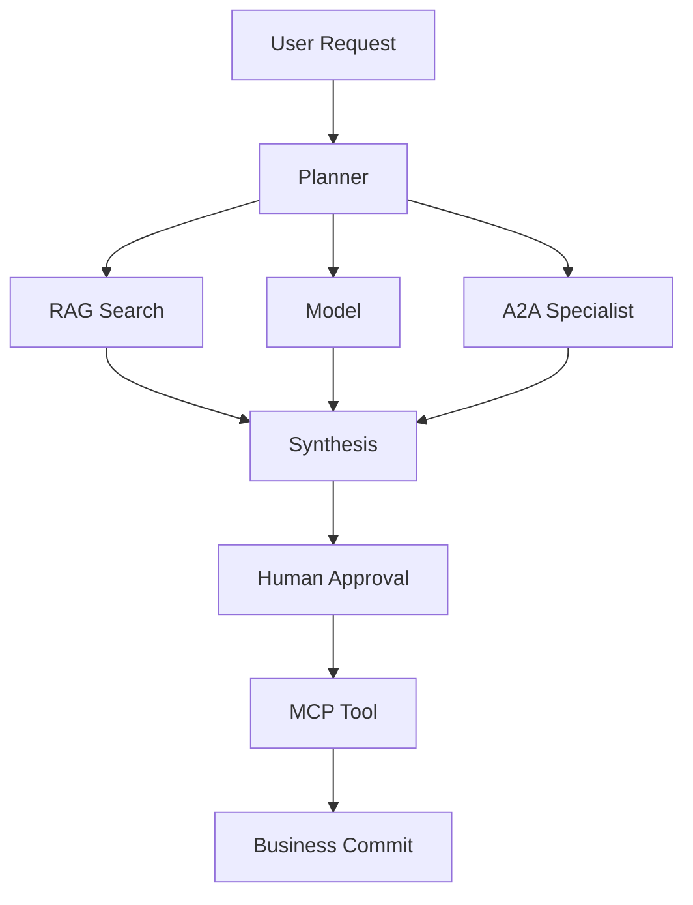
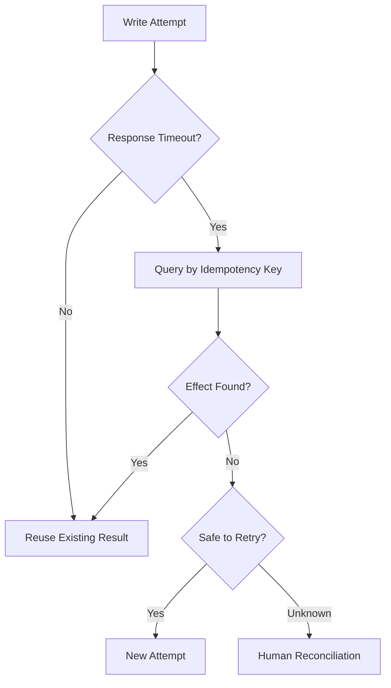
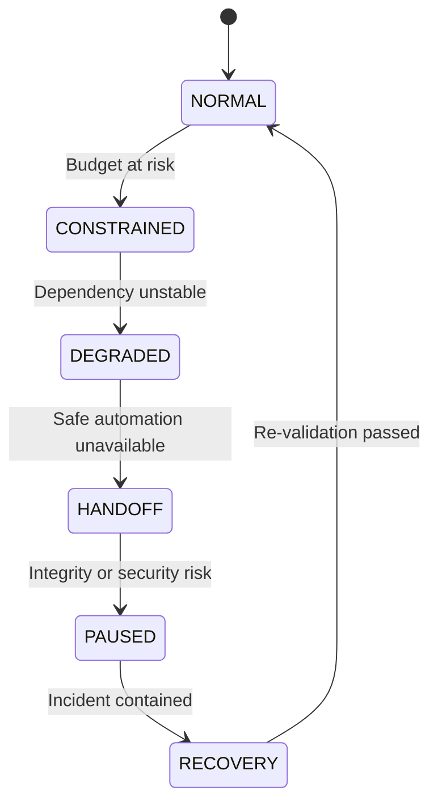

# AI Agent Dependency Resilience 설계: Model·RAG·MCP·A2A 장애 전파를 막는 법

AI Agent 한 번의 실행은 Model, RAG, MCP Tool, 다른 Agent를 함께 호출합니다. 그래서 한 곳의 지연이 재시도를 부르고 재시도가 다시 부하를 키우는 연쇄로 번집니다. 이 글은 Deadline과 Retry Budget, Backpressure, Bulkhead, 서킷 브레이커, Load Shedding과 Fallback으로 의존성 장애 전파를 끊는 설계를 정리합니다.

<blockquote id="aiarchitect-toc" data-ke-style="box" style="background-color: #f6f9fc; color: #263746; font-family: Pretendard-Regular, AppleSDGothicNeo-Regular, sans-serif; font-weight: 400;" data-mce-style="background-color: #f6f9fc; color: #263746; font-family: Pretendard-Regular, AppleSDGothicNeo-Regular, sans-serif; font-weight: 400;">
<p style="color: #263746; font-weight: 700;" data-mce-style="color: #263746; font-weight: 700;"><b>목차</b></p>
<ol style="list-style-type: decimal; color: #555555; font-weight: 400;" data-mce-style="list-style-type: decimal; color: #555555; font-weight: 400;" data-ke-list-type="decimal">
<li style="color: #555555; font-weight: 400;" data-mce-style="color: #555555; font-weight: 400;"><a href="#ai-section-1">Dependency Resilience는 호출별 기능이 아니라 Graph 문제다</a></li>
<li style="color: #555555; font-weight: 400;" data-mce-style="color: #555555; font-weight: 400;"><a href="#ai-section-2">단일 SDK 안정성과 Agent Runtime 안정성의 경계를 나눈다</a></li>
<li style="color: #555555; font-weight: 400;" data-mce-style="color: #555555; font-weight: 400;"><a href="#ai-section-3">Dependency Graph와 Critical Path를 먼저 그린다</a></li>
<li style="color: #555555; font-weight: 400;" data-mce-style="color: #555555; font-weight: 400;"><a href="#ai-section-4">의존성을 Hard·Soft·Write·Async로 분류한다</a></li>
<li style="color: #555555; font-weight: 400;" data-mce-style="color: #555555; font-weight: 400;"><a href="#ai-section-5">Root Run에 네 가지 공유 Budget을 둔다</a></li>
<li style="color: #555555; font-weight: 400;" data-mce-style="color: #555555; font-weight: 400;"><a href="#ai-section-6">하나의 Deadline을 모든 경계에 전파한다</a></li>
<li style="color: #555555; font-weight: 400;" data-mce-style="color: #555555; font-weight: 400;"><a href="#ai-section-7">Admission과 단계별 Reserve로 불가능한 작업을 일찍 거절한다</a></li>
<li style="color: #555555; font-weight: 400;" data-mce-style="color: #555555; font-weight: 400;"><a href="#ai-section-8">오류를 재시도 가능성보다 업무 의미로 분류한다</a></li>
<li style="color: #555555; font-weight: 400;" data-mce-style="color: #555555; font-weight: 400;"><a href="#ai-section-9">Retry를 성공 기능이 아니라 추가 부하로 계산한다</a></li>
<li style="color: #555555; font-weight: 400;" data-mce-style="color: #555555; font-weight: 400;"><a href="#ai-section-10">Backoff·Jitter·Retry-After를 남은 예산 안에서 사용한다</a></li>
<li style="color: #555555; font-weight: 400;" data-mce-style="color: #555555; font-weight: 400;"><a href="#ai-section-11">Timeout 이후 Side Effect 불명 상태를 조정한다</a></li>
<li style="color: #555555; font-weight: 400;" data-mce-style="color: #555555; font-weight: 400;"><a href="#ai-section-12">Queue와 Backpressure로 버릴 작업을 먼저 정한다</a></li>
<li style="color: #555555; font-weight: 400;" data-mce-style="color: #555555; font-weight: 400;"><a href="#ai-section-13">Bulkhead로 Tenant·Capability·Provider 자원을 격리한다</a></li>
<li style="color: #555555; font-weight: 400;" data-mce-style="color: #555555; font-weight: 400;"><a href="#ai-section-14">Circuit Breaker를 Dependency·Operation 단위로 운영한다</a></li>
<li style="color: #555555; font-weight: 400;" data-mce-style="color: #555555; font-weight: 400;"><a href="#ai-section-15">Load Shedding은 우선순위와 비용을 함께 본다</a></li>
<li style="color: #555555; font-weight: 400;" data-mce-style="color: #555555; font-weight: 400;"><a href="#ai-section-16">Graceful Degradation을 상태 머신으로 만든다</a></li>
<li style="color: #555555; font-weight: 400;" data-mce-style="color: #555555; font-weight: 400;"><a href="#ai-section-17">Model Fallback은 품질·정책·Context 계약을 유지한다</a></li>
<li style="color: #555555; font-weight: 400;" data-mce-style="color: #555555; font-weight: 400;"><a href="#ai-section-18">RAG Fallback은 근거 수준을 숨기지 않는다</a></li>
<li style="color: #555555; font-weight: 400;" data-mce-style="color: #555555; font-weight: 400;"><a href="#ai-section-19">MCP Tool 호출의 전송 실패와 Task 수명을 분리한다</a></li>
<li style="color: #555555; font-weight: 400;" data-mce-style="color: #555555; font-weight: 400;"><a href="#ai-section-20">A2A 장기 Task는 조회·구독·취소 후 조정한다</a></li>
<li style="color: #555555; font-weight: 400;" data-mce-style="color: #555555; font-weight: 400;"><a href="#ai-section-21">취소와 늦게 도착한 결과를 별도 상태로 처리한다</a></li>
<li style="color: #555555; font-weight: 400;" data-mce-style="color: #555555; font-weight: 400;"><a href="#ai-section-22">Fan-out·Hedging·Quorum이 장애를 증폭하지 않게 제한한다</a></li>
<li style="color: #555555; font-weight: 400;" data-mce-style="color: #555555; font-weight: 400;"><a href="#ai-section-23">Cache와 Stale 결과의 허용 범위를 계약한다</a></li>
<li style="color: #555555; font-weight: 400;" data-mce-style="color: #555555; font-weight: 400;"><a href="#ai-section-24">SLO와 Error Budget을 Runtime 정책에 연결한다</a></li>
<li style="color: #555555; font-weight: 400;" data-mce-style="color: #555555; font-weight: 400;"><a href="#ai-section-25">Logical Run·Attempt·Dependency를 하나의 Trace로 본다</a></li>
<li style="color: #555555; font-weight: 400;" data-mce-style="color: #555555; font-weight: 400;"><a href="#ai-section-26">장애 주입과 과부하 시험으로 축소 경로를 검증한다</a></li>
<li style="color: #555555; font-weight: 400;" data-mce-style="color: #555555; font-weight: 400;"><a href="#ai-section-27">합성 사례로 장애 전파 차단을 검증한다</a></li>
<li style="color: #555555; font-weight: 400;" data-mce-style="color: #555555; font-weight: 400;"><a href="#ai-section-28">단계적으로 구현하고 정책을 보정한다</a></li>
<li style="color: #555555; font-weight: 400;" data-mce-style="color: #555555; font-weight: 400;"><a href="#ai-section-29">운영 체크리스트와 마무리</a></li>
<li style="color: #555555; font-weight: 400;" data-mce-style="color: #555555; font-weight: 400;"><a href="#ai-section-30">공식 참고자료</a></li>
</ol>
</blockquote>

회의 분석 Agent가 요청 한 건을 처리합니다.

```text
RAG 검색이 느려진다.
Orchestrator가 같은 검색을 재시도한다.
두 Model Provider가 동시에 호출된다.
MCP Tool은 이미 Ticket Draft를 만들었지만 응답이 끊긴다.
Fallback Agent가 같은 Draft를 다시 만든다.
A2A Task는 사용자가 떠난 뒤에도 계속 실행된다.
Queue가 길어져 새 요청도 Deadline을 넘긴다.
```

처음에는 Retrieval 지연 하나였습니다. 몇 분 뒤에는 Retry Traffic, Model 비용, 중복 Side Effect와 Queue 정체가 결합된 전체 Agent 장애가 됩니다.

AI Agent는 하나의 API를 호출하는 Client가 아닙니다. Model·Vector Search·Reranker·MCP Tool·A2A Specialist·Approval·업무 API가 동적으로 연결되는 실행 Graph입니다. 각 Client에 Timeout과 Retry를 따로 넣는 것만으로는 이 Graph를 보호할 수 없습니다.

Agent Dependency Resilience의 목표는 모든 의존성 실패를 숨기는 것이 아닙니다. **사용자 요청 하나가 사용할 시간·재시도·동시성·비용을 Root Run 수준에서 제한하고, 의존성이 불안정할 때 작은 실패를 중복 실행이나 과부하로 증폭하지 않으며, 약속한 품질을 만들 수 없으면 명시적으로 축소·이관·중단하는 것**입니다.

이 글은 [복구 가능한 Agent Workflow](https://aiarchitect.tistory.com/7), [프라이빗 망 Server SDK 운영 안정성](https://aiarchitect.tistory.com/39), [MCP와 A2A 통합 아키텍처](https://aiarchitect.tistory.com/75), [AI Agent 실행 아키텍처](https://aiarchitect.tistory.com/77), [Enterprise Agent Router](https://aiarchitect.tistory.com/78), [Agent Contract Testing](https://aiarchitect.tistory.com/80), [Agentic AI Incident Response](https://aiarchitect.tistory.com/81), [Agentic AI SRE](https://aiarchitect.tistory.com/82)를 전제로 합니다. 단일 SDK의 전송 안정성이나 일반적인 Retry 구현을 반복하지 않고, **여러 의존성이 연결된 Agent Root Run 전체의 장애 전파 제어**에 집중합니다.

> 이 글의 Agent, Tenant, Provider, Task, Endpoint, 오류 코드, 시간, 비용, 용량과 Threshold는 모두 교육용 합성 예시입니다. 특정 회사·고객·제품의 실제 구성이나 운영값을 나타내지 않습니다. 실제 정책은 지연 분포, 업무 위험, Side Effect 의미, Provider 계약, 부하 시험과 조직의 대응 능력을 바탕으로 정해야 합니다.

## 1. Dependency Resilience는 호출별 기능이 아니라 Graph 문제다

전통적인 Client Resilience는 호출 하나를 중심으로 설명하기 쉽습니다.

```text
Client → API
  Timeout
  Retry
  Circuit Breaker
```

Agent Runtime에서는 논리 요청 하나가 분기되고 다시 합쳐집니다.

```text
User Request
  → Planner
      ├─ RAG Search → Reranker
      ├─ Model A
      ├─ MCP Read Tool → Business API
      └─ A2A Specialist
  → Synthesis
  → Approval
  → MCP Write Tool
  → User-visible Outcome
```

각 경계가 독립적으로 세 번씩 시도하면 최하위 의존성의 Attempt 수는 빠르게 커집니다. Fan-out과 Fallback까지 더해지면 실제 부하는 사용자가 보낸 요청 수와 전혀 다른 모양이 됩니다.

```text
Logical Run 1건
  × Plan Branch 4개
  × Branch Retry 최대 3회
  × Provider Fallback 2개
  = 최대 24 Attempt
```

따라서 Resilience의 제어 단위는 개별 HTTP 호출이 아니라 **Root Run과 그 아래의 전체 Attempt Graph**입니다.

## 2. 단일 SDK 안정성과 Agent Runtime 안정성의 경계를 나눈다

BLOG-39의 Server SDK 안정성은 특정 API Client가 Deadline·인증·멱등성·Retry·Circuit·Bulkhead를 일관되게 적용하는 문제였습니다. Agent Runtime은 그 위에서 여러 Client를 조합합니다.

| 계층 | 책임 |
|---|---|
| Provider SDK | 연결·전송 Timeout, Protocol 오류 변환, Provider별 Retry-After 해석 |
| Dependency Adapter | Operation 의미, 멱등성, 오류 정규화, Provider Circuit |
| Agent Runtime | Root Deadline, Retry·Fan-out·Cost Budget, 분기 취소, Fallback 결정 |
| Control Plane | 정책 Version, Tenant 제한, Kill Switch, Degraded Mode 승인 |
| Workflow Store | Run·Attempt·Task·Side Effect 상태의 내구성 있는 조정 |

SDK의 기본 Retry가 있다는 이유로 Runtime이 Retry Budget을 생략하면 안 됩니다. 반대로 Runtime이 모든 전송 세부를 직접 구현하면 Provider별 동작 차이가 Orchestrator에 새어 나옵니다.

권장 경계는 다음과 같습니다.

```text
Provider SDK: 실패를 안정적인 분류로 반환
Dependency Adapter: 이 Operation에서 재시도 가능한지 판단할 Evidence 제공
Agent Runtime: 남은 전체 Budget과 업무 상태를 보고 실제 다음 행동 결정
```

## 3. Dependency Graph와 Critical Path를 먼저 그린다

무엇을 보호할지 모르면 Timeout 숫자만 늘어납니다. Task Class별 실행 Graph를 Versioned Spec으로 만듭니다.



그림 1. 여러 의존성이 분기·합류하는 Agent 실행 Graph

각 Edge에는 최소한 다음 계약이 필요합니다.

```yaml
dependency_edge:
  from: synthesis
  to: policy-search
  operation: retrieve_policy_evidence
  criticality: HARD
  effect: READ_ONLY
  max_attempts: 2
  fallback: APPROVED_SNAPSHOT
  deadline_reserve_ms: 2500
  cost_weight: 1
```

Critical Path는 가장 느린 Span 하나가 아니라 최종 결과에 반드시 필요한 경로입니다. 병렬 분기 중 선택 의존성이 늦는다면 기다리지 않고 제외할 수 있지만, 승인이나 Write 결과 조정은 건너뛰어서는 안 됩니다.

## 4. 의존성을 Hard·Soft·Write·Async로 분류한다

모든 실패에 같은 정책을 적용하지 않습니다.

| 분류 | 의미 | 예시 | 기본 실패 행동 |
|---|---|---|---|
| Hard Read | 결과 성립에 필수인 읽기 | 권한 정책 조회 | 안전 실패 또는 Human Handoff |
| Soft Read | 품질을 높이지만 생략 가능 | 보조 추천 검색 | 표시 후 축소 결과 |
| Write | 외부 상태를 변경 | Ticket Commit | 상태 조회·조정 후 재시도 판단 |
| Async Task | 호출 수명보다 길게 실행 | 대량 문서 분석 | Durable Handle로 추적 |
| Approval | 사람의 결정 필요 | 고위험 변경 승인 | Deadline과 업무 만료 분리 |
| Advisory | 결과에 참고만 사용 | 비용 추정 | 누락 표시 후 계속 가능 |

`Hard`와 `Soft`만으로도 부족합니다. 같은 Hard 의존성이라도 Read는 다른 Provider로 Fallback할 수 있지만, Write는 원래 Side Effect가 적용됐는지 확인하기 전 다른 경로를 호출하면 중복이 됩니다.

```yaml
dependency_contract:
  id: ticket-write
  criticality: HARD
  effect_semantics: WRITE_IDEMPOTENT_WITH_KEY
  uncertainty_resolution: GET_BY_IDEMPOTENCY_KEY
  cancel_semantics: BEST_EFFORT
  fallback_semantics: HUMAN_RECONCILIATION
```

## 5. Root Run에 네 가지 공유 Budget을 둔다

Attempt마다 독립 상한만 두면 전체 Run은 여전히 폭주할 수 있습니다. Root Run은 적어도 네 가지 Budget을 공유합니다.

```yaml
run_budget:
  deadline_at: "2026-08-12T14:10:30Z"
  retry_tokens: 4
  concurrency_tokens: 6
  cost_units: 20
```

### Time Budget

사용자가 결과를 기다릴 수 있는 End-to-End 시간입니다. Queue·Model·Tool·Approval 후처리를 모두 포함합니다.

### Retry Budget

Root Run 아래에서 새 Attempt를 만들 수 있는 공용 Token입니다. 특정 Dependency가 모두 소진하지 못하게 Scope별 하위 상한도 둡니다.

### Concurrency Budget

동시에 실행할 수 있는 Branch·Model·Tool 호출 수입니다. Planner가 생성한 Step 수와 실제 병렬 실행 수를 분리합니다.

### Cost Budget

Token뿐 아니라 Retrieval·Reranker·Tool·Remote Agent·검증·Fallback 비용을 포함합니다.

```text
다음 Attempt 허용
  = 남은 Deadline 충족
  AND Retry Token 보유
  AND Concurrency Slot 보유
  AND Cost Budget 충족
  AND Operation 의미상 안전
  AND Circuit 허용
```

하나라도 만족하지 못하면 같은 호출을 반복하는 대신 축소·이관·실패 중 하나를 선택합니다.

## 6. 하나의 Deadline을 모든 경계에 전파한다

각 단계에 `30초 Timeout`을 따로 설정하면 다섯 단계의 최악 시간은 150초가 됩니다. 재시도와 Queue 대기까지 합치면 사용자 약속을 지킬 수 없습니다.

Root Run 시작 시 절대 Deadline을 정하고 매 경계에서 남은 시간을 계산합니다.

```text
remaining = root_deadline - now
attempt_timeout = min(operation_cap, remaining - downstream_reserve)
```

gRPC는 Deadline을 원래 Client의 대기 종료 시점으로 정의하며, 다른 Server를 호출할 때 이미 사용한 시간을 뺀 Timeout으로 전파할 수 있습니다. Agent Runtime도 Protocol이 HTTP·MCP·A2A로 달라져도 같은 원칙을 유지해야 합니다.

```json
{
  "run_id": "run-fixture-8101",
  "deadline_at": "2026-08-12T14:10:30Z",
  "remaining_ms": 7400,
  "reserved_ms": {
    "synthesis": 1800,
    "effect_reconciliation": 1200,
    "response_delivery": 400
  }
}
```

Clock이 다른 외부 시스템에 절대 시각만 전달할 때는 오차를 고려해야 합니다. 내부 Runtime은 절대 Deadline을 권위 값으로 보존하되, 전송 Adapter가 안전한 남은 Duration으로 변환합니다.

Deadline 만료는 Client가 결과를 더 기다리지 않는다는 뜻이지, Remote 작업이나 Side Effect가 자동으로 사라졌다는 뜻이 아닙니다.

## 7. Admission과 단계별 Reserve로 불가능한 작업을 일찍 거절한다

Deadline이 2초 남았는데 평균 8초 걸리는 분석을 Queue에 넣는 것은 성공 가능성을 높이지 않습니다. 자원만 사용하고 뒤늦게 실패합니다.

Admission Control은 실행 전에 다음을 확인합니다.

```text
예상 Queue Wait
+ Critical Path 예상 시간
+ 결과 조립 Reserve
+ Side Effect 조정 Reserve
<= 남은 Deadline
```

```yaml
admission_decision:
  task_class: large-meeting-analysis
  remaining_ms: 4200
  predicted_queue_ms: 1800
  predicted_p90_execution_ms: 6700
  required_reserve_ms: 1200
  decision: REJECT_OR_ASYNC
  reason: INSUFFICIENT_TIME_BUDGET
```

동기 완료가 불가능해도 업무 자체가 유효하다면 Durable Async Task로 전환할 수 있습니다. 단, Client가 비동기 결과 수신을 지원하고 Task TTL·조회·취소 계약이 있을 때만 가능합니다.

## 8. 오류를 재시도 가능성보다 업무 의미로 분류한다

`retryable=true` 하나로는 부족합니다. 오류는 다음 행동을 결정할 수 있을 만큼 구체적이어야 합니다.

| Failure Kind | 예시 | 기본 행동 |
|---|---|---|
| INVALID_INPUT | Schema·업무 규칙 위반 | 수정 가능하면 Re-plan, 같은 입력 재시도 금지 |
| UNAUTHORIZED | Scope·Audience 부족 | Fail-closed, Credential 무한 갱신 금지 |
| RATE_LIMITED | 429·Quota | Retry-After와 Budget 확인 |
| OVERLOADED | Queue·Capacity 거절 | Backoff 또는 Load Shed, 즉시 재시도 금지 |
| TRANSIENT_TRANSPORT | 연결 종료·일시 DNS | Read 또는 멱등 Operation만 조건부 재시도 |
| PERMANENT_PROVIDER | 지원하지 않는 Model·Tool | Compatible Fallback 또는 실패 |
| RESULT_INVALID | Schema·Grounding Gate 실패 | 다른 전략·Model 검토, 같은 결과 재사용 금지 |
| EFFECT_UNKNOWN | Write 응답 유실 | 상태 조정 전 재실행 금지 |
| DEADLINE_EXHAUSTED | 남은 시간 부족 | 새 Attempt 금지 |
| CANCELED | 사용자·상위 Run 중단 | 하위 취소 전파와 결과 폐기 정책 |

오류 분류는 Provider 응답 코드의 복사본이 아니라 Runtime의 안정적인 Vocabulary여야 합니다.

```json
{
  "provider_code": "gateway_timeout",
  "failure_kind": "EFFECT_UNKNOWN",
  "operation": "create_ticket_draft",
  "retry_decision": "RECONCILE_FIRST",
  "reason_code": "WRITE_RESPONSE_LOST"
}
```

## 9. Retry를 성공 기능이 아니라 추가 부하로 계산한다

Retry는 일시 오류를 흡수할 수 있지만, 이미 과부하인 의존성에는 실패를 증폭하는 새 Traffic입니다. Google SRE는 여러 계층이 각각 Retry할 때 Attempt 수가 곱으로 증가할 수 있다고 경고합니다.

Agent Runtime에서는 다음 원칙을 적용합니다.

1. 자동 Retry 책임 계층을 한 곳으로 정합니다.
2. SDK 내부 Retry도 Root Retry Budget에서 차감합니다.
3. 같은 Failure Kind가 반복되면 성공 확률을 낮게 봅니다.
4. Provider 전체가 과부하일 때 Tenant별 Retry를 합산 제한합니다.
5. Retry Budget 소진은 숨기지 않고 Degradation 신호로 사용합니다.

```text
allowed_retry_rate
  = min(
      per_run_retry_tokens,
      per_dependency_retry_capacity,
      tenant_retry_quota,
      global_retry_ratio_limit
    )
```

Hedging도 Retry의 한 형태입니다. 첫 호출이 끝나기 전에 두 번째 호출을 보내 Tail Latency를 줄일 수 있지만, Read-only·비싼 Tail·충분한 용량·낮은 중복 비용이라는 조건이 없으면 정상 Traffic을 두 배로 만듭니다.

## 10. Backoff·Jitter·Retry-After를 남은 예산 안에서 사용한다

실패 직후 모든 Run이 동시에 재시도하면 복구 중인 Provider에 새 Burst가 생깁니다. Backoff와 Jitter는 Attempt를 시간에 분산합니다.

```text
capped = min(max_backoff, base * 2^attempt)
sleep = random(0, capped)
```

정확한 분포는 정책 선택에 따라 달라질 수 있지만 다음 조건은 공통입니다.

```text
sleep
+ predicted_attempt_time
+ required_downstream_reserve
< remaining_deadline
```

Provider가 `Retry-After`를 반환해도 무조건 기다리지 않습니다.

```yaml
retry_decision:
  retry_after_ms: 5000
  remaining_ms: 4300
  predicted_attempt_ms: 1700
  decision: NO_RETRY
  fallback: LOWER_COST_MODEL
  reason: RETRY_AFTER_EXCEEDS_REMAINING_BUDGET
```

주기적 Polling, Token 갱신, Cache Refresh와 Batch Schedule에도 Jitter를 적용합니다. 장애가 끝난 직후 대기 중인 모든 Task가 같은 시각에 깨어나는 Recovery Storm을 줄이기 위해서입니다.

## 11. Timeout 이후 Side Effect 불명 상태를 조정한다

Write 요청의 Timeout은 실패 확정이 아닙니다.

```text
Client가 응답을 받지 못함
  ├─ Server가 요청을 받지 못했을 수 있음
  ├─ Server가 처리 중일 수 있음
  ├─ Commit 후 응답만 유실됐을 수 있음
  └─ Downstream 일부만 완료됐을 수 있음
```

이 상태에서 Fallback Tool이나 다른 Agent로 같은 Write를 보내면 중복 Side Effect가 됩니다.

Write Operation은 다음 계약 중 하나를 가져야 합니다.

- Client-generated Idempotency Key와 Server 결과 재사용
- Operation Status 조회 API
- Business Key로 결과 검색
- Side Effect Ledger 대조
- 중복을 안전하게 흡수하는 Upsert
- 자동 판정이 불가능할 때 Human Reconciliation



그림 2. Write Timeout 이후 상태 조정과 재시도 결정

`exactly once`라는 표현보다 어떤 범위에서 중복을 막고, Key TTL 뒤에는 무엇을 하며, Payload가 다른 같은 Key를 어떻게 거절하는지 명시하는 편이 안전합니다.

## 12. Queue와 Backpressure로 버릴 작업을 먼저 정한다

무한 Queue는 실패를 지연으로 바꿔 숨깁니다. 요청은 수락됐지만 실행될 때 이미 Deadline이 지난 상태가 됩니다.

Backpressure는 Downstream이 처리 가능한 속도를 Upstream Planner와 Admission에 전달합니다.

```yaml
queue_policy:
  key: tenant_and_task_class
  max_depth: 120
  max_wait_ms: 1500
  expired_item_action: DROP_WITH_REASON
  overflow_action: REJECT_NEW_LOW_PRIORITY
```

Queue 정책은 Task 의미에 따라 다릅니다.

| Task | 권장 Queue 행동 |
|---|---|
| 실시간 사용자 질문 | 짧은 Queue, 오래된 요청 조기 거절 |
| Background 색인 | 속도 제한, 재개 가능한 Checkpoint |
| 고위험 Write | Durable Queue, 중복 Key와 승인 만료 검증 |
| 상태 Polling | 합치기·간격 확대·최신 상태만 유지 |
| 같은 문서 분석 | Single-flight로 중복 작업 합치기 |

Planner도 Backpressure를 알아야 합니다. Queue가 포화됐는데 더 많은 전문 Agent로 Fan-out하는 계획을 만들면 제어가 너무 늦습니다.

## 13. Bulkhead로 Tenant·Capability·Provider 자원을 격리한다

Circuit Breaker는 호출 허용 여부를 결정하지만 동시성 자체를 제한하지 않습니다. Bulkhead는 한 종류의 작업이 모든 Thread·Connection·GPU Slot·Provider Quota를 점유하지 못하게 합니다.

```text
Global Capacity
  ├─ Interactive Read Pool
  ├─ Long-running Analysis Pool
  ├─ Write and Approval Pool
  ├─ Tenant Reserved Pool
  └─ Recovery and Reconciliation Pool
```

격리 축을 너무 많이 만들면 용량이 조각나지만, 최소한 다음 Noisy Neighbor는 분리할 가치가 있습니다.

- 고비용 Long-running Task와 짧은 사용자 요청
- Read와 Write
- Stable Traffic과 Canary·Shadow
- 대형 Tenant와 일반 Tenant
- Primary Provider와 Fallback 검증 Traffic
- 정상 처리와 장애 복구·상태 조정

```yaml
bulkhead:
  interactive_read:
    max_in_flight: 80
    max_queue: 40
  long_analysis:
    max_in_flight: 12
    max_queue: 60
  write_reconciliation:
    reserved_in_flight: 6
```

복구 Pool까지 일반 Traffic이 점유하면 장애 중 Side Effect 확인과 취소가 실행되지 못합니다.

## 14. Circuit Breaker를 Dependency·Operation 단위로 운영한다

Provider 전체에 Circuit 하나만 두면 Read 실패 때문에 상태 조회와 취소까지 막힐 수 있습니다. 반대로 Endpoint마다 Circuit을 쪼개면 표본이 너무 작아집니다.

권장 Key는 업무 의미와 실패 상관관계를 반영합니다.

```text
circuit_key
  = provider
  + region
  + capability
  + operation_class
```

| Circuit | 포함 Operation | 이유 |
|---|---|---|
| model-generation | Chat·Completion | 생성 지연·Quota 상관 |
| vector-search | Retrieval Read | 검색 Cluster 상태 상관 |
| ticket-write | Create·Update | Side Effect와 조정 필요 |
| task-status | Get·Cancel | 복구 Control Path 보호 |

Circuit 상태는 보통 Closed·Open·Half-open으로 설명하지만, Agent Runtime에서는 다음을 추가로 봅니다.

- Failure Rate뿐 아니라 Slow Call Rate
- 최소 표본 수와 관측 Window
- Half-open Probe의 별도 용량
- 보안·계약 오류를 Circuit 실패율에 섞지 않음
- Open 시 Fallback의 호환성과 남은 Budget
- Control Plane Kill Switch와의 우선순위

Circuit Open은 실패를 없애는 것이 아니라 빠르고 예측 가능하게 드러냅니다.

## 15. Load Shedding은 우선순위와 비용을 함께 본다

과부하 상태에서 모든 요청을 끝까지 처리하려 하면 성공하는 요청도 사라집니다. Load Shedding은 일부 작업을 일찍 버려 시스템이 유용한 일을 계속하도록 합니다.

Agent Traffic은 요청 수만으로 비용을 알기 어렵습니다.

```text
estimated_load_units
  = model_token_weight
  + retrieval_fanout_weight
  + tool_effect_weight
  + remote_agent_weight
  + expected_retry_weight
```

Shedding 우선순위 예시는 다음과 같습니다.

1. Shadow·Offline 재평가 Traffic 중단
2. 선택적 Enrichment·보조 검색 생략
3. 낮은 우선순위 Batch 속도 제한
4. 새 Long-running Task 비동기 전환 또는 거절
5. Read-only 결과를 승인된 Cache로 제공
6. 필수 Interactive·복구·취소 Traffic 보호

Tenant 등급만으로 판단하지 않습니다. 고가 Tenant의 무제한 Batch가 전체 Interactive Traffic을 막아서는 안 됩니다. Task Class·업무 만료·비용·안전성을 함께 봅니다.

## 16. Graceful Degradation을 상태 머신으로 만든다

Fallback 함수를 곳곳에 흩어 놓으면 현재 서비스가 어떤 품질을 제공하는지 알 수 없습니다. Degraded Mode를 명시적인 상태로 운영합니다.



그림 3. Dependency 상태와 Error Budget을 반영한 기능 축소 상태 머신

| 상태 | 허용 행동 |
|---|---|
| NORMAL | 승인된 전체 기능·기본 Fan-out |
| CONSTRAINED | Retry·Fan-out·Context 크기 축소 |
| DEGRADED | Soft Dependency 생략·Cache·저비용 Model 사용 |
| HANDOFF | 자동 Write 중지·사람에게 Evidence Package 전달 |
| PAUSED | 신규 실행 중지·상태 조회·취소·복구만 허용 |
| RECOVERY | Probe·Canary·Reconciliation 후 단계적 복원 |

Degraded 결과에는 품질 수준과 빠진 근거를 사용자에게 표시합니다. 낮은 품질을 정상 결과처럼 반환하면 기술적 가용성은 높아져도 신뢰성은 나빠집니다.

## 17. Model Fallback은 품질·정책·Context 계약을 유지한다

Model A Timeout 뒤 Model B를 호출하는 것만으로 Fallback이 완성되지 않습니다.

다음 호환성을 확인해야 합니다.

- 입력·출력 Schema와 Structured Output 지원
- Context Length와 실제 남은 Token Budget
- Tool Calling·Streaming·Vision 지원
- Data Region·보존·Tenant 정책
- Safety Filter와 금지 Capability
- 품질 Evaluation Slice와 최소 표본
- 비용·지연·Quota와 현재 Circuit

```yaml
model_fallback:
  primary: model-tier-a
  candidates:
    - id: model-tier-b
      allowed_tasks: [SUMMARY_DRAFT, READ_ONLY_ANSWER]
      forbidden_tasks: [SECURITY_DECISION, FINAL_WRITE_APPROVAL]
      max_context_tokens: 64000
      quality_floor: 0.91
  on_schema_failure: REPAIR_ONCE_THEN_HANDOFF
```

Context가 긴 요청을 작은 Model로 보낼 때 무작정 자르면 근거가 사라집니다. 승인된 압축·Chunk 재구성·부분 결과 전략이 있어야 합니다.

Model Fallback이 성공해도 `fallback_used`, 품질 등급과 누락 Capability를 Outcome Evidence에 남깁니다.

## 18. RAG Fallback은 근거 수준을 숨기지 않는다

Retrieval 장애 시 Model이 기억만으로 답하게 하면 장애가 환각으로 변합니다.

RAG Fallback은 Task 위험에 따라 다릅니다.

| 상황 | 허용 가능한 행동 |
|---|---|
| 보조 추천 | 검색 생략 후 일반 안내 표시 가능 |
| 내부 정책 질문 | 승인된 Snapshot 또는 답변 보류 |
| 최신 상태 조회 | Stale 결과에 시각·출처 표시, Write 근거로 사용 금지 |
| 법적·보안 판단 | 근거 없으면 Human Handoff 또는 Fail-closed |

```json
{
  "evidence_mode": "APPROVED_SNAPSHOT",
  "snapshot_at": "2026-08-12T13:00:00Z",
  "freshness_limit_seconds": 3600,
  "missing_sources": ["live-ticket-index"],
  "allowed_use": "DRAFT_ONLY"
}
```

Vector Search, Keyword Search와 Cache를 서로 다른 품질 등급으로 운영합니다. Fallback 성공률만 보면 낮은 근거 답변이 정상으로 집계될 수 있으므로 Grounding SLI와 함께 봅니다.

## 19. MCP Tool 호출의 전송 실패와 Task 수명을 분리한다

MCP `2026-07-28`은 Protocol Core를 Stateless하게 만들었습니다. 요청은 Protocol Version과 Client Capability를 요청별 Metadata로 전달하며, 장기 실행은 명시적으로 협상한 `io.modelcontextprotocol/tasks` Extension의 Durable Task Handle로 다룰 수 있습니다. Tasks는 Core MCP의 필수 기능이 아니므로 Client와 Server가 모두 Extension을 지원한다고 선언한 경우에만 사용합니다.

이 변화는 Runtime Resilience에 중요한 경계를 만듭니다.

```text
HTTP 또는 JSON-RPC Request 수명
  ≠ Tool 업무 수명
  ≠ MCP Task 수명
  ≠ Business Side Effect 수명
```

짧은 Read Tool은 동기 Result로 처리할 수 있지만, Batch·CI·Human Approval 같은 작업은 Task를 사용합니다.

```json
{
  "resultType": "task",
  "task": {
    "taskId": "task-fixture-mcp-81",
    "status": "working",
    "ttlMs": 3600000,
    "pollIntervalMs": 2000
  }
}
```

Client는 `pollIntervalMs`를 존중하고 Task ID를 내구성 있게 저장해야 합니다. 연결이 끊겼다고 새 `tools/call`을 보내지 않고 `tasks/get`으로 권위 상태를 확인합니다. `tasks/cancel`은 협력적 취소 요청이므로 Server가 수락해도 작업이 반드시 중단된다고 가정하지 않습니다.

MCP Core Tool 오류와 업무 오류도 구분합니다.

- 알 수 없는 Tool·Schema 불일치: Protocol 오류, 같은 요청 반복 금지
- Tool 실행 오류: 수정 가능한 입력인지, 일시 Downstream 오류인지 분류
- `input_required`: 실패가 아니라 추가 입력 대기
- Task `failed`: 새 Task 생성 전 Side Effect와 재개 가능성 확인
- Task 취소: 협력적 중단이며 실제 업무 정지 여부 별도 확인

## 20. A2A 장기 Task는 조회·구독·취소 후 조정한다

A2A 1.0에서 Task는 `TASK_STATE_SUBMITTED`, `TASK_STATE_WORKING`, `TASK_STATE_INPUT_REQUIRED` 같은 상태를 거쳐 Terminal 상태로 이동합니다. Send Message 응답 연결과 Task 실행은 독립적일 수 있습니다.

```text
SendMessage Timeout
  → 같은 Message 즉시 재전송 금지
  → Task ID를 받았으면 GetTask
  → Task ID가 불명확하면 Message ID·Delegation Ledger로 조정
  → 진행 중이면 Subscribe 또는 Poll
  → Terminal이면 Artifact와 Outcome 검증
```

A2A는 Polling, Streaming과 Push Notification을 보완적인 상태 전달 방식으로 정의합니다. 연결이 끊겨도 Task가 자동 취소되는 것은 아닙니다.

```yaml
a2a_task_tracking:
  task_id: task-fixture-a2a-81
  message_id: message-fixture-81
  delegation_id: delegation-fixture-81
  observation_mode: POLL
  poll_interval_ms: 3000
  business_deadline_at: "2026-08-12T14:20:00Z"
  last_protocol_state: TASK_STATE_WORKING
  normalized_state: RUNNING
```

공개 Protocol 상태명과 내부 정규화 상태를 구분합니다. 예를 들어 A2A의 `TASK_STATE_COMPLETED`를 내부 `SUCCEEDED`로 Mapping할 수 있지만 외부 상태를 존재하지 않는 값으로 기록하면 안 됩니다.

## 21. 취소와 늦게 도착한 결과를 별도 상태로 처리한다

취소는 세 가지 질문으로 나눕니다.

1. Caller가 결과를 더 사용할 것인가?
2. Runtime이 계산을 멈출 수 있는가?
3. 이미 발생한 Side Effect를 어떻게 할 것인가?

gRPC, A2A와 MCP 모두 취소가 실제 계산 중단이나 Rollback을 자동 보장한다고 가정해서는 안 됩니다. Handler와 Remote Runtime이 협력적으로 작업을 멈춰야 하고, 취소가 늦게 도착할 수 있습니다.

```text
CANCEL_REQUESTED
  → downstream cancel dispatched
  → task state observed
      ├─ CANCELED: unused result, effect check
      ├─ COMPLETED: late result policy
      ├─ FAILED: failure reconciliation
      └─ STILL_RUNNING: escalation or orphan tracking
```

늦은 결과 정책 예시는 다음과 같습니다.

| 결과 | 정책 |
|---|---|
| Read Artifact | Cache 가능 여부 평가, 원 요청에는 반환하지 않음 |
| Draft Write | Idempotency Key로 보존 후 사용자에게 중복 노출 금지 |
| 외부 Commit | Ledger 대조 후 보상·통지·Human Review |
| Model Generation | 비용 기록, 결과 폐기 |
| Remote Task 계속 실행 | Orphan Queue와 Owner 지정 |

`CANCELED`와 `ROLLED_BACK`은 같은 상태가 아닙니다.

## 22. Fan-out·Hedging·Quorum이 장애를 증폭하지 않게 제한한다

Multi-Agent와 Ensemble은 품질을 높일 수 있지만 Capacity 관점에서는 증폭기입니다.

```yaml
fanout_policy:
  max_branches: 3
  max_delegation_depth: 4
  max_total_attempts: 8
  max_parallel_cost_units: 12
  visited_agents_required: true
```

### Fan-out

Planner가 여러 Agent를 호출할 때 전체 Branch 상한과 Criticality를 지정합니다. Soft Branch는 Root Deadline Reserve가 줄면 먼저 취소합니다.

### Hedging

Tail Latency가 높은 Read-only 요청에서만 제한적으로 사용합니다. 첫 호출이 일정 Percentile을 넘을 때 두 번째 호출을 시작하고, 승자가 정해지면 나머지를 취소합니다. 두 결과가 서로 다른 Side Effect를 만들 수 있는 Write에는 사용하지 않습니다.

### Quorum

세 Model 중 두 개가 동의하면 성공이라는 규칙은 독립성이 있을 때만 의미가 있습니다. 같은 Retrieval 오류와 같은 Prompt를 공유하면 세 결과가 함께 틀릴 수 있습니다. Quorum은 신뢰성 증거이지 진실 보장이 아닙니다.

```text
fanout allowed
  = branch value > incremental cost
  AND remaining deadline sufficient
  AND global concurrency available
  AND failure domains meaningfully distinct
```

## 23. Cache와 Stale 결과의 허용 범위를 계약한다

Cache는 장애 중 유용한 Fallback이지만 오래된 데이터를 정상 최신 결과처럼 제공하면 Side Effect 오류를 만듭니다.

Cache 계약에는 다음이 필요합니다.

```yaml
cache_contract:
  data_class: policy-document
  cache_scope: TENANT
  fresh_ttl_seconds: 300
  stale_if_error_seconds: 1800
  provenance_required: true
  forbidden_for:
    - permission_decision
    - irreversible_write
```

구분해야 할 상태는 다음과 같습니다.

- **Fresh Hit**: 정상 결과로 사용 가능
- **Stale but Allowed**: 시각·출처·제한을 표시하고 일부 Task에만 사용
- **Expired**: 사용 금지
- **Negative Cache**: Not Found Burst를 줄이지만 짧은 TTL 필요
- **Single-flight**: 같은 Key의 동시 Cache Miss를 하나의 실행으로 합침

MCP `2026-07-28`은 일부 List·Read 결과에 TTL과 Cache Scope를 전달할 수 있습니다. Protocol Metadata가 있어도 업무 Freshness·Tenant 격리·보안 정책이 우선합니다.

## 24. SLO와 Error Budget을 Runtime 정책에 연결한다

Dependency Resilience는 고정 Threshold 집합이 아닙니다. BLOG-82의 SLO와 Error Budget 상태를 실행 정책에 연결합니다.

| Budget 상태 | Runtime 정책 예시 |
|---|---|
| Healthy | 정상 Fan-out·승인된 Fallback·기본 Retry Budget |
| At Risk | Retry·Hedging 축소, Canary 중지, Soft Branch 제한 |
| Exhausted | 위험 변경 동결, 저비용·안전 경로만 허용 |
| Integrity Incident | 관련 Write Capability 즉시 Pause, 조정 우선 |

```yaml
runtime_policy:
  version: resilience-policy-8
  when:
    completion_budget: AT_RISK
    dependency: model-primary
  actions:
    retry_tokens_per_run: 1
    max_fanout: 1
    disable_hedging: true
    fallback_mode: APPROVED_MODEL_ONLY
```

외부 Provider 장애가 원인이어도 사용자가 받은 실패는 End-to-End SLO에 남깁니다. 다만 어떤 변경을 동결하고 어떤 Fallback 개선을 허용할지는 원인·통제 가능성·변경 위험을 반영한 Error Budget Policy가 결정합니다.

## 25. Logical Run·Attempt·Dependency를 하나의 Trace로 본다

관측 단위가 Provider Request뿐이면 Retry 증폭과 Fallback 경로를 설명할 수 없습니다.

```text
agent.run
  ├─ agent.plan
  ├─ dependency.logical_call rag.search
  │    ├─ dependency.attempt 1 TIMEOUT
  │    └─ dependency.attempt 2 SUCCESS
  ├─ dependency.logical_call model.generate
  │    ├─ primary attempt OVERLOADED
  │    └─ fallback attempt SUCCESS
  ├─ a2a.task
  └─ mcp.tool.write
       ├─ attempt EFFECT_UNKNOWN
       └─ reconciliation FOUND
```

Metric은 낮은 Cardinality Dimension으로 집계합니다.

| Metric | 의미 |
|---|---|
| logical_run_total | 사용자 논리 요청 수 |
| dependency_attempt_total | 실제 하위 Attempt 수 |
| retry_amplification_ratio | Attempt / Logical Call |
| budget_exhausted_total | Time·Retry·Cost·Concurrency 소진 |
| queue_rejected_total | Admission·Backpressure 거절 |
| degradation_transition_total | 상태 전환 횟수 |
| effect_unknown_total | Write 결과 불명 상태 |
| orphan_task_total | 상위 종료 뒤 계속되는 Task |
| fallback_outcome_total | Fallback별 성공·품질·비용 |

```json
{
  "run.id": "run-fixture-8101",
  "dependency.kind": "mcp_tool",
  "dependency.name": "ticket_write",
  "attempt.number": 2,
  "failure.kind": "EFFECT_UNKNOWN",
  "retry.decision": "RECONCILE_FIRST",
  "budget.retry.remaining": 1,
  "degradation.mode": "CONSTRAINED"
}
```

Raw Prompt, Credential, 전체 문서와 사용자 식별자를 Metric Label에 넣지 않습니다. Trace·Audit·Side Effect Ledger의 보존 목적도 분리합니다.

## 26. 장애 주입과 과부하 시험으로 축소 경로를 검증한다

Graceful Degradation은 자주 실행되지 않기 때문에 실제 장애 때 처음 시험하면 실패하기 쉽습니다. 정기적으로 안전한 범위에서 경로를 실행합니다.

### 장애 주입

- Model 응답 지연·429·Schema 불일치
- Vector Search Partial Result·Stale Index
- MCP Tool 응답 유실과 Commit 성공
- A2A Task 장기 `TASK_STATE_WORKING`
- Cancel 무시·늦은 Terminal Event
- Queue 포화·Worker 감소·Provider Quota 축소
- Cache 장애와 오래된 Snapshot

### 검증 질문

```text
Root Deadline이 실제로 모든 Branch를 제한했는가?
Retry Attempt가 Budget을 초과하지 않았는가?
Soft Branch가 Hard Branch보다 먼저 중단됐는가?
Write Timeout 뒤 중복 실행 없이 상태를 조정했는가?
Control Path의 조회·취소 용량이 남았는가?
Degraded 결과에 근거 수준이 표시됐는가?
부하를 줄인 뒤 자동 복원이 진동하지 않았는가?
```

과부하 시험은 정상 용량까지만 확인하지 않습니다. Breaking Point를 넘겼을 때 어떤 자원이 먼저 고갈되고, Load Shedding이 유용한 일을 얼마나 보존하며, 복구 중 Retry Storm이 생기는지 측정합니다.

## 27. 합성 사례로 장애 전파 차단을 검증한다

합성 회의 분석 Agent의 정상 정책은 다음과 같습니다.

```yaml
task: meeting-analysis-draft
root_deadline_ms: 12000
retry_tokens: 4
concurrency_tokens: 5
cost_units: 18
dependencies:
  policy_rag:
    criticality: HARD
    fallback: APPROVED_SNAPSHOT
  related_ticket_search:
    criticality: SOFT
    fallback: OMIT_WITH_NOTICE
  specialist_agent:
    criticality: SOFT
    fallback: LOCAL_SUMMARY
  ticket_draft_write:
    effect: WRITE_IDEMPOTENT_WITH_KEY
```

### 장애 시작

Primary Model의 p95 지연이 2초에서 7초로 상승하고, Vector Search는 5% Timeout을 보입니다. A2A Specialist도 같은 Model Provider를 사용합니다.

### 나쁜 동작

```text
RAG 각 3회 Retry
Model Primary 3회 Retry 후 Fallback
A2A Specialist도 내부 Model 3회 Retry
Timeout 뒤 Ticket Draft Write 재호출
→ Attempt·비용·Queue와 중복 Draft 동시 증가
```

### Resilience 정책 실행

1. Model Circuit의 Slow Call Rate가 Threshold를 넘겨 `CONSTRAINED`로 전환
2. Root Retry Token을 4개에서 1개로 축소
3. A2A Soft Branch 시작을 중단
4. Policy RAG는 20분 이내 승인 Snapshot으로 전환
5. Ticket 검색 Enrichment 생략을 결과에 표시
6. Model Fallback을 Evaluation 통과한 저비용 Model 한 개로 제한
7. Write 응답 유실 시 Idempotency Key 조회 후 기존 Draft 재사용
8. Recovery Probe와 Canary 성공 뒤 단계적 정상화

### 결과

```text
Task 자동 완료율: 98.8% → 93.4%
안전한 Draft 또는 Handoff 비율: 99.6%
Retry 증폭률: 2.9 → 1.2
성공 결과당 비용: 기준선 대비 1.18배
중복 Draft: 0건
Root Deadline 초과: 14.2% → 3.7%
```

일부 자동 완료를 포기했지만 전체 장애와 중복 Side Effect를 막았습니다. 수치는 설계 설명을 위한 합성 예시이며 실제 목표가 아닙니다.

## 28. 단계적으로 구현하고 정책을 보정한다

### 1단계: Graph와 Evidence

- Root Run·Logical Call·Attempt ID
- Dependency Contract와 Failure Kind
- End-to-End Deadline과 실제 Attempt 수
- Side Effect Ledger·Task Handle

### 2단계: 공유 Budget

- Root Retry·Concurrency·Cost Budget
- SDK Retry와 Runtime Budget 연결
- Queue 상한·Admission Control
- Task Class별 Reserve

### 3단계: 격리와 축소

- Bulkhead·Circuit·Load Shedding
- Hard·Soft Dependency Fallback
- Explicit Degradation State
- Write Reconciliation

### 4단계: SLO 기반 자동화

- Error Budget과 Runtime Policy 연결
- Canary·Shadow Traffic 자동 제한
- Recovery Probe·Hysteresis·점진 복원
- Chaos·Overload 정기 검증

```text
Measure first
  → bound total work
  → isolate failure domains
  → degrade explicitly
  → automate with evidence
```

처음부터 복잡한 적응형 알고리즘을 만들지 않습니다. 결정적이고 설명 가능한 상한부터 적용한 뒤 실제 지연·품질·비용·장애 데이터를 바탕으로 보정합니다.

## 29. 운영 체크리스트와 마무리

### Graph·계약

- [ ] Task Class별 Dependency Graph와 Critical Path가 Versioned되어 있는가?
- [ ] Hard·Soft·Write·Async·Approval 의존성을 구분하는가?
- [ ] 각 Edge에 Effect·Fallback·Cancel·Reconciliation 계약이 있는가?
- [ ] Provider SDK와 Agent Runtime의 Retry 책임이 분리되는가?

### Budget·Deadline

- [ ] Root Run이 Time·Retry·Concurrency·Cost Budget을 공유하는가?
- [ ] SDK 내부 Retry도 Root Budget에 포함되는가?
- [ ] 남은 Deadline에서 Downstream·조정 Reserve를 보존하는가?
- [ ] 성공 가능성이 없는 작업을 Admission에서 조기 거절하는가?

### Retry·Side Effect

- [ ] 오류가 Provider 코드가 아니라 안정적인 Failure Kind로 정규화되는가?
- [ ] Backoff·Jitter·Retry-After가 남은 Budget 안에서 적용되는가?
- [ ] Write Timeout을 실패 확정으로 간주하지 않는가?
- [ ] Idempotency Key·상태 조회·Ledger·Human 조정 경로가 있는가?

### Capacity·축소

- [ ] Queue 깊이와 최대 대기 시간이 제한되는가?
- [ ] Interactive·Batch·Write·Recovery 자원이 Bulkhead로 보호되는가?
- [ ] Circuit이 Status·Cancel 같은 Control Path를 함께 막지 않는가?
- [ ] Load Shedding 우선순위와 Degradation 상태가 승인돼 있는가?
- [ ] 낮아진 근거·품질 수준을 사용자에게 표시하는가?

### MCP·A2A·장기 Task

- [ ] 전송 연결 수명과 Remote Task 수명을 구분하는가?
- [ ] MCP·A2A Task Handle을 내구성 있게 저장하는가?
- [ ] Poll Interval·Streaming·Push Notification을 Capability에 맞게 쓰는가?
- [ ] 취소를 Rollback이나 실제 중단 완료로 오해하지 않는가?
- [ ] Late Result와 Orphan Task의 Owner·TTL·조정 정책이 있는가?

### 운영·검증

- [ ] Logical Run 대비 실제 Attempt 증폭률을 측정하는가?
- [ ] Budget 소진·Fallback·Degradation·Effect Unknown을 관측하는가?
- [ ] Chaos·Overload·Recovery Storm을 정기적으로 시험하는가?
- [ ] SLO와 Error Budget 상태가 실제 Runtime 정책을 바꾸는가?

AI Agent Dependency Resilience의 핵심은 더 많은 Retry와 Fallback이 아닙니다.

```text
전체 실행 Graph를 안다.
Root Run의 총 작업량을 제한한다.
남은 Deadline과 업무 의미로 다음 Attempt를 결정한다.
과부하를 Queue 뒤에 숨기지 않는다.
Read와 Write, 정상 경로와 복구 경로를 격리한다.
품질을 만들 수 없으면 명시적으로 축소하거나 사람에게 넘긴다.
취소·Timeout·Late Result를 끝까지 조정한다.
```

좋은 Resilience는 작은 오류를 무조건 성공으로 바꾸지 않습니다. **작은 오류가 Retry Storm·Queue 고갈·비용 폭주·중복 Side Effect와 다중 Agent 장애로 커지는 연결 고리를 끊고, 남은 자원으로 가장 중요한 업무를 안전하게 보존합니다.**

다음 글에서는 이 정책이 실제로 작동하는지 검증하는 방법에 집중합니다. Model 지연, RAG Partial Result, MCP Write 응답 유실, A2A Task 정체와 취소 Race를 안전하게 주입하고, Steady State·Blast Radius·Abort Condition·Recovery Gate로 검증하는 **AI Agent Chaos Engineering과 Recovery Testing**을 다룹니다.

## 30. 공식 참고자료

- [Google SRE Book — Addressing Cascading Failures](https://sre.google/sre-book/addressing-cascading-failures/)
- [Google SRE Book — Production Services Best Practices](https://sre.google/sre-book/service-best-practices/)
- [Amazon Builders' Library — Timeouts, Retries, and Backoff with Jitter](https://aws.amazon.com/builders-library/timeouts-retries-and-backoff-with-jitter/)
- [Amazon Builders' Library — Making Retries Safe with Idempotent APIs](https://aws.amazon.com/builders-library/making-retries-safe-with-idempotent-APIs/)
- [gRPC — Deadlines](https://grpc.io/docs/guides/deadlines/)
- [gRPC — Cancellation](https://grpc.io/docs/guides/cancellation/)
- [A2A Protocol 1.0 Specification](https://a2a-protocol.org/latest/specification/)
- [A2A Protocol — What's New in v1.0](https://a2a-protocol.org/latest/whats-new-v1/)
- [Model Context Protocol — 2026-07-28 Specification Release](https://blog.modelcontextprotocol.io/posts/2026-07-28/)
- [Model Context Protocol — Tasks Extension](https://modelcontextprotocol.io/extensions/tasks/overview)
- [Model Context Protocol — Tools](https://modelcontextprotocol.io/specification/2026-07-28/server/tools)
- [OpenTelemetry Semantic Conventions](https://opentelemetry.io/docs/specs/semconv/)
- [OpenTelemetry GenAI Semantic Conventions](https://github.com/open-telemetry/semantic-conventions-genai)

> 이 글은 2026년 8월 12일 기준 Google SRE, Amazon Builders' Library, gRPC, A2A 1.0, MCP 2026-07-28과 OpenTelemetry 공식 공개 자료를 바탕으로 작성했습니다. 모든 Agent, Tenant, Provider, Task, Endpoint, 오류 코드, 시간, 비용, 용량과 Threshold는 교육용 Fixture이며 실제 운영값이 아닙니다. 실제 적용 시 업무 위험, Side Effect 의미, 지연 분포, Provider 계약, 부하 시험, 보안·규제 요구와 조직의 대응 능력을 확인해 정책을 공동 승인해야 합니다.
