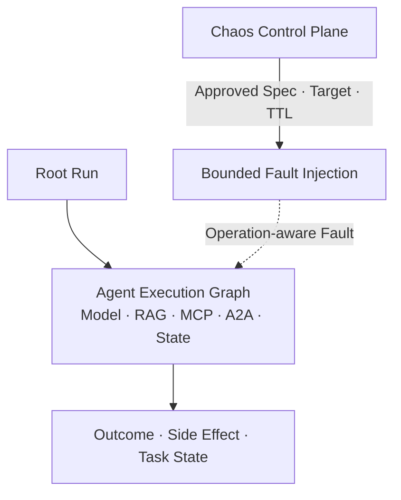
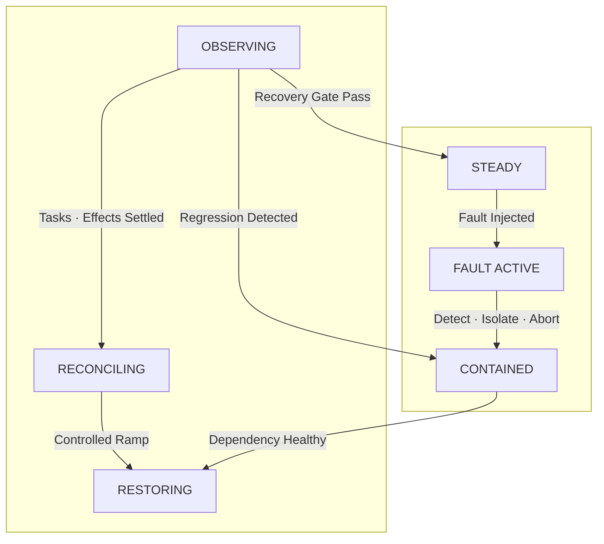
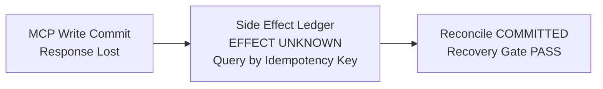

# AI Agent Chaos Engineering 설계: Model·RAG·MCP·A2A 장애와 Recovery를 안전하게 검증하는 법

AI Agent Chaos Engineering의 목적은 장애를 터뜨리는 것이 아니라 복구가 작동함을 증명하는 것입니다. Model 지연과 RAG 오류, MCP Tool 실패, 다른 Agent의 무응답이 한 요청 안에서 겹치기 때문에, 확인할 것은 그때 업무가 안전하게 축소·취소되고 남은 Side Effect가 정리되는지입니다. 이 글은 Steady State와 Blast Radius, Abort Condition, Recovery Gate로 실험 범위를 통제하며 Model·RAG·MCP·A2A 장애와 자동 복구를 검증하는 방법을 정리합니다.

<blockquote id="aiarchitect-toc" data-ke-style="box" style="background-color: #f6f9fc; color: #263746; font-family: Pretendard-Regular, AppleSDGothicNeo-Regular, sans-serif; font-weight: 400;" data-mce-style="background-color: #f6f9fc; color: #263746; font-family: Pretendard-Regular, AppleSDGothicNeo-Regular, sans-serif; font-weight: 400;">
<p style="color: #263746; font-weight: 700;" data-mce-style="color: #263746; font-weight: 700;"><b>목차</b></p>
<ol style="list-style-type: decimal; color: #555555; font-weight: 400;" data-mce-style="list-style-type: decimal; color: #555555; font-weight: 400;" data-ke-list-type="decimal">
<li style="color: #555555; font-weight: 400;" data-mce-style="color: #555555; font-weight: 400;">AI Agent Chaos Engineering은 무작위 장애가 아니다</li>
<li style="color: #555555; font-weight: 400;" data-mce-style="color: #555555; font-weight: 400;">Fault Injection·Chaos·Game Day·Recovery Testing을 구분한다</li>
<li style="color: #555555; font-weight: 400;" data-mce-style="color: #555555; font-weight: 400;">Component Health보다 업무 결과를 실험 대상으로 삼는다</li>
<li style="color: #555555; font-weight: 400;" data-mce-style="color: #555555; font-weight: 400;">Steady State를 사용자·업무·시스템 신호로 정의한다</li>
<li style="color: #555555; font-weight: 400;" data-mce-style="color: #555555; font-weight: 400;">Invariant와 실험 가설을 분리한다</li>
<li style="color: #555555; font-weight: 400;" data-mce-style="color: #555555; font-weight: 400;">실제 사고와 Near Miss에서 Fault Model을 만든다</li>
<li style="color: #555555; font-weight: 400;" data-mce-style="color: #555555; font-weight: 400;">실험 명세를 Versioned Contract로 관리한다</li>
<li style="color: #555555; font-weight: 400;" data-mce-style="color: #555555; font-weight: 400;">Blast Radius를 Tenant·Task·Capability·시간으로 제한한다</li>
<li style="color: #555555; font-weight: 400;" data-mce-style="color: #555555; font-weight: 400;">Precondition·Abort Condition·Kill Switch를 독립시킨다</li>
<li style="color: #555555; font-weight: 400;" data-mce-style="color: #555555; font-weight: 400;">Control Group과 Experiment Group을 비교한다</li>
<li style="color: #555555; font-weight: 400;" data-mce-style="color: #555555; font-weight: 400;">Fault Injection을 Agent 실행 경계에 배치한다</li>
<li style="color: #555555; font-weight: 400;" data-mce-style="color: #555555; font-weight: 400;">Model 장애는 Transport·Capacity·Semantic으로 나눈다</li>
<li style="color: #555555; font-weight: 400;" data-mce-style="color: #555555; font-weight: 400;">RAG 장애는 지연보다 Evidence 왜곡이 더 위험하다</li>
<li style="color: #555555; font-weight: 400;" data-mce-style="color: #555555; font-weight: 400;">MCP Read와 Write의 실패 의미를 다르게 시험한다</li>
<li style="color: #555555; font-weight: 400;" data-mce-style="color: #555555; font-weight: 400;">A2A 장기 Task의 정체·취소·Late Result를 시험한다</li>
<li style="color: #555555; font-weight: 400;" data-mce-style="color: #555555; font-weight: 400;">Retry Storm·Queue 포화·Recovery Storm을 함께 검증한다</li>
<li style="color: #555555; font-weight: 400;" data-mce-style="color: #555555; font-weight: 400;">Graceful Degradation과 Human Handoff를 결과 계약으로 검증한다</li>
<li style="color: #555555; font-weight: 400;" data-mce-style="color: #555555; font-weight: 400;">취소 이후 실행과 Orphan Task를 끝까지 추적한다</li>
<li style="color: #555555; font-weight: 400;" data-mce-style="color: #555555; font-weight: 400;">Recovery를 감지·격리·복원·조정·확신 회복으로 나눈다</li>
<li style="color: #555555; font-weight: 400;" data-mce-style="color: #555555; font-weight: 400;">Recovery Gate는 Traffic 복귀 전 Evidence를 요구한다</li>
<li style="color: #555555; font-weight: 400;" data-mce-style="color: #555555; font-weight: 400;">Side Effect Ledger로 Effect Unknown을 조정한다</li>
<li style="color: #555555; font-weight: 400;" data-mce-style="color: #555555; font-weight: 400;">실험 Trace와 Evidence Package를 남긴다</li>
<li style="color: #555555; font-weight: 400;" data-mce-style="color: #555555; font-weight: 400;">Shadow·Staging·Canary·Production 순으로 승격한다</li>
<li style="color: #555555; font-weight: 400;" data-mce-style="color: #555555; font-weight: 400;">Release Gate와 정기 실험을 분리해 자동화한다</li>
<li style="color: #555555; font-weight: 400;" data-mce-style="color: #555555; font-weight: 400;">Game Day는 사람과 Runbook도 함께 시험한다</li>
<li style="color: #555555; font-weight: 400;" data-mce-style="color: #555555; font-weight: 400;">합성 사례로 MCP Write 응답 유실을 검증한다</li>
<li style="color: #555555; font-weight: 400;" data-mce-style="color: #555555; font-weight: 400;">실패한 실험은 신뢰성 Backlog와 회귀 시험으로 바꾼다</li>
<li style="color: #555555; font-weight: 400;" data-mce-style="color: #555555; font-weight: 400;">단계적으로 구현하고 실험 성숙도를 높인다</li>
<li style="color: #555555; font-weight: 400;" data-mce-style="color: #555555; font-weight: 400;">운영 체크리스트와 마무리</li>
<li style="color: #555555; font-weight: 400;" data-mce-style="color: #555555; font-weight: 400;">공식 참고자료</li>
</ol>
</blockquote>

회의 분석 Agent의 Resilience 설계가 완료됐습니다.

```text
Model Timeout은 3초다.
Retry Budget은 Root Run마다 4개다.
RAG가 느리면 승인된 Snapshot으로 축소한다.
MCP Write는 Idempotency Key를 사용한다.
A2A Task는 취소하고 Late Result를 조정한다.
```

문서만 보면 안전합니다. 하지만 실제 장애가 발생했을 때 다음 질문에는 아직 답하지 못합니다.

```text
Model 응답이 느려지면 정말 Deadline 전에 Fallback하는가?
RAG가 일부 결과만 반환하면 근거 부족을 사용자에게 표시하는가?
MCP Write는 성공했지만 응답만 유실되면 중복 Ticket을 만들지 않는가?
A2A 취소 직후 완료 결과가 도착하면 누가 소유하고 조정하는가?
장애가 해소된 뒤 밀린 Retry가 한꺼번에 몰려 Recovery Storm을 만들지 않는가?
```

설계 검토와 단위 시험만으로는 분산된 Agent 실행 Graph의 실제 동작을 증명하기 어렵습니다. Timeout·Retry·Fallback·Cancellation이 각각 맞게 구현돼도, 결합된 순서와 부하에서는 예상하지 못한 상태가 생깁니다.

AI Agent Chaos Engineering의 목표는 시스템을 고장 내는 것이 아닙니다. **통제된 범위에 현실적인 장애를 주입하고, 사용자에게 약속한 업무 결과와 안전 Invariant가 유지되는지 측정하며, 실패를 감지·격리·축소·조정한 뒤 정상 Traffic을 다시 받을 준비가 됐다는 Evidence를 만드는 것**입니다.

이 글은 [AI Agent 관측성](https://aiarchitect.tistory.com/72), [AI Agent 평가 아키텍처](https://aiarchitect.tistory.com/74), [AI Agent Control Plane](https://aiarchitect.tistory.com/76), [AI Agent 실행 아키텍처](https://aiarchitect.tistory.com/77), [Agent Contract Testing](https://aiarchitect.tistory.com/80), [Agentic AI Incident Response](https://aiarchitect.tistory.com/81), [Agentic AI SRE](https://aiarchitect.tistory.com/82), [AI Agent Dependency Resilience](https://aiarchitect.tistory.com/83)를 전제로 합니다. Chaos 도구 설치법이나 일반적인 서버 장애 주입을 반복하지 않고, **Model·RAG·MCP·A2A가 연결된 Agent 업무의 기능 축소와 Recovery 검증**에 집중합니다.

> 이 글의 Agent, Tenant, Task, Provider, Endpoint, 오류 코드, 수치, 시간, 비용과 Threshold는 모두 교육용 합성 예시입니다. 특정 회사·고객·제품의 실제 구성이나 운영값을 나타내지 않습니다. 실제 실험은 서비스 Owner, SRE, 보안, 업무 Owner와 변경 승인자가 Blast Radius·Abort Condition·복구 절차를 공동 승인한 뒤 수행해야 합니다.

## 1. AI Agent Chaos Engineering은 무작위 장애가 아니다

Chaos Engineering은 무작위로 서버를 내리거나 운영자를 놀라게 하는 활동이 아닙니다. 정상 상태와 가설을 먼저 정의하고, 현실적인 변수를 통제된 범위에 주입해 가설을 반증하려는 실험입니다.

```text
Chaos Experiment
  = Observable Steady State
  + Falsifiable Hypothesis
  + Realistic Fault
  + Bounded Blast Radius
  + Automated Abort
  + Recovery Evidence
```

Agent 시스템에서는 장애 주입 자체보다 무엇을 정상으로 볼지가 더 어렵습니다. Model API가 200을 반환해도 잘못된 JSON이나 근거 없는 답을 만들 수 있고, MCP Tool이 Timeout을 반환해도 외부 업무 Write는 이미 Commit됐을 수 있습니다.

따라서 성공한 실험은 Fault Action이 정상 실행된 실험이 아닙니다. 다음이 Evidence로 남은 실험입니다.

- 사용자 영향이 허용 범위 안에 있었다.
- 안전 Invariant가 한 번도 깨지지 않았다.
- 기대한 기능 축소·차단·Handoff가 발생했다.
- 미결 Task와 Side Effect가 정해진 시간 안에 조정됐다.
- 장애 제거 후 정상 상태가 지속적으로 회복됐다.

## 2. Fault Injection·Chaos·Game Day·Recovery Testing을 구분한다

비슷한 활동을 하나로 부르면 목적과 합격 기준이 흐려집니다.

| 활동 | 주된 질문 | 예시 | 완료 기준 |
|---|---|---|---|
| Fault Injection | 특정 오류를 만들 수 있는가? | Model 응답에 2초 지연 추가 | 지정 Fault가 대상에만 적용됨 |
| Chaos Experiment | 오류에도 업무 Steady State가 유지되는가? | RAG Partial Result에서 근거 표시 검증 | 가설·Invariant·영향 범위 판정 |
| Recovery Testing | 복구 절차가 목표 시간 안에 끝나는가? | Circuit Half-open 후 Traffic 복귀 | Recovery Gate와 조정 완료 |
| Game Day | 사람·도구·Runbook이 함께 작동하는가? | On-call이 Kill Switch와 Handoff 수행 | 역할·의사결정·Communication 검증 |
| Disaster Recovery | 더 큰 Failure Domain에서 서비스를 복원하는가? | Region·Workflow Store 복구 | RTO·RPO와 업무 정합성 충족 |

Fault Injection은 수단이고 Chaos는 가설 기반 학습 활동입니다. Recovery Testing은 장애가 끝난 뒤 실제로 정상 상태와 정합성이 돌아왔는지를 검증합니다. 이 글의 범위는 단일 Region 재해 복구보다 **Agent 실행 Graph의 장애 대응과 업무 복구**에 가깝습니다.

## 3. Component Health보다 업무 결과를 실험 대상으로 삼는다

다음 실험은 기술적으로 성공했지만 업무적으로는 실패할 수 있습니다.

```text
주입: Model Provider A에 429 반환
관측: Provider B Fallback 성공, HTTP 200
누락: Provider B가 Tool Schema를 다르게 해석
결과: Ticket Priority가 잘못 기록됨
```

Component Metric만 보면 Fallback은 성공했습니다. 사용자 업무 관점에서는 잘못된 Side Effect입니다.

실험 대상은 다음 세 계층을 연결해야 합니다.

| 계층 | 확인할 것 |
|---|---|
| Dependency | 지연, 오류, 가용성, Rate Limit, Protocol 상태 |
| Agent Runtime | Plan, Retry, Fallback, Budget, Cancellation, Task 상태 |
| Business Outcome | 정확성, 근거, 승인, Side Effect, 중복, Handoff |

권장 실험 단위는 Endpoint가 아니라 Task Class입니다.

```yaml
experiment_scope:
  task_class: meeting-to-ticket
  tenant_slice: chaos-lab
  dependency: mcp-ticket-write
  business_outcome: exactly_one_draft_or_explicit_handoff
```

## 4. Steady State를 사용자·업무·시스템 신호로 정의한다

Steady State는 모든 Metric이 고정된 상태가 아닙니다. 정상적인 변동 안에서 서비스가 약속한 결과를 내는 상태입니다.

Agent 실험은 최소 세 종류의 신호를 사용합니다.

### 사용자 신호

- 완료·축소·Handoff 상태가 정해진 시간 안에 표시되는가?
- 근거 부족이나 최신성 저하가 숨겨지지 않는가?
- 같은 요청에 모순된 결과가 노출되지 않는가?

### 업무 신호

- 승인 없는 Write가 0건인가?
- 동일 Idempotency Key의 중복 Side Effect가 0건인가?
- Effect Unknown이 조정 목표 시간 안에 해소되는가?

### 시스템 신호

- End-to-End 성공률과 지연이 허용 범위 안인가?
- Logical Run당 Attempt·Token·비용 증폭이 상한 안인가?
- Queue Age·Orphan Task·Circuit Open 비율이 회복되는가?

합성 실험의 Steady State 예시는 다음과 같습니다.

```yaml
steady_state:
  window: 10m
  user_visible_outcome_rate:
    min: 0.97
  unauthorized_write_count:
    max: 0
  duplicate_effect_count:
    max: 0
  effect_unknown_age_p95:
    max_seconds: 120
  run_latency_p95:
    max_seconds: 8
  attempt_amplification_p95:
    max: 1.8
```

평균만 사용하면 특정 Tenant나 고위험 Task의 실패가 숨습니다. Task Class·Tenant·Provider·Risk Tier Slice를 함께 고정합니다.

## 5. Invariant와 실험 가설을 분리한다

가설은 일정 범위에서 틀릴 수 있고, Invariant는 실험 중에도 깨져서는 안 됩니다.

```text
Hypothesis
  Model A가 30초 동안 429를 반환해도
  저위험 요약 Task의 97%는 Provider B 또는 명시적 축소로
  8초 안에 사용자 결과를 만든다.

Invariant
  승인 없는 Write는 발생하지 않는다.
  Tenant 경계를 넘는 Context는 노출되지 않는다.
  Retry·Cost·Concurrency Budget 상한을 넘지 않는다.
```

가설이 깨지면 학습 결과입니다. Invariant가 깨질 가능성이 보이면 실험을 즉시 중단하고 Incident 절차로 전환해야 합니다.

가설은 다음처럼 반증 가능해야 합니다.

```yaml
hypothesis:
  when: model-a returns rate_limited for 30s
  expect:
    outcome_rate_gte: 0.97
    latency_p95_lte_ms: 8000
    degraded_result_label_rate: 1.0
    retry_amplification_lte: 1.8
```

“시스템이 잘 버틴다”는 판정할 수 없습니다. 조건·대상·관측 Window·Threshold를 명시해야 합니다.

## 6. 실제 사고와 Near Miss에서 Fault Model을 만든다

현실과 무관한 Fault는 도구 시연은 되지만 신뢰를 높이지 못합니다. Fault 후보는 다음 Evidence에서 시작합니다.

- 과거 Incident와 Near Miss
- Trace에서 반복되는 Dependency 오류
- Error Budget을 소진한 Slice
- Architecture Review의 Single Point of Failure
- Contract Test에서 발견한 Protocol 차이
- Provider의 공개 장애 유형과 Rate Limit 계약
- 운영자가 수동으로 복구한 작업

Agent Fault Model은 계층별로 정리합니다.

| 계층 | Fault 예시 | 숨은 결합 |
|---|---|---|
| Model | Timeout, 429, 5xx, Malformed JSON, 빈 Tool Call | Fallback 품질·Token 폭증 |
| RAG | 지연, Partial Result, Stale Index, ACL Filter 실패 | 근거 누락·권한 노출 |
| MCP | 연결 단절, 응답 유실, Schema 불일치, Task 정체 | Effect Unknown·중복 Write |
| A2A | Agent Card 불일치, Task Stall, Stream 단절, Late Result | Orphan Task·취소 Race |
| Runtime | Queue 포화, Worker 재시작, Clock Skew, Budget Store 지연 | Retry Storm·Deadline 오판 |
| Control Plane | 정책 Version 지연, Kill Switch 전파 지연 | 다른 Node의 상이한 행동 |

Fault를 오류 코드 하나로만 만들지 않습니다. 발생 위치와 시점도 바꿔야 합니다.

```text
Write 전 연결 실패
Write Commit 중 Process 종료
Write Commit 후 응답 유실
응답 수신 후 Workflow Store 기록 실패
취소 요청과 완료 응답의 동시 도착
```

같은 Timeout이라도 업무 의미는 전혀 다릅니다.

## 7. 실험 명세를 Versioned Contract로 관리한다

실험은 사람이 기억하는 Runbook이 아니라 검토 가능한 명세여야 합니다.

```yaml
experiment:
  id: chx-mcp-write-response-loss-v3
  owner: agent-platform-sre
  task_class: meeting-to-ticket
  risk_tier: medium
  hypothesis_ref: hyp-duplicate-free-write-v2

  target:
    tenant: chaos-lab
    route: mcp-ticket-write
    max_logical_runs: 20
    duration_seconds: 90

  fault:
    type: drop_response_after_commit
    probability: 0.25

  preconditions:
    - error_budget_state == HEALTHY
    - incident_severity_active == NONE
    - reconciliation_worker_ready == true

  abort_conditions:
    - unauthorized_write_count > 0
    - duplicate_effect_count > 0
    - effect_unknown_age_max > 180s

  recovery_gate:
    - fault_removed == true
    - pending_effect_unknown == 0
    - orphan_task_count == 0
    - steady_state_held_for == 10m
```

명세에는 Owner, 승인자, 만료일과 변경 이력도 둡니다. 오래된 실험이 현재 정책·Schema·Provider 계약과 다를 수 있기 때문입니다.

## 8. Blast Radius를 Tenant·Task·Capability·시간으로 제한한다

Blast Radius는 대상 Instance 수만 뜻하지 않습니다. Agent에서는 업무 위험과 Side Effect까지 포함합니다.

```text
Blast Radius
  = Tenant Scope
  × Task Class
  × Capability
  × Traffic Percentage
  × Duration
  × Side-effect Risk
```

권장 제한 순서는 다음과 같습니다.

1. Synthetic Input과 가짜 업무 System
2. 격리된 Test Tenant
3. Read-only Capability
4. 내부 사용자 Shadow 또는 Canary
5. 저위험 Production Task의 작은 비율
6. 승인된 Write Capability

Write 실험에서는 단순히 Traffic을 1%로 줄이는 것으로 충분하지 않습니다. 한 건의 잘못된 급여 변경이나 계정 삭제도 허용할 수 없기 때문입니다. 고위험 Write는 Sandbox, Dry Run, Draft 생성, 추가 Approval과 가역적 Fixture를 사용합니다.

Blast Radius Selector는 명시적으로 교집합을 계산해야 합니다.

```yaml
target_selector:
  environment: production
  tenant_allowlist:
    - chaos-lab
  task_class_allowlist:
    - meeting-summary
  effect_semantics:
    - READ_ONLY
  max_concurrent_runs: 5
  ttl_seconds: 60
```

빈 Allowlist를 전체 대상으로 해석해서는 안 됩니다. Selector를 해석하지 못하면 안전 실패해야 합니다.

## 9. Precondition·Abort Condition·Kill Switch를 독립시킨다

세 제어는 목적이 다릅니다.

| 제어 | 시점 | 역할 |
|---|---|---|
| Precondition | 시작 전 | 실험을 시작해도 되는지 판단 |
| Abort Condition | 실행 중 | 자동 중단 Threshold 판단 |
| Kill Switch | 언제든 | 사람이 즉시 Fault 주입과 대상 Route를 차단 |

Precondition 예시는 다음과 같습니다.

- 현재 Incident가 없다.
- Error Budget이 보호 상태가 아니다.
- On-call과 업무 Owner가 응답 가능하다.
- 관측 Pipeline과 조정 Worker가 정상이다.
- 최근 배포가 안정화 Window를 통과했다.

Abort Condition은 실험 Dashboard를 사람이 지켜보는 것에 의존하지 않습니다.

```yaml
abort:
  evaluation_interval_seconds: 5
  conditions:
    - metric: unauthorized_write_count
      operator: GT
      threshold: 0
    - metric: queue_age_p99_seconds
      operator: GT
      threshold: 30
    - metric: user_error_rate
      operator: GT
      threshold: 0.05
      consecutive_windows: 2
```

Fault Injector가 멈추는 것과 영향을 제거하는 것은 다릅니다. 이미 지연된 Packet, Queue에 쌓인 Attempt와 실행 중인 Task가 남을 수 있습니다. Abort 후에도 Drain·Cancel·Reconcile 작업은 계속돼야 합니다.

### Chaos Control Plane도 보호 대상이다

Fault Injector는 정상 Traffic을 방해하고 오류 응답을 만들 수 있는 고권한 Control Plane입니다. 일반 운영 Dashboard의 편의 기능처럼 다루면 안 됩니다.

```yaml
chaos_control_plane:
  identity: dedicated_workload_identity
  authorization: experiment_spec_and_target_bound
  production_approval: two_person
  immutable_audit: true
  max_fault_ttl_seconds: 120
  concurrent_experiment_limit_per_target: 1
  default_on_controller_loss: REMOVE_FAULT
```

- 사람 계정의 장기 Credential을 Injector에 넣지 않습니다.
- 승인된 Experiment Spec Digest·Target·Fault Type·TTL에만 권한을 좁힙니다.
- Production Write 실험은 실행자와 승인자를 분리합니다.
- 같은 Dependency·Tenant Slice를 겨냥한 실험은 Lease로 직렬화합니다.
- Controller Heartbeat가 끊기면 Fault가 자동 만료되도록 합니다.
- 중단 경로는 실험 대상과 다른 Failure Domain의 Watchdog·Safety Lever로 둡니다.

관측 Pipeline 하나에 Abort 판정을 모두 의존하면 실험이 그 Pipeline까지 느리게 만들 때 중단 신호도 사라집니다. 사용자 Canary, 업무 Invariant와 인프라 보호 Metric 중 최소 하나는 독립 경로에서 판정하고, Abort 명령의 전달·적용 완료도 별도 Evidence로 남깁니다.

## 10. Control Group과 Experiment Group을 비교한다

시간대 전체 Metric만 보면 실험 때문인지 자연 변동인지 구분하기 어렵습니다. 같은 Task Class와 유사한 Input 분포를 가진 Control Group을 유지합니다.

```text
Control Group
  Fault 없음
  같은 Release·Policy Version
  같은 Task Class·Risk Tier

Experiment Group
  선택된 Dependency Fault만 적용
  나머지 조건은 Control과 동일
```

비교할 핵심 Delta는 다음과 같습니다.

```text
Δ Outcome Rate
Δ End-to-End Latency
Δ Attempt Amplification
Δ Token and Cost
Δ Handoff Rate
Δ Effect Unknown Age
Δ Recovery Time
```

Control과 Experiment를 완벽히 같게 만들 수 없다면 Input 특성과 Version을 Evidence에 남기고 판정의 불확실성을 표시합니다. 작은 표본에서 성공률 100%가 나왔다고 강한 결론을 내리지 않습니다.

## 11. Fault Injection을 Agent 실행 경계에 배치한다

Agent 실험은 인프라 Network Layer 하나만으로 충분하지 않습니다. 오류의 업무 의미를 재현하려면 여러 주입 지점이 필요합니다.



그림 1. Model·RAG·MCP·A2A 실행 경계에 배치한 Agent Fault Injection Map

| 주입 계층 | 잘 재현하는 Fault | 주의점 |
|---|---|---|
| Network Proxy | 지연, 단절, Packet Loss, Reset | Commit 전후 의미를 모를 수 있음 |
| Adapter | 429, Schema 오류, Partial Result | 실제 Provider 동작과 차이 가능 |
| Runtime Hook | Budget 고갈, Cancellation Race | Production Code 경로 오염 방지 |
| Fake Provider | 결정적인 Edge Case | 실제 부하·Network 특성 부족 |
| Business Sandbox | 실제 Side Effect 흐름 | Test Data와 권한 격리 필요 |

한 실험에서 여러 Fault를 동시에 넣기 전에 단일 Fault로 인과를 확인합니다. 복합 장애는 기본 경로가 검증된 뒤 추가합니다.

## 12. Model 장애는 Transport·Capacity·Semantic으로 나눈다

Model Fault를 단순한 5xx로만 시험하면 Agent 고유 실패를 놓칩니다.

### Transport Fault

- 연결 Timeout
- Streaming 중단
- 응답 Header만 수신 후 Body 유실
- 지연이 Deadline을 넘는 Slow Response

### Capacity Fault

- 429와 Retry-After
- 특정 Model·Region만 과부하
- 동시성 제한 축소
- Token 처리 속도 저하

### Semantic Fault

- 유효하지 않은 JSON
- Tool Name 또는 Argument Schema 불일치
- 빈 응답이나 중간에서 끊긴 Structured Output
- 근거와 모순되는 답
- 안전 정책상 거절됐지만 Runtime이 일반 실패로 오인

검증 항목은 Fallback 성공 여부보다 넓습니다.

```yaml
model_experiment_assertions:
  root_deadline_respected: true
  retry_budget_respected: true
  fallback_policy_version_preserved: true
  tool_schema_revalidated: true
  degraded_result_labeled: true
  output_quality_gate_applied: true
  abandoned_stream_cancelled_or_accounted: true
```

Provider Fallback이 더 짧은 Context Window, 다른 Tool Calling 계약이나 다른 안전 정책을 가진다면 같은 Prompt를 재전송하는 것만으로 동등한 결과를 보장하지 못합니다.

## 13. RAG 장애는 지연보다 Evidence 왜곡이 더 위험하다

RAG 장애는 Timeout처럼 명확하지 않을 수 있습니다. 빠르게 응답하지만 일부 Shard가 빠지거나 오래된 Index가 사용되면 Agent는 그럴듯한 결론을 만들 수 있습니다.

시험할 Fault는 다음과 같습니다.

| Fault | 기대 행동 |
|---|---|
| 검색 지연 | 남은 Deadline에 따라 생략·축소·중단 |
| 일부 Shard Timeout | Coverage 부족 표시 또는 안전 실패 |
| 빈 결과 | 모른다고 응답하거나 Human Handoff |
| Stale Index | Snapshot Age와 허용 정책 확인 |
| Reranker 실패 | 승인된 기본 순위로 축소하고 표시 |
| ACL Filter 오류 | 결과를 노출하지 않고 안전 실패 |
| Citation Mapping 불일치 | 답변 생성 차단 또는 근거 재검증 |

RAG Steady State에는 단순 Hit Rate가 아니라 Evidence 계약이 필요합니다.

```yaml
rag_invariants:
  cross_tenant_document_count: 0
  unsupported_claim_rate: 0
  citation_target_mismatch_count: 0
  stale_snapshot_used_without_label_count: 0
```

권한 필터가 실패했을 때 “검색 품질이 낮아졌다”고 처리하면 안 됩니다. 보안 Invariant 위반 가능성이므로 실험을 즉시 중단합니다.

## 14. MCP Read와 Write의 실패 의미를 다르게 시험한다

MCP Tool은 같은 Protocol 호출이라도 Read와 Write의 위험이 다릅니다.

### Read Tool

Read 실패에서는 Timeout·Partial Result·Schema Drift·Stale Cache를 시험합니다. Fallback 결과의 최신성과 근거 수준을 검증합니다.

### Write Tool

Write 실패에서는 응답 코드보다 Side Effect 시점을 통제해야 합니다.

```text
A. 요청이 Server에 도달하기 전 실패
B. Server가 요청을 받았지만 Commit 전 실패
C. Commit은 성공했지만 응답 유실
D. 응답은 왔지만 Client 상태 저장 전 실패
```

C와 D에서 무조건 재시도하면 중복 Side Effect가 생길 수 있습니다.

권장 시험 Oracle은 Business System의 실제 상태와 Side Effect Ledger입니다.

```yaml
mcp_write_oracle:
  idempotency_key: exp-20260812-run-0042
  expected:
    committed_effect_count: 1
    duplicate_effect_count: 0
    final_run_state: COMPLETED_OR_RECONCILED
    unknown_state_max_seconds: 120
```

MCP Tasks Extension을 사용하는 장기 작업은 Task Handle이 내구성 있게 저장됐는지, 연결을 다시 맺은 뒤 같은 Task를 조회하는지, Poll Interval을 존중하는지와 협력적 취소 이후 최종 상태를 조정하는지도 시험합니다.

## 15. A2A 장기 Task의 정체·취소·Late Result를 시험한다

A2A Task는 호출 응답보다 오래 살아 있을 수 있습니다. Streaming 연결이 끊겨도 원격 Agent의 Task는 계속 실행될 수 있습니다.

시험할 시나리오는 다음과 같습니다.

```text
Task 생성 응답 직후 Client 재시작
WORKING 상태에서 Status Update 중단
Push Notification 중복·순서 변경
CancelTask와 COMPLETED의 동시 발생
취소 후 Artifact 도착
Task 조회가 일시적으로 Not Found
Agent Card·Protocol Version 변경
```

A2A 1.0에서 Cancel Task 호출이 멱등적이어도, 업무 수준에서 모든 하위 Side Effect가 되돌려졌다는 뜻은 아닙니다. 실험은 Protocol 상태와 업무 상태를 분리해 확인해야 합니다.

| Protocol Evidence | Business Evidence |
|---|---|
| Task ID와 Context ID | Root Run과 업무 요청 연결 |
| Task State·Timestamp | 실제 처리 단계와 Side Effect |
| Artifact·History | 결과 승인·채택 여부 |
| Cancel 응답 | 실제 중단·완료·보상 상태 |

Late Result는 버리기 전에 Artifact가 이미 업무에 반영됐는지 확인합니다. 채택하지 않은 결과도 비용·감사·데이터 보존 정책에는 남을 수 있습니다.

## 16. Retry Storm·Queue 포화·Recovery Storm을 함께 검증한다

Dependency가 실패할 때보다 회복할 때 더 큰 부하가 생길 수 있습니다.

```text
Dependency 지연
  → Timeout 증가
  → 여러 계층 Retry
  → Queue 적체
  → Circuit Open
  → Dependency 회복
  → 대기 Retry와 Half-open Probe 동시 실행
  → Recovery Storm
```

단일 요청 Fault만 시험하면 이 증폭을 보지 못합니다. 제한된 부하에서 다음을 함께 측정합니다.

- Logical Run 대비 실제 Attempt 비율
- Queue Length보다 Queue Age
- Retry Token 소진 속도
- Circuit Half-open 동시 Probe 수
- Provider·Tenant별 Concurrency
- 취소됐지만 실행 중인 Attempt
- 장애 제거 후 정상 지연까지의 시간

Recovery 실험에는 Ramp-up 정책도 포함합니다.

```yaml
recovery_ramp:
  stages:
    - traffic_percent: 1
      hold_seconds: 120
    - traffic_percent: 5
      hold_seconds: 300
    - traffic_percent: 25
      hold_seconds: 600
    - traffic_percent: 100
  advance_when:
    - steady_state_pass == true
    - queue_age_decreasing == true
    - effect_unknown_count == 0
```

장애가 사라졌다는 이유만으로 Circuit을 모두 닫고 Queue를 한꺼번에 Drain하지 않습니다.

## 17. Graceful Degradation과 Human Handoff를 결과 계약으로 검증한다

기능 축소는 Fallback 함수가 호출됐다는 것으로 끝나지 않습니다. 사용자에게 전달된 결과가 축소 계약을 지켜야 합니다.

```yaml
degraded_outcome_contract:
  state: DEGRADED
  required_fields:
    - limitation_reason
    - evidence_level
    - freshness
    - omitted_capabilities
    - next_action
  forbidden:
    - automatic_high_risk_write
    - unlabeled_stale_evidence
```

실험은 다음을 확인합니다.

- Soft Dependency 실패가 Hard Failure로 번지지 않는가?
- 품질을 만들 수 없으면 그럴듯한 답을 생성하지 않는가?
- Handoff Package에 요청·수집 근거·미완료 단계·권한 상태가 포함되는가?
- 장애 중 임시 축소가 장애 후에도 계속 남지 않는가?
- Degraded 상태의 결과가 정상 결과로 잘못 집계되지 않는가?

Human Handoff도 성공률을 높이기 위한 Escape Hatch가 아닙니다. Queue 용량, 응답 시간과 담당자 부재를 포함해 실제로 완료 가능한 경로인지 시험해야 합니다.

## 18. 취소 이후 실행과 Orphan Task를 끝까지 추적한다

취소 요청은 의도이고 실제 중단은 관측된 상태입니다.

```text
CANCEL_REQUESTED
  ├─ CANCEL_CONFIRMED
  ├─ COMPLETED_AFTER_CANCEL
  ├─ FAILED_AFTER_CANCEL
  └─ CANCEL_UNKNOWN
```

Chaos 실험에서는 취소 직전과 직후에 의도적으로 Race를 만듭니다.

```yaml
cancel_race_experiment:
  inject:
    delay_cancel_delivery_ms: 500
    complete_task_after_ms: 300
  expect:
    user_result_adopted: false
    late_artifact_quarantined: true
    side_effect_reconciled: true
    orphan_owner_assigned: true
```

Orphan Task는 Root Run이 종료됐지만 하위 Task나 Attempt가 Terminal 상태가 아닌 경우입니다. 다음 SLI가 필요합니다.

```text
orphan_task_count
orphan_task_age
late_result_count
cancel_to_terminal_duration
unowned_effect_unknown_count
```

TTL이 지났다고 업무 책임까지 사라지는 것은 아닙니다. Protocol Task가 삭제되기 전에 필요한 감사·조정 Evidence를 Workflow Store에 보존합니다.

## 19. Recovery를 감지·격리·복원·조정·확신 회복으로 나눈다

Recovery는 Process가 다시 응답하는 순간이 아닙니다.



그림 2. 장애 제거 후 조정과 관찰을 거쳐 정상 상태로 돌아가는 Recovery Gate 상태 머신

Recovery 단계를 다음처럼 구분합니다.

| 단계 | 질문 |
|---|---|
| Detect | Steady State 이탈을 정해진 시간 안에 찾았는가? |
| Contain | Fault와 영향을 지정 범위에 격리했는가? |
| Restore | Dependency·Worker·Route가 다시 건강한가? |
| Reconcile | Task·Queue·Side Effect·비용 상태를 정리했는가? |
| Rebuild Confidence | 정상 상태가 관찰 Window 동안 유지됐는가? |

MTTR 하나만 측정하면 어느 단계가 느린지 알 수 없습니다.

```text
MTTD: Fault 시작 → 감지
MTTC: 감지 → 격리
MTTS: 격리 → 서비스 기능 복원
MTTRecon: 기능 복원 → 업무 조정 완료
MTTConfidence: 조정 완료 → Recovery Gate 통과
```

## 20. Recovery Gate는 Traffic 복귀 전 Evidence를 요구한다

Abort Condition과 Recovery Gate는 대칭이 아닙니다. 중단은 빠르게, 복귀는 더 많은 Evidence를 보고 점진적으로 결정합니다.

여기서 Recovery Gate는 A2A나 MCP가 정의한 Protocol 필드가 아니라, 이 글에서 제안하는 운영 통제 패턴입니다. Protocol의 Task 상태, Workflow Store, Side Effect Ledger와 SLO Evidence를 모아 Traffic 복귀 여부를 판정합니다.

```yaml
recovery_gate:
  technical:
    dependency_health_windows: 5
    circuit_half_open_success_rate_gte: 0.99
    queue_age_trend: DECREASING
  workflow:
    orphan_task_count: 0
    pending_cancel_unknown: 0
  business:
    effect_unknown_count: 0
    duplicate_effect_count: 0
    sampled_outcome_quality_pass: true
  safety:
    unauthorized_write_count: 0
    policy_version_consistent: true
  hold:
    steady_state_minutes: 10
```

Recovery Gate 결과는 다음 중 하나입니다.

```text
PASS
  정상 Traffic으로 다음 Ramp 단계 진행

HOLD
  현재 Traffic을 유지하고 Evidence 추가 수집

ROLLBACK
  이전 안전 상태로 복귀

HUMAN_APPROVAL_REQUIRED
  고위험 Write·불확실한 Side Effect 때문에 수동 승인
```

Gate 판정 Logic과 Threshold도 Version을 남깁니다. 실험 결과를 유리하게 만들기 위해 실행 중 Threshold를 바꾸면 안 됩니다.

Gate의 `0건` 조건은 전체 서비스의 우연한 기존 항목이 아니라 **실험 Cohort와 그 영향으로 생성된 Descendant Task·Side Effect**를 기준으로 평가합니다. 반대로 실험 영향이 Target Selector 밖으로 전파됐다면 Cohort에서 제외하지 않고 Blast Radius 위반으로 판정합니다. Write 재개 전에는 Fault TTL 만료, Injector Lease 해제와 임시 Route·Policy 원복까지 확인해 다음 실험이나 정상 요청에 잔여 Fault가 남지 않게 합니다.

## 21. Side Effect Ledger로 Effect Unknown을 조정한다

외부 Write가 있는 Agent에서 Recovery의 핵심은 재시작이 아니라 정합성 복원입니다.

```yaml
side_effect_ledger:
  effect_id: eff-0042
  root_run_id: run-0042
  operation: create_ticket_draft
  idempotency_key: exp-20260812-run-0042
  intended_state: DRAFT_CREATED
  observed_transport_state: RESPONSE_LOST
  business_state: UNKNOWN
  reconciliation_owner: workflow-reconciler
  next_check_at: "2026-08-12T15:02:30Z"
```

조정 순서는 다음과 같습니다.

1. Idempotency Key나 업무 Key로 외부 상태를 조회합니다.
2. 이미 적용됐다면 원래 Run과 연결하고 재시도하지 않습니다.
3. 적용되지 않았음이 확인되면 남은 업무 Deadline과 승인 상태를 확인합니다.
4. 재시도가 안전할 때만 새 Attempt를 실행합니다.
5. 상태를 확인할 수 없으면 Human Reconciliation Queue로 보냅니다.

Compensation도 새 Side Effect입니다. 성공을 가정하지 않고 별도 Ledger Entry·승인·실패 처리를 둡니다.

Chaos 실험의 합격 조건에는 Ledger 누락, 영구 Unknown과 무소유 조정 항목이 없어야 합니다.

## 22. 실험 Trace와 Evidence Package를 남긴다

실험 결과는 Dashboard Screenshot 하나로 충분하지 않습니다. 재현과 감사를 위한 Evidence Package를 만듭니다.

```yaml
experiment_evidence:
  experiment_id: chx-mcp-write-response-loss-v3
  execution_id: exec-20260812-1500
  spec_digest: sha256-example
  release_version: agent-runtime-4.8.2
  policy_version: resilience-17
  fault_started_at: "2026-08-12T15:00:00Z"
  fault_stopped_at: "2026-08-12T15:01:30Z"
  control_trace_set: trace-set-control-81
  experiment_trace_set: trace-set-exp-82
  gate_result: PASS
  exceptions: []
```

Trace에는 최소 다음 연결 키가 필요합니다.

```text
Experiment ID
Root Run ID
Attempt ID
Dependency Operation
MCP Task ID or A2A Task ID
Idempotency Key
Policy Version
Fault Type and Phase
Recovery Gate Decision
```

Prompt·응답·Tool Argument 전체를 기본 수집하지 않습니다. 개인정보·기밀·인증정보가 포함될 수 있으므로 Hash, 분류 Label, 허용된 Sampling과 별도 보관 정책을 사용합니다. OpenTelemetry의 공통 의미 체계를 활용하되 조직 고유 Chaos Attribute는 낮은 Cardinality와 명확한 Version 계약으로 추가합니다.

## 23. Shadow·Staging·Canary·Production 순으로 승격한다

Production Chaos는 목표일 수 있지만 출발점은 아닙니다.

| 단계 | Traffic·Data | 검증 목표 | 다음 단계 조건 |
|---|---|---|---|
| Simulation | 없음 | 상태 머신과 판정 Logic | 결정적 회귀 시험 통과 |
| Local·Fake | 합성 | Adapter 오류 처리 | Invariant·Budget 통과 |
| Staging | 합성·복제 | 실제 배포·관측·복구 | Production Parity 확인 |
| Shadow | 실제 Input, 결과 미채택 | 분포와 부하 영향 | 민감정보·비용 통제 |
| Canary | 작은 실제 Slice | 사용자 Outcome | 자동 Abort 검증 |
| Production | 승인된 범위 | 실제 시스템 신뢰 | 정기 실행과 지속 개선 |

Staging이 Production과 다르면 결과의 한계를 명시합니다. Provider Quota, Network 경로, 데이터 크기, 업무 API Sandbox 동작이 다를 수 있습니다.

승격 기준 예시는 다음과 같습니다.

```yaml
promotion_gate:
  previous_stage_passes: 3
  invariant_violations: 0
  automatic_abort_tested: true
  recovery_gate_tested: true
  owner_approval_required:
    - service_owner
    - sre
    - business_owner
```

## 24. Release Gate와 정기 실험을 분리해 자동화한다

모든 Chaos 실험을 배포 Pipeline에서 실행하면 느리고 위험합니다. 반대로 정기 Game Day만 하면 변경 직후 Regression을 늦게 발견합니다.

### Release Gate

- 빠르고 결정적인 Adapter Fault
- Timeout·Retry Budget 회귀
- Structured Output·Schema 오류
- Idempotency와 Response Loss
- Cancellation State Machine

### Scheduled Experiment

- 실제 Provider와 제한된 Traffic
- Queue 포화·Retry Storm
- 장기 A2A·MCP Task
- Control Plane 전파 지연
- 사람 참여 Recovery와 Communication

실험 Portfolio는 Risk와 비용으로 스케줄링합니다.

```yaml
experiment_schedule:
  per_commit:
    - model-malformed-json
    - mcp-response-loss-fake
  daily:
    - rag-partial-shard-staging
  weekly:
    - model-rate-limit-canary
  quarterly:
    - cross-agent-recovery-game-day
```

새로운 Incident가 생기면 가장 작은 결정적 회귀 시험을 먼저 추가하고, 필요하면 Production Experiment로 확장합니다.

## 25. Game Day는 사람과 Runbook도 함께 시험한다

자동 복구가 있어도 사람의 판단이 필요한 상황은 남습니다.

- Effect Unknown이 업무 조회로 확인되지 않는다.
- 안전 Invariant 경보가 상충한다.
- 두 Provider가 동시에 불안정하다.
- Kill Switch가 일부 Runtime에만 전파된다.
- 고위험 Write를 재개할지 결정해야 한다.

Game Day 역할을 사전에 분리합니다.

| 역할 | 책임 |
|---|---|
| Experiment Commander | 시작·중단·범위 결정 |
| Fault Operator | 승인된 Fault만 주입·제거 |
| Safety Observer | Invariant·Abort Condition 감시 |
| Service On-call | 실제 Incident 절차 수행 |
| Business Owner | 업무 영향·Write 재개 판단 |
| Recorder | Timeline·Decision·Evidence 기록 |

참가자에게 모든 시나리오를 숨길 필요는 없습니다. 목표가 탐지 훈련인지, 복구 절차 검증인지, 의사결정 훈련인지에 따라 공개 수준을 정합니다.

Game Day가 끝난 뒤 “잘 대응했다”는 소감보다 다음을 측정합니다.

```text
탐지까지 걸린 시간
Owner 지정까지 걸린 시간
Kill Switch 실제 전파 시간
잘못된 Runbook 단계 수
수동 Query·권한 부족 횟수
Recovery Gate 판정 근거의 완전성
```

## 26. 합성 사례로 MCP Write 응답 유실을 검증한다

가상의 회의 분석 Agent가 승인된 결정 사항을 Ticket Draft로 만듭니다.

### 정상 계약

```text
Task Class: meeting-to-ticket
Write: MCP create_ticket_draft
Idempotency Key: Root Run ID
정상 결과: Draft 1건 + 업무 ID 저장
실패 결과: Effect Unknown → 상태 조회 → 조정
```

### 실험 가설

```text
MCP Server가 Draft를 Commit한 뒤 응답을 25% 유실해도
중복 Draft는 발생하지 않고,
모든 Effect Unknown은 120초 안에
COMMITTED 또는 NOT_APPLIED로 조정된다.
```

### 실험 흐름



그림 3. MCP Write Commit 후 응답 유실을 Side Effect 조회로 조정하는 합성 실험

### Abort Condition

```yaml
abort_conditions:
  - duplicate_draft_count > 0
  - unauthorized_draft_count > 0
  - effect_unknown_age_max > 180s
  - write_queue_age_p99 > 30s
```

### 합성 결과

```text
Logical Run: 20
Fault 적용: 5
Effect Unknown 생성: 5
업무 조회로 COMMITTED 확인: 5
중복 Draft: 0
승인 없는 Draft: 0
최대 조정 시간: 46초
Recovery Gate: PASS
```

이 수치는 교육용 Fixture입니다. 중요한 것은 20건이 모두 HTTP 200이었는지가 아니라, 응답 유실 5건의 실제 업무 상태가 확인되고 중복 없이 원래 Run과 연결됐다는 Evidence입니다.

## 27. 실패한 실험은 신뢰성 Backlog와 회귀 시험으로 바꾼다

Chaos 실험에서 가설이 깨지는 것은 실험의 실패가 아니라 시스템 약점의 발견입니다. 그러나 발견만 기록하고 끝나면 운영 가치는 없습니다.

```text
Experiment Finding
  → Risk Classification
  → Owner and Deadline
  → Design or Policy Change
  → Deterministic Regression Test
  → Chaos Re-run
  → Production Promotion Decision
```

Finding 예시는 다음과 같습니다.

```yaml
finding:
  id: chf-2026-082
  experiment_id: chx-a2a-cancel-race-v2
  observation: completed artifact was adopted after user cancellation
  invariant_impact: user_intent_violation
  severity: high
  owner: orchestration-team
  remediation:
    - add adoption gate on root_run_state
    - quarantine late artifact
    - add cancel-complete race regression
  revalidation_required: true
```

같은 실험을 그대로 반복하기 전에 원인과 기대 행동을 고정한 작은 회귀 시험을 만듭니다. 이후 통합 Chaos 실험으로 결합 상태를 다시 검증합니다.

## 28. 단계적으로 구현하고 실험 성숙도를 높인다

한 번에 Production Chaos Platform을 만들 필요는 없습니다.

### 1단계: 결과 계약과 관측성

- Task Class별 Steady State 정의
- Root Run·Attempt·Task·Side Effect 연결
- 안전 Invariant와 Owner 지정
- Orphan·Effect Unknown SLI 추가

### 2단계: 결정적 Adapter Fault

- Model Timeout·429·Malformed Output
- RAG Partial·Stale·ACL Fail-closed
- MCP Response Loss
- A2A Cancel·Late Result Race

### 3단계: Recovery 자동화

- Fault 제거와 Queue Drain 분리
- Side Effect Reconciler
- Recovery Gate와 점진적 Ramp
- Evidence Package 자동 생성

### 4단계: 제한된 실제 실험

- Test Tenant·Read-only Canary
- 자동 Abort와 Kill Switch 검증
- Control Group 비교
- Error Budget 상태와 연동

### 5단계: 지속적 신뢰성 운영

- Release Gate와 Scheduled Experiment
- Incident·Near Miss 자동 후보화
- Game Day와 업무 Owner 참여
- 실험 Coverage·Finding Closure 관리

성숙도는 실험 횟수가 아니라 **중요한 실패 가설이 얼마나 검증됐고, 발견된 약점이 얼마나 빨리 수정·재검증되는지**로 측정합니다.

## 29. 운영 체크리스트와 마무리

### 실험 설계

- [ ] Task Class와 업무 Outcome을 기준으로 대상을 정했는가?
- [ ] Steady State가 사용자·업무·시스템 신호를 포함하는가?
- [ ] 가설이 조건·Threshold·Window로 반증 가능한가?
- [ ] 가설과 절대 깨지면 안 되는 Invariant를 분리했는가?
- [ ] Fault가 실제 Incident·Near Miss·Architecture Risk에서 왔는가?

### 안전 제어

- [ ] Tenant·Task·Capability·Traffic·시간·Side Effect로 Blast Radius를 제한했는가?
- [ ] Precondition과 자동 Abort Condition이 있는가?
- [ ] Fault Injector와 Route를 끄는 Kill Switch가 독립적인가?
- [ ] Controller 장애 시 Fault가 자동 만료되고 독립 Watchdog이 중단을 확인하는가?
- [ ] Experiment Spec·Target·TTL에 묶인 전용 Identity와 변경 불가능한 Audit이 있는가?
- [ ] 같은 Target의 동시 실험과 잔여 Fault를 Lease·사후 점검으로 막는가?
- [ ] Fault Operator와 Safety Observer 역할을 분리했는가?
- [ ] 고위험 Write는 Sandbox·Draft·Approval로 보호하는가?

### Agent 의존성

- [ ] Model Transport·Capacity·Semantic Fault를 각각 시험하는가?
- [ ] RAG Partial·Stale·ACL 오류에서 Evidence 계약을 검증하는가?
- [ ] MCP Write Commit 전후 실패를 구분하는가?
- [ ] MCP Task Handle과 A2A Task ID를 내구성 있게 추적하는가?
- [ ] 취소·Late Result·Orphan Task Race를 시험하는가?
- [ ] Retry Storm·Queue 포화·Recovery Storm을 측정하는가?

### Recovery와 Evidence

- [ ] Fault 제거를 Recovery 완료로 오해하지 않는가?
- [ ] Detect·Contain·Restore·Reconcile·Confidence 시간을 분리하는가?
- [ ] Recovery Gate에 Task·Side Effect·품질 Evidence가 포함되는가?
- [ ] Effect Unknown을 Business State 조회로 조정하는가?
- [ ] Control Group과 Experiment Group의 차이를 기록하는가?
- [ ] Prompt·응답의 민감정보를 과잉 수집하지 않는가?
- [ ] Finding을 Owner·기한·회귀 시험·재검증으로 연결하는가?

AI Agent Chaos Engineering의 핵심은 더 많은 장애를 만드는 것이 아닙니다.

```text
업무 결과로 Steady State를 정의한다.
깨지면 안 되는 Invariant를 먼저 고정한다.
실제 사고를 작은 Fault Model로 바꾼다.
Blast Radius와 Abort Condition 안에서 가설을 반증한다.
Model·RAG·MCP·A2A의 서로 다른 실패 의미를 검증한다.
장애 제거 뒤 Task·Queue·Side Effect를 끝까지 조정한다.
Recovery Gate를 통과한 Evidence가 있을 때만 Traffic을 복귀시킨다.
발견한 약점을 회귀 시험과 다음 실험으로 남긴다.
```

좋은 Chaos Engineering은 “장애에도 시스템이 살아 있었다”는 낙관을 만들지 않습니다. **어떤 조건에서 어떤 기능을 보존하고, 무엇을 축소하거나 중단하며, 불확실한 Task와 Side Effect를 어떻게 조정한 뒤 다시 정상 운영을 승인하는지 반복 가능한 Evidence로 증명합니다.**

다음 글에서는 장애를 견디는 검증을 넘어, 평상시와 장애 시 필요한 자원을 수치로 계획하는 방법에 집중합니다. Token 처리량, Queue Age, 동시 실행, Provider Quota, Retry 증폭과 비용을 하나의 용량 모델로 연결하고, Admission Control과 Scale 정책을 설계하는 **AI Agent Capacity Planning**을 다룹니다.

## 30. 공식 참고자료

- [Principles of Chaos Engineering](https://principlesofchaos.org/)
- [Google SRE Book — Addressing Cascading Failures](https://sre.google/sre-book/addressing-cascading-failures/)
- [Google SRE Workbook — Non-Abstract Large System Design](https://sre.google/workbook/non-abstract-design/)
- [AWS Fault Injection Service — Experiment Template Components](https://docs.aws.amazon.com/fis/latest/userguide/experiment-templates.html)
- [AWS Fault Injection Service — Stop Conditions](https://docs.aws.amazon.com/fis/latest/userguide/stop-conditions.html)
- [AWS Well-Architected — Integrate Resiliency Testing as Part of Your Deployment](https://docs.aws.amazon.com/wellarchitected/latest/framework/rel_tracking_change_management_resiliency_testing.html)
- [AWS Well-Architected — Test Resiliency Using Chaos Engineering](https://docs.aws.amazon.com/wellarchitected/latest/framework/rel_testing_resiliency_failure_injection_resiliency.html)
- [A2A Protocol 1.0 Specification](https://a2a-protocol.org/latest/specification/)
- [A2A Protocol — What's New in v1.0](https://a2a-protocol.org/latest/whats-new-v1/)
- [Model Context Protocol — 2026-07-28 Release Candidate](https://blog.modelcontextprotocol.io/posts/2026-07-28-release-candidate/)
- [Model Context Protocol — MCP Tasks Extension](https://modelcontextprotocol.io/extensions/tasks/overview)
- [OpenTelemetry Semantic Conventions](https://opentelemetry.io/docs/specs/semconv/)

> 이 글은 2026년 8월 12일 기준 Principles of Chaos Engineering, Google SRE, AWS Fault Injection Service·Well-Architected, A2A 1.0, MCP 2026-07-28 Tasks Extension과 OpenTelemetry 공식 공개 자료를 바탕으로 작성했습니다. 모든 실험 대상, 수치와 결과는 교육용 합성 예시이며 실제 운영값이 아닙니다. 실제 적용 시 서비스 SLO, Error Budget, 업무 위험, 데이터 보호, Provider 계약, Side Effect 의미, 비상 중단 권한과 조직의 대응 능력을 확인해 실험 범위와 승인 절차를 공동 결정해야 합니다.
