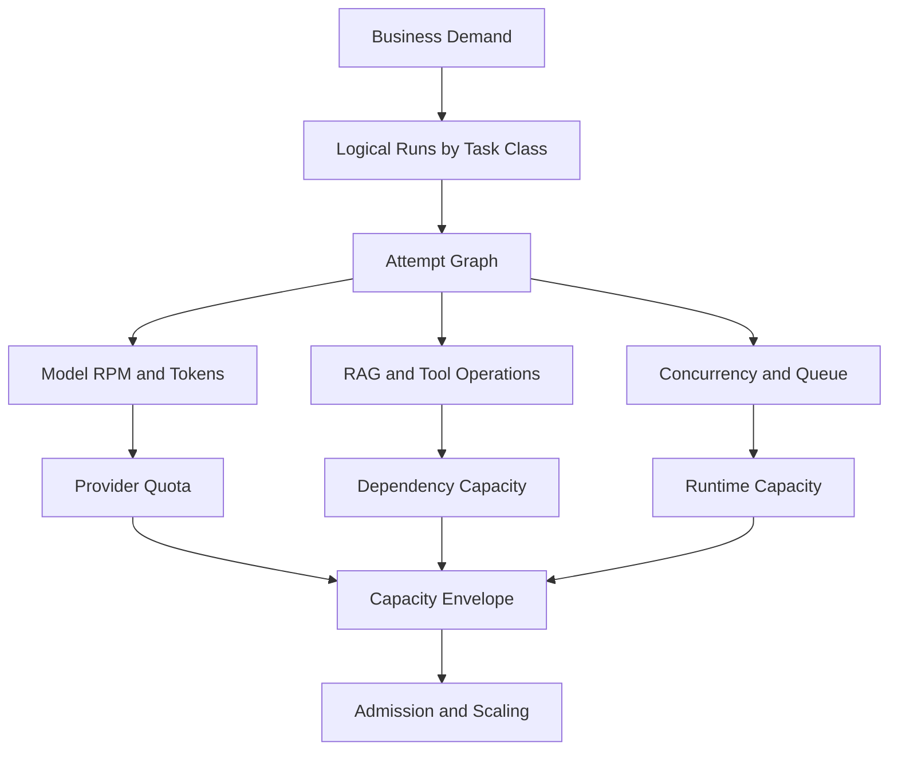
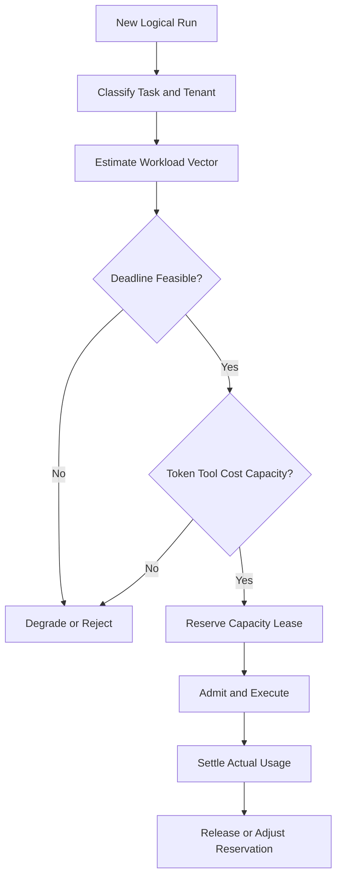
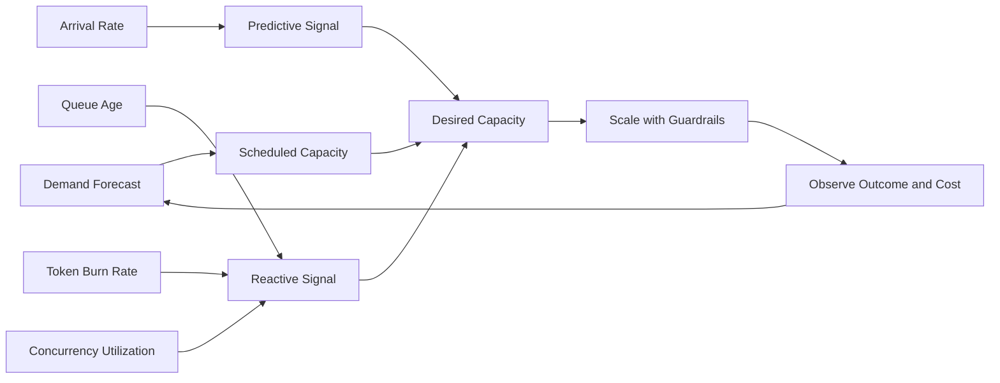

# AI Agent Capacity Planning 설계: Token·Queue·동시 실행·Provider Quota·비용을 하나의 용량 모델로 계산하는 법

AI Agent 용량 계획에서 초당 요청 수는 출발점이 되지 못합니다. 한 번의 실행이 Model Token과 RAG 검색, MCP 호출, 다른 Agent 위임을 함께 소비하고, 재시도가 그 수요를 배로 키우며, Provider Quota가 별도의 상한으로 걸리기 때문입니다. 이 글은 업무 수요를 Token·Queue·동시 실행 수요로 변환하고 Retry 증폭과 장애 여유, 비용을 반영해 Admission Control과 Auto Scaling을 설계하는 방법을 정리합니다.

<blockquote id="aiarchitect-toc" data-ke-style="box" style="background-color: #f6f9fc; color: #263746; font-family: Pretendard-Regular, AppleSDGothicNeo-Regular, sans-serif; font-weight: 400;" data-mce-style="background-color: #f6f9fc; color: #263746; font-family: Pretendard-Regular, AppleSDGothicNeo-Regular, sans-serif; font-weight: 400;">
<p style="color: #263746; font-weight: 700;" data-mce-style="color: #263746; font-weight: 700;"><b>목차</b></p>
<ol style="list-style-type: decimal; color: #555555; font-weight: 400;" data-mce-style="list-style-type: decimal; color: #555555; font-weight: 400;" data-ke-list-type="decimal">
<li style="color: #555555; font-weight: 400;" data-mce-style="color: #555555; font-weight: 400;">AI Agent 용량은 요청 수 하나로 계산할 수 없다</li>
<li style="color: #555555; font-weight: 400;" data-mce-style="color: #555555; font-weight: 400;">Task Class와 업무 Outcome을 용량 계획의 기준으로 삼는다</li>
<li style="color: #555555; font-weight: 400;" data-mce-style="color: #555555; font-weight: 400;">수요를 Workload Vector로 표현한다</li>
<li style="color: #555555; font-weight: 400;" data-mce-style="color: #555555; font-weight: 400;">Trace에서 Execution Profile을 추출한다</li>
<li style="color: #555555; font-weight: 400;" data-mce-style="color: #555555; font-weight: 400;">Logical Run을 실제 Attempt 부하로 변환한다</li>
<li style="color: #555555; font-weight: 400;" data-mce-style="color: #555555; font-weight: 400;">Model 용량을 Input·Output·Reasoning Token으로 분리한다</li>
<li style="color: #555555; font-weight: 400;" data-mce-style="color: #555555; font-weight: 400;">Context 성장과 Cache 효과를 별도로 모델링한다</li>
<li style="color: #555555; font-weight: 400;" data-mce-style="color: #555555; font-weight: 400;">RAG·MCP·A2A를 서로 다른 자원 단위로 계산한다</li>
<li style="color: #555555; font-weight: 400;" data-mce-style="color: #555555; font-weight: 400;">Little's Law로 동시 실행 수를 추정한다</li>
<li style="color: #555555; font-weight: 400;" data-mce-style="color: #555555; font-weight: 400;">Queue Length보다 Queue Age와 Drain Time을 본다</li>
<li style="color: #555555; font-weight: 400;" data-mce-style="color: #555555; font-weight: 400;">가장 먼저 포화되는 Constraint가 전체 용량을 결정한다</li>
<li style="color: #555555; font-weight: 400;" data-mce-style="color: #555555; font-weight: 400;">Provider Quota를 Versioned Capacity Contract로 관리한다</li>
<li style="color: #555555; font-weight: 400;" data-mce-style="color: #555555; font-weight: 400;">Interactive·Async·Batch Workload를 분리한다</li>
<li style="color: #555555; font-weight: 400;" data-mce-style="color: #555555; font-weight: 400;">Headroom·Redundancy·Failover 용량을 구분한다</li>
<li style="color: #555555; font-weight: 400;" data-mce-style="color: #555555; font-weight: 400;">Retry·Fallback·Recovery Storm을 Reserve에 반영한다</li>
<li style="color: #555555; font-weight: 400;" data-mce-style="color: #555555; font-weight: 400;">Admission Control에서 다차원 Budget을 예약한다</li>
<li style="color: #555555; font-weight: 400;" data-mce-style="color: #555555; font-weight: 400;">Tenant·Task Class별 공정성과 격리를 설계한다</li>
<li style="color: #555555; font-weight: 400;" data-mce-style="color: #555555; font-weight: 400;">Priority·Deadline·가치를 함께 보고 수락 순서를 정한다</li>
<li style="color: #555555; font-weight: 400;" data-mce-style="color: #555555; font-weight: 400;">Rate·Concurrency·Token·Cost Limit의 역할을 나눈다</li>
<li style="color: #555555; font-weight: 400;" data-mce-style="color: #555555; font-weight: 400;">Auto Scaling은 Leading Signal과 Lagging Signal을 결합한다</li>
<li style="color: #555555; font-weight: 400;" data-mce-style="color: #555555; font-weight: 400;">Cold Start와 Provisioning Lead Time을 계획에 넣는다</li>
<li style="color: #555555; font-weight: 400;" data-mce-style="color: #555555; font-weight: 400;">Scale-in은 장기 Task의 Drain·Lease·Checkpoint를 지킨다</li>
<li style="color: #555555; font-weight: 400;" data-mce-style="color: #555555; font-weight: 400;">비용을 Run·Outcome·Tenant 단위로 예산화한다</li>
<li style="color: #555555; font-weight: 400;" data-mce-style="color: #555555; font-weight: 400;">Organic·Inorganic 수요를 Scenario로 예측한다</li>
<li style="color: #555555; font-weight: 400;" data-mce-style="color: #555555; font-weight: 400;">부하 시험으로 Resource-to-Capacity 비율을 보정한다</li>
<li style="color: #555555; font-weight: 400;" data-mce-style="color: #555555; font-weight: 400;">포화 곡선과 과부하 실패 모드를 함께 찾는다</li>
<li style="color: #555555; font-weight: 400;" data-mce-style="color: #555555; font-weight: 400;">합성 사례로 회의 분석 Agent 용량을 계산한다</li>
<li style="color: #555555; font-weight: 400;" data-mce-style="color: #555555; font-weight: 400;">Capacity Plan을 Versioned Spec과 Gate로 운영한다</li>
<li style="color: #555555; font-weight: 400;" data-mce-style="color: #555555; font-weight: 400;">단계적으로 구현하고 운영 체크리스트로 검증한다</li>
<li style="color: #555555; font-weight: 400;" data-mce-style="color: #555555; font-weight: 400;">공식 참고자료</li>
</ol>
</blockquote>

AI Agent 서비스에 하루 10만 건의 요청이 들어옵니다. 운영 회의에서는 다음과 같은 질문이 나옵니다.

```text
서버를 몇 대 준비해야 하는가?
Model Provider Quota는 충분한가?
Queue가 몇 건이면 증설해야 하는가?
Retry가 늘어도 같은 용량으로 버틸 수 있는가?
Tenant별 월 비용을 어디까지 허용할 것인가?
한 Provider가 실패하면 나머지가 전체 Traffic을 받을 수 있는가?
```

전통적인 웹 API라면 QPS·CPU·Memory로 시작할 수 있습니다. AI Agent에서는 Logical Run 한 건이 여러 Model 호출, RAG 검색, MCP Tool, A2A Task와 재시도로 확장됩니다. Input Token과 Output Token의 분포가 다르고, 일부 작업은 몇 초 만에 끝나지만 장기 Task는 수분 동안 Lease와 상태를 유지합니다.

AI Agent Capacity Planning의 목표는 최대 Traffic 숫자 하나를 맞히는 것이 아닙니다. **업무 수요를 실행 Graph의 자원 수요로 변환하고, 어느 Constraint가 먼저 포화되는지 예측하며, 장애와 성장에도 SLO를 지킬 공급·Admission·Scale 정책을 Evidence로 관리하는 것**입니다.

이 글은 [AI Agent 관측성](https://aiarchitect.tistory.com/72), [AI Agent 실행 아키텍처](https://aiarchitect.tistory.com/77), [Agentic AI SRE](https://aiarchitect.tistory.com/82), [AI Agent Dependency Resilience](https://aiarchitect.tistory.com/83), [AI Agent Chaos Engineering](https://aiarchitect.tistory.com/84)을 전제로 합니다. 일반적인 Kubernetes 설치법이나 특정 Model Provider의 현재 요금표를 반복하지 않고, **Token·Queue·동시 실행·Provider Quota·비용을 하나의 용량 계약으로 연결하는 방법**에 집중합니다.

> 이 글의 Tenant, Task, Provider, Model, Endpoint, Quota, 수치, 비용과 Threshold는 모두 교육용 합성 예시입니다. 특정 회사·고객·제품의 실제 구성이나 운영값이 아닙니다. Provider Quota와 가격은 계정·지역·Model·계약·시점에 따라 달라질 수 있으므로 실제 Control Plane이 읽는 Versioned 설정과 공식 Console·계약값을 기준으로 검증해야 합니다.

## 1. AI Agent 용량은 요청 수 하나로 계산할 수 없다

사용자 요청 수는 수요의 시작일 뿐입니다.

```text
User Request 1건
  → Planner Model 1회
  → RAG Search 3회
  → Reranker 1회
  → Specialist Model 2회
  → MCP Read 2회
  → MCP Write 1회
  → 실패 Branch Retry 1회
```

같은 요청 1건이라도 실행 경로에 따라 자원 사용량이 달라집니다.

| 요청 유형 | Model | RAG | Tool | 상태 | 지연 특성 |
|---|---:|---:|---:|---:|---|
| 짧은 질의 | 1회 | 1회 | 0회 | 짧음 | Interactive |
| 회의 요약 | 2회 | 2회 | 1회 | 중간 | Token 중심 |
| 회의→Ticket | 3회 | 3회 | Read 2·Write 1 | 내구성 필요 | Side Effect 포함 |
| 장기 조사 | 5회 이상 | 다수 | A2A Task | 장기 | Async·Burst |

따라서 Capacity는 단일 Scalar가 아니라 여러 한도를 가진 Vector입니다.

```text
Capacity
  = min(
      Runtime Concurrency,
      Model RPM,
      Model TPM,
      RAG QPS,
      Tool Concurrency,
      Queue Drain Rate,
      Workflow Store IOPS,
      Cost Budget
    )
```

한 Constraint의 여유가 많아도 다른 Constraint가 포화되면 전체 업무 처리량은 늘지 않습니다.

## 2. Task Class와 업무 Outcome을 용량 계획의 기준으로 삼는다

Endpoint별 평균을 사용하면 비싼 업무가 숨습니다. 계획 단위는 사용자에게 약속한 결과가 같은 Task Class여야 합니다.

```yaml
task_class: meeting-to-ticket
outcome_contract:
  success: one_approved_ticket_draft
  deadline_seconds: 12
  degradation: summary_without_write
  risk_tier: medium
```

Task Class는 최소 다음 특성을 고정합니다.

- 실행 Graph Version
- Input 크기와 Token 분포
- Output 상한과 품질 기준
- RAG·Tool·A2A 호출 수
- Side Effect 의미와 승인 단계
- Interactive·Async·Batch 유형
- Deadline과 Degradation 경로
- Tenant·Risk Tier·우선순위

용량 목표도 업무 결과로 표현합니다.

```yaml
capacity_objective:
  task_class: meeting-to-ticket
  demand_p99_runs_per_minute: 240
  outcome_rate_min: 0.98
  latency_p95_seconds: 8
  queue_age_p95_seconds: 2
  duplicate_effect_max: 0
```

HTTP 200 처리량이 아니라 정상·축소·Handoff를 포함한 **사용자 가시 Outcome 처리량**을 계산해야 합니다.

## 3. 수요를 Workload Vector로 표현한다

Task Class 한 건의 자원 수요를 Workload Vector로 만듭니다.



```yaml
workload_vector:
  logical_run: 1
  input_tokens_p50: 6200
  input_tokens_p95: 9800
  output_tokens_p50: 900
  output_tokens_p95: 1600
  model_attempts_expected: 2.3
  vector_queries_expected: 3
  rerank_documents_p95: 40
  mcp_read_ops_expected: 2
  mcp_write_ops_expected: 0.8
  workflow_state_writes_expected: 18
  active_seconds_p95: 9.5
```

용량 계산에는 평균과 Tail을 섞지 않습니다.

| 값 | 용도 |
|---|---|
| 평균 | 장기 비용·총 처리량·월 예산 |
| p50 | 일반 사용자 경험과 기준 비교 |
| p95 | Interactive SLO와 평상시 Provisioning |
| p99 | Burst·Admission·Queue 보호 |
| 최대 상한 | 단일 Run 폭주 차단 |

모든 필드를 p99로 곱하면 지나치게 비싼 계획이 되고, 모든 필드를 평균으로 계산하면 동시에 발생하는 Tail을 놓칩니다. 실제 Trace에서 상관관계를 보고 Scenario별 결합 분포를 만듭니다.

## 4. Trace에서 Execution Profile을 추출한다

설계 문서의 호출 수와 운영 중 실제 호출 수는 다를 수 있습니다. Route·Fallback·Retry·Cache Hit에 따라 실행 Graph가 달라집니다.

```text
Root Run Trace
  ├─ Task Class
  ├─ Route Version
  ├─ Attempt Count
  ├─ Input / Output Token
  ├─ Dependency Operation
  ├─ Queue Wait / Service Time
  ├─ Cache Hit / Miss
  ├─ Side Effect State
  └─ Final Outcome
```

OpenTelemetry의 GenAI Semantic Conventions는 Model Operation, 요청 Model, Input·Output Token과 Duration을 공통 이름으로 관측하는 출발점을 제공합니다. 다만 표준은 계속 발전하므로 조직 고유 필드는 Version을 붙여 낮은 Cardinality로 추가합니다.

```yaml
capacity_trace_attributes:
  agent.task.class: meeting-to-ticket
  agent.route.version: route-17
  agent.run.outcome: completed
  agent.attempt.count: 3
  agent.queue.wait_ms: 420
  agent.capacity.reservation_id: cap-9f2a
```

Prompt·응답·Tool Argument 원문을 Capacity Metric에 넣지 않습니다. Token 수, 크기 Bucket, Operation 유형과 정책 Version만으로도 대부분의 용량 모델을 만들 수 있고 민감정보 유출 위험을 줄일 수 있습니다.

## 5. Logical Run을 실제 Attempt 부하로 변환한다

Logical Run Rate를 그대로 Provider 요청 Rate로 사용하면 안 됩니다.

```text
Attempt Amplification
  = 실제 전체 Attempt 수 / Logical Run 수
```

Task Class `i`의 Dependency `d`에 대한 부하는 다음처럼 계산할 수 있습니다.

```text
Dependency Attempts(i, d)
  = Logical Runs(i)
  × Base Calls per Run(i, d)
  × Retry Amplification(i, d)
  × Fallback Fan-out(i, d)
```

예를 들어 분당 200 Run이 있고 Model 기본 호출이 2회, Retry 증폭이 1.08, Fallback Fan-out 기대값이 1.03이면 다음과 같습니다.

```text
200 × 2 × 1.08 × 1.03
  = 444.96 Model Requests / minute
```

Worst-case 최대 Retry를 모든 요청에 곱하는 대신 정상·부분 장애·Provider Failover Scenario를 분리합니다.

```yaml
scenarios:
  normal:
    retry_amplification: 1.04
  degraded_provider:
    retry_amplification: 1.20
    fallback_share: 0.35
  provider_failover:
    retry_amplification: 1.10
    fallback_share: 1.00
```

## 6. Model 용량을 Input·Output·Reasoning Token으로 분리한다

Model 용량은 요청 수와 Token 수를 동시에 봐야 합니다.

```text
Input TPM
  = Σ(Runs/min × Model Calls/run × Input Tokens/call × Amplification)

Output TPM
  = Σ(Runs/min × Model Calls/run × Output Tokens/call × Amplification)
```

Input과 Output을 나누는 이유는 다음과 같습니다.

- 긴 Context는 전송·Prefill·비용에 영향을 줍니다.
- 긴 Output은 생성 시간과 동시 실행 점유를 늘립니다.
- Reasoning Token은 사용자에게 보이는 출력과 다를 수 있습니다.
- Cached Input은 청구·지연·Quota 의미가 Provider마다 다를 수 있습니다.
- 동일 RPM이라도 Token 분포가 다르면 실제 처리 가능한 Run 수가 달라집니다.

합성 예시는 다음과 같습니다.

```text
Run Rate: 120/min
Model Calls: 2.2/run
Input: 7,000 tokens/call
Output: 1,100 tokens/call
Amplification: 1.06
```

Capacity Pipeline은 계산식을 코드로 고정하고 단위 검증을 수행해야 합니다.

```text
120 × 2.2 = 264
264 × 7,000 = 1,848,000
1,848,000 × 1.06 = 1,958,880 Input Tokens/min

264 × 1,100 × 1.06 = 307,824 Output Tokens/min
```

중간 계산과 단위를 함께 저장하면 Spreadsheet의 조용한 오류를 줄일 수 있습니다.

### 자체 호스팅 Model은 GPU Capacity Envelope를 추가한다

Hosted API는 계약된 RPM·TPM·동시 요청이 주요 경계지만, 자체 호스팅 Model은 GPU Memory와 실행 단계가 직접 Constraint가 됩니다.

```text
Self-hosted Model Capacity
  = min(
      Model Weight and KV Cache Memory,
      Prefill Tokens/s,
      Decode Tokens/s,
      Active Sequence Slots,
      Interconnect Throughput
    )
```

| 단계 | 주된 영향 | 관측 단위 |
|---|---|---|
| Model Load | Weight·Replica 수 | GPU Memory |
| Prefill | Input Context 처리 | Input Tokens/s |
| Decode | Output 생성 | Output Tokens/s |
| KV Cache | Context·동시 Sequence | Bytes·Cache Utilization |
| Batch Scheduler | 처리량·Tail 지연 | Active·Queued Sequences |

긴 Input과 긴 Output이 같은 GPU를 서로 다른 방식으로 점유하므로 평균 Token/s 하나로 합치지 않습니다. Model·정밀도·Batch 정책·Context Bucket별 Load Test로 Safe Operating Point를 만들고, OOM이나 KV Cache 고갈 전에 Admission이 Context·Output 상한과 Active Sequence를 제한해야 합니다.

## 7. Context 성장과 Cache 효과를 별도로 모델링한다

대화형 Agent는 Turn이 늘수록 Context가 선형보다 빠르게 증가할 수 있습니다.

```text
Turn 1: System + User
Turn 2: 이전 대화 + RAG Evidence + Tool Result
Turn 3: 이전 전체 + 추가 Evidence + Retry Error
```

Capacity Model은 다음을 분리합니다.

```yaml
context_profile:
  fixed_system_tokens: 1400
  conversation_tokens_by_turn:
    p50: [900, 1800, 3100, 4700]
  rag_evidence_tokens_p95: 4200
  tool_result_tokens_p95: 1800
  compaction_trigger_tokens: 12000
  cache_eligible_prefix_tokens: 1100
```

Cache Hit Rate를 하나의 전역 평균으로 두지 않습니다. Model·Prompt Version·Tenant 정책·Route에 따라 나눕니다.

```text
Effective Uncached Input
  = Total Input
  - Cache Read Input
```

Cache는 용량을 줄이는 최적화이지 안전 용량의 전제조건이 아닙니다. Cache 장애나 Version 변경으로 Hit Rate가 급락해도 Admission이 Provider와 비용 Budget을 보호하는지 시험해야 합니다.

## 8. RAG·MCP·A2A를 서로 다른 자원 단위로 계산한다

모든 Dependency를 QPS로만 표현하면 병목을 설명할 수 없습니다.

| 계층 | 핵심 자원 단위 | 추가로 볼 것 |
|---|---|---|
| Embedding | Text·Token/s | Batch 크기, Queue Wait |
| Vector Search | Query/s | Candidate 수, Filter 복잡도 |
| Reranker | Documents/s | 문서 길이, Batch 효율 |
| MCP Read | Operations/s | Downstream Rate·Connection |
| MCP Write | Writes/s | 승인, Idempotency, Reconciliation |
| A2A | Active Tasks | Lease, Poll·Stream, Artifact 크기 |
| Workflow Store | State Writes/s | Hot Key, Transaction, Retention |

예를 들어 A2A 장기 Task는 새 Task 생성률이 낮아도 Active Task 수가 클 수 있습니다.

```text
Active A2A Tasks
  ≈ Task Arrival Rate × Mean Task Lifetime
```

Polling을 사용한다면 조회 부하도 추가됩니다.

```text
Task Poll QPS
  = Active Tasks / Poll Interval Seconds
```

Task 3,000개를 2초마다 조회하면 생성 QPS와 무관하게 약 1,500 Poll QPS가 됩니다. Streaming으로 바꾸면 Poll은 줄지만 Connection·Buffer·재연결 부하가 새 Constraint가 됩니다.

## 9. Little's Law로 동시 실행 수를 추정한다

안정 상태에서 평균 동시 실행 수는 도착률과 평균 체류 시간의 곱으로 추정할 수 있습니다.

```text
L = λ × W

L: 평균 In-flight Run 수
λ: 초당 도착 Run 수
W: 평균 시스템 체류 시간(초)
```

초당 8 Run이 들어오고 평균 체류 시간이 6초라면 평균 In-flight는 약 48개입니다.

```text
8 runs/s × 6 s = 48 concurrent runs
```

하지만 Provisioning을 평균 48에 맞추면 Tail과 Burst를 처리하지 못합니다.

```text
Provisioned Concurrency
  = Baseline Concurrency
  + Burst Reserve
  + Failover Reserve
  + Control Margin
```

Little's Law는 용량 계획의 출발점이지 Tail SLO의 보증식이 아닙니다. Arrival과 Service Time의 분포, Queue 정책, 의존성 상관관계를 부하 시험으로 보정합니다.

정확한 `L = λ × W`에는 장기 평균 도착률과 평균 체류 시간을 사용합니다. p95 도착률과 p95 체류 시간을 곱하는 방식은 Little's Law 계산이 아니라 보수적인 Peak Scenario 휴리스틱입니다. 두 결과를 같은 이름으로 기록하지 않습니다.

```yaml
concurrency_estimates:
  steady_state_mean:
    method: littles_law
  planned_peak:
    method: percentile_scenario_simulation
```

## 10. Queue Length보다 Queue Age와 Drain Time을 본다

Queue 1,000건이 항상 위험한 것은 아닙니다. 초당 1,000건을 처리하는 작업과 초당 2건을 처리하는 작업의 의미가 다릅니다.

```text
Estimated Drain Time
  = Backlog / Effective Service Rate
```

AWS의 Queue 기반 Auto Scaling 지침도 단순 Queue 길이보다 Worker당 Backlog와 허용 지연을 연결합니다. 합성 예시는 다음과 같습니다.

```text
허용 Queue Delay: 4초
Worker 1개의 평균 처리시간: 0.5초/작업

허용 Backlog/Worker
  = 4 / 0.5
  = 8개
```

Agent Queue에서는 Cost와 Deadline도 포함합니다.

```yaml
queue_metrics:
  - queue_age_p95_seconds
  - oldest_deadline_remaining_seconds
  - backlog_token_estimate
  - backlog_cost_estimate
  - backlog_by_task_class
  - effective_drain_runs_per_second
```

이미 Deadline을 넘길 작업을 Queue에 계속 쌓으면 Memory와 비용만 사용합니다. Admission 단계에서 예상 시작 시간과 남은 Deadline을 비교해 조기에 축소·거절·Batch 전환합니다.

```text
Deadline Feasible
  = Estimated Queue Wait
  + Estimated Service Time
  + Completion Reserve
  ≤ Remaining Root Deadline
```

Queue가 여러 Stage에 존재한다면 각 Stage의 대기시간을 합산하고, 이미 사용한 Root Deadline을 다시 배정하지 않습니다.

## 11. 가장 먼저 포화되는 Constraint가 전체 용량을 결정한다

Task Class별 자원 소비량과 현재 공급을 연결합니다.

```text
Capacity by Resource(r)
  = Available Supply(r) / Demand per Run(r)

Effective Run Capacity
  = min(Capacity by Resource(r))
```

합성 Capacity Envelope입니다.

| Constraint | Run 환산 용량 | 이용률 |
|---|---:|---:|
| Runtime Concurrency | 320 Run/min | 63% |
| Provider RPM | 410 Run/min | 49% |
| Provider TPM | 235 Run/min | 85% |
| Vector Search | 600 Run/min | 33% |
| MCP Write | 260 Run/min | 77% |
| Cost Budget | 250 Run/min | 80% |

이 경우 CPU를 두 배로 늘려도 전체 안전 용량은 늘지 않습니다. Provider TPM이 먼저 포화되고, 그 다음은 비용과 MCP Write입니다.

병목은 시간에 따라 이동합니다.

```text
정상: Provider TPM
Cache 장애: Input TPM
Provider Failover: Fallback RPM
업무 마감: MCP Write
대규모 문서: Reranker Documents/s
Recovery: Queue Drain·Workflow Store IOPS
```

Capacity Dashboard는 현재 병목과 다음 병목을 함께 보여야 합니다.

## 12. Provider Quota를 Versioned Capacity Contract로 관리한다

Provider 제한을 문서에 복사해 두면 실제 상태와 어긋납니다. 계정·Project·Region·Model·Tier별 한도를 Versioned Contract로 관리합니다.

```yaml
provider_capacity_contract:
  provider: provider-a
  model_route: reasoning-medium
  scope:
    account: prod-agent
    region: region-1
  effective_from: "2026-08-12T00:00:00Z"
  limits:
    requests_per_minute: ${RUNTIME_CONFIG}
    input_tokens_per_minute: ${RUNTIME_CONFIG}
    output_tokens_per_minute: ${RUNTIME_CONFIG}
    concurrent_requests: ${RUNTIME_CONFIG}
  source: provider_console_and_contract
  verified_at: "2026-08-12T08:00:00Z"
  owner: ai-platform-capacity
```

Capacity Contract에는 다음을 포함합니다.

- Hard Limit과 운영 Soft Limit
- Burst Window와 지속 Window
- Quota 공유 Scope
- 증가 요청 Lead Time
- Rate Limit 응답과 Retry-After 의미
- Fallback Provider의 독립성
- Primary·Fallback이 공유하는 Account·Region·조직 Quota
- Price·Model Version·Data Residency 제약
- 마지막 검증 시각과 Owner

Quota 조회 실패 시 마지막 Known-good 값을 무기한 신뢰하지 않습니다. TTL을 두고 만료되면 신규 저우선순위 작업을 보수적으로 제한합니다.

Endpoint가 다르다는 이유만으로 Failover Capacity가 독립적이라고 가정하지 않습니다. 두 Route가 같은 상위 Account Quota, Network Egress, 결제 한도나 Control Plane을 공유하면 상관 실패가 됩니다. Capacity Contract에 `failure_domain`과 `shared_limit_group`을 명시하고 Failover Scenario에서는 공유 한도를 한 번만 계산합니다.

```yaml
failure_domain:
  provider_account: account-prod-1
  shared_limit_group: global-reasoning-tpm
  network_egress: nat-pool-3
```

## 13. Interactive·Async·Batch Workload를 분리한다

서로 다른 지연 계약의 작업을 한 Queue와 Worker Pool에 넣으면 긴 Batch가 Interactive 요청을 막습니다.

| 유형 | 사용자 기대 | Queue 정책 | Scale 정책 |
|---|---|---|---|
| Interactive | 수초 내 결과 | 짧은 Deadline·작은 Backlog | Warm Capacity |
| Async | 상태 조회 가능 | 내구성·Priority·Checkpoint | Queue 기반 Scale |
| Batch | 완료 시각 약속 | Window·Cost 최적화 | 예약·저가 Capacity |
| Recovery | 정합성 복구 | 가장 오래된 위험 우선 | 별도 Reserve |

권장 격리는 다음과 같습니다.

```yaml
capacity_pools:
  interactive:
    min_warm_workers: 12
    max_queue_age_seconds: 2
  async:
    max_queue_age_seconds: 60
  batch:
    execution_windows: ["00:00-06:00"]
  reconciliation:
    reserved_workers: 3
```

Recovery·Reconciliation Worker를 일반 Batch와 경쟁시키지 않습니다. 장애 때 가장 필요한 정합성 복구 용량이 평상시 비용 최적화 작업에 소진될 수 있기 때문입니다.

## 14. Headroom·Redundancy·Failover 용량을 구분한다

남는 용량을 모두 Headroom이라고 부르면 목적이 흐려집니다.

```text
Provisioned Supply
  = Forecast Demand
  + Statistical Headroom
  + Operational Margin
  + Failover Reserve
  + Recovery Reserve
```

| 여유 | 보호 대상 |
|---|---|
| Statistical Headroom | 예측 오차와 정상 Burst |
| Operational Margin | 배포·GC·Cache Warm-up·성능 편차 |
| Failover Reserve | Zone·Provider·Worker Pool 손실 |
| Recovery Reserve | Queue Drain·Reconciliation·재처리 |

두 Region이 평소 각각 50%를 처리한다고 해서 한 Region 장애 시 자동으로 충분한 것은 아닙니다. 남은 Region이 100% Traffic과 증가한 Retry·Cache Miss까지 처리할 수 있어야 합니다.

```text
Failover Required Capacity
  = Redirected Useful Load
  × Failure Amplification
  ÷ Degraded-mode Efficiency
```

Failover를 계획에만 넣지 않고 정기적으로 제한된 Traffic Shift와 Load Test로 검증합니다.

## 15. Retry·Fallback·Recovery Storm을 Reserve에 반영한다

장애 때 Capacity가 줄어드는 동시에 수요가 늘 수 있습니다.

```text
Healthy Supply ↓
Retry Attempts ↑
Fallback Calls ↑
Cache Miss ↑
Queue Backlog ↑
Reconciliation Work ↑
```

Retry Reserve는 최대 Retry 횟수가 아니라 관측된 증폭과 정책 상한을 기준으로 합니다.

```yaml
failure_capacity_scenario:
  healthy_capacity_loss_percent: 35
  retry_amplification_max: 1.15
  fallback_extra_calls_per_run: 0.4
  cache_hit_rate_floor: 0.20
  reconciliation_ops_per_failed_write: 2
  degraded_mode_token_reduction_percent: 45
```

정상 기능 전체를 Failover 용량에 맞출 수 없다면 Degraded Mode를 계획합니다.

```text
NORMAL
  → NO_RERANK
  → SMALL_CONTEXT
  → READ_ONLY
  → ASYNC_HANDOFF
  → REJECT
```

기능 축소로 절약되는 Token·Tool·Concurrency를 실제 부하 시험으로 측정해야 Capacity Plan에 반영할 수 있습니다.

## 16. Admission Control에서 다차원 Budget을 예약한다

Auto Scaling은 공급을 늘리지만 즉시 늘어나지 않습니다. Admission Control은 현재 공급 안에서 새 Run을 받아도 되는지 결정합니다.



예약 단위는 하나의 Semaphore가 아닙니다.

```yaml
capacity_reservation:
  reservation_id: cap-9f2a
  root_run_id: run-0042
  expires_at: "2026-08-12T16:00:15Z"
  reserved:
    runtime_slots: 1
    input_tokens: 12000
    output_tokens: 1800
    mcp_write_ops: 1
    estimated_cost_units: 34
```

실행 후 실제 사용량으로 정산합니다.

```text
Reserved > Actual → 차액 즉시 반환
Actual > Reserved → 남은 Budget 확인 후 추가 예약
Lease 만료 → Orphan 확인 후 회수
Run 취소 → 하위 Attempt 종료 확인 후 반환
```

예약만 하고 실제 Provider 호출 전에 취소된 작업이 Budget을 계속 잡지 않게 TTL·Heartbeat·Owner를 둡니다.

## 17. Tenant·Task Class별 공정성과 격리를 설계한다

전역 FIFO Queue는 큰 Tenant나 비싼 Task가 전체 용량을 점유하게 합니다.

```text
Global Capacity
  ├─ Reserved Critical Pool
  ├─ Tenant Guaranteed Share
  ├─ Shared Burst Pool
  └─ Recovery Pool
```

정책 예시는 다음과 같습니다.

```yaml
fairness_policy:
  tenant_a:
    guaranteed_share_percent: 20
    burst_share_percent: 15
  tenant_b:
    guaranteed_share_percent: 10
    burst_share_percent: 10
  global:
    critical_reserved_percent: 15
    reconciliation_reserved_percent: 5
```

공정성은 요청 건수가 아니라 Weighted Cost로 계산합니다.

```text
Run Weight
  = Token Weight
  + Tool Weight
  + Concurrency-Time Weight
  + Side-effect Risk Weight
```

Tenant가 예약분을 사용하지 않을 때 Shared Pool이 빌릴 수 있지만, 원래 Tenant의 수요가 돌아오면 Deadline 안에 회수할 수 있어야 합니다.

## 18. Priority·Deadline·가치를 함께 보고 수락 순서를 정한다

Priority가 높다는 이유만으로 무제한 수락하면 Critical Queue도 포화됩니다.

Admission Score는 조직 정책에 맞게 결정적으로 계산합니다.

```text
Admission Score
  = Business Priority
  + Deadline Urgency
  + Recovery Value
  - Estimated Resource Cost
  - Side-effect Risk
```

예시는 다음과 같습니다.

| 작업 | Priority | Deadline | 비용 | 결정 |
|---|---:|---:|---:|---|
| 사용자 승인 완료 Write | 높음 | 8초 | 중간 | Reserved Pool |
| Interactive 질의 | 중간 | 5초 | 낮음 | 즉시 수락 |
| 일괄 재요약 | 낮음 | 6시간 | 높음 | Batch Window |
| 오래된 Effect Unknown 조정 | 높음 | 2분 | 낮음 | Recovery Pool |

이미 시작할 수 없는 Deadline의 작업을 높은 Priority라는 이유로 Queue 앞에 두지 않습니다. 명시적 Handoff나 축소 결과를 빠르게 반환하는 것이 더 나은 Outcome일 수 있습니다.

## 19. Rate·Concurrency·Token·Cost Limit의 역할을 나눈다

한 가지 Limit으로 모든 과부하를 막을 수 없습니다.

| 제어 | 막는 문제 | 놓칠 수 있는 문제 |
|---|---|---|
| Rate Limit | 짧은 시간 요청 폭주 | 느린 장기 요청 점유 |
| Concurrency Limit | In-flight 자원 고갈 | 요청당 Token 폭주 |
| Token Limit | Model 처리량·비용 초과 | Tool Write·장기 Task |
| Cost Limit | 재무 예산 초과 | 즉시 지연·Queue 포화 |
| Tool Operation Limit | 업무 API 보호 | Model·RAG 부하 |

정책은 계층적으로 적용합니다.

```yaml
limits:
  global:
    concurrent_runs: 800
  tenant:
    concurrent_runs: 80
    cost_units_per_hour: 12000
  task_class:
    output_tokens_per_run: 2200
  dependency:
    mcp_write_concurrency: 24
```

거절 응답은 재시도 폭주를 만들지 않게 Retry 가능 여부, Retry-After, 축소 경로와 요청 상태를 명확히 전달합니다.

## 20. Auto Scaling은 Leading Signal과 Lagging Signal을 결합한다

CPU가 80%가 된 뒤에만 Scale-out하면 Queue Age가 이미 SLO를 넘었을 수 있습니다.



Leading Signal과 Lagging Signal을 나눕니다.

### Leading Signal

- Arrival Rate 증가율
- 예약된 Batch·업무 마감 일정
- Backlog Token·Cost 추정량
- 남은 Deadline 대비 예상 시작 시간
- Provider Quota 이용률 증가 속도

### Lagging Signal

- CPU·Memory·GPU 이용률
- 현재 Queue Age
- Active Run·Connection 수
- Model·Tool 실제 Duration
- Error·Timeout·SLO 위반

Kubernetes HPA는 Resource뿐 아니라 Custom·External Metric과 여러 Metric을 사용할 수 있고, Scale Up·Down 동작과 Stabilization을 설정할 수 있습니다. Agent Worker는 CPU 하나보다 Queue Age·Backlog/Worker·Token Burn·Concurrency 중 가장 위험한 신호를 조합하는 편이 낫습니다.

Scale Signal이 없거나 지연됐을 때의 동작도 계약합니다. 관측 실패를 부하 0으로 해석해 Scale-in하면 안 되며, 마지막 유효 신호의 TTL이 지나면 최소 안전 Replica를 유지하고 Alert를 발생시킵니다. 또한 Provider TPM이 병목이면 Runtime Worker만 늘려도 용량은 증가하지 않으므로 병목 Constraint가 공급 가능한 경우에만 Scale-out합니다.

## 21. Cold Start와 Provisioning Lead Time을 계획에 넣는다

필요한 순간에 Scale-out 명령을 내리는 것과 실제 처리 용량이 생기는 것은 다릅니다.

```text
Provisioning Lead Time
  = Scheduler Wait
  + Image Pull
  + Process Start
  + Model / Cache Warm-up
  + Readiness Verification
  + Traffic Ramp
```

Interactive Pool은 예상 Burst보다 Lead Time이 길면 Warm Capacity가 필요합니다.

```text
Required Warm Reserve
  ≥ Expected Demand Increase during Lead Time
```

예를 들어 2분 안에 분당 120 Run이 증가할 수 있고 새 Worker가 유효 용량을 내는 데 90초가 걸린다면 CPU Threshold 기반 Scale-out만으로는 늦습니다.

Scale-to-zero가 적합하지 않은 경로도 있습니다.

- 사용자 Interactive SLO가 수초인 경로
- 대형 Model·Index Warm-up이 긴 경로
- Approval 후 즉시 Write가 필요한 경로
- Recovery·Reconciliation 경로

반면 긴 Deadline의 Batch와 드문 내부 도구는 Scale-to-zero 후보가 될 수 있습니다.

## 22. Scale-in은 장기 Task의 Drain·Lease·Checkpoint를 지킨다

Worker 수를 줄이는 것은 단순 Process 종료가 아닙니다.

```text
SERVING
  → DRAINING
  → NO_NEW_ASSIGNMENT
  → CHECKPOINT_OR_COMPLETE
  → LEASE_TRANSFERRED
  → TERMINATED
```

Scale-in 계약 예시는 다음과 같습니다.

```yaml
scale_in_policy:
  stabilization_window_seconds: 600
  max_reduction_percent_per_step: 20
  drain_timeout_seconds: 180
  require:
    - no_uncheckpointed_write
    - no_unowned_a2a_task
    - capacity_lease_released
  on_timeout: transfer_or_quarantine
```

장기 A2A Task와 MCP Task Handle은 Worker Memory가 아니라 Workflow Store에 보존합니다. Scale-in 후 Late Result가 도착해도 새 Owner가 상태를 조정할 수 있어야 합니다.

Queue가 잠깐 줄었다고 즉시 Scale-in하면 Cold Start와 Scale-out을 반복하는 Thrashing이 발생합니다. Stabilization Window와 단계적 축소를 사용합니다.

## 23. 비용을 Run·Outcome·Tenant 단위로 예산화한다

월 Provider 청구액만 보면 어떤 업무가 비용을 만들었는지 알 수 없습니다.

```text
Run Cost
  = Model Input Cost
  + Model Output Cost
  + Embedding / Rerank Cost
  + Tool / External API Cost
  + Runtime Compute Cost
  + Storage / Observability Cost
  + Expected Reconciliation Cost
```

가격은 코드에 상수로 박지 않고 Effective Date가 있는 Contract로 관리합니다.

```yaml
price_contract:
  version: price-2026-08-12
  effective_from: "2026-08-12"
  route: reasoning-medium
  input_token_unit_cost: ${PRICE_CONFIG}
  output_token_unit_cost: ${PRICE_CONFIG}
  cache_read_unit_cost: ${PRICE_CONFIG}
  currency: ${CONTRACT_CURRENCY}
```

비용 SLI는 다음처럼 연결합니다.

```text
Cost per Logical Run
Cost per Successful Outcome
Cost per Evidence-backed Outcome
Cost per Tenant / Task Class
Waste Cost from Cancelled or Superseded Attempts
Retry and Fallback Cost Amplification
```

가장 싼 Run이 좋은 것은 아닙니다. 품질 실패로 재작업이나 Human Handoff가 늘면 Outcome당 총비용은 더 커질 수 있습니다.

## 24. Organic·Inorganic 수요를 Scenario로 예측한다

Google SRE는 Capacity Planning에서 자연 성장과 출시·캠페인 같은 비자연적 수요를 함께 반영하고, 공급 Lead Time보다 앞선 Forecast와 정기 Load Test를 강조합니다.

Agent 수요는 다음 신호를 사용합니다.

```text
Organic Demand
  = Active Tenants
  × Users per Tenant
  × Runs per User
  × Task Mix

Inorganic Demand
  = New Feature Launch
  + Tenant Migration
  + Business Deadline
  + Backfill / Reindex
  + Incident Recovery
```

단일 Forecast 대신 Scenario를 둡니다.

| Scenario | 수요 | 효율 | 장애 | 목적 |
|---|---:|---:|---:|---|
| Base | p50 Forecast | 현재 | 없음 | 예산 기준 |
| Planned Peak | p95 | 현재 | 없음 | 업무 마감 |
| Growth | p95+성장 | 개선 예상 | 없음 | 분기 계획 |
| Failover | Peak | Cache 저하 | Provider 1개 손실 | 복원력 |
| Recovery | Peak 일부 | 낮음 | Backlog 존재 | Drain 시간 |

Forecast에는 Confidence와 가정도 저장합니다.

```yaml
forecast:
  horizon: 90d
  scenario: planned_peak
  runs_per_minute_p95: 420
  confidence: medium
  assumptions:
    - tenant_migration_wave_2_on_schedule
    - output_token_p95_below_1800
    - provider_quota_increase_approved_by_day_45
```

## 25. 부하 시험으로 Resource-to-Capacity 비율을 보정한다

Capacity Model은 실제 부하 시험 없이 완성되지 않습니다. Google SRE와 AWS Well-Architected 모두 변화한 시스템의 실제 처리 능력을 Load Test로 확인할 것을 강조합니다.

부하 시험은 실제 분포를 재현해야 합니다.

```yaml
load_test_mix:
  meeting-summary: 0.45
  meeting-to-ticket: 0.25
  evidence-search: 0.20
  long-research: 0.10
input_distribution: sanitized_production_histogram_v7
arrival_patterns:
  - steady
  - burst
  - ramp
  - synchronized_batch
```

시험 데이터는 합성 또는 비식별·정제된 데이터를 사용합니다. 실제 고객 Prompt·Tool Argument·업무 레코드를 그대로 복제하지 않습니다.

측정 결과는 Versioned Performance Profile로 남깁니다.

```yaml
performance_profile:
  release: agent-runtime-4.9.0
  route_version: route-18
  worker_type: runtime-standard-v3
  safe_service_rate_runs_per_second: 2.8
  saturation_point_runs_per_second: 3.4
  queue_age_slo_breakpoint_runs_per_second: 3.0
  tested_at: "2026-08-12"
```

## 26. 포화 곡선과 과부하 실패 모드를 함께 찾는다

처리량은 부하와 끝까지 선형으로 증가하지 않습니다.

```text
Low Load      : 처리량 증가, 지연 안정
Efficient Zone: 자원 이용률과 처리량 선형
Knee Point    : Queue와 Tail Latency 급증
Saturation    : 처리량 증가 정지
Collapse      : Timeout·Retry·GC·Cache Miss로 유효 처리량 감소
```

Google SRE의 Cascading Failure 지침은 과부하에서 지연·Queue·In-flight·Retry가 서로 증폭될 수 있으므로 최대 처리량뿐 아니라 실패 모드를 시험해야 한다고 설명합니다.

Capacity Test의 합격 기준은 가장 높은 QPS가 아닙니다.

```yaml
capacity_gate:
  useful_outcome_rate_min: 0.98
  latency_p95_seconds_max: 8
  queue_age_p95_seconds_max: 2
  retry_amplification_max: 1.15
  duplicate_effect_count_max: 0
  recovery_to_steady_state_seconds_max: 300
```

Knee Point보다 아래에 Safe Operating Point를 정하고, 초과 시 Degradation과 Load Shedding이 실제로 유효 처리량을 보존하는지 확인합니다.

## 27. 합성 사례로 회의 분석 Agent 용량을 계산한다

합성 Task Class `meeting-to-ticket`의 Peak 수요를 계산합니다.

### 수요와 실행 Profile

```yaml
demand:
  peak_logical_runs_per_minute: 180
profile:
  model_calls_per_run: 2.4
  input_tokens_per_call_p95: 7200
  output_tokens_per_call_p95: 1200
  retry_amplification: 1.08
  runtime_service_time_seconds_mean: 6
  runtime_service_time_seconds_p95: 8
  vector_queries_per_run: 3
  mcp_writes_per_run: 0.75
```

### Model 요청과 Token 수요

```text
Model RPM
  = 180 × 2.4 × 1.08
  = 466.56 RPM

Input TPM
  = 466.56 × 7,200
  = 3,359,232 TPM

Output TPM
  = 466.56 × 1,200
  = 559,872 TPM
```

### Runtime 동시 실행

분당 180 Run은 초당 3 Run입니다. 평균 체류 시간으로 Little's Law의 정상 상태 평균을 먼저 계산합니다.

```text
Baseline In-flight
  = 3 runs/s × 6 s
  = 18 runs
```

p95 체류 시간 8초를 Peak Scenario의 보수적 기준으로 적용하면 24 Slot입니다. 여기에 정상 Burst 25%, 운영 Margin 15%, Failover Reserve 35%를 단순 가산한 계획 예시는 다음과 같습니다.

```text
Peak Scenario Slots
  = 3 runs/s × 8 s
  = 24 slots

Provisioned Run Slots
  = 24 × (1 + 0.25 + 0.15 + 0.35)
  = 42 slots
```

이 가산 방식은 교육용 초기 모델입니다. 실제로는 Burst·Failover·Service Time의 상관관계를 Scenario Simulation으로 계산해 중복 Reserve를 제거합니다.

### RAG와 MCP 수요

```text
Vector Query Rate
  = 180 × 3 / 60
  = 9 QPS

MCP Write Rate
  = 180 × 0.75 / 60
  = 2.25 writes/s
```

### 판정

```yaml
capacity_decision:
  runtime_slots_required: 42
  model_rpm_required: 467
  input_tpm_required: 3359232
  output_tpm_required: 559872
  vector_qps_required: 9
  mcp_write_qps_required: 2.25
  bottleneck: input_tpm
  actions:
    - reduce_context_p95
    - verify_provider_quota
    - reserve_failover_tpm
    - load_test_mcp_write_and_reconciliation
```

최종 결정은 “Worker 42개”가 아닙니다. 가장 빡빡한 Input TPM을 줄이거나 확보하고, MCP Write의 정합성 처리량과 장애 시 Reserve까지 동시에 검증하는 것입니다.

## 28. Capacity Plan을 Versioned Spec과 Gate로 운영한다

Capacity Plan은 한 번 만든 Spreadsheet가 아니라 변경 때마다 재계산되는 Spec입니다.

```yaml
capacity_plan:
  id: cap-meeting-agent-2026q3-v4
  owner: ai-platform-capacity
  workload_profile_version: workload-23
  route_version: route-18
  price_version: price-2026-08-12
  quota_contract_version: quota-31
  forecast_version: forecast-2026q3-v6
  scenarios:
    - base
    - planned_peak
    - provider_failover
    - recovery_storm
  evidence:
    load_test_run: lt-20260812-04
    chaos_experiment: chx-capacity-failover-03
```

재계산 Trigger를 둡니다.

- Model·Prompt·Route Version 변경
- Context·Output 상한 변경
- 신규 Tenant·기능 출시
- Provider Quota·가격 변경
- Worker Type·Runtime 변경
- Retry·Fallback 정책 변경
- Load Test 결과 변화
- Incident·Near Miss의 새 증폭 계수

Release·Launch Gate 예시는 다음과 같습니다.

```yaml
release_capacity_gate:
  require:
    - peak_scenario_headroom_gte_20_percent
    - failover_scenario_outcome_slo_pass
    - quota_contract_not_expired
    - load_test_profile_matches_release
    - monthly_cost_forecast_within_budget
  on_fail:
    - block_launch
    - reduce_scope
    - enable_degraded_mode
```

Google SRE의 Intent-based Capacity Planning처럼 구현 자원 숫자보다 SLO·지역·중복성·우선순위라는 의도를 Spec에 담으면 수요·공급이 바뀔 때 새 Allocation Plan을 자동 계산하기 쉽습니다.

## 29. 단계적으로 구현하고 운영 체크리스트로 검증한다

한 번에 완전한 Solver를 만들 필요는 없습니다.

### 1단계: 측정 단위 통일

- [ ] Root Run·Attempt·Dependency를 Trace로 연결한다.
- [ ] Task Class와 Outcome을 정의한다.
- [ ] Input·Output Token, Queue Wait와 Service Time을 분리한다.
- [ ] Provider Quota·가격을 Versioned Contract로 만든다.

### 2단계: 정적 Capacity Model

- [ ] Logical Run을 Model·RAG·Tool·A2A 수요로 변환한다.
- [ ] 평균·p95·p99와 상한의 용도를 나눈다.
- [ ] Resource별 Run 환산 용량과 병목을 계산한다.
- [ ] 정상·Peak·Failover·Recovery Scenario를 비교한다.

### 3단계: Admission과 Queue 보호

- [ ] 다차원 Capacity Reservation과 TTL을 적용한다.
- [ ] Tenant·Task Class별 Guaranteed·Burst Pool을 둔다.
- [ ] 불가능한 Deadline을 조기에 축소·거절한다.
- [ ] Reconciliation 용량을 일반 Batch와 격리한다.

### 4단계: Auto Scaling과 Load Test

- [ ] Queue Age·Backlog/Worker·Token Burn을 Scale Signal로 사용한다.
- [ ] Cold Start·Warm-up·Provisioning Lead Time을 측정한다.
- [ ] Scale-in Drain·Checkpoint·Lease Transfer를 검증한다.
- [ ] Knee Point·Collapse·Recovery까지 부하 시험한다.

### 5단계: 지속적 계획 운영

- [ ] Forecast와 Capacity Plan을 정기 재계산한다.
- [ ] Release·Launch·Quota 변경을 Capacity Gate에 연결한다.
- [ ] Cost per Outcome과 Waste Cost를 추적한다.
- [ ] Chaos Experiment로 Failover·Cache Miss·Recovery Storm을 검증한다.

AI Agent Capacity Planning의 핵심은 다음과 같습니다.

```text
요청 수가 아니라 Task Class와 Outcome으로 수요를 정의한다.
Logical Run을 실제 Attempt Graph와 Token·Tool 부하로 변환한다.
Queue Length보다 Queue Age·Deadline·Drain Time을 본다.
가장 먼저 포화되는 Constraint를 찾는다.
Quota·가격·성능 Profile을 Versioned Contract로 관리한다.
장애 때 줄어든 공급과 늘어난 Retry·Recovery 수요를 함께 계산한다.
Auto Scaling 전에 Admission Control로 현재 시스템을 보호한다.
Load Test와 Chaos Experiment로 계획을 실제 Evidence로 바꾼다.
```

좋은 Capacity Plan은 “CPU가 60%라 아직 여유가 있다”는 추측이 아닙니다. 어떤 Task Class가 어떤 실행 Graph를 거쳐 얼마의 Token·동시성·Tool·Queue·비용을 사용하는지, 정상 Peak와 Provider Failover에서 어느 Constraint가 먼저 포화되는지, 수용할 수 없는 작업을 어떻게 축소·예약·거절할지를 반복 가능한 계산과 시험으로 보여줍니다.

다음 글에서는 확보한 용량을 여러 Tenant와 Agent Team에 어떻게 배분하고 비용 책임을 연결할지 다룹니다. Shared Platform의 Guaranteed Share·Burst Credit·Showback·Chargeback·Budget Policy와 Unit Economics를 연결하는 **AI Agent FinOps와 Multi-tenant Resource Governance**를 살펴봅니다.

## 30. 공식 참고자료

- [Google SRE Book — Introduction: Demand Forecasting and Capacity Planning](https://sre.google/sre-book/introduction/)
- [Google SRE Book — Software Engineering in SRE: Intent-Based Capacity Planning](https://sre.google/sre-book/software-engineering-in-sre/)
- [Google SRE Book — Production Services Best Practices](https://sre.google/sre-book/service-best-practices/)
- [Google SRE Book — Addressing Cascading Failures](https://sre.google/sre-book/addressing-cascading-failures/)
- [Google SRE Book — Reliable Product Launches at Scale](https://sre.google/sre-book/reliable-product-launches/)
- [AWS Well-Architected — REL07-BP04 Load Test Your Workload](https://docs.aws.amazon.com/wellarchitected/latest/framework/rel_adapt_to_changes_load_tested_adapt.html)
- [Amazon EC2 Auto Scaling — Scaling Policy Based on an SQS Queue](https://docs.aws.amazon.com/autoscaling/ec2/userguide/as-using-sqs-queue.html)
- [Kubernetes — Horizontal Pod Autoscaling](https://kubernetes.io/docs/concepts/workloads/autoscaling/horizontal-pod-autoscale/)
- [OpenTelemetry — Semantic Conventions](https://opentelemetry.io/docs/specs/semconv/)
- [OpenTelemetry — Generative AI Attributes](https://opentelemetry.io/docs/specs/semconv/registry/attributes/gen-ai/)

이 글은 2026년 8월 12일 기준 Google SRE, AWS Well-Architected·Auto Scaling, Kubernetes HPA와 OpenTelemetry 공식 공개 자료를 바탕으로 작성했습니다. 모든 Task·Quota·Token·비용·성능 수치는 교육용 합성 예시입니다. 실제 적용 시 서비스 SLO, Tenant 계약, Provider Console·상업 계약, 지역·Model별 Quota, 최신 가격, 실제 Trace 분포, 부하 시험, Side Effect 위험과 공급 Lead Time을 확인해 Capacity Plan과 Admission 정책을 결정해야 합니다.
