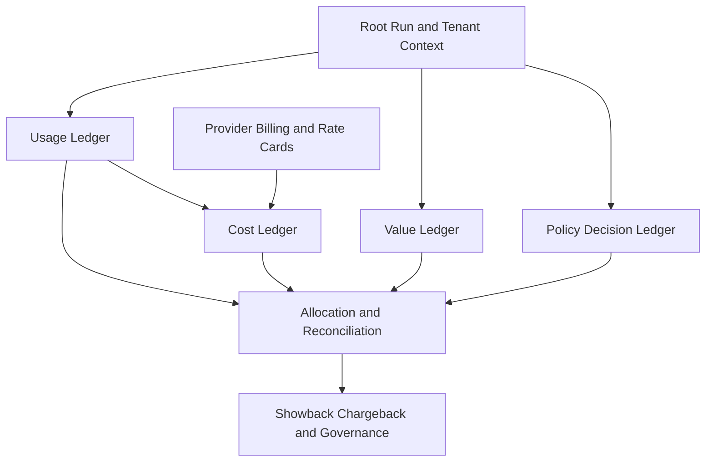
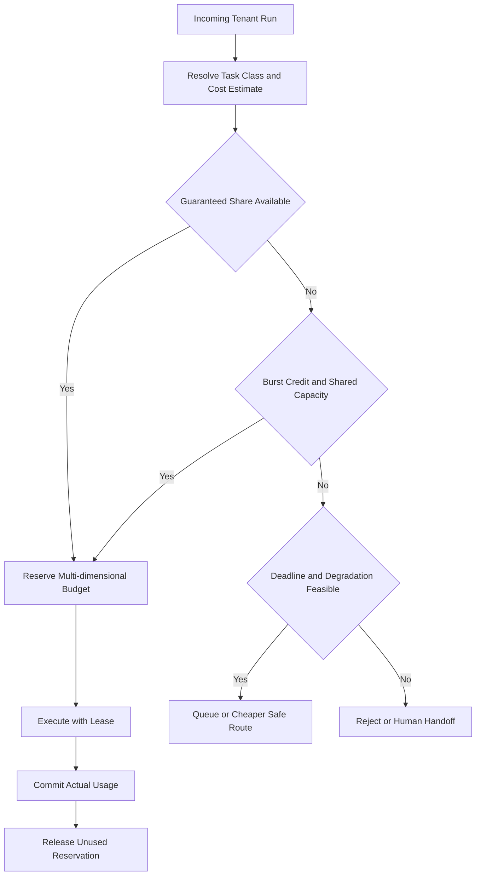
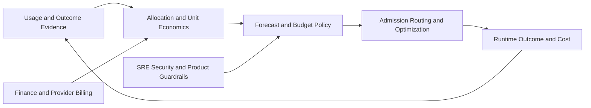

# AI Agent FinOps와 Multi-tenant Resource Governance 설계: Token·비용·Quota를 Tenant별 가치와 책임으로 연결하는 법

AI Agent 비용은 Token 요금만이 아닙니다. RAG 검색과 MCP 호출, 다른 Agent 위임, GPU 점유가 한 요청 안에서 함께 발생하는데 어느 테넌트의 어떤 업무가 썼는지 남지 않으면 통제할 수 없습니다. 이 글은 FinOps 관점에서 비용을 Tenant와 업무 Outcome에 배분하고 Guaranteed Share·Burst Credit·Budget Policy·Showback·Chargeback으로 공정성과 책임을 운영하는 방법을 정리합니다.

<blockquote id="aiarchitect-toc" data-ke-style="box" style="background-color: #f6f9fc; color: #263746; font-family: Pretendard-Regular, AppleSDGothicNeo-Regular, sans-serif; font-weight: 400;" data-mce-style="background-color: #f6f9fc; color: #263746; font-family: Pretendard-Regular, AppleSDGothicNeo-Regular, sans-serif; font-weight: 400;">
<p style="color: #263746; font-weight: 700;" data-mce-style="color: #263746; font-family: Pretendard-Regular, AppleSDGothicNeo-Regular, sans-serif; font-weight: 700;"><b>목차</b></p>
<ol style="list-style-type: decimal; color: #555555; font-weight: 400;" data-mce-style="list-style-type: decimal; color: #555555; font-weight: 400;" data-ke-list-type="decimal">
<li style="color: #555555; font-weight: 400;" data-mce-style="color: #555555; font-weight: 400;"><a href="#ai-section-1">AI Agent FinOps의 목표는 단순한 비용 절감이 아니다</a></li>
<li style="color: #555555; font-weight: 400;" data-mce-style="color: #555555; font-weight: 400;"><a href="#ai-section-2">관리 단위를 Tenant·Agent·Task Class·Outcome으로 정한다</a></li>
<li style="color: #555555; font-weight: 400;" data-mce-style="color: #555555; font-weight: 400;"><a href="#ai-section-3">Usage·Cost·Value·Policy 원장을 분리한다</a></li>
<li style="color: #555555; font-weight: 400;" data-mce-style="color: #555555; font-weight: 400;"><a href="#ai-section-4">Tenant Context를 실행 Graph 전체에 전달한다</a></li>
<li style="color: #555555; font-weight: 400;" data-mce-style="color: #555555; font-weight: 400;"><a href="#ai-section-5">Billing-grade Meter Event를 설계한다</a></li>
<li style="color: #555555; font-weight: 400;" data-mce-style="color: #555555; font-weight: 400;"><a href="#ai-section-6">실시간 추정 비용과 확정 청구 비용을 구분한다</a></li>
<li style="color: #555555; font-weight: 400;" data-mce-style="color: #555555; font-weight: 400;"><a href="#ai-section-7">FOCUS와 내부 실행 원장의 경계를 지킨다</a></li>
<li style="color: #555555; font-weight: 400;" data-mce-style="color: #555555; font-weight: 400;"><a href="#ai-section-8">비용을 Direct·Shared·Idle·Commitment Pool로 분해한다</a></li>
<li style="color: #555555; font-weight: 400;" data-mce-style="color: #555555; font-weight: 400;"><a href="#ai-section-9">Shared Cost를 인과 관계가 있는 Driver로 배분한다</a></li>
<li style="color: #555555; font-weight: 400;" data-mce-style="color: #555555; font-weight: 400;"><a href="#ai-section-10">Cost per Run보다 Cost per Outcome을 본다</a></li>
<li style="color: #555555; font-weight: 400;" data-mce-style="color: #555555; font-weight: 400;"><a href="#ai-section-11">비용 데이터에도 품질 SLO를 둔다</a></li>
<li style="color: #555555; font-weight: 400;" data-mce-style="color: #555555; font-weight: 400;"><a href="#ai-section-12">Budget의 목적과 시간 범위를 나눈다</a></li>
<li style="color: #555555; font-weight: 400;" data-mce-style="color: #555555; font-weight: 400;"><a href="#ai-section-13">Money 하나가 아닌 다차원 Budget Envelope를 사용한다</a></li>
<li style="color: #555555; font-weight: 400;" data-mce-style="color: #555555; font-weight: 400;"><a href="#ai-section-14">Guaranteed Share와 Burst Credit을 분리한다</a></li>
<li style="color: #555555; font-weight: 400;" data-mce-style="color: #555555; font-weight: 400;"><a href="#ai-section-15">빌려준 용량은 회수 가능한 Lease로 관리한다</a></li>
<li style="color: #555555; font-weight: 400;" data-mce-style="color: #555555; font-weight: 400;"><a href="#ai-section-16">Admission Control에서 공정성을 집행한다</a></li>
<li style="color: #555555; font-weight: 400;" data-mce-style="color: #555555; font-weight: 400;"><a href="#ai-section-17">Noisy Neighbor를 자원 종류별로 차단한다</a></li>
<li style="color: #555555; font-weight: 400;" data-mce-style="color: #555555; font-weight: 400;"><a href="#ai-section-18">Priority·Deadline·업무 가치를 함께 평가한다</a></li>
<li style="color: #555555; font-weight: 400;" data-mce-style="color: #555555; font-weight: 400;"><a href="#ai-section-19">조직·제품·Tenant·Task의 계층형 Budget을 운영한다</a></li>
<li style="color: #555555; font-weight: 400;" data-mce-style="color: #555555; font-weight: 400;"><a href="#ai-section-20">Showback과 Chargeback을 구분한다</a></li>
<li style="color: #555555; font-weight: 400;" data-mce-style="color: #555555; font-weight: 400;"><a href="#ai-section-21">Allocation Version과 Correction으로 재현성을 지킨다</a></li>
<li style="color: #555555; font-weight: 400;" data-mce-style="color: #555555; font-weight: 400;"><a href="#ai-section-22">Retry·Loop·Fallback을 비용 이상 징후로 탐지한다</a></li>
<li style="color: #555555; font-weight: 400;" data-mce-style="color: #555555; font-weight: 400;"><a href="#ai-section-23">Spend Velocity와 Budget Burn Rate를 운영 지표로 사용한다</a></li>
<li style="color: #555555; font-weight: 400;" data-mce-style="color: #555555; font-weight: 400;"><a href="#ai-section-24">Budget 초과 대응을 단계적 정책으로 만든다</a></li>
<li style="color: #555555; font-weight: 400;" data-mce-style="color: #555555; font-weight: 400;"><a href="#ai-section-25">저가 Model 전환에도 Quality Floor를 적용한다</a></li>
<li style="color: #555555; font-weight: 400;" data-mce-style="color: #555555; font-weight: 400;"><a href="#ai-section-26">절감 효과를 비용·품질·신뢰성으로 함께 검증한다</a></li>
<li style="color: #555555; font-weight: 400;" data-mce-style="color: #555555; font-weight: 400;"><a href="#ai-section-27">Kubernetes와 Provider Control Plane의 책임을 나눈다</a></li>
<li style="color: #555555; font-weight: 400;" data-mce-style="color: #555555; font-weight: 400;"><a href="#ai-section-28">합성 사례로 Tenant별 비용과 정책을 계산한다</a></li>
<li style="color: #555555; font-weight: 400;" data-mce-style="color: #555555; font-weight: 400;"><a href="#ai-section-29">Versioned FinOps Spec과 운영 체크리스트로 관리한다</a></li>
<li style="color: #555555; font-weight: 400;" data-mce-style="color: #555555; font-weight: 400;"><a href="#ai-section-30">공식 참고자료</a></li>
</ol>
</blockquote>

공용 AI Agent Platform을 여러 조직이 함께 사용합니다. 월말 보고서에는 Model Provider 비용과 GPU 비용이 합계로만 보입니다. 곧 다음 질문이 시작됩니다.

```text
어느 Tenant가 비용을 만들었는가?
공용 RAG·Queue·관측성 비용은 누구에게 배분해야 하는가?
중요 업무의 예약 용량을 누가 보장받는가?
남는 용량을 다른 Tenant가 빌려 써도 되는가?
예산이 부족하면 어떤 기능부터 줄여야 하는가?
비용을 줄인 결과 품질과 SLO가 나빠지지는 않았는가?
```

AI Agent 비용은 Model Token만이 아닙니다. RAG 검색, Vector Index, MCP Tool, A2A 전문 Agent, Workflow Store, Queue, 관측성, Human Review와 실패 후 Reconciliation도 비용을 만듭니다. 하나의 Tenant가 Retry Loop나 긴 Context로 공용 Quota를 소진하면 다른 Tenant의 정상 업무까지 지연됩니다.

AI Agent FinOps와 Multi-tenant Resource Governance의 목표는 **비용을 사후 집계하는 것이 아니라, 사용량·비용·업무 가치·정책을 같은 Run 계보로 연결하고 한정된 용량을 Tenant 사이에 예측 가능하고 공정하게 배분하는 것**입니다.

이 글은 [AI Agent 관측성](https://aiarchitect.tistory.com/72), [AI Agent Control Plane](https://aiarchitect.tistory.com/76), [AI Agent 실행 아키텍처](https://aiarchitect.tistory.com/77), [Agentic AI SRE](https://aiarchitect.tistory.com/82), [AI Agent Capacity Planning](https://aiarchitect.tistory.com/85)을 전제로 합니다. 특정 Provider의 현재 가격표를 비교하지 않고, Provider가 바뀌어도 유지되는 **Metering·Allocation·Budget·Admission·Showback·Chargeback 계약**에 집중합니다.

> 이 글의 Tenant, Agent, Model, Token, Quota, 가격, Budget과 수치는 모두 교육용 합성 예시입니다. 실제 가격·할인·세금·약정·환율·Quota는 Provider, 계정, 지역, Model, 계약과 시점에 따라 달라집니다. 재무 처리와 Chargeback은 조직의 회계 정책 및 확정 청구 데이터에 따라 결정해야 합니다.

## 1. AI Agent FinOps의 목표는 단순한 비용 절감이 아니다

FinOps는 비용을 무조건 줄이는 활동이 아닙니다. 기술 소비가 만드는 사업 가치를 이해하고 Engineering·Finance·Business가 함께 의사결정과 책임을 운영하는 방식입니다.

| 목표 | 질문 | 실패 예시 |
|---|---|---|
| Value | 비용이 어떤 Outcome을 만들었는가 | Token은 줄었지만 업무 완료율도 하락 |
| Efficiency | 같은 품질을 더 적은 자원으로 만들었는가 | Cache를 늘렸지만 오래된 근거 사용 |
| Governance | 누가 얼마를 사용할 수 있는가 | 한 Tenant가 공용 TPM과 Queue 독점 |

좋은 정책은 가장 싼 실행을 고르지 않습니다.

```text
FinOps Decision
  = maximize Business Value
  subject to
      Quality Floor
      Outcome SLO
      Security Policy
      Tenant Fairness
      Capacity Envelope
      Financial Budget
```

비용은 목적 함수의 한 항이고 품질·신뢰성·보안·공정성은 제약 조건입니다.

## 2. 관리 단위를 Tenant·Agent·Task Class·Outcome으로 정한다

Provider 청구서의 Service Name만으로는 비용 책임자를 찾을 수 없습니다. 최소 네 단위를 연결해야 합니다.

```yaml
finops_dimensions:
  tenant_id: tenant-alpha
  agent_id: meeting-agent
  agent_version: 24
  task_class: meeting-to-ticket
  outcome_type: approved_ticket_draft
```

- Tenant는 비용과 용량을 책임지는 조직·고객·제품 경계입니다.
- Agent는 실행 로직과 Model·Tool 선택의 소유 경계입니다.
- Task Class는 비슷한 실행 Graph와 SLO를 가진 업무 유형입니다.
- Outcome은 사용자가 실제로 받은 결과입니다.

Endpoint나 Model 단위 집계만 보면 업무 의미가 사라집니다. 반대로 Outcome만 보면 어떤 자원이 비용을 만들었는지 알 수 없습니다.

```text
Tenant
  → Product
    → Agent Version
      → Task Class
        → Root Run
          → Attempt
            → Model·RAG·MCP·A2A Usage
          → Outcome
```

이 계층은 비용 대시보드의 Drill-down 구조이면서 Budget과 Admission Policy의 Scope가 됩니다.

## 3. Usage·Cost·Value·Policy 원장을 분리한다

하나의 거대한 비용 테이블에 모든 것을 넣으면 확정 시점과 수정 규칙이 뒤섞입니다.



| 원장 | 핵심 데이터 | 갱신 특성 |
|---|---|---|
| Usage Ledger | Token·GPU-second·RAG·Tool·Queue | 실행 직후, 중복 제거 |
| Cost Ledger | 추정·유효·청구·배분 비용 | 가격·청구 도착 후 수정 |
| Value Ledger | 성공·승인·절감 시간·매출 기여 | 업무 시스템에서 지연 도착 |
| Policy Ledger | 허용·축소·거절·Budget 예약 | Admission 시 불변 기록 |

네 원장은 `root_run_id`, `tenant_id`, `task_class`, `meter_event_id`와 Version을 통해 연결합니다. 관측성 데이터의 보존 기간이 끝나도 재무 근거와 정책 결정을 재현할 수 있어야 합니다.

## 4. Tenant Context를 실행 Graph 전체에 전달한다

Tenant ID가 API Gateway에만 있으면 하위 Model·RAG·MCP·A2A 비용은 공용으로 남습니다. 인증된 Tenant Context를 Root Run부터 모든 Child Attempt에 전달합니다.

```yaml
tenant_context:
  tenant_id: tenant-alpha
  cost_center: cc-product-42
  product_id: support-suite
  plan_tier: enterprise
  budget_policy_id: bp-alpha-2026q3
  data_region: kr
  issued_at: 2026-08-12T08:00:00Z
  expires_at: 2026-08-12T08:15:00Z
  signature: detached-signature
```

- 인증·인가 경계에서 Tenant를 확정합니다.
- Workload Identity와 서명으로 변조를 막습니다.
- 하위 Agent는 상위 Tenant Scope보다 넓힐 수 없습니다.
- Queue Message와 Workflow Checkpoint에도 보존합니다.
- Late Result·Retry·Compensation에도 원래 Tenant를 유지합니다.

Model Prompt나 Tool Argument 전체를 비용 Label로 복사하지 않습니다. 민감정보와 높은 Cardinality를 피하고 안정적인 식별자만 전달합니다.

## 5. Billing-grade Meter Event를 설계한다

Trace는 디버깅에 유용하지만 Sampling·보존 기간·재처리 때문에 그대로 청구 원장으로 쓰기 어렵습니다. Billing-grade Meter Event는 별도의 내구성 계약을 가집니다.

```json
{
  "meter_event_id": "mev-01K2...",
  "occurred_at": "2026-08-12T08:01:22.412Z",
  "tenant_id": "tenant-alpha",
  "root_run_id": "run-7f2",
  "attempt_id": "att-03",
  "task_class": "meeting-to-ticket",
  "resource_type": "model_tokens",
  "quantity": {
    "input_tokens": 8400,
    "cache_read_input_tokens": 3100,
    "output_tokens": 920
  },
  "provider": "provider-a",
  "model_route": "reasoning-medium",
  "rate_card_version": "rc-2026-08-12",
  "schema_version": 3
}
```

Meter Event 계약은 다음을 포함합니다.

- 전역적으로 중복되지 않는 Event ID
- Event Time과 수집·처리 시각 분리
- 적어도 한 번 전달을 전제로 한 Idempotent 집계
- 단위와 수량의 명시적 Schema
- 음수 Correction과 원본 Event 참조
- 원본 Prompt·응답·Credential 제외
- Schema·Rate Card·Allocation Version 보존

Provider 응답의 Token Usage를 우선 사용하되, 누락되면 추정값임을 표시합니다. 추정값을 확정값처럼 Chargeback하지 않습니다.

OpenTelemetry GenAI Semantic Conventions의 Provider·Model·Input/Output Token 같은 공통 의미를 관측성 계층에 활용하고, 내부 Meter Event는 Billing에 필요한 Tenant·Rate·Correction 계약을 별도로 확장합니다. OpenTelemetry의 기존 GenAI Registry 항목은 전용 GenAI Semantic Conventions 저장소로 이동 중이므로 사용한 Schema Version을 고정하고 변경을 추적합니다. Span Sampling 여부와 관계없이 Billing Event는 누락되지 않아야 하며, Prompt·Tool Argument 같은 민감한 Content Attribute를 비용 계산을 위해 수집하지 않습니다.

## 6. 실시간 추정 비용과 확정 청구 비용을 구분한다

운영 정책은 월말 청구서를 기다릴 수 없고, 회계는 실시간 추정값만 믿을 수 없습니다.

```text
Estimated Cost
  → Repriced Cost
    → Effective Cost
      → Billed Cost
        → Allocated Cost
          → Chargeback Adjustment
```

| 비용 | 용도 | 데이터 근거 |
|---|---|---|
| Estimated | 실시간 Admission·Alert | Usage × 임시 Rate |
| Repriced | 가격표 변경 반영 | Usage × Versioned Rate Card |
| Effective | 할인·약정 상각 후 경제적 비용 | Provider Cost Export |
| Billed | Invoice 조정 | 확정 청구 데이터 |
| Allocated | Tenant 책임 배분 | Allocation Method |

실시간 Budget은 Estimated Cost로 보호하되 안전 여유를 둡니다. 월말 Showback과 Chargeback은 Effective·Billed Cost가 도착한 뒤 Reconciliation합니다.

```yaml
cost_record:
  amount: 0.1842
  currency: USD
  status: estimated
  confidence: medium
  rate_card_version: rc-2026-08-12
  superseded_by: null
```

하나의 숫자를 계속 덮어쓰지 않고 상태 전이와 Correction 계보를 보존해야 “왜 지난주 보고서와 금액이 다른가”를 설명할 수 있습니다.

## 7. FOCUS와 내부 실행 원장의 경계를 지킨다

FOCUS는 Provider가 다른 비용·사용량 데이터를 공통 용어와 Schema로 정규화하는 공개 표준입니다. 2026년 8월 12일 기준 공식 Specification 페이지는 1.3을 제공합니다.

```text
Provider Billing Export
  → FOCUS-normalized Cost and Usage Dataset
  → Cost Bridge
  ← Internal Run-level Usage Ledger
  → Tenant Allocation Dataset
```

FOCUS의 Provider·Service·SKU·Billing Account·Sub Account·Effective Cost 같은 열은 외부 비용 정규화에 사용합니다. Run·Outcome·Prompt Version 같은 고해상도 데이터는 내부 원장에 둡니다.

```yaml
cost_bridge:
  provider: provider-a
  billing_account_id: billing-17
  sub_account_id: ai-platform-prod
  service_name: managed-model-api
  charge_period: 2026-08-12T08:00:00Z/PT1H
  internal_usage_partition: usage-20260812-08
  allocation_method_id: alloc-token-route-v4
```

FOCUS 1.3의 Split Cost Allocation과 Custom Property를 사용할 때는 Specification의 규칙과 `x_` Prefix를 지킵니다. 하지만 임의의 내부 테이블을 “FOCUS 호환”이라고 부르지 않습니다. 원본 청구 합계 보존과 Conformance를 별도로 검증해야 합니다.

Currency와 세금도 한 숫자로 섞지 않습니다. Pricing Currency·Billing Currency·내부 Reporting Currency를 구분하고, 환율 출처·적용 시각·Version을 기록합니다. Tax·Credit·Refund·Marketplace Charge·약정 할인은 경제적 원인과 회계 정책이 다르므로 별도 Cost Pool로 보존한 뒤 배분 여부를 결정합니다. 특히 Provider Credit을 Usage 비율로 자동 환원할지, 계약을 책임진 중앙 조직에 둘지는 Finance와 사전에 합의해야 합니다.

## 8. 비용을 Direct·Shared·Idle·Commitment Pool로 분해한다

모든 비용에 같은 배분식을 적용하면 책임과 개선 신호가 왜곡됩니다.

| Cost Pool | 예시 | 기본 배분 원칙 |
|---|---|---|
| Direct Variable | Model Token·전용 Tool API | 실제 Tenant Usage |
| Shared Variable | 공용 RAG·Queue·관측성 | 인과적 Usage Driver |
| Fixed Platform | Control Plane·Registry | 합의된 고정 또는 혼합 기준 |
| Idle·Headroom | Warm GPU·Failover Reserve | 예약 책임 또는 중앙 전략비 |
| Commitment | 선결제·Reserved Capacity | 수혜·예약·위험 부담 기준 |

```yaml
cost_pool:
  id: pool-shared-rag-2026-08
  type: shared_variable
  total_effective_cost: 18420.00
  currency: USD
  allocation_driver: weighted_query_compute
  allocation_method_version: 5
```

Idle Cost를 사용량이 많은 Tenant에만 배분하면 예약한 Tenant의 책임이 사라질 수 있습니다. 반대로 모든 Platform 비용을 균등 분배하면 소형 Tenant가 대형 Tenant를 보조합니다. Cost Pool별 경제적 원인을 먼저 정의해야 합니다.

## 9. Shared Cost를 인과 관계가 있는 Driver로 배분한다

공용 비용은 Run 수만으로 나누기 쉽지만 Run별 부담이 크게 다릅니다.

```text
Tenant Share
  = Tenant Weighted Usage
    / Sum(All Tenant Weighted Usage)

Weighted Usage
  = Model Input Token × w1
  + Model Output Token × w2
  + GPU-second × w3
  + Vector Query Compute Unit × w4
  + Workflow State GB-hour × w5
```

좋은 Allocation Driver는 비용 발생과 인과 관계가 있고, Tenant가 이해하고 개선할 수 있으며, 동일 Version과 입력으로 재계산할 수 있어야 합니다.

공용 관측성 비용은 Trace Byte, 공용 Queue는 Message Processing Time, Vector DB는 Query Compute·저장량을 사용할 수 있습니다. 완벽한 정확성보다 일관되고 설명 가능한 Approximation이 낫지만, 오차와 Unallocated 비율은 공개해야 합니다.

Allocation Driver가 Tenant 행동에 따라 쉽게 조작되지 않는지도 확인합니다. 예를 들어 Run 수만 기준으로 삼으면 큰 Run을 합쳐 부담을 줄이거나 작은 Run으로 쪼개 다른 정책을 우회할 수 있습니다. Driver 변경은 FinOps·Platform·Tenant 대표가 검토하고, 변경 전후 Tenant별 영향과 Cross-subsidy를 Simulation한 뒤 다음 Period부터 적용합니다.

```yaml
allocation_quality:
  allocated_cost_coverage: 0.985
  unallocated_cost_ratio: 0.015
  estimated_usage_ratio: 0.032
  stale_owner_ratio: 0.004
```

## 10. Cost per Run보다 Cost per Outcome을 본다

Run 단가는 실행 효율을 보여주지만 실패·재시도·사람 검토를 숨길 수 있습니다.

```text
Cost per Successful Outcome
  = Total Allocated Cost
    / Successful Business Outcomes

Cost per Approved Outcome
  = (
      Model + RAG + Tool + Platform
      + Human Review + Reconciliation
    )
    / Approved Outcomes
```

| Agent | Run 단가 | 성공률 | 성공 Outcome 단가 |
|---|---:|---:|---:|
| A | 0.20 | 50% | 0.40 |
| B | 0.27 | 90% | 0.30 |

싼 Model을 선택해 Run 단가가 줄었지만 승인율이 크게 떨어지면 Unit Economics는 악화됩니다. 가치 지표는 승인된 Ticket Draft, 해결된 고객 문의, 사람 검토 시간 절감, 중복 Side Effect 없이 완료된 Workflow처럼 업무별로 정의합니다.

## 11. 비용 데이터에도 품질 SLO를 둔다

잘못된 Tenant ID와 누락된 Token은 정책을 잘못 집행합니다. 비용 데이터 Pipeline에도 SLO가 필요합니다.

```yaml
finops_data_slo:
  metering_completeness:
    target: 0.999
    window: 24h
  allocation_coverage:
    target: 0.98
    window: billing_period
  estimated_cost_freshness_p95_minutes:
    target: 5
  invoice_reconciliation_difference:
    target: 0.001
  correction_completion_hours:
    target: 24
```

필수 검사는 다음과 같습니다.

- Root Run과 Meter Event 수량 대사
- Provider Usage와 내부 Usage 차이
- Invoice 총액과 FOCUS 정규화 합계 보존
- Unknown Tenant·Cost Center 비율
- 중복 Event·Late Event·음수 Correction 비율
- Rate Card 유효 기간과 Currency
- Allocation 전후 Cost Conservation

```text
Sum(Source Cost)
  = Sum(Allocated Cost)
    + Explicit Unallocated Cost
    + Explicit Rounding Difference
```

차이를 숨기기 위해 임의의 Tenant에 밀어 넣지 않습니다.

## 12. Budget의 목적과 시간 범위를 나눈다

“월 예산 1억” 하나로는 실시간 폭주와 장기 투자를 함께 관리할 수 없습니다.

| Budget | 시간 범위 | 목적 |
|---|---|---|
| Run Budget | 초·분 | 단일 실행 Loop·Token 폭주 제한 |
| Operational Budget | 시간·일 | 실시간 Tenant 소비 제어 |
| Period Budget | 월·분기 | Forecast·Showback·책임 관리 |
| Experiment Budget | 캠페인·기간 | 탐색적 AI 사용의 손실 상한 |
| Reserve Budget | 장애·Peak | 중요 업무와 복구 용량 보호 |

```yaml
budget_scope:
  tenant_id: tenant-alpha
  period: 2026-08
  committed: 5000
  forecast_limit: 6500
  hard_ceiling: 7200
  experiment_pool: 400
  incident_reserve: 300
  currency: USD
```

Forecast Limit은 계획 수정 신호이고 Hard Ceiling은 실행 차단 신호입니다. 두 값을 같게 두면 정상적인 일중 변동에도 서비스가 갑자기 멈춥니다.

## 13. Money 하나가 아닌 다차원 Budget Envelope를 사용한다

비용 예산이 남아도 Provider TPM이 소진되거나 GPU Slot이 부족할 수 있습니다. Budget은 Capacity와 같은 Vector여야 합니다.

```yaml
budget_envelope:
  tenant_id: tenant-alpha
  money:
    monthly_usd: 6500
    daily_soft_usd: 240
  model:
    input_tokens_per_minute: 180000
    output_tokens_per_minute: 24000
    concurrent_requests: 24
  runtime:
    active_runs: 40
    gpu_seconds_per_hour: 900
  dependencies:
    vector_queries_per_second: 12
    mcp_writes_per_minute: 60
  risk:
    irreversible_actions_per_hour: 20
```

Money Limit은 환율·가격 지연 때문에 운영 보호가 늦을 수 있습니다. Token·Concurrency·Write 같은 물리·논리 Limit을 함께 사용하면 현재 시스템과 Downstream을 즉시 보호할 수 있습니다.

```text
Admissible
  = Money Budget Available
  AND Token Budget Available
  AND Concurrency Available
  AND Dependency Quota Available
  AND Risk Budget Available
```

## 14. Guaranteed Share와 Burst Credit을 분리한다

Tenant마다 최소 보장과 일시적 초과 사용을 분리합니다.

```yaml
resource_share:
  tenant_id: tenant-alpha
  guaranteed:
    input_tpm: 120000
    concurrent_runs: 20
  burst:
    input_tpm_max: 240000
    concurrent_runs_max: 40
    credit_refill_per_minute: 8000
    credit_capacity: 480000
```

Guaranteed Share는 다른 Tenant가 사용 중이어도 회수 가능한 최소 계약입니다. Burst Credit은 공용 잉여 용량이 있을 때만 사용할 수 있습니다.

```text
Allowed Usage
  = Guaranteed Share
    + min(
        Available Shared Capacity,
        Burst Credit Balance,
        Financial Budget Remaining
      )
```

Guaranteed Share를 너무 높이면 공용 효율이 떨어지고, 너무 낮으면 Premium·Critical 업무의 SLO가 불안정해집니다. Capacity Plan과 계약 Tier를 함께 보며 조정합니다.

## 15. 빌려준 용량은 회수 가능한 Lease로 관리한다

남는 예약 용량을 놀리지 않으려면 다른 Tenant가 빌릴 수 있어야 합니다. 다만 소유 Tenant의 수요가 돌아오면 예측 가능하게 회수해야 합니다.

```yaml
borrow_lease:
  lease_id: bl-882
  lender_pool: guaranteed-alpha
  borrower_tenant: tenant-beta
  resource: input_tpm
  amount: 40000
  expires_at: 2026-08-12T08:06:00Z
  reclaim_notice_seconds: 30
  preemptible: true
  allowed_task_classes:
    - batch-summary
```

회수 정책은 다음 순서를 사용합니다.

```text
Stop New Borrowed Admissions
  → Let Short Runs Drain
  → Checkpoint Long Tasks
  → Move Batch to Queue
  → Restore Lender Guarantee
```

Irreversible Write가 진행 중인 Run을 즉시 Kill하면 비용 절감보다 정합성 복구 비용이 커집니다. Borrowed Capacity에는 Preemptible Task만 배치하고 Side Effect 단계는 별도 예약으로 보호합니다.

## 16. Admission Control에서 공정성을 집행한다

비용 보고서는 사후 설명이고 Admission Control은 현재의 공정성을 집행합니다.

단, Budget은 인가가 아닙니다. Tenant에게 비용과 용량이 남아 있어도 사용자·Agent·Tool 권한, Data Region, Risk Policy와 승인 조건을 통과하지 못하면 요청을 실행하지 않습니다. 반대로 Budget 부족을 이유로 기존 보안 검사를 생략하거나 더 넓은 저가 Data Source·Tool로 우회해서도 안 됩니다. Authorization Gate를 먼저 통과한 후보에만 Capacity·Budget Gate를 적용합니다.



Admission 전에 예상 비용과 최악의 상한을 예약합니다.

```text
Reserved Cost
  = Estimated Base Cost
    × Retry Reserve
    × Context Growth Reserve
    + Side Effect Reconciliation Reserve
```

완료 후 실제 사용량만 Commit하고 남은 예약을 반환합니다. 예약 TTL과 Fencing Token으로 Worker 장애 뒤 Budget이 영구 잠기거나 이중 소비되는 것을 막습니다.

공정성 알고리즘은 단순 선착순보다 Weighted Fair Queue·Deficit Round Robin 같은 방식이 적합합니다. Tenant Weight와 Task Cost를 함께 고려해야 작은 요청이 거대한 Batch 뒤에서 굶지 않습니다.

## 17. Noisy Neighbor를 자원 종류별로 차단한다

Noisy Neighbor는 CPU만의 문제가 아닙니다.

| 자원 | 독점 패턴 | 보호 장치 |
|---|---|---|
| Model | 긴 Context·Output·동시 요청 | TPM·Output Cap·Concurrency |
| RAG | 광범위 검색·과도한 Rerank | Query Unit·Top-k·Index 격리 |
| MCP | 느린 Tool·Write 폭주 | Bulkhead·Rate·Write Budget |
| A2A | Fan-out·장기 Task | Delegation Count·Active Task |
| Workflow | 큰 State·빈번한 Checkpoint | GB-hour·IOPS·TTL |
| Observability | Prompt Payload·고 Cardinality | Sampling·Byte Budget |

```yaml
tenant_guardrail:
  max_agent_depth: 5
  max_delegations_per_run: 12
  max_tool_attempts_per_run: 18
  max_context_tokens: 48000
  max_output_tokens: 3000
  max_trace_bytes_per_run: 262144
```

Tenant 격리는 Security Isolation, Performance Isolation, Financial Isolation을 모두 포함합니다. Namespace 하나나 비용 Tag 하나로 세 경계가 자동으로 만들어지지 않습니다.

## 18. Priority·Deadline·업무 가치를 함께 평가한다

비싼 요청을 무조건 뒤로 보내면 중요한 업무가 실패하고, 높은 Priority만 믿으면 모든 팀이 자신을 Critical로 지정합니다.

```text
Admission Score
  = Contract Weight
    + Deadline Urgency
    + Business Value Class
    + Guaranteed Deficit
    - Estimated Resource Cost
    - Risk Penalty
```

Hard Gate와 Soft Ranking을 나눕니다.

```yaml
hard_gate:
  tenant_authorized: true
  risk_policy_pass: true
  deadline_feasible: true
  hard_budget_available: true

soft_rank:
  priority_class: business-critical
  tenant_weight: 4
  queue_age_seconds: 1.8
  estimated_cost_usd: 0.42
```

Priority Class 발급 권한을 중앙 정책으로 제한하고 사용량 자체에도 Quota를 둡니다. 그렇지 않으면 High Priority가 새 Noisy Neighbor가 됩니다.

## 19. 조직·제품·Tenant·Task의 계층형 Budget을 운영한다

Budget은 조직 구조와 실행 구조를 동시에 반영합니다.

```text
Enterprise AI Budget
  ├─ Shared Platform
  ├─ Product A
  │   ├─ Tenant Alpha
  │   │   ├─ Interactive
  │   │   └─ Batch
  │   └─ Tenant Beta
  └─ Experiments
```

Child Budget이 남아도 Parent Budget이 소진되면 새 소비를 허용할 수 없습니다.

```text
Effective Remaining
  = min(
      Enterprise Remaining,
      Product Remaining,
      Tenant Remaining,
      Task Pool Remaining
    )
```

반대로 Parent Budget이 남아도 특정 Tenant Hard Ceiling을 넘기지 않습니다. 예외는 승인된 Budget Transfer로 처리하고, 누가 왜 얼마를 옮겼는지 Audit에 남깁니다.

```yaml
budget_transfer:
  from: product-a.experiment
  to: product-a.tenant-alpha.incident-reserve
  amount: 200
  currency: USD
  approved_by:
    - product-owner
    - finops-owner
  expires_at: 2026-08-13T00:00:00Z
```

## 20. Showback과 Chargeback을 구분한다

Showback은 팀에 사용량과 비용을 보여 책임 있는 의사결정을 돕습니다. Chargeback은 실제 회계 예산·Cost Center에 비용을 반영하는 공식 절차입니다.

| 항목 | Showback | Chargeback |
|---|---|---|
| 목적 | 투명성·학습·개선 | 공식 재무 책임 |
| 데이터 | 추정값 포함 가능 | 확정·조정된 비용 중심 |
| 빈도 | 실시간·일·주 | 회계 마감 주기 |
| 오류 처리 | Dashboard Correction | 회계 Adjustment |
| 필수성 | 모든 운영에 권장 | 조직 회계 정책에 따라 선택 |

FinOps Foundation도 Showback은 항상 필요하지만 Chargeback은 조직 정책에 따라 달라진다고 설명합니다. Chargeback을 “더 성숙한 단계”로 간주해 무조건 도입할 필요는 없습니다.

Showback 보고서는 Period Budget·Actual·Forecast, Tenant·Agent·Task Class별 비용, Direct·Shared·Idle 구분, Cost per Successful Outcome, Retry·Failure·Waste Cost, Allocation Method와 Data Confidence를 함께 제공합니다.

## 21. Allocation Version과 Correction으로 재현성을 지킨다

Shared Cost 배분식이 바뀌면 같은 Usage도 다른 금액이 됩니다. 보고서에는 계산 Version을 고정합니다.

```yaml
allocation_spec:
  id: alloc-ai-platform-v7
  effective_from: 2026-08-01
  cost_pools:
    model_api: direct_usage
    shared_rag: weighted_query_compute_v3
    control_plane: guaranteed_share_plus_usage
    idle_gpu: reservation_owner
  rounding: largest_remainder
  unallocated_target: central-finops
```

Correction은 원본을 삭제하지 않고 반전·대체 Event로 처리합니다.

```json
{
  "correction_id": "cor-882",
  "reverses_allocation_record": "ar-201",
  "reason": "late_provider_discount",
  "old_amount": 184.20,
  "new_amount": 161.80,
  "allocation_method_version": 7,
  "approved_at": "2026-08-15T02:00:00Z"
}
```

이미 마감된 기간은 조직의 회계 정책에 따라 당월 Adjustment 또는 이전 기간 재작성으로 구분합니다.

금액이 Materiality Threshold를 넘거나 여러 Tenant의 Chargeback을 바꾸는 Correction은 작성자와 승인자를 분리합니다. 변경 사유, 영향 Tenant, 이전·새 금액, 환율·Rate·Allocation Version과 회계 반영 Period를 불변 Audit에 남깁니다.

## 22. Retry·Loop·Fallback을 비용 이상 징후로 탐지한다

AI Agent 비용 이상은 가격 상승보다 실행 Graph의 비정상 증폭에서 자주 시작합니다.

```text
Waste Cost
  = Failed Attempt Cost
    + Duplicate Tool Cost
    + Unused Output Cost
    + Excess Context Cost
    + Reconciliation Cost
```

탐지할 패턴은 다음과 같습니다.

- Run당 Model Attempt 급증
- 같은 Tool Argument의 반복 호출
- Output Length와 Truncation 동시 증가
- Cache Hit 하락과 Input Token 상승
- Fallback Route가 Primary보다 오래 유지
- 성공 Outcome은 일정한데 Cost per Outcome 급증
- 한 Tenant의 Spend와 Queue Age가 동시에 상승

```yaml
cost_anomaly:
  scope: tenant-beta/meeting-to-ticket
  signal: cost_per_successful_outcome
  baseline: 0.31
  observed: 0.74
  correlated:
    retry_amplification: 2.6
    cache_hit_ratio: 0.18
    outcome_rate: 0.91
  action: freeze-agent-version-25
```

비용 Alert를 FinOps 팀에만 보내지 않습니다. Root Run·Agent Version·Owner가 있어야 Engineering이 원인을 수정할 수 있습니다.

## 23. Spend Velocity와 Budget Burn Rate를 운영 지표로 사용한다

월 누적 비용은 폭주를 너무 늦게 보여줍니다.

```text
Spend Velocity
  = Cost in Recent Window
    / Window Duration

Budget Burn Rate
  = Actual Spend Rate
    / Planned Spend Rate

Time to Exhaust
  = Remaining Budget
    / Current Spend Velocity
```

예를 들어 30일 Budget이 3,000이고 10일째 Actual이 1,500이면 선형 계획 대비 Burn Rate는 다음과 같습니다.

```text
Planned Spend at Day 10
  = 3000 × 10 / 30
  = 1000

Budget Burn Rate
  = 1500 / 1000
  = 1.5
```

Burn Rate 1.5가 곧 장애는 아닙니다. 출시·월초 Batch·계약 Event를 Forecast에 넣고 여러 Window를 봅니다.

```yaml
budget_alert:
  fast_window:
    duration: 1h
    burn_rate: 3.0
  slow_window:
    duration: 24h
    burn_rate: 1.3
  require_both: true
```

SRE Error Budget의 Multi-window Burn Rate와 비슷한 형태를 사용할 수 있지만, 비용 Budget은 소진 후 복구되지 않는 기간 누적량이라는 차이를 반영해야 합니다.

## 24. Budget 초과 대응을 단계적 정책으로 만든다

Hard Kill 하나만 두면 중요한 업무와 진행 중 Side Effect가 함께 중단됩니다.

```yaml
budget_policy:
  thresholds:
    - at: 0.70
      actions:
        - notify_owner
        - disable_nonessential_tracing_payload
    - at: 0.85
      actions:
        - route_batch_to_economy
        - reduce_optional_rerank
    - at: 0.95
      actions:
        - stop_new_experiments
        - queue_low_priority
    - at: 1.00
      actions:
        - allow_guaranteed_critical_only
        - require_budget_exception
```

정책 단계는 다음 순서를 따릅니다.

```text
Inform
  → Optimize Optional Work
    → Slow or Queue Low Priority
      → Degrade Safely
        → Reject New Non-critical Work
          → Preserve Critical and Reconciliation
```

이미 시작한 Write·결제·승인 Workflow의 조정 비용은 Reserve로 보호합니다. Budget 초과가 정합성 훼손의 이유가 되어서는 안 됩니다.

## 25. 저가 Model 전환에도 Quality Floor를 적용한다

Model Route 변경은 가장 큰 절감 수단이면서 품질 위험입니다.

```yaml
economy_route_policy:
  eligible:
    task_classes:
      - extract-action-items
      - classify-intent
    risk_tier_max: medium
  require:
    evaluation_dataset: eval-42
    quality_score_min: 0.88
    outcome_rate_min: 0.97
    latency_p95_seconds_max: 6
  exclude:
    - legal-final-decision
    - irreversible-tool-approval
```

Route는 Cost만으로 Rank하지 않습니다.

```text
Route Utility
  = Expected Outcome Value
    - Expected Total Cost
    - Quality Risk Penalty
    - Latency Penalty
    - Failure and Reconciliation Cost
```

저가 Model이 더 많은 Retry·Human Review를 만들면 총비용이 올라갑니다. Canary와 Evaluation Gate를 거쳐 Cost per Successful Outcome이 실제로 좋아지는지 검증합니다.

## 26. 절감 효과를 비용·품질·신뢰성으로 함께 검증한다

Optimization은 가설과 Guardrail을 가진 Experiment로 운영합니다.

| 최적화 | 기대 절감 | 함께 볼 Guardrail |
|---|---|---|
| Context 축소 | Input Token | 근거 Recall·품질 |
| Prompt Cache | Input 비용·지연 | Cache 오염·신선도 |
| Batch 처리 | Provider 단가 | Deadline·Queue Age |
| Top-k 축소 | RAG 비용 | 정답 근거 포함률 |
| Output Cap | Output Token | 완결성·Truncation |
| Model Downgrade | Token 단가 | 승인율·재시도 |
| Trace Sampling | 관측 비용 | Incident 진단 가능성 |

```yaml
optimization_experiment:
  id: opt-context-17
  baseline:
    cost_per_outcome: 0.42
    quality_score: 0.91
    outcome_rate: 0.982
  candidate_gate:
    cost_reduction_min: 0.15
    quality_score_drop_max: 0.01
    outcome_rate_min: 0.98
    duplicate_effect_max: 0
```

절감 금액은 List Price가 아니라 가능한 경우 Effective Cost 기준으로 계산합니다. 약정이 남아 있어 현금 지출이 바로 줄지 않는다면 “사용량 절감”과 “실현 비용 절감”을 분리합니다.

## 27. Kubernetes와 Provider Control Plane의 책임을 나눈다

Kubernetes ResourceQuota는 Namespace의 CPU·Memory·Object 수 등을 제한할 수 있지만 외부 Model TPM·Token 비용·MCP Write·업무 Outcome은 알지 못합니다.

```text
Kubernetes Control
  - Namespace and RBAC
  - CPU Memory GPU Request and Limit
  - ResourceQuota and LimitRange
  - PriorityClass and Scheduling
  - NetworkPolicy

AI Resource Governance
  - Tenant Context
  - Token and Provider Quota
  - Run and Task Budget
  - MCP and A2A Concurrency
  - Outcome and Cost Policy
```

두 계층을 연결합니다.

```yaml
tenant_runtime_mapping:
  tenant_id: tenant-alpha
  namespace: ai-tenant-alpha
  kubernetes_quota: rq-alpha-v8
  priority_classes:
    allowed:
      - ai-standard
      - ai-business-critical
  provider_budget_pool: provider-a-alpha
  network_policy: default-deny-plus-approved-egress
```

Kubernetes 공식 문서가 설명하듯 Namespace는 주요 정책 Scope이지만 완전한 보안 경계로 단정할 수 없습니다. 엄격한 Tenant 격리는 Default-deny NetworkPolicy, Admission Policy, Workload Identity, Secret·Data 경계와 별도 Cluster·Silo 필요성을 함께 평가합니다.

PriorityClass도 권한과 ResourceQuota로 제한합니다. 모든 Tenant가 최고 Priority를 선택할 수 있으면 공정성이 무너집니다.

Self-hosted GPU는 다음 단위로 Metering합니다.

```text
GPU Effective Cost per Outcome
  = (
      Allocated GPU Capacity Cost
      + Energy and Platform Cost
      + Idle and Failover Reserve
    )
    / Successful Outcomes
```

GPU-second만 배분하면 긴 Prefill과 KV Cache 압력을 놓칠 수 있으므로 Model별 Profile과 Active Sequence·Token Throughput을 함께 봅니다.

## 28. 합성 사례로 Tenant별 비용과 정책을 계산한다

공용 Meeting Agent Platform에 Alpha·Beta·Gamma 세 Tenant가 있다고 가정합니다.

### 비용 Pool

```yaml
monthly_cost_pool:
  direct:
    alpha: 4200
    beta: 5000
    gamma: 2100
  shared_variable: 3000
  idle_and_failover_reserve: 900
  currency: USD
```

Shared Variable Cost는 Model·RAG·Queue의 Weighted Usage로 배분합니다.

```text
Weighted Usage Share
  Alpha = 0.40
  Beta  = 0.45
  Gamma = 0.15

Shared Allocation
  Alpha = 3000 × 0.40 = 1200
  Beta  = 3000 × 0.45 = 1350
  Gamma = 3000 × 0.15 = 450
```

Idle·Failover Reserve는 Guaranteed Share 50%·30%·20%로 배분합니다.

```text
Reserve Allocation
  Alpha = 900 × 0.50 = 450
  Beta  = 900 × 0.30 = 270
  Gamma = 900 × 0.20 = 180
```

### Tenant별 총비용과 Outcome 단가

| Tenant | Direct | Shared | Reserve | 총비용 | 성공 Outcome | Outcome 단가 |
|---|---:|---:|---:|---:|---:|---:|
| Alpha | 4,200 | 1,200 | 450 | 5,850 | 10,800 | 0.54 |
| Beta | 5,000 | 1,350 | 270 | 6,620 | 27,000 | 0.25 |
| Gamma | 2,100 | 450 | 180 | 2,730 | 6,800 | 0.40 |
| 합계 | 11,300 | 3,000 | 900 | 15,200 | 44,600 | 0.34 |

```text
Cost Conservation
  = Direct 11300
    + Shared 3000
    + Reserve 900
  = 15200

Allocated Total
  = Alpha 5850
    + Beta 6620
    + Gamma 2730
  = 15200
```

Alpha의 Outcome 단가가 높은 이유를 “낭비”라고 즉시 결론 내리지 않습니다. 보장 용량, 높은 Risk Tier, Human Review가 가치 계약에 포함됐는지 확인합니다.

### Budget 정책 판정

```yaml
tenant_forecast:
  alpha:
    forecast: 6200
    limit: 6500
    action: monitor
  beta:
    forecast: 6800
    limit: 7000
    action: preserve_guarantee
  gamma:
    forecast: 3600
    limit: 3200
    action:
      - stop_experiment_pool
      - economy_route_for_batch
      - queue_low_priority
```

Gamma가 Limit을 넘었다고 진행 중 MCP Write를 Kill하지 않습니다. 새 Experiment를 중단하고 Batch를 Economy Route로 이동하며, Critical Guaranteed Share와 Reconciliation Budget은 유지합니다.

## 29. Versioned FinOps Spec과 운영 체크리스트로 관리한다

정책·가격·배분식은 코드와 같은 변경 관리 대상입니다.

```yaml
ai_finops_spec:
  id: finops-ai-platform-2026q3-v8
  owner: ai-platform-finops
  tenant_model_version: tenant-model-12
  meter_schema_version: 3
  rate_card_version: rc-2026-08-12
  focus_version: 1.3
  allocation_method_version: 7
  budget_policy_version: 11
  capacity_plan_version: cap-2026q3-v4
  evidence:
    reconciliation_run: recon-20260812
    allocation_test: alloc-test-93
    policy_simulation: sim-budget-41
```

역할을 분리합니다.

| 역할 | 책임 |
|---|---|
| FinOps | Allocation·Forecast·Showback·이상 관리 |
| AI Platform | Metering·Admission·Route·Quota 집행 |
| Product·Tenant Owner | Outcome·Budget·우선순위 책임 |
| Finance·Accounting | Invoice·Chargeback·마감·Correction |
| SRE | SLO·Capacity·Incident·복구 Reserve |
| Security·Risk | Tenant 격리·Risk Budget·예외 승인 |



### 1단계: Metering과 Attribution

- [ ] Tenant Context를 Root Run·Queue·MCP·A2A에 보존한다.
- [ ] Billing-grade Meter Event와 중복 제거를 구현한다.
- [ ] Usage·Cost·Value·Policy 원장을 분리한다.
- [ ] Unknown Tenant·Unallocated Cost를 명시한다.

### 2단계: Cost Normalization과 Allocation

- [ ] Provider 비용을 FOCUS 기반 공통 용어로 정규화한다.
- [ ] Direct·Shared·Idle·Commitment Pool을 구분한다.
- [ ] Shared Cost Driver와 Allocation Version을 승인한다.
- [ ] Source·Allocated Cost Conservation을 검증한다.

### 3단계: Unit Economics와 Showback

- [ ] Run·성공 Outcome·승인 Outcome 단가를 계산한다.
- [ ] Retry·Failure·Human Review·Reconciliation 비용을 포함한다.
- [ ] Actual·Forecast·Budget과 Data Confidence를 함께 보여준다.
- [ ] Chargeback 필요성을 회계 정책과 별도로 결정한다.

### 4단계: Multi-tenant Governance

- [ ] Tenant별 Guaranteed Share·Burst Credit을 정의한다.
- [ ] Borrowed Capacity를 회수 가능한 Lease로 운영한다.
- [ ] Money·Token·Concurrency·Tool·Risk Budget을 예약한다.
- [ ] Priority 발급 권한과 Noisy Neighbor Guardrail을 적용한다.

### 5단계: Closed-loop Optimization

- [ ] Spend Velocity·Burn Rate·Cost per Outcome 이상을 탐지한다.
- [ ] Budget 단계별 Degradation·Queue·Reject 정책을 시험한다.
- [ ] 저가 Route에 Evaluation·Quality·SLO Gate를 적용한다.
- [ ] Allocation·Rate·Policy 변경을 Simulation과 Audit로 검증한다.

핵심 원칙을 정리하면 다음과 같습니다.

```text
Token 비용만 보지 말고 전체 실행 Graph 비용을 측정한다.
Tenant·Agent·Task Class·Outcome을 같은 계보로 연결한다.
실시간 추정 비용과 확정 청구 비용을 분리한다.
FOCUS 비용 데이터와 Run-level Usage 원장의 책임을 나눈다.
Shared Cost는 인과적 Driver와 Versioned Method로 배분한다.
Money·Token·Concurrency·Risk를 다차원 Budget으로 예약한다.
Guaranteed Share와 Burst·Borrowed Capacity를 구분한다.
비용 절감은 Quality·SLO·Security Floor 안에서만 허용한다.
Showback은 기본으로 운영하고 Chargeback은 회계 정책에 따라 선택한다.
비용 정책을 Admission·Routing·Evaluation으로 닫힌 제어 Loop에 연결한다.
```

좋은 AI Agent FinOps는 월말에 “누가 얼마를 썼다”는 표를 만드는 데서 끝나지 않습니다. 어떤 Tenant의 어떤 업무 Outcome이 어떤 자원을 소비했고, 공용 비용이 어떤 근거로 배분됐으며, Budget과 용량이 부족할 때 어떤 업무를 보호·축소·대기·거절했는지를 재현 가능한 Evidence로 설명합니다.

다음 글에서는 FinOps·Capacity·SLO·Evaluation Evidence를 실제 배포 의사결정에 연결하는 **AI Agent Release Governance와 Progressive Delivery**를 다룹니다. Agent·Prompt·Model·Tool·Policy Version을 하나의 Release Bundle로 묶고 Offline Gate·Shadow·Canary·자동 Rollback을 설계하는 방법을 살펴봅니다.

## 30. 공식 참고자료

- [FinOps Foundation — FinOps Framework Overview](https://www.finops.org/framework/)
- [FinOps Foundation — FinOps for AI](https://www.finops.org/framework/technology-categories/ai/)
- [FinOps Foundation — Allocation Capability](https://www.finops.org/framework/capabilities/allocation/)
- [FinOps Foundation — Unit Economics Capability](https://www.finops.org/framework/capabilities/unit-economics/)
- [FinOps Foundation — Invoicing & Chargeback Capability](https://www.finops.org/framework/capabilities/invoicing-chargeback/)
- [FinOps Foundation — Anomaly Management Capability](https://www.finops.org/framework/capabilities/anomaly-management/)
- [FOCUS — FOCUS Specification v1.3](https://focus.finops.org/focus-specification/v1-3/)
- [AWS Well-Architected SaaS Lens — Expenditure Awareness](https://docs.aws.amazon.com/wellarchitected/latest/saas-lens/expenditure-awareness.html)
- [AWS Well-Architected SaaS Lens — General Design Principles](https://docs.aws.amazon.com/wellarchitected/latest/saas-lens/general-design-principles.html)
- [Kubernetes — Multi-tenancy](https://kubernetes.io/docs/concepts/security/multi-tenancy/)
- [Kubernetes — Resource Quotas](https://kubernetes.io/docs/concepts/policy/resource-quotas/)
- [Kubernetes — Pod Priority and Preemption](https://kubernetes.io/docs/concepts/scheduling-eviction/pod-priority-preemption/)
- [OpenTelemetry — Semantic Conventions](https://opentelemetry.io/docs/specs/semconv/)
- [OpenTelemetry — GenAI Semantic Conventions Repository](https://github.com/open-telemetry/semantic-conventions-genai)

이 글은 2026년 8월 12일 기준 FinOps Foundation, FOCUS 1.3, AWS Well-Architected SaaS Lens, Kubernetes와 OpenTelemetry 공식 공개 자료를 바탕으로 작성했습니다. FinOps Framework의 개념은 FinOps Foundation의 CC BY 4.0 자료를 참조했으며 구체적인 아키텍처와 합성 예시는 이 글의 설명을 위해 재구성했습니다. 실제 적용 시 Provider의 최신 가격·할인·약정·세금·환율·Quota, 조직의 회계·Chargeback 정책, Tenant 계약·SLO·Risk Tier, 실제 Trace·Metering·Outcome 데이터와 법무·보안 요구사항을 확인해 Allocation·Budget·Admission 정책을 결정해야 합니다.
