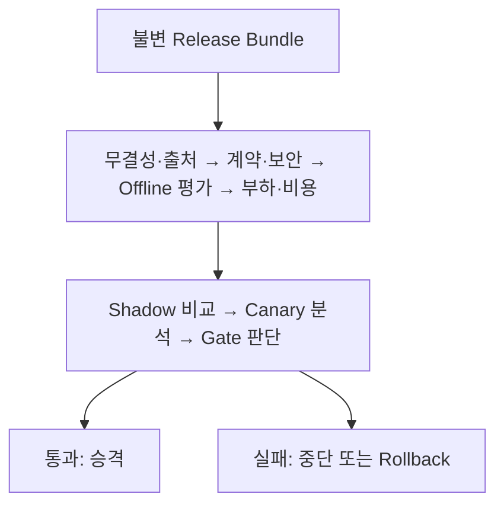
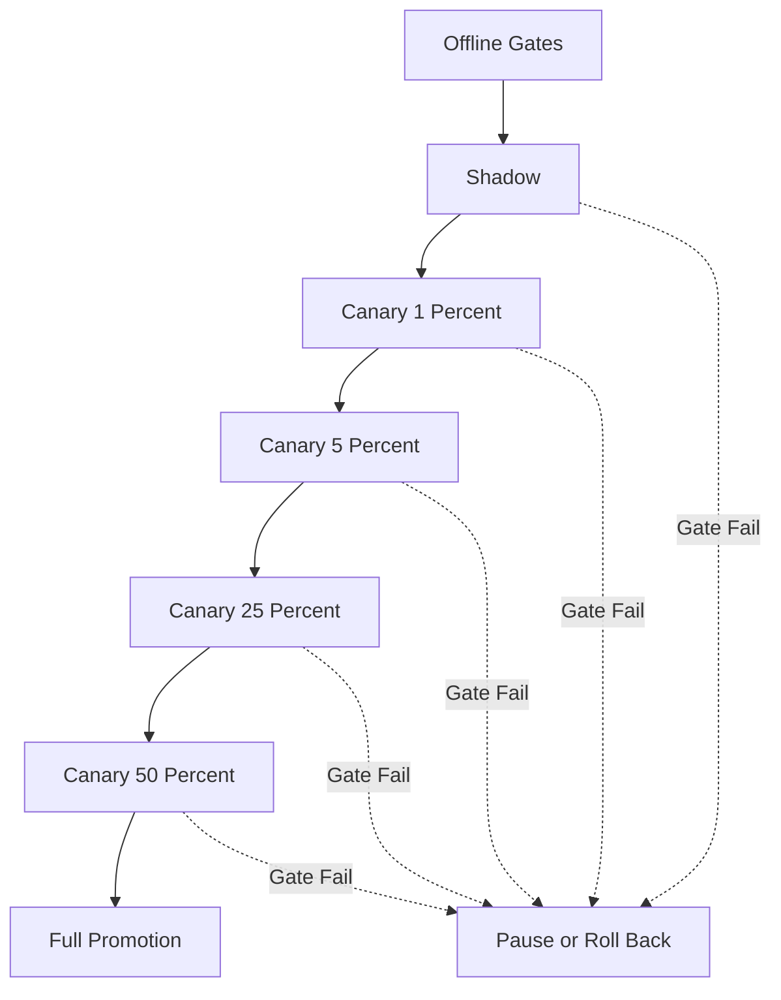
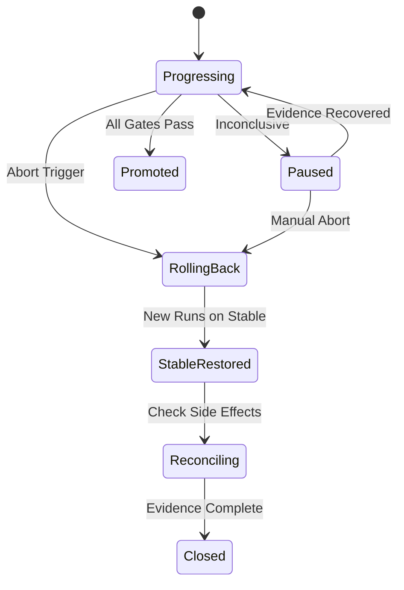

# AI Agent Release Governance와 Progressive Delivery 설계: Prompt·Model·Tool·Policy를 Shadow·Canary·자동 Rollback으로 안전하게 배포하는 법

AI Agent 배포는 Container Image 교체보다 넓습니다. Code가 그대로여도 Prompt나 Model, RAG 색인, Tool 정의가 바뀌면 동작이 달라지기 때문입니다. 이 글은 Code·Prompt·Model·RAG·MCP Tool·Policy를 하나의 Release Bundle로 묶고, Offline Evaluation과 Shadow, 카나리 배포와 자동 Rollback, 감사 Evidence로 안전하게 내보내는 방법을 정리합니다.

<blockquote id="aiarchitect-toc" data-ke-style="box" style="background-color: #f6f9fc; color: #263746; font-family: Pretendard-Regular, AppleSDGothicNeo-Regular, sans-serif; font-weight: 400;" data-mce-style="background-color: #f6f9fc; color: #263746; font-family: Pretendard-Regular, AppleSDGothicNeo-Regular, sans-serif; font-weight: 400;">
<p style="color: #263746; font-weight: 700;" data-mce-style="color: #263746; font-family: Pretendard-Regular, AppleSDGothicNeo-Regular, sans-serif; font-weight: 700;"><b>목차</b></p>
<ol style="list-style-type: decimal; color: #555555; font-weight: 400;" data-mce-style="list-style-type: decimal; color: #555555; font-weight: 400;" data-ke-list-type="decimal">
<li style="color: #555555; font-weight: 400;" data-mce-style="color: #555555; font-weight: 400;"><a href="#ai-section-1">AI Agent Release는 Container Image 교체보다 넓다</a></li>
<li style="color: #555555; font-weight: 400;" data-mce-style="color: #555555; font-weight: 400;"><a href="#ai-section-2">변경 가능한 요소를 하나의 Release Bundle로 묶는다</a></li>
<li style="color: #555555; font-weight: 400;" data-mce-style="color: #555555; font-weight: 400;"><a href="#ai-section-3">Artifact Digest와 Provenance로 재현성을 지킨다</a></li>
<li style="color: #555555; font-weight: 400;" data-mce-style="color: #555555; font-weight: 400;"><a href="#ai-section-4">Desired·Effective·Observed Release를 분리한다</a></li>
<li style="color: #555555; font-weight: 400;" data-mce-style="color: #555555; font-weight: 400;"><a href="#ai-section-5">Change Class로 필요한 검증 강도를 정한다</a></li>
<li style="color: #555555; font-weight: 400;" data-mce-style="color: #555555; font-weight: 400;"><a href="#ai-section-6">Risk Tier와 Blast Radius를 먼저 제한한다</a></li>
<li style="color: #555555; font-weight: 400;" data-mce-style="color: #555555; font-weight: 400;"><a href="#ai-section-7">Release Readiness Contract를 기계 판독 가능하게 만든다</a></li>
<li style="color: #555555; font-weight: 400;" data-mce-style="color: #555555; font-weight: 400;"><a href="#ai-section-8">Offline Evaluation을 첫 번째 Release Gate로 둔다</a></li>
<li style="color: #555555; font-weight: 400;" data-mce-style="color: #555555; font-weight: 400;"><a href="#ai-section-9">Golden·Regression·Adversarial Dataset의 역할을 나눈다</a></li>
<li style="color: #555555; font-weight: 400;" data-mce-style="color: #555555; font-weight: 400;"><a href="#ai-section-10">평균 점수보다 Slice·최저 품질·표본 수를 본다</a></li>
<li style="color: #555555; font-weight: 400;" data-mce-style="color: #555555; font-weight: 400;"><a href="#ai-section-11">불확실한 결과는 통과가 아니라 Inconclusive로 처리한다</a></li>
<li style="color: #555555; font-weight: 400;" data-mce-style="color: #555555; font-weight: 400;"><a href="#ai-section-12">보안·Privacy·Compliance Gate를 품질 Gate와 분리한다</a></li>
<li style="color: #555555; font-weight: 400;" data-mce-style="color: #555555; font-weight: 400;"><a href="#ai-section-13">성능·Capacity·FinOps Gate를 함께 적용한다</a></li>
<li style="color: #555555; font-weight: 400;" data-mce-style="color: #555555; font-weight: 400;"><a href="#ai-section-14">Shadow Traffic으로 실제 입력 분포를 검증한다</a></li>
<li style="color: #555555; font-weight: 400;" data-mce-style="color: #555555; font-weight: 400;"><a href="#ai-section-15">Shadow 실행의 Side Effect를 원천 차단한다</a></li>
<li style="color: #555555; font-weight: 400;" data-mce-style="color: #555555; font-weight: 400;"><a href="#ai-section-16">Baseline과 Candidate를 동일한 Context로 비교한다</a></li>
<li style="color: #555555; font-weight: 400;" data-mce-style="color: #555555; font-weight: 400;"><a href="#ai-section-17">Tenant·Task·Risk Cohort로 Canary 대상을 고른다</a></li>
<li style="color: #555555; font-weight: 400;" data-mce-style="color: #555555; font-weight: 400;"><a href="#ai-section-18">Feature Flag는 노출 제어이지 Authorization이 아니다</a></li>
<li style="color: #555555; font-weight: 400;" data-mce-style="color: #555555; font-weight: 400;"><a href="#ai-section-19">Canary 단계와 관찰 시간을 Evidence로 정의한다</a></li>
<li style="color: #555555; font-weight: 400;" data-mce-style="color: #555555; font-weight: 400;"><a href="#ai-section-20">품질·SLO·비용·보안을 하나의 Metric Basket으로 평가한다</a></li>
<li style="color: #555555; font-weight: 400;" data-mce-style="color: #555555; font-weight: 400;"><a href="#ai-section-21">Burn Rate와 Candidate Delta를 함께 판단한다</a></li>
<li style="color: #555555; font-weight: 400;" data-mce-style="color: #555555; font-weight: 400;"><a href="#ai-section-22">Hysteresis·Cooldown·최소 표본으로 Flapping을 막는다</a></li>
<li style="color: #555555; font-weight: 400;" data-mce-style="color: #555555; font-weight: 400;"><a href="#ai-section-23">자동 Rollback 계약을 배포 전에 검증한다</a></li>
<li style="color: #555555; font-weight: 400;" data-mce-style="color: #555555; font-weight: 400;"><a href="#ai-section-24">Code만 되돌리지 말고 State·Schema·Knowledge를 조정한다</a></li>
<li style="color: #555555; font-weight: 400;" data-mce-style="color: #555555; font-weight: 400;"><a href="#ai-section-25">Rollback이 불가능하면 Kill Switch와 Forward Fix를 사용한다</a></li>
<li style="color: #555555; font-weight: 400;" data-mce-style="color: #555555; font-weight: 400;"><a href="#ai-section-26">장기 실행 Task는 시작 Release에 고정한다</a></li>
<li style="color: #555555; font-weight: 400;" data-mce-style="color: #555555; font-weight: 400;"><a href="#ai-section-27">승인·업무 분리·Break-glass를 Release Ledger에 남긴다</a></li>
<li style="color: #555555; font-weight: 400;" data-mce-style="color: #555555; font-weight: 400;"><a href="#ai-section-28">합성 사례로 회의 후속조치 Agent를 점진 배포한다</a></li>
<li style="color: #555555; font-weight: 400;" data-mce-style="color: #555555; font-weight: 400;"><a href="#ai-section-29">Versioned Release Spec과 운영 체크리스트로 관리한다</a></li>
<li style="color: #555555; font-weight: 400;" data-mce-style="color: #555555; font-weight: 400;"><a href="#ai-section-30">공식 참고자료</a></li>
</ol>
</blockquote>

AI Agent의 새 버전을 배포합니다. Container Image는 이전과 같습니다. Prompt 한 줄과 Model Route, MCP Tool 허용 목록만 바꿨습니다. 단위 테스트와 HTTP Health Check는 모두 통과했습니다. 그런데 운영에서는 다음 문제가 발생합니다.

```text
회의 요약 품질은 좋아졌지만 후속조치 누락률이 증가했다.
새 Model은 더 정확하지만 p95 지연과 Token 비용이 두 배가 됐다.
Tool Description 변경으로 쓰기 Tool이 더 자주 선택됐다.
RAG Index 교체 후 오래된 문서를 인용했다.
Policy 변경이 일부 Tenant의 승인 절차를 건너뛰었다.
Rollback했지만 진행 중이던 Workflow는 새 규칙을 계속 사용했다.
```

전통적인 애플리케이션 배포는 실행 코드와 Runtime Artifact 중심입니다. AI Agent의 동작은 Code뿐 아니라 Prompt, Model, Tool Schema, RAG Corpus, Evaluation Policy와 Routing Rule의 조합으로 결정됩니다. 이 조합 중 하나만 바뀌어도 품질·비용·지연·권한·Side Effect가 달라질 수 있습니다.

AI Agent Release Governance의 목표는 변경을 느리게 만드는 것이 아닙니다. **무엇이 바뀌었고, 어떤 Evidence로 안전하다고 판단했으며, 누구에게 얼마나 노출했고, 이상이 생기면 어떤 상태까지 되돌릴지를 재현 가능한 계약으로 만드는 것**입니다.

이 글은 [AI Agent Evaluation](https://aiarchitect.tistory.com/74), [AI Agent Control Plane](https://aiarchitect.tistory.com/76), [AI Agent Contract Testing](https://aiarchitect.tistory.com/80), [Agentic AI SRE](https://aiarchitect.tistory.com/82), [AI Agent Chaos Engineering](https://aiarchitect.tistory.com/84), [AI Agent Capacity Planning](https://aiarchitect.tistory.com/85), [AI Agent FinOps](https://aiarchitect.tistory.com/86)을 전제로 합니다. 특정 CI/CD 제품의 설치법보다 **Release Bundle·Gate·Shadow·Canary·Rollback·Evidence 계약**에 집중합니다.

> 이 글의 Agent, Tenant, Dataset, Model, Tool, Release ID, 수치와 Threshold는 모두 교육용 합성 예시입니다. 특정 회사·고객·제품의 실제 운영값이 아닙니다. 실제 배포에서는 조직의 Risk Appetite, 법무·보안 정책, Provider 계약, 데이터 지역, SLO와 실제 Evaluation·Trace·Outcome 데이터를 기준으로 Gate를 결정해야 합니다.

## 1. AI Agent Release는 Container Image 교체보다 넓다

AI Agent의 실행 결과는 여러 Version의 함수입니다.

```text
Agent Outcome
  = f(
      Code Version,
      Prompt Version,
      Model Route Version,
      Tool Contract Version,
      RAG Corpus and Index Version,
      Policy Version,
      Feature Flag Snapshot,
      Runtime Dependency Version,
      User and Tenant Context
    )
```

Container Image가 같아도 Prompt Registry의 Alias가 다른 Revision을 가리키면 다른 Release입니다. 반대로 Image가 바뀌어도 Agent 동작 계약이 동일할 수 있습니다.

| 변경 요소 | 가능한 영향 | 기본 검증 |
|---|---|---|
| Agent Code | 실행 경로·오류·상태 전이 | Unit·Contract·Integration Test |
| Prompt | 의도·형식·Tool 선택 | Golden·Regression·Adversarial Evaluation |
| Model Route | 품질·지연·비용·지역 | Slice Evaluation·Load·Cost Gate |
| Tool Schema | 선택률·Argument·Side Effect | Contract·Authorization·Replay Test |
| RAG Index | 근거·신선도·Tenant 격리 | Retrieval·Citation·Isolation Test |
| Policy | 허용·승인·Budget·Fallback | Policy Simulation·Negative Test |

배포 단위를 Image Tag 하나로 축소하면 실제 변경과 Evidence 사이에 틈이 생깁니다.

## 2. 변경 가능한 요소를 하나의 Release Bundle로 묶는다

Release Bundle은 실행에 필요한 Version Pointer와 검증 Evidence를 하나의 불변 Manifest로 묶습니다.

```yaml
release_bundle:
  release_id: rel-meeting-agent-20260812-07
  agent:
    code_digest: sha256:4f7a...
    workflow_spec: meeting-workflow@31
  prompts:
    planner: prompt-planner@18
    summarizer: prompt-summary@27
  models:
    route_policy: route-meeting@12
  tools:
    contract_bundle: mcp-meeting-tools@9
    allowlist_policy: tool-policy@14
  knowledge:
    corpus_revision: meeting-corpus@20260812
    index_revision: index-kr-20260812-03
  policies:
    authorization: authz-agent@22
    budget: budget-policy@11
    safety: safety-policy@16
  evaluation:
    gate_spec: gate-meeting-risk2@8
    dataset_snapshot: eval-meeting@20260810
```

Bundle은 최신 Alias의 모음이 아닙니다. 각 Pointer는 Digest나 불변 Revision으로 해석돼야 합니다.

```text
Bad  : prompt = production-latest
Good : prompt = prompt-summary@27, digest = sha256:...
```

Release ID는 모든 Trace, Meter Event, Policy Decision, Outcome과 연결합니다.

## 3. Artifact Digest와 Provenance로 재현성을 지킨다

Release Bundle에는 “무엇”뿐 아니라 “어떻게 만들어졌는가”가 필요합니다.

```yaml
provenance:
  source_revision: git:8b2e1f4
  build_workflow: agent-release-build@6
  builder_identity: ci-builder-prod
  built_at: 2026-08-12T09:20:00Z
  materials:
    - prompt-repo:rev-1a42
    - policy-repo:rev-0d91
    - eval-dataset:snapshot-20260810
  attestations:
    - type: build-provenance
      digest: sha256:72c1...
    - type: evaluation-summary
      digest: sha256:93aa...
```

SLSA Provenance는 Artifact가 어디서, 언제, 어떤 입력과 과정으로 만들어졌는지 검증 가능한 정보를 제공하는 Software Supply Chain 계약입니다. Agent Release에서도 Code Artifact에 적용하고, Prompt·Policy·Dataset Snapshot은 별도의 Domain Attestation으로 연결할 수 있습니다.

주의할 점은 Evidence를 Bundle과 같은 저장소에 임의로 덮어쓰지 않는 것입니다.

- Artifact와 Attestation을 Digest로 연결합니다.
- 서명 주체와 검증 주체를 분리합니다.
- Evaluation 결과의 Dataset·Evaluator Version을 보존합니다.
- 만료되거나 철회된 Attestation을 구분합니다.
- Release 후 Evidence를 수정하지 않고 Correction을 추가합니다.

## 4. Desired·Effective·Observed Release를 분리한다

Control Plane에서 선언한 Release와 실제 실행된 Release가 항상 같지는 않습니다.

```text
Desired Release
  → Reconciliation
    → Effective Release
      → Runtime Execution
        → Observed Release
```

| 상태 | 의미 | 예시 |
|---|---|---|
| Desired | 운영자가 의도한 Bundle | rel-07을 10% Canary에 배치 |
| Effective | Control Plane이 승인·해석한 Bundle | rel-07, Policy Snapshot 22 |
| Observed | 실제 Run이 사용한 Version 집합 | rel-06 Prompt와 rel-07 Model 혼합 |

Observed Release가 Effective와 다르면 Release Drift입니다.

```json
{
  "root_run_id": "run-01K2...",
  "desired_release_id": "rel-07",
  "effective_release_id": "rel-07",
  "observed": {
    "agent_version": "31",
    "prompt_version": "27",
    "model_route_version": "12",
    "provider_model_id": "model-family-2026-07-31",
    "tool_contract_version": "9",
    "policy_version": "22"
  },
  "drift_detected": false
}
```

Canary 성공률을 Release ID로 나눠도 내부 Version이 섞이면 비교가 무의미합니다. Admission 시점에 Effective Bundle을 고정하고 하위 MCP·A2A 호출까지 전달합니다.

Provider의 `latest` 같은 Model Alias가 Bundle 밖에서 조용히 바뀌는 경우도 Drift입니다. 공급자가 불변 Model Revision을 제공하면 그것을 고정하고, 제공하지 않으면 최소한 Endpoint·요청 Model ID·응답에 보고된 Model ID·Region·호출 시각을 함께 기록합니다. Alias가 가리키는 대상이 바뀌면 같은 Release ID라도 재평가하거나 노출을 중단합니다.

## 5. Change Class로 필요한 검증 강도를 정한다

모든 변경에 같은 Gate를 적용하면 사소한 문구 수정은 느려지고, 위험한 Tool 권한 변경은 충분히 검증되지 않을 수 있습니다.

| Change Class | 예시 | 기본 Gate |
|---|---|---|
| C1 Presentation | 응답 Markdown 형식 | Format·Golden Regression |
| C2 Behavior | Prompt·Model Route | Quality·Latency·Cost·Shadow |
| C3 Knowledge | Corpus·Embedding·Reranker | Retrieval·Citation·Freshness·Isolation |
| C4 Capability | Tool 추가·Schema 변경 | Contract·Authorization·Side Effect Test |
| C5 Control | Policy·Budget·Approval 변경 | Simulation·SoD Approval·Canary |
| C6 State | Workflow·Checkpoint Schema | Migration·Replay·Rollback Drill |

한 Release가 여러 Class를 포함하면 가장 높은 Risk 기준을 적용합니다.

```text
Required Gate Set
  = union(Gates for every Change Class)
    + Risk Tier mandatory gates
```

Change Class는 개발자가 임의로 낮추지 못하게 Diff Analyzer와 Policy Engine이 계산하고, 수동 Override는 근거와 승인자를 남깁니다.

## 6. Risk Tier와 Blast Radius를 먼저 제한한다

Release 위험은 변경 크기만으로 결정되지 않습니다.

```text
Release Risk
  = Change Impact
    × Side Effect Severity
    × Data Sensitivity
    × Exposure Scale
    × Reversibility Difficulty
```

| Risk Tier | 업무 예시 | 초기 노출 |
|---|---|---|
| R1 | 읽기 전용 내부 검색 | 합성 Traffic 또는 내부 사용자 |
| R2 | 초안 생성·사람 승인 필수 | 저위험 Tenant·Task 1~5% |
| R3 | 외부 전송·업무 시스템 쓰기 | 명시적 Cohort·강제 승인 |
| R4 | 재무·법률·고위험 자동 실행 | 사전 승인·이중 통제·극소수 Pilot |

Blast Radius는 단순 Traffic 비율이 아닙니다.

```yaml
blast_radius:
  max_tenants: 2
  max_concurrent_runs: 20
  max_external_writes: 0
  max_cost_per_hour: 30
  allowed_task_classes:
    - meeting-summary-draft
  excluded_data_classes:
    - restricted
```

10% Canary라도 대형 Tenant 하나가 포함되면 실제 업무 영향은 50%일 수 있습니다. Tenant·Task·Data·Action·Cost 한도를 함께 제한합니다.

## 7. Release Readiness Contract를 기계 판독 가능하게 만든다

문서 체크리스트만으로는 자동 Gate를 실행할 수 없습니다.

```yaml
release_readiness:
  release_id: rel-meeting-agent-20260812-07
  risk_tier: R2
  required_gates:
    - bundle-integrity
    - contract-test
    - offline-evaluation
    - security-negative-test
    - load-and-cost
    - shadow-comparison
  required_approvals:
    - product-owner
    - platform-owner
  progressive_plan: meeting-r2-canary@5
  rollback_plan: rollback-meeting@7
  expires_at: 2026-08-19T00:00:00Z
```

Readiness 판단은 세 값을 구분합니다.

```text
PASS         Evidence가 Threshold와 Freshness를 만족
FAIL         명확한 위반이나 Regression
INCONCLUSIVE 표본 부족·Metric 누락·Evaluator 오류
```

`INCONCLUSIVE`를 `PASS`로 취급하면 관측 장애가 배포 승인으로 바뀝니다. 기본 정책은 Pause입니다.

## 8. Offline Evaluation을 첫 번째 Release Gate로 둔다

운영 Traffic을 받기 전에 결정적이고 반복 가능한 Dataset으로 Candidate를 평가합니다.

```text
Release Bundle
  → Integrity and Provenance
  → Contract and Security Tests
  → Offline Evaluation
  → Load and Cost Test
  → Shadow
  → Canary
  → Promotion
```



Offline Gate는 Baseline과 Candidate를 같은 조건으로 실행해야 합니다.

```yaml
offline_eval_run:
  baseline_release: rel-06
  candidate_release: rel-07
  dataset_snapshot: eval-meeting@20260810
  evaluator_bundle: eval-policy@13
  model_seed_policy: fixed-when-supported
  repetitions: 3
  tool_mode: deterministic-sandbox
  external_network: denied
```

Model 출력이 비결정적이면 한 번의 실행 결과로 승패를 정하지 않습니다. 반복 실행과 분포를 사용합니다.

Evaluator도 Candidate와 독립적으로 Version을 고정합니다. 특히 LLM-as-a-Judge를 사용한다면 Candidate와 같은 Prompt·Model Route를 평가기로 재사용하지 않고, 사람 검토 표본으로 Judge의 일치도와 편향을 주기적으로 보정합니다. Candidate 팀이 만든 단일 점수만으로 Gate를 통과시키지 않습니다.

## 9. Golden·Regression·Adversarial Dataset의 역할을 나눈다

하나의 Dataset으로 모든 위험을 검증할 수 없습니다.

| Dataset | 목적 | 예시 |
|---|---|---|
| Golden | 대표 업무 품질 | 회의 요약·결정사항·후속조치 |
| Regression | 과거 장애 재발 방지 | 누락·잘못된 Tool·무한 Loop 사례 |
| Adversarial | 공격·오용 방어 | Prompt Injection·권한 상승·Data Exfiltration |
| Edge | 희귀·경계 입력 | 빈 회의·긴 Transcript·다국어·중복 화자 |
| Freshness | 최신 지식 반영 | 변경된 조직 정책·새 문서 Revision |
| Tenant Isolation | 격리 검증 | 다른 Tenant 문서·Memory 접근 시도 |

Dataset은 운영 로그의 무제한 복사본이 아닙니다.

- 개인정보와 Secret을 제거하거나 합성합니다.
- 출처·동의·보존 기간을 기록합니다.
- Train·Tune·Evaluation 데이터 오염을 관리합니다.
- 과거 사고 사례는 재현 가능한 최소 입력으로 보존합니다.
- Dataset Snapshot의 Digest와 생성 절차를 남깁니다.

## 10. 평균 점수보다 Slice·최저 품질·표본 수를 본다

전체 평균은 작은 고위험 Slice의 실패를 숨깁니다.

```text
Overall Score = 0.94

Korean meeting     = 0.96, n=800
English meeting    = 0.95, n=300
Long transcript    = 0.82, n=45
External write     = 0.71, n=12
Restricted tenant  = sample unavailable
```

Gate는 다음을 함께 봅니다.

```yaml
quality_gate:
  overall:
    min_score: 0.92
    max_regression: 0.01
    min_samples: 1000
  slices:
    long-transcript:
      min_score: 0.88
      max_regression: 0.02
      min_samples: 100
    external-write:
      min_success_rate: 0.995
      max_unauthorized_action_rate: 0
      min_samples: 200
```

특히 보안·권한 위반은 평균에 섞지 않고 Zero-tolerance Guardrail로 둡니다.

## 11. 불확실한 결과는 통과가 아니라 Inconclusive로 처리한다

Evaluator도 실패할 수 있습니다.

```text
Metric Missing
Evaluator Timeout
Low Sample Count
High Variance
Conflicting Evaluators
Dataset Drift
Telemetry Gap
```

```yaml
gate_decision:
  status: inconclusive
  reasons:
    - slice external-write has 54 samples, requires 200
    - cost metric missing for provider-b route
  action: pause
  retry_after: PT2H
  human_review_required: true
```

규칙은 Fail-open과 Fail-closed를 Metric별로 정의합니다.

| Metric | 누락 시 기본 행동 |
|---|---|
| Authorization Violation | Fail-closed·Rollback |
| Side Effect Integrity | Fail-closed·Rollback |
| Quality Score | Pause·추가 표본 |
| Cost Estimate | Pause 또는 낮은 노출 유지 |
| 비핵심 사용자 만족도 | 낮은 단계에서 제한적 진행 가능 |

결정과 근거를 분리해 저장하면 이후 사람이 Override해도 자동 판단을 재현할 수 있습니다.

## 12. 보안·Privacy·Compliance Gate를 품질 Gate와 분리한다

품질이 좋아도 금지된 데이터나 권한을 사용하면 배포할 수 없습니다.

```yaml
security_gate:
  prompt_injection_escape_rate: 0
  cross_tenant_retrieval_rate: 0
  unauthorized_tool_call_rate: 0
  secret_exposure_rate: 0
  approval_bypass_rate: 0
  sensitive_log_attribute_rate: 0
```

검증 범위는 다음을 포함합니다.

- Prompt·Tool Description의 Injection Surface
- MCP Tool Argument와 Result의 Schema·권한 검증
- A2A 위임 시 Credential·Tenant Scope 축소
- RAG Retrieval Filter와 Cache·Memory 격리
- PII·Secret의 Prompt·Trace·Evaluation Dataset 노출
- Region·Retention·Model Provider 사용 정책
- Human Approval과 Non-repudiation Evidence

NIST AI RMF와 Generative AI Profile은 AI Risk를 조직의 목표와 우선순위에 맞춰 식별·측정·관리하는 틀을 제공합니다. 구체적인 Threshold는 조직의 Risk Policy로 변환해야 하며, Framework 인용 자체가 Release 승인을 대신하지 않습니다.

## 13. 성능·Capacity·FinOps Gate를 함께 적용한다

Candidate가 더 정확해도 운영 가능하지 않을 수 있습니다.

```yaml
operational_gate:
  latency:
    p95_delta_max: 0.10
    p99_absolute_max_ms: 12000
  capacity:
    token_per_outcome_delta_max: 0.15
    queue_age_p95_max_seconds: 20
    provider_quota_headroom_min: 0.25
  cost:
    cost_per_successful_outcome_delta_max: 0.12
    hourly_canary_budget_max: 50
  reliability:
    retry_amplification_max: 1.10
    error_budget_burn_rate_max: 1.0
```

비용 Gate는 Token 단가만 보지 않습니다.

```text
Cost per Successful Outcome
  = Model + RAG + Tool + Queue + Platform
    + Retry + Human Review + Reconciliation
```

Candidate가 실행당 비용은 높지만 성공률을 높여 재시도와 사람 검토를 줄일 수 있습니다. 최종 판단은 Outcome 단가로 비교합니다.

## 14. Shadow Traffic으로 실제 입력 분포를 검증한다

Offline Dataset은 운영 분포를 완전히 복제하지 못합니다. Shadow는 운영 요청을 Candidate에도 복제하되 Candidate 결과를 사용자에게 반환하지 않습니다.

```text
Production Request
  ├─ Stable Release → User-visible Result
  └─ Candidate Release → Shadow Result → Comparison Store
```

Shadow의 목적은 다음과 같습니다.

- 실제 Prompt 길이와 언어 분포 확인
- RAG Query·Tool Selection 변화 측정
- 지연·Token·Quota·Cost 추정 보정
- 알려지지 않은 Task Slice 발견
- Stable·Candidate 결과의 Paired Comparison

Shadow도 비용과 개인정보를 사용합니다. 무제한 복제하지 않습니다.

```yaml
shadow_policy:
  sample_rate: 0.05
  allowed_task_classes:
    - meeting-summary-draft
  excluded_data_classes:
    - restricted
  max_hourly_cost: 40
  retention: P7D
  store_raw_content: false
```

## 15. Shadow 실행의 Side Effect를 원천 차단한다

Candidate 결과를 사용자에게 보여주지 않는다고 안전한 것은 아닙니다. Candidate가 Email 전송, Ticket 생성, 결제, 파일 변경을 실행하면 실제 Side Effect가 발생합니다.

```yaml
shadow_execution_context:
  mode: shadow
  side_effect_policy: deny
  tool_policy:
    read_only: allow
    reversible_write: simulate
    irreversible_write: deny
  credential_scope: shadow-readonly
  outbound_network: allowlisted
```

Side Effect 차단은 Prompt 지시가 아니라 Enforcement Point에서 수행합니다.

- 쓰기 Credential을 발급하지 않습니다.
- MCP Gateway에서 `side_effect=true` Tool을 거절합니다.
- 외부 API는 Sandbox·Mock·Dry-run Endpoint를 사용합니다.
- Outbox Commit을 비활성화하고 Intent만 기록합니다.
- A2A 하위 Agent에도 Shadow Context를 전파합니다.

```json
{
  "tool_call": "create_followup_ticket",
  "mode": "shadow",
  "decision": "simulated",
  "side_effect_committed": false,
  "comparison_artifact_id": "cmp-01K2..."
}
```

## 16. Baseline과 Candidate를 동일한 Context로 비교한다

서로 다른 입력·시간·Tool 상태를 사용하면 Release 효과와 환경 차이를 구분하기 어렵습니다.

```yaml
paired_comparison:
  request_fingerprint: reqfp-72c...
  baseline_release: rel-06
  candidate_release: rel-07
  context_snapshot:
    tenant_policy_version: 22
    tool_contract_version: 9
    knowledge_snapshot: index-kr-20260812-03
  evaluator_version: eval-policy@13
```

완전히 같은 환경을 만들 수 없는 요소는 명시합니다.

| 요소 | 처리 방식 |
|---|---|
| 외부 Tool 상태 | Snapshot·Mock 또는 차이 표시 |
| Model 비결정성 | 반복 실행·분포 비교 |
| 최신 RAG 문서 | 동일 Snapshot 사용 |
| 시간 의존 Prompt | 고정 Evaluation Time 주입 |
| 사용자 Memory | 승인된 Snapshot·민감정보 최소화 |

Candidate Delta를 계산할 때 Baseline의 같은 Run과 Pairing하면 입력 분포 차이를 줄일 수 있습니다.

## 17. Tenant·Task·Risk Cohort로 Canary 대상을 고른다

Random 1%만으로는 고위험 업무를 보호하거나 필요한 Slice를 확보하기 어렵습니다.

```yaml
canary_cohort:
  tenant_ids:
    - tenant-pilot-a
    - tenant-pilot-b
  task_classes:
    - meeting-summary-draft
  risk_tiers:
    - R1
    - R2
  data_classes:
    - internal
  exclude:
    - legal-hold
    - external-auto-send
```

좋은 Cohort는 다음 조건을 만족합니다.

- 업무 영향이 제한적입니다.
- Candidate가 해결하려는 대표 Slice를 포함합니다.
- Tenant가 Pilot 조건과 Rollback 가능성을 이해합니다.
- Stable과 비교할 충분한 Traffic이 있습니다.
- 특정 사용자에게 Release가 계속 고정됩니다.

동일 Session이나 Workflow가 요청마다 Stable과 Candidate를 오가면 상태와 사용자 경험이 깨집니다. `tenant_id + workflow_id` 같은 안정적 Key로 Sticky Assignment합니다.

## 18. Feature Flag는 노출 제어이지 Authorization이 아니다

Feature Flag는 Candidate Route, Model 선택, Tool 기능 노출을 점진적으로 제어하는 데 유용합니다. OpenFeature는 Provider와 독립적인 Flag Evaluation API, Evaluation Context, Hook와 Event 계약을 제공합니다.

```json
{
  "flag_key": "meeting-agent-release",
  "evaluation_context": {
    "tenant_id": "tenant-pilot-a",
    "task_class": "meeting-summary-draft",
    "risk_tier": "R2",
    "region": "kr"
  },
  "variant": "rel-07",
  "reason": "TARGETING_MATCH"
}
```

그러나 Flag는 Authorization이 아닙니다.

```text
Feature Flag says Tool UI is enabled
          ≠
User and Agent are authorized to execute Tool
```

Release Route를 우회해도 Policy Enforcement Point는 동일하게 권한을 검증해야 합니다. Flag Evaluation Context에 Secret이나 원본 개인정보를 넣지 않고 안정적인 저카디널리티 속성을 사용합니다. Flag Provider가 Timeout·오류를 반환할 때는 새 Run을 검증된 Stable Release로 보내고, Fallback 이유와 Provider 상태를 Release Ledger에 남기는 기본값도 사전에 정의합니다.

## 19. Canary 단계와 관찰 시간을 Evidence로 정의한다

“1%에서 문제 없으면 100%”는 계획이 아닙니다.

```yaml
progressive_plan:
  release_id: rel-07
  stages:
    - name: pilot
      exposure: 0.01
      min_duration: PT2H
      min_outcomes: 200
    - name: limited
      exposure: 0.05
      min_duration: PT6H
      min_outcomes: 1000
    - name: expanded
      exposure: 0.25
      min_duration: P1D
      min_outcomes: 5000
    - name: majority
      exposure: 0.50
      min_duration: P1D
      min_outcomes: 10000
    - name: full
      exposure: 1.00
```



Argo Rollouts의 Canary Step은 Traffic Weight와 Pause를 선언하고, AnalysisRun 결과로 진행·중단·Pause를 결정할 수 있습니다. Agent Release에서는 HTTP 성공률 외에 품질·Tool·비용 Metric을 Analysis Provider로 연결해야 합니다.

## 20. 품질·SLO·비용·보안을 하나의 Metric Basket으로 평가한다

단일 Metric은 Release의 다른 실패를 숨깁니다.

```yaml
metric_basket:
  quality:
    successful_outcome_rate:
      min: 0.95
    action_item_recall:
      min: 0.92
    unsupported_claim_rate:
      max: 0.01
  reliability:
    p95_latency_delta:
      max: 0.10
    retry_amplification:
      max: 1.10
  cost:
    cost_per_successful_outcome_delta:
      max: 0.12
  safety:
    unauthorized_tool_call_rate:
      max: 0
    side_effect_integrity_violation:
      max: 0
```

Metric은 Candidate 절대값과 Baseline 대비 Delta를 함께 봅니다.

```text
Pass(metric)
  = Candidate within absolute floor or ceiling
    AND Candidate Delta within regression budget
    AND sample size and freshness are sufficient
```

사용자 만족도처럼 늦게 도착하는 Outcome은 즉시 Gate에만 의존하지 않습니다. Leading Guardrail과 Delayed Outcome Gate를 분리하고, Full Promotion 후에도 Bake Period를 둡니다. 이 기간에는 Stable Bundle·Capacity·Credential·이전 RAG Index를 즉시 복구할 수 있게 보존하며, 지연 Outcome이 Gate를 위반하면 신규 Run을 Stable로 되돌립니다. Bake Period가 끝나야 Release를 `closed`로 표시하고 오래된 Revision 제거를 별도 승인합니다.

## 21. Burn Rate와 Candidate Delta를 함께 판단한다

서비스가 이미 Error Budget을 빠르게 소모하고 있다면 작은 Regression도 배포를 중단해야 합니다.

```text
Release Decision
  = Candidate Delta
    + Current SLO Burn Rate
    + Remaining Error Budget
    + Risk Tier
    + Rollback Readiness
```

```yaml
release_slo_gate:
  current_burn_rate:
    fast_window: 5m
    slow_window: 1h
  policy:
    - when: burn_rate_fast > 14
      action: rollback
    - when: burn_rate_slow > 2
      action: pause
    - when: remaining_error_budget < 0.20
      action: require_manual_approval
```

Candidate Traffic만 분리해 SLI를 계산하되 전체 서비스 영향도 함께 봅니다. Candidate가 공용 Queue·Provider Quota를 소진하면 Stable 사용자의 SLO도 나빠질 수 있습니다.

## 22. Hysteresis·Cooldown·최소 표본으로 Flapping을 막는다

Metric이 Threshold 주변에서 흔들리면 Promote와 Rollback이 반복될 수 있습니다.

```yaml
decision_stability:
  min_samples: 500
  min_observation: PT30M
  success_consecutive_windows: 3
  failure_consecutive_windows: 2
  promotion_cooldown: PT1H
  rollback_cooldown: PT30M
  max_metric_age: PT5M
```

원칙은 다음과 같습니다.

- Promote 조건은 보수적으로 연속 성공을 요구합니다.
- 보안·Side Effect 위반은 한 건으로 즉시 Rollback할 수 있습니다.
- 품질 저하는 표본과 신뢰 구간을 확인합니다.
- Metric이 오래됐으면 마지막 좋은 값으로 진행하지 않습니다.
- Rollback 후 자동 재배포를 금지하고 원인·Evidence를 확인합니다.

Threshold는 Release 중 임의 변경하지 않습니다. 변경이 필요하면 Gate Spec의 새 Version을 만들고 승인합니다.

## 23. 자동 Rollback 계약을 배포 전에 검증한다

Rollback은 장애 후 떠올리는 명령이 아닙니다.

```yaml
rollback_contract:
  stable_release_id: rel-06
  triggers:
    - unauthorized_tool_call_rate > 0
    - side_effect_integrity_violation > 0
    - fast_burn_rate > 14
    - quality_regression > 0.05 for 2 windows
  actions:
    - route_new_runs_to_stable
    - disable_candidate_write_capability
    - revoke_candidate_credentials
    - stop_candidate_workers
    - quarantine_candidate_outbox
    - preserve_evidence
  max_recovery_time: PT5M
```



Rollback Drill은 다음을 측정합니다.

- Trigger 감지 시간
- Traffic 전환 시간
- Credential 철회 시간
- 진행 중 Run 격리 시간
- Outbox·Side Effect 조정 완료 시간
- Stable Capacity와 Provider Quota 여유

## 24. Code만 되돌리지 말고 State·Schema·Knowledge를 조정한다

Kubernetes Deployment Rollback은 Pod Template Revision을 되돌립니다. AI Agent Release는 그보다 넓은 상태를 다룹니다.

| 대상 | Rollback 고려사항 |
|---|---|
| Workflow State | 이전 Version이 새 Checkpoint를 읽을 수 있는가 |
| Tool Schema | 새 Argument로 저장된 Intent를 이전 Tool이 처리할 수 있는가 |
| RAG Index | 이전 Corpus·Index가 아직 보존돼 있는가 |
| Memory | Candidate가 쓴 Memory를 식별·격리할 수 있는가 |
| Outbox | Candidate의 미Commit Side Effect를 차단할 수 있는가 |
| External Effect | 이미 전송·생성된 결과를 취소·보상할 수 있는가 |

```yaml
compatibility_contract:
  state_schema:
    read_previous: true
    write_compatible: true
  tool_intent_schema:
    backward_readable_versions: [8, 9]
  knowledge:
    retained_index_versions: 2
  memory:
    release_id_tag_required: true
  side_effect:
    reconciliation_handler: meeting-ticket-reconcile@4
```

Schema Migration은 Expand → Migrate → Contract 순서로 운영해 Stable과 Candidate가 동시에 읽을 수 있게 합니다.

## 25. Rollback이 불가능하면 Kill Switch와 Forward Fix를 사용한다

외부에 보낸 Email이나 삭제된 데이터는 Image Rollback으로 되돌아오지 않습니다.

```text
Reversible Change     → Automatic Rollback
Partially Reversible  → Rollback + Reconciliation
Irreversible Change   → Kill Switch + Containment + Forward Fix
```

Kill Switch는 범위를 나눕니다.

```yaml
kill_switches:
  release:
    rel-07: disable
  capability:
    external_write: disable
  tool:
    create_followup_ticket: read_only
  tenant:
    tenant-pilot-a: stable_only
  global:
    autonomous_side_effects: require_human_approval
```

Forward Fix는 새 Release이므로 긴급 상황에서도 최소 Integrity·Authorization·Smoke Gate를 통과해야 합니다. Break-glass는 Gate 제거가 아니라 단축된 별도 Gate와 사후 검토 계약입니다.

## 26. 장기 실행 Task는 시작 Release에 고정한다

Workflow가 수분·수시간 지속되면 중간 Promotion이 진행 중 Task를 섞을 수 있습니다.

```yaml
workflow_release_binding:
  workflow_id: wf-01K2...
  release_id: rel-06
  bound_at: 2026-08-12T09:30:00Z
  binding_mode: sticky_until_terminal
  migration_allowed: false
```

기본 원칙은 다음과 같습니다.

- 새 Run만 Candidate로 Route합니다.
- 진행 중 Run은 시작 Release의 Prompt·Model·Tool·Policy를 유지합니다.
- 필요한 Artifact와 Policy Snapshot을 Retention 기간 동안 보존합니다.
- 강제 Migration은 Compatibility Gate와 명시적 승인 후 수행합니다.
- Candidate 철회 시 진행 중 Run을 Drain·Pause·Compensate 중 하나로 처리합니다.

Release Retention은 단순 Revision 개수가 아니라 가장 오래 실행될 수 있는 Workflow 기간과 Audit 보존 요구를 반영합니다.

## 27. 승인·업무 분리·Break-glass를 Release Ledger에 남긴다

고위험 Release를 개발자 한 명이 만들고 승인하고 배포하고 Evidence까지 수정할 수 있으면 통제가 약합니다.

```yaml
release_approval:
  release_id: rel-07
  risk_tier: R3
  requested_by: agent-team
  approvals:
    - role: product-owner
      decision: approved
      evidence_digest: sha256:11ac...
    - role: security-owner
      decision: approved
      evidence_digest: sha256:22bd...
    - role: platform-owner
      decision: approved
      evidence_digest: sha256:33ce...
  policy_version: release-approval@9
```

Release Ledger는 다음 Event를 불변 기록합니다.

```text
Bundle Created
Evidence Attached
Gate Evaluated
Approval Granted or Denied
Shadow Started and Stopped
Canary Stage Changed
Automatic Pause or Rollback
Manual Override
Side Effect Reconciliation
Release Closed
```

Break-glass에는 사유, Scope, 만료 시간, 승인자, 사용한 Credential, 사후 Review 기한을 남깁니다.

## 28. 합성 사례로 회의 후속조치 Agent를 점진 배포한다

회의 Transcript에서 요약과 후속조치 초안을 만드는 Agent를 `rel-06`에서 `rel-07`로 배포한다고 가정합니다.

변경 내용은 다음과 같습니다.

```text
Prompt Summary 26 → 27
Model Route 11 → 12
Tool Contract 8 → 9
RAG Index 20260810 → 20260812
Policy 21 → 22
```

### 1단계: Offline Gate

| Metric | Baseline | Candidate | Gate | 결과 |
|---|---:|---:|---:|---|
| Action Item Recall | 0.89 | 0.94 | ≥ 0.92 | PASS |
| Unsupported Claim | 0.012 | 0.009 | ≤ 0.01 | PASS |
| Unauthorized Tool | 0 | 0 | 0 | PASS |
| p95 Latency | 7.4s | 8.0s | Delta ≤ 10% | PASS |
| Cost per Success | 0.42 | 0.47 | Delta ≤ 12% | PASS |

### 2단계: Shadow 5%

```yaml
shadow_result:
  paired_runs: 1800
  candidate_win_rate: 0.61
  long_transcript_regression: 0.01
  tool_selection_delta: 0.04
  cost_delta: 0.10
  side_effect_committed: 0
  decision: pass
```

### 3단계: Pilot Canary 1%

두 Pilot Tenant의 읽기·초안 업무만 포함하고 외부 자동 전송은 제외합니다.

```yaml
pilot_result:
  successful_outcomes: 320
  quality_regression: -0.03
  p95_latency_delta: 0.07
  cost_delta: 0.11
  fast_burn_rate: 0.8
  security_violations: 0
  decision: promote_to_5_percent
```

### 4단계: Canary 5%

Long Transcript Slice에서 p95 지연이 18% 증가했습니다. 전체 평균은 8%이지만 Slice Gate를 위반합니다.

```yaml
canary_decision:
  status: paused
  reason: long-transcript p95 latency delta 0.18 > 0.12
  action:
    - keep exposure at 0.05
    - route long-transcript to stable
    - collect 500 more outcomes
```

Route Policy를 수정한 `rel-08`을 새 Bundle로 만들고 다시 Offline·Shadow Gate를 거칩니다. 실행 중인 `rel-07`을 조용히 수정하지 않습니다.

## 29. Versioned Release Spec과 운영 체크리스트로 관리한다

Release 정책도 Versioned Artifact입니다.

```yaml
release_governance_spec:
  spec_version: 1.0.0
  owner: agent-platform
  applies_to:
    - agent-release
    - prompt-release
    - model-route-release
    - tool-contract-release
    - policy-release
  default_decision_on_missing_evidence: pause
  retention:
    release_bundle: P2Y
    gate_evidence: P2Y
    raw_shadow_comparison: P7D
  review_cycle: P90D
```

### 1단계: Release Bundle과 Provenance

- [ ] Code·Prompt·Model·Tool·Knowledge·Policy Version을 Bundle로 묶는다.
- [ ] Alias 대신 Digest·불변 Revision을 사용한다.
- [ ] Build·Source·Evaluation Provenance를 검증한다.
- [ ] Release ID를 Trace·Outcome·Cost·Policy Decision에 연결한다.

### 2단계: Pre-production Gate

- [ ] Change Class와 Risk Tier를 계산한다.
- [ ] Golden·Regression·Adversarial·Isolation Dataset을 실행한다.
- [ ] Slice별 품질·표본·Regression Budget을 검증한다.
- [ ] Security·Privacy·Capacity·Cost Gate를 분리해 평가한다.

### 3단계: Shadow와 Canary

- [ ] Shadow Credential과 Side Effect 차단을 Enforcement한다.
- [ ] Baseline·Candidate를 같은 Context Snapshot으로 비교한다.
- [ ] Tenant·Task·Risk Cohort와 Sticky Assignment를 적용한다.
- [ ] 단계별 노출·관찰 시간·최소 Outcome 수를 정의한다.

### 4단계: 자동 판단과 Rollback

- [ ] Metric 누락을 Inconclusive로 처리한다.
- [ ] Hysteresis·Cooldown·Metric Freshness를 적용한다.
- [ ] Rollback Trigger·Action·RTO를 사전에 검증한다.
- [ ] State·Schema·Memory·Outbox·External Effect를 조정한다.

### 5단계: Governance와 Evidence

- [ ] 승인자와 Artifact 작성자의 업무를 분리한다.
- [ ] Manual Override와 Break-glass의 Scope·TTL을 남긴다.
- [ ] Promotion·Pause·Rollback·Reconciliation Event를 기록한다.
- [ ] Release 후 Delayed Outcome과 Drift를 계속 감시한다.
- [ ] Full Promotion 뒤 Bake Period와 Stable Artifact 제거 시점을 승인한다.

핵심 원칙을 정리하면 다음과 같습니다.

```text
AI Agent Release를 Container Image 하나로 축소하지 않는다.
Code·Prompt·Model·Tool·Knowledge·Policy를 불변 Bundle로 묶는다.
평균 품질뿐 아니라 Slice·최저 품질·표본 수를 본다.
관측 실패와 표본 부족은 PASS가 아니라 INCONCLUSIVE다.
Shadow Side Effect는 Prompt가 아니라 Credential과 Gateway에서 차단한다.
Canary는 Traffic 비율과 Tenant·Task·Risk Cohort를 함께 제한한다.
Feature Flag는 노출 제어이며 Authorization을 대신하지 않는다.
품질·SLO·비용·보안 Metric을 함께 평가한다.
Rollback은 State·Schema·Memory·Outbox·External Effect까지 포함한다.
모든 판단과 Override를 Release Ledger의 Evidence로 남긴다.
```

좋은 Progressive Delivery는 1%에서 100%로 Traffic 숫자를 올리는 기능이 아닙니다. Release Bundle의 무결성부터 실제 Outcome, 비용, SLO, 권한과 Side Effect까지 Evidence를 점진적으로 쌓고, 불확실하면 멈추며, 이상이 발생하면 제한된 Blast Radius 안에서 복구하는 운영 시스템입니다.

다음 글에서는 여러 팀이 같은 Agent Platform을 빠르게 사용하면서도 이 Release·Evaluation·Security·Observability 계약을 지키게 만드는 **AI Agent Internal Developer Platform과 Golden Path**를 다룹니다. Project Template, Self-service Environment, Policy-as-code, Scorecard와 Platform Product 운영 방법을 살펴봅니다.

## 30. 공식 참고자료

- [Kubernetes — Deployments](https://kubernetes.io/docs/concepts/workloads/controllers/deployment/)
- [Argo Rollouts — Canary Deployment Strategy](https://argo-rollouts.readthedocs.io/en/stable/features/canary/)
- [Argo Rollouts — Analysis and Progressive Delivery](https://argo-rollouts.readthedocs.io/en/stable/features/analysis/)
- [Argo Rollouts — Experiments](https://argo-rollouts.readthedocs.io/en/stable/features/experiment/)
- [OpenFeature — Specification](https://openfeature.dev/specification/)
- [NIST — AI Risk Management Framework](https://www.nist.gov/itl/ai-risk-management-framework)
- [NIST — Artificial Intelligence Risk Management Framework: Generative Artificial Intelligence Profile](https://nvlpubs.nist.gov/nistpubs/ai/NIST.AI.600-1.pdf)
- [SLSA — Specification 1.2](https://slsa.dev/spec/v1.2/)
- [SLSA — Provenance](https://slsa.dev/spec/v1.2/provenance)
- [SLSA — Distributing Provenance](https://slsa.dev/spec/v1.2/distributing-provenance)
- [OpenTelemetry — Semantic Conventions](https://opentelemetry.io/docs/specs/semconv/)
- [OpenTelemetry — GenAI Semantic Conventions Repository](https://github.com/open-telemetry/semantic-conventions-genai)

이 글은 2026년 8월 12일 기준 Kubernetes, Argo Rollouts, OpenFeature, NIST AI RMF, SLSA 1.2와 OpenTelemetry 공식 공개 자료를 바탕으로 작성했습니다. NIST 공식 페이지가 안내하듯 AI RMF 1.0은 개정이 진행 중이므로 실제 Governance 기준은 최신 발행 상태를 다시 확인해야 합니다. Kubernetes Deployment Rollback은 Pod Template Revision을 다루며, 이 글의 Release Bundle·AI Evaluation Gate·State Reconciliation 구조는 AI Agent 운영 요구사항에 맞게 확장한 설계입니다. 실제 적용 시 사용하는 Progressive Delivery Controller와 Traffic Router의 지원 기능, Provider의 Model·Quota·가격·데이터 처리 정책, 조직의 SLO·Risk Appetite·보안·법무·감사 요구사항, 실제 Evaluation·Trace·Outcome 데이터를 확인해 Gate·Canary·Rollback 정책을 결정해야 합니다.
