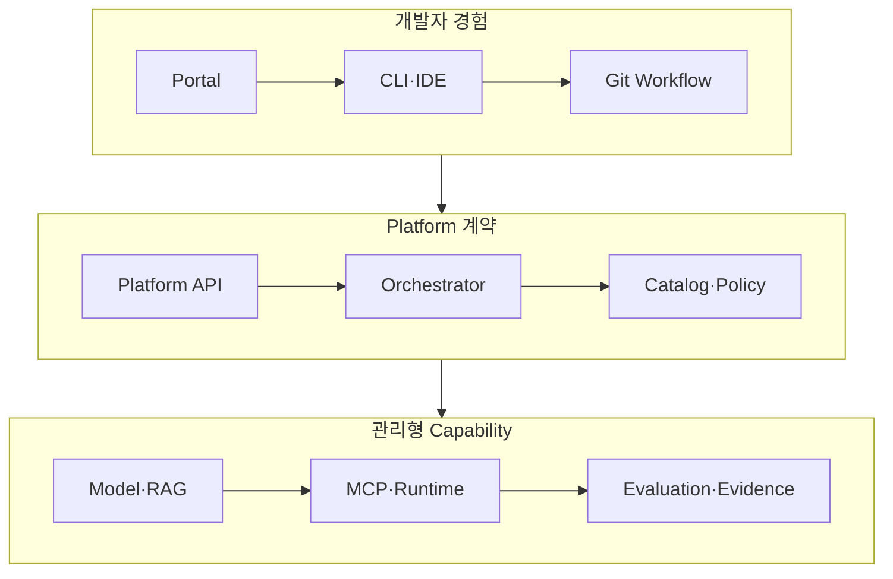
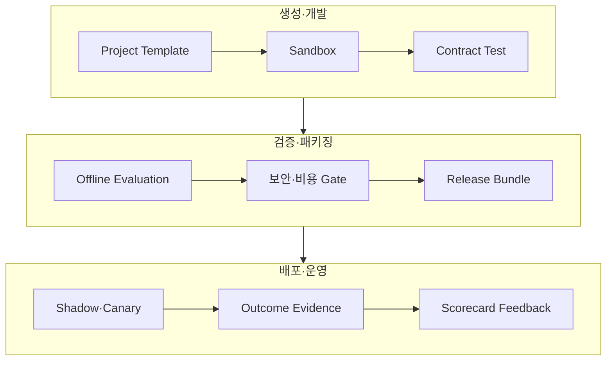
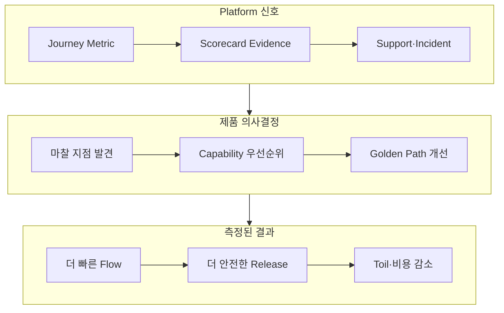

# AI Agent Internal Developer Platform과 Golden Path 설계: 여러 팀이 보안·평가·배포 계약을 지키며 Self-service로 Agent를 만드는 법

여러 팀이 각자 AI Agent를 만들면 속도는 나오지만 보안·평가·관측성·비용 계약이 팀마다 갈라집니다. Portal 하나를 세우는 것으로는 해결되지 않고, 무엇을 기본 경로로 제공하고 무엇을 예외로 허용할지 정해야 합니다. 이 글은 AI Agent를 위한 Internal Developer Platform을 제품으로 운영하는 방법과 Golden Path·Self-service 환경, Scorecard와 Escape Hatch, Portal·Platform API·Control Plane·Runtime 책임 분리를 정리합니다.

<blockquote id="aiarchitect-toc" data-ke-style="box" style="background-color: #f6f9fc; color: #263746; font-family: Pretendard-Regular, AppleSDGothicNeo-Regular, sans-serif; font-weight: 400;" data-mce-style="background-color: #f6f9fc; color: #263746; font-family: Pretendard-Regular, AppleSDGothicNeo-Regular, sans-serif; font-weight: 400;">
<p style="color: #263746; font-weight: 700;" data-mce-style="color: #263746; font-family: Pretendard-Regular, AppleSDGothicNeo-Regular, sans-serif; font-weight: 700;"><b>목차</b></p>
<ol style="list-style-type: decimal; color: #555555; font-weight: 400;" data-mce-style="list-style-type: decimal; color: #555555; font-weight: 400;" data-ke-list-type="decimal">
<li style="color: #555555; font-weight: 400;" data-mce-style="color: #555555; font-weight: 400;"><a href="#ai-section-1">AI Agent Platform은 Portal 하나가 아니다</a></li>
<li style="color: #555555; font-weight: 400;" data-mce-style="color: #555555; font-weight: 400;"><a href="#ai-section-2">내부 고객과 핵심 User Journey를 먼저 정의한다</a></li>
<li style="color: #555555; font-weight: 400;" data-mce-style="color: #555555; font-weight: 400;"><a href="#ai-section-3">Platform을 프로젝트가 아니라 제품으로 운영한다</a></li>
<li style="color: #555555; font-weight: 400;" data-mce-style="color: #555555; font-weight: 400;"><a href="#ai-section-4">Portal·Platform API·Control Plane·Runtime 책임을 분리한다</a></li>
<li style="color: #555555; font-weight: 400;" data-mce-style="color: #555555; font-weight: 400;"><a href="#ai-section-5">Capability Map으로 제공 범위와 소유권을 정한다</a></li>
<li style="color: #555555; font-weight: 400;" data-mce-style="color: #555555; font-weight: 400;"><a href="#ai-section-6">Golden Path는 기본 경로이지 Golden Cage가 아니다</a></li>
<li style="color: #555555; font-weight: 400;" data-mce-style="color: #555555; font-weight: 400;"><a href="#ai-section-7">Agent Project Template에 운영 계약을 내장한다</a></li>
<li style="color: #555555; font-weight: 400;" data-mce-style="color: #555555; font-weight: 400;"><a href="#ai-section-8">Agent Manifest를 Platform API 계약으로 만든다</a></li>
<li style="color: #555555; font-weight: 400;" data-mce-style="color: #555555; font-weight: 400;"><a href="#ai-section-9">Software Catalog로 소유권·의존성·수명주기를 관리한다</a></li>
<li style="color: #555555; font-weight: 400;" data-mce-style="color: #555555; font-weight: 400;"><a href="#ai-section-10">Self-service Environment를 비동기 요청으로 제공한다</a></li>
<li style="color: #555555; font-weight: 400;" data-mce-style="color: #555555; font-weight: 400;"><a href="#ai-section-11">Tenant·환경·Network·Quota 격리를 기본값으로 둔다</a></li>
<li style="color: #555555; font-weight: 400;" data-mce-style="color: #555555; font-weight: 400;"><a href="#ai-section-12">User·Workload Identity와 Secret 수명을 자동화한다</a></li>
<li style="color: #555555; font-weight: 400;" data-mce-style="color: #555555; font-weight: 400;"><a href="#ai-section-13">Model Gateway와 Route Policy를 공통 Capability로 제공한다</a></li>
<li style="color: #555555; font-weight: 400;" data-mce-style="color: #555555; font-weight: 400;"><a href="#ai-section-14">Prompt·Configuration Registry를 Release Bundle에 연결한다</a></li>
<li style="color: #555555; font-weight: 400;" data-mce-style="color: #555555; font-weight: 400;"><a href="#ai-section-15">RAG Knowledge Onboarding을 데이터 계약으로 만든다</a></li>
<li style="color: #555555; font-weight: 400;" data-mce-style="color: #555555; font-weight: 400;"><a href="#ai-section-16">MCP Tool 등록과 권한 검증을 표준화한다</a></li>
<li style="color: #555555; font-weight: 400;" data-mce-style="color: #555555; font-weight: 400;"><a href="#ai-section-17">Policy-as-code를 Template과 Admission에 겹쳐 적용한다</a></li>
<li style="color: #555555; font-weight: 400;" data-mce-style="color: #555555; font-weight: 400;"><a href="#ai-section-18">Evaluation을 선택 기능이 아니라 기본 Pipeline으로 만든다</a></li>
<li style="color: #555555; font-weight: 400;" data-mce-style="color: #555555; font-weight: 400;"><a href="#ai-section-19">Observability와 Evidence Schema를 자동 계측한다</a></li>
<li style="color: #555555; font-weight: 400;" data-mce-style="color: #555555; font-weight: 400;"><a href="#ai-section-20">SLO·Capacity·FinOps Guardrail을 Self-service에 연결한다</a></li>
<li style="color: #555555; font-weight: 400;" data-mce-style="color: #555555; font-weight: 400;"><a href="#ai-section-21">Release Bundle과 Progressive Delivery를 Golden Path에 포함한다</a></li>
<li style="color: #555555; font-weight: 400;" data-mce-style="color: #555555; font-weight: 400;"><a href="#ai-section-22">Supply Chain Provenance와 Artifact Promotion을 보장한다</a></li>
<li style="color: #555555; font-weight: 400;" data-mce-style="color: #555555; font-weight: 400;"><a href="#ai-section-23">Desired·Effective·Observed State를 Reconciliation한다</a></li>
<li style="color: #555555; font-weight: 400;" data-mce-style="color: #555555; font-weight: 400;"><a href="#ai-section-24">Escape Hatch는 예외 Workflow로 제품화한다</a></li>
<li style="color: #555555; font-weight: 400;" data-mce-style="color: #555555; font-weight: 400;"><a href="#ai-section-25">Scorecard는 순위표가 아니라 개선 Action을 제공해야 한다</a></li>
<li style="color: #555555; font-weight: 400;" data-mce-style="color: #555555; font-weight: 400;"><a href="#ai-section-26">Adoption·Flow·Outcome Metric을 함께 측정한다</a></li>
<li style="color: #555555; font-weight: 400;" data-mce-style="color: #555555; font-weight: 400;"><a href="#ai-section-27">Platform SLO와 Support Contract를 정의한다</a></li>
<li style="color: #555555; font-weight: 400;" data-mce-style="color: #555555; font-weight: 400;"><a href="#ai-section-28">Template Version과 기존 Agent Upgrade를 관리한다</a></li>
<li style="color: #555555; font-weight: 400;" data-mce-style="color: #555555; font-weight: 400;"><a href="#ai-section-29">합성 사례와 5단계 도입 로드맵</a></li>
<li style="color: #555555; font-weight: 400;" data-mce-style="color: #555555; font-weight: 400;"><a href="#ai-section-30">공식 참고자료</a></li>
</ol>
</blockquote>

첫 번째 팀은 회의 요약 Agent를 만듭니다. 두 번째 팀은 계약서 검토 Agent를 만들고, 세 번째 팀은 고객 문의 분류 Agent를 만듭니다. 세 팀은 비슷한 문제를 각각 해결합니다.

```text
Repository 구조를 다시 설계한다.
Model API와 Secret 연결법을 다시 정한다.
RAG Index와 MCP Tool 등록 절차를 다시 만든다.
Trace·Evaluation·Budget Event Schema를 다시 구현한다.
보안 검토와 운영 승인에 필요한 Evidence를 다시 수집한다.
Shadow·Canary·Rollback Pipeline을 다시 연결한다.
```

자율성을 준다고 했지만 실제로는 각 팀이 Platform Engineer가 되어야 합니다. 반대로 모든 선택을 중앙팀 Ticket으로 통제하면 안전할 수는 있어도 출시가 느려집니다.

AI Agent Internal Developer Platform의 목표는 **팀이 Agent 업무 로직에 집중하면서도 Identity·Security·Evaluation·Observability·Cost·Release 계약을 기본값으로 지키게 하는 것**입니다. 플랫폼은 복잡성을 없애지 않습니다. 반복적이고 차별화되지 않는 복잡성을 Platform Capability 아래로 옮기고, 개발자가 필요한 의사결정만 드러냅니다.

이 글은 [AI Agent Control Plane](https://aiarchitect.tistory.com/76), [AI Agent Evaluation](https://aiarchitect.tistory.com/74), [AI Agent Contract Testing](https://aiarchitect.tistory.com/80), [Agentic AI SRE](https://aiarchitect.tistory.com/82), [AI Agent Capacity Planning](https://aiarchitect.tistory.com/85), [AI Agent FinOps](https://aiarchitect.tistory.com/86), [AI Agent Release Governance](https://aiarchitect.tistory.com/87)을 전제로 합니다. 특정 Portal 제품의 설치법보다 **Platform Product·Capability·Golden Path·Self-service·Guardrail·Scorecard 계약**에 집중합니다.

> 이 글의 조직, 팀, Agent, Tenant, Repository, Model, Tool, Dataset, 수치와 Threshold는 모두 교육용 합성 예시입니다. 실제 Platform 범위와 통제 수준은 조직의 Risk Appetite, 개발 조직 구조, 데이터 등급, Provider 계약, 보안·법무 정책과 실제 Developer Journey 데이터를 기준으로 결정해야 합니다.

## 1. AI Agent Platform은 Portal 하나가 아니다

Developer Portal은 Platform의 중요한 Interface지만 Platform 전체는 아닙니다.

```text
Portal without Platform
  = Catalog 화면 + Link 모음 + Ticket Form

Platform without usable Interface
  = 강력한 자동화 + 낮은 발견성 + 높은 학습 비용

Internal Developer Platform
  = Curated Capabilities
    + Stable Interfaces
    + Self-service Workflows
    + Guardrails
    + Product Operating Model
```

CNCF Platforms White Paper는 Platform을 내부 고객의 요구에 맞춰 통합 Capability와 일관된 경험을 제공하는 횡단 계층으로 설명합니다. Interface는 Web Portal일 수도 있고 CLI·API·Template일 수도 있습니다.

AI Agent Platform에서 다음을 구분해야 합니다.

| 구성 요소 | 책임 |
|---|---|
| Developer Portal | 발견·요청·상태·문서·Scorecard |
| Platform API | 안정적인 Self-service 계약 |
| Orchestrator | 여러 Capability 요청의 순서·보상·재시도 |
| Control Plane | Registry·Policy·Budget·Release State 조정 |
| Runtime Plane | Agent·RAG·MCP·Model 실행 |
| Evidence Plane | Trace·Evaluation·Cost·Audit 저장 |

Portal 버튼이 내부적으로 관리자 Credential을 직접 실행하거나 Ticket만 만들면 Self-service Platform이라고 보기 어렵습니다.

## 2. 내부 고객과 핵심 User Journey를 먼저 정의한다

Platform은 Tool 목록이 아니라 내부 고객의 반복 업무를 줄이는 제품입니다.

먼저 Persona를 나눕니다.

| Persona | 원하는 결과 | 피하고 싶은 일 |
|---|---|---|
| Agent Developer | 업무 로직을 빠르게 실험 | Cluster·Network·Secret 전문가 되기 |
| Data·Knowledge Owner | 승인된 문서를 안전하게 연결 | 임의 복사·권한 누락·삭제 불가 |
| Tool Owner | MCP Tool을 재사용 가능하게 제공 | Agent마다 별도 Adapter 유지 |
| Security Owner | 기본 통제와 Evidence 확인 | 모든 PR을 수동 검토 |
| SRE·Platform Operator | 예측 가능한 운영과 복구 | 팀별 독자 Stack 지원 |
| Product Owner | Outcome과 비용 확인 | Token 수만 보고 가치 추정 |

핵심 User Journey를 구체적인 시작·완료 상태로 정의합니다.

```yaml
user_journey:
  name: create-low-risk-agent
  actor: agent-developer
  starts_when: approved use case and owner exist
  completes_when:
    - repository is created
    - sandbox is ready
    - sample dataset evaluation passes
    - service is registered in catalog
    - first shadow release is observable
  target_lead_time: PT30M
```

“개발자 경험 개선”보다 “승인된 R1 Agent가 첫 Shadow Run까지 30분 안에 도달한다”가 측정 가능한 Platform 목표입니다.

## 3. Platform을 프로젝트가 아니라 제품으로 운영한다

Platform Project는 구축 완료일을 향하지만 Platform Product는 사용자 Outcome을 계속 개선합니다.

DORA Platform Engineering 가이드는 내부 Platform을 기술 프로젝트로만 보지 않고 사용자 중심·제품 중심으로 운영해야 한다고 강조합니다. CNCF White Paper도 Platform Team이 User Research, Roadmap, Interface와 Feedback을 책임해야 한다고 설명합니다.

```text
Bad Platform Roadmap
  Kubernetes Upgrade
  Portal Plugin 12개 설치
  신규 Pipeline Engine 도입

Product Roadmap
  Agent 생성 Lead Time 2일 → 30분
  Secret 수동 발급 80% → 5%
  첫 Evaluation 통과율 35% → 75%
  Platform 지원 Ticket/Agent 6건 → 1건
```

Platform Product Manager는 다음 질문을 반복합니다.

- 가장 많은 대기와 재작업이 발생하는 Journey는 무엇인가?
- Platform이 숨겨야 할 복잡성과 드러내야 할 선택은 무엇인가?
- 사용자가 우회하는 이유는 Capability 부족인가, 경험 문제인가?
- 성공한 Agent가 아니라 성공한 내부 고객을 어떻게 측정할 것인가?

Mandate만으로 Adoption을 올리면 Shadow Platform과 비공식 Script가 생깁니다.

## 4. Portal·Platform API·Control Plane·Runtime 책임을 분리한다

안정적인 경계는 UI가 아니라 Platform API입니다.



UI는 바뀔 수 있지만 `AgentProject`, `EnvironmentRequest`, `ReleaseRequest` 같은 계약은 Version을 가집니다. Portal, CLI와 GitOps Controller는 같은 API를 사용합니다.

| 계층 | 하면 안 되는 일 |
|---|---|
| Portal | 장기 Workflow 상태를 Browser Session에 보관 |
| Platform API | Provider별 세부 구현을 사용자 계약에 노출 |
| Orchestrator | Policy 결정을 Prompt에 위임 |
| Control Plane | 모든 Data Plane 요청의 동기 병목이 됨 |
| Runtime | Catalog의 Desired State를 임의로 변경 |

Platform API는 요청을 접수하고 Operation ID를 반환하며, Control Plane이 Desired State를 Reconciliation하는 구조가 확장하기 쉽습니다.

## 5. Capability Map으로 제공 범위와 소유권을 정한다

모든 도구를 Platform Team이 직접 운영할 필요는 없습니다. Platform은 Capability의 일관된 경험과 계약을 소유하고, 구현은 다른 팀이나 Managed Service에 위임할 수 있습니다.

```yaml
platform_capability:
  id: model-inference
  interface_owner: agent-platform
  implementation_owner: ai-infrastructure
  service_tier: shared-critical
  interfaces:
    - platform-api:model-route/v1
    - sdk:model-client/v3
  dependencies:
    - workload-identity
    - budget-ledger
    - telemetry-pipeline
  support:
    channel: platform-support
    oncall: ai-platform-primary
```

초기 Capability Map은 다음 정도면 충분합니다.

| Domain | 핵심 Capability |
|---|---|
| Create | Template·Repository·Catalog·Docs |
| Develop | Sandbox·Mock Tool·Synthetic Dataset·Prompt Registry |
| Integrate | Model Gateway·RAG Onboarding·MCP Registry·A2A Registry |
| Govern | Identity·Policy·Data Class·Approval·Budget |
| Verify | Contract Test·Evaluation·Security Scan·Load Test |
| Deliver | Release Bundle·Shadow·Canary·Rollback |
| Operate | Trace·SLO·Incident·Cost·Scorecard |

Capability마다 Owner, SLO, 비용 모델, 지원 범위와 Deprecation 정책이 없으면 Portal의 메뉴만 늘어납니다.

## 6. Golden Path는 기본 경로이지 Golden Cage가 아니다

Golden Path는 가장 흔하고 권장되는 업무를 빠르고 안전하게 완료하는 기본 경로입니다.

```text
Golden Path
  = Recommended Defaults
    + Automated Guardrails
    + Working Example
    + Documentation
    + Observable Outcome
    + Supported Upgrade Path
```

좋은 Golden Path는 세 가지 층을 가집니다.

| 층 | 예시 | 변경 가능성 |
|---|---|---|
| Mandatory Guardrail | Tenant 격리·Audit·Secret 금지·Authorization | 우회 불가 또는 승인 필요 |
| Supported Default | 표준 SDK·Pipeline·Model Route·Trace Schema | 구성으로 선택 가능 |
| Example Preference | Framework·Directory·Test Library | 팀이 교체 가능 |

모든 Agent를 같은 Framework와 Model에 묶으면 Golden Cage가 됩니다. 반대로 모든 선택을 열어두면 지원 가능한 경로가 사라집니다.

Risk Tier별 Path를 나누는 방식이 현실적입니다.

```yaml
golden_paths:
  - id: draft-assistant-r1
    external_write: denied
    approval: automatic
  - id: internal-action-agent-r2
    external_write: reversible
    approval: product-owner
  - id: regulated-agent-r3
    external_write: controlled
    approval: security-and-domain-owner
```

## 7. Agent Project Template에 운영 계약을 내장한다

Template은 빈 Repository를 복사하는 기능이 아닙니다. 실행·검증·운영 계약의 첫 Version을 만듭니다.

```text
agent-project/
├── agent.yaml
├── catalog-info.yaml
├── src/
├── prompts/
├── evaluations/
│   ├── golden/
│   ├── regression/
│   └── adversarial/
├── policies/
├── tools/
├── docs/
├── deploy/
└── .ci/
```

Template이 자동 생성해야 할 기본 항목은 다음과 같습니다.

- Owner·System·Lifecycle이 있는 Catalog Metadata
- Agent·Prompt·Model Route·Tool·Knowledge Pointer
- Workload Identity와 최소 권한 요청
- Trace·Metric·Log·Evaluation Event 계측
- Unit·Contract·Evaluation·Security Pipeline
- Release Bundle·Shadow·Canary Manifest
- Runbook·SLO·Data Handling 문서 뼈대

Backstage Software Templates는 Skeleton에 변수를 적용하고 Repository를 게시하며 Catalog에 등록하는 구현 예입니다. 그러나 Scaffolder는 Repository 생성 같은 높은 권한을 가질 수 있으므로 Template·Action·Parameter·Task Log 권한을 별도로 통제해야 합니다.

## 8. Agent Manifest를 Platform API 계약으로 만든다

질문 Form의 응답이 바로 Shell Script 변수가 되면 재현성과 검증이 약합니다. 사용자의 의도를 Versioned Manifest로 저장합니다.

```yaml
apiVersion: agent.platform.example/v1alpha1
kind: AgentProject
metadata:
  name: meeting-followup
  owner: team-collaboration
spec:
  useCase:
    taskClass: meeting-followup-draft
    riskTier: R2
    dataClass: internal
  runtime:
    framework: graph-runtime-v3
    region: kr
  capabilities:
    modelRoute: balanced-korean-v2
    knowledgeProfile: meeting-internal
    toolBundles:
      - meeting-read-tools-v4
      - followup-draft-tools-v2
  delivery:
    path: internal-action-agent-r2
    progressivePlan: standard-r2
```

Platform은 Manifest를 검증하고 Effective Spec을 계산합니다.

```text
User Intent
  + Organization Defaults
  + Risk Policy
  + Environment Constraints
  = Effective Agent Spec
```

Default가 조용히 바뀌어 기존 Agent의 동작이 변하지 않게 Manifest에 해석된 Version을 기록합니다.

## 9. Software Catalog로 소유권·의존성·수명주기를 관리한다

Agent를 배포한 뒤 Owner와 의존성을 찾을 수 없다면 Platform이 아니라 자동 생성기입니다.

```yaml
apiVersion: backstage.io/v1alpha1
kind: Component
metadata:
  name: meeting-followup-agent
  annotations:
    backstage.io/techdocs-ref: dir:.
spec:
  type: ai-agent
  lifecycle: production
  owner: team-collaboration
  system: meeting-intelligence
  dependsOn:
    - resource:default/meeting-knowledge
    - component:default/model-gateway
  providesApis:
    - meeting-followup-task-api
```

Backstage Software Catalog는 Source Control의 Metadata를 Source of Truth로 삼고 Component의 Owner·System·Dependency를 발견 가능하게 만드는 구현 예입니다. AI Agent Catalog에는 다음 Entity 관계가 추가로 필요합니다.

```text
Agent
  ├─ uses Model Route
  ├─ reads Knowledge Asset
  ├─ invokes MCP Tool Bundle
  ├─ delegates to Agent Card
  ├─ governed by Policy Bundle
  └─ released as Release Bundle
```

Catalog는 Runtime Authorization의 Source of Truth가 아닙니다. Ownership Metadata와 실제 Policy Decision을 분리하고 Drift를 감지합니다.

## 10. Self-service Environment를 비동기 요청으로 제공한다

Agent Sandbox 생성은 Namespace·Identity·Quota·Network·Dataset·Model Route·Telemetry를 함께 준비해야 하므로 몇 초 이상 걸릴 수 있습니다.

```http
POST /platform/v1/environment-requests
Idempotency-Key: env-meeting-20260812-01

{
  "agentProject": "meeting-followup",
  "environmentClass": "sandbox-r2",
  "ttl": "PT8H",
  "dataProfile": "synthetic-meeting",
  "requestedBy": "user:developer-a"
}
```

응답은 완료된 환경이 아니라 Operation입니다.

```json
{
  "operationId": "op-env-01K2...",
  "status": "accepted",
  "desiredEnvironmentId": "env-01K2...",
  "expiresAt": "2026-08-12T18:00:00Z"
}
```

Operation은 `Accepted → Validating → Provisioning → Ready` 또는 `Failed → Compensating → Closed` 상태를 가집니다. 같은 Idempotency Key의 재요청이 중복 환경을 만들면 안 됩니다.

## 11. Tenant·환경·Network·Quota 격리를 기본값으로 둔다

Self-service는 공유 Cluster에 제한 없이 Resource를 만드는 기능이 아닙니다.

Kubernetes Namespace는 Resource 이름과 일부 Policy의 Scope를 제공하지만 완전한 보안 경계는 아닙니다. RBAC, ResourceQuota, NetworkPolicy, Workload Identity, Secret과 Data Access Policy를 함께 적용해야 합니다.

| 통제 | Sandbox 기본값 | Production 기본값 |
|---|---|---|
| Namespace | Project·Environment별 | Tenant·Risk Domain 고려 |
| Network | Default-deny Egress | Allowlist + Private Endpoint |
| Resource | 낮은 CPU·Memory·GPU Quota | Capacity Plan 기반 Reservation |
| Model | Sandbox Route·낮은 Budget | 승인 Route·Failover 계약 |
| Tool | Mock·Read-only | 최소 권한·Approval 적용 |
| Data | Synthetic·Masked | 승인 Corpus·Region·Retention |
| TTL | 자동 만료 | Release Lifecycle 연계 |

```yaml
environment_guardrails:
  namespace:
    owner_label_required: true
  network:
    default_deny_egress: true
    dns_exception_required: true
  quota:
    cpu: "8"
    memory: 16Gi
    model_tokens_per_hour: 200000
  lifecycle:
    ttl_required: true
    max_ttl: PT24H
```

NetworkPolicy는 지원하는 Network Plugin이 실제 Enforcement해야 효과가 있다는 점도 Readiness Gate에서 확인합니다.

## 12. User·Workload Identity와 Secret 수명을 자동화한다

Portal 사용자의 Identity와 생성된 Agent Runtime의 Identity를 분리합니다.

```text
Developer Identity
  → Platform Request Authorization
    → Platform Orchestrator Identity
      → Provisioned Workload Identity
        → Task-bound Credential
```

Template에 API Key를 넣거나 팀 공용 Secret을 복사하면 안 됩니다.

```yaml
identity_request:
  workload: meeting-followup-agent
  tenant_scope: tenant-pilot-a
  capabilities:
    - model:infer:balanced-korean-v2
    - knowledge:read:meeting-internal
    - tool:invoke:create-followup-draft
  credential:
    type: short-lived
    max_ttl: PT15M
    audience: agent-runtime
```

Platform은 Identity 생성, Rotation, Revocation과 Audit을 제공하지만 Tool Gateway는 매 호출에서 User·Agent·Tenant·Task 권한을 다시 확인합니다. Portal에서 Template 실행 권한이 있다고 Production Tool 권한까지 생기지 않습니다.

## 13. Model Gateway와 Route Policy를 공통 Capability로 제공한다

각 Agent가 Provider SDK·Retry·Quota·가격·Region을 직접 구현하면 운영 정책이 분산됩니다.

```yaml
model_route_profile:
  id: balanced-korean-v2
  allowed_risk_tiers: [R1, R2]
  data_regions: [kr]
  objectives:
    max_p95_latency: PT8S
    max_cost_per_success: 0.50
  policies:
    prompt_logging: metadata-only
    fallback: quality-compatible
    provider_alias_drift: pause
```

Model Gateway의 Platform 계약은 다음을 포함합니다.

- Provider 독립 Client와 Versioned Route ID
- Deadline·Retry·Rate Limit·Circuit Breaker
- Tenant·Agent·Task별 Token·Cost Metering
- Data Region·Retention·Training Opt-out Policy
- Safety Filter와 Response Metadata
- Provider 장애 시 Fallback과 Quality Re-evaluation

Model 선택권을 완전히 숨기지 않습니다. 사용자는 Quality·Latency·Cost Profile을 선택하고, Platform은 그 Profile을 만족하는 Route를 조정합니다.

## 14. Prompt·Configuration Registry를 Release Bundle에 연결한다

Prompt를 Source Code 밖에서 편집할 수 있어도 Release 밖에서 변경되면 안 됩니다.

```yaml
prompt_artifact:
  id: meeting-summary@27
  digest: sha256:81ab...
  owner: team-collaboration
  input_schema: meeting-context@4
  output_schema: meeting-summary@6
  compatible_model_profiles:
    - balanced-korean-v2
  evaluation_baseline: eval-meeting@20260810
```

Platform은 Draft·Review·Approved·Deprecated 상태와 변경 Diff, Evaluation Evidence를 제공합니다. Production Alias를 직접 수정하는 대신 Prompt Revision을 Release Bundle에 고정합니다.

Configuration도 같은 원칙을 적용합니다.

```text
Bad  : Runtime reads latest prompt and mutable YAML
Good : Release Bundle pins prompt digest and config revision
```

Prompt Editor UI는 편집 경험이고 Registry와 Release Governance가 통제 경계입니다.

## 15. RAG Knowledge Onboarding을 데이터 계약으로 만든다

“문서 폴더를 선택하면 RAG가 만들어진다”는 시작일 뿐입니다. Knowledge Asset에는 출처·권한·삭제·신선도 계약이 필요합니다.

```yaml
knowledge_asset:
  id: meeting-internal
  owner: knowledge-operations
  source:
    connector: document-repository-v2
    authority_mode: source-acl
  data_class: internal
  region: kr
  retention: P90D
  deletion_sla: PT24H
  indexing:
    parser_profile: meeting-doc-v4
    embedding_profile: multilingual-v3
  quality:
    min_citation_coverage: 0.95
    max_freshness_lag: PT2H
```

Golden Path는 Connector 등록, ACL 전파, Chunking·Embedding, Index Build, Retrieval Evaluation과 Publication을 하나의 Workflow로 만듭니다.

| Gate | 실패 예시 |
|---|---|
| Source Authority | 접근 권한 없는 문서 수집 |
| Data Classification | 제한 데이터가 공용 Index로 이동 |
| ACL Propagation | 문서 ACL과 Retrieval Filter 불일치 |
| Quality | Citation Coverage·Recall 미달 |
| Freshness | Source 변경이 Index에 반영되지 않음 |
| Deletion | 삭제 요청 후 Chunk·Cache 잔존 |

## 16. MCP Tool 등록과 권한 검증을 표준화한다

MCP Tool은 설명과 Schema만으로 운영 준비가 끝나지 않습니다.

```yaml
mcp_tool_registration:
  server_id: meeting-tools
  tool_name: create_followup_draft
  contract_version: 2
  owner: team-collaboration
  side_effect: reversible-write
  authorization:
    required_scopes:
      - followup:draft:create
    tenant_bound: true
    user_context_required: true
  reliability:
    idempotency_key_required: true
    timeout: PT5S
  environments:
    sandbox: simulated
    production: approval-required
```

등록 Workflow는 Schema Lint, Contract Test, Negative Authorization Test, Timeout·Retry Test, Side Effect Replay와 Owner 승인을 실행합니다.

```text
Tool is discoverable
  ≠ Agent may invoke it
  ≠ User is authorized
  ≠ Side effect may commit now
```

Platform Catalog는 발견을 돕고 MCP Gateway와 Policy Enforcement Point가 실제 호출을 통제합니다.

## 17. Policy-as-code를 Template과 Admission에 겹쳐 적용한다

Template에 안전한 기본값을 넣는 것만으로는 충분하지 않습니다. 사용자는 생성 후 Manifest를 수정할 수 있고 기존 Resource도 Drift할 수 있습니다.

```text
Template Policy     → 좋은 기본값 생성
CI Policy           → 변경 전 빠른 Feedback
Admission Policy    → 금지된 State 유입 차단
Runtime Policy      → 실제 요청·Tool·Data 권한 판단
Audit Policy        → Evidence 보존과 사후 검증
```

Kubernetes ValidatingAdmissionPolicy는 CEL로 API 요청을 검증하는 선언적 방법을 제공합니다. 하지만 Cluster Policy가 Agent의 업무 Authorization을 대신하지는 않습니다.

```yaml
policy_decision:
  subject: agent:meeting-followup
  action: release:create
  resource: environment:production-kr
  context:
    risk_tier: R2
    evidence_bundle: evidence-01K2...
  decision: allow
  policy_version: agent-release-policy@12
```

Policy는 Version, Owner, Test, Rollout, Rollback과 예외 만료 시간을 가져야 합니다.

## 18. Evaluation을 선택 기능이 아니라 기본 Pipeline으로 만든다

Platform이 Test Runner만 제공하고 Dataset·Threshold·Evidence 계약을 팀이 모두 설계하게 하면 Adoption이 낮아집니다.



Golden Path가 제공할 기본 Evaluation은 다음과 같습니다.

- Task Class별 Starter Golden Dataset
- 과거 장애를 담는 Regression Dataset 구조
- Prompt Injection·권한 상승·Data Exfiltration Adversarial Set
- Baseline·Candidate Paired Runner
- Slice·최소 표본·Inconclusive 처리
- LLM-as-a-Judge Version과 Human Calibration
- Release Gate와 Evidence Digest 연결

팀은 업무 Metric과 Dataset을 확장하지만 Security·Isolation·Side Effect Gate는 Platform 기본값을 제거할 수 없습니다.

## 19. Observability와 Evidence Schema를 자동 계측한다

Agent가 배포된 뒤 Trace를 추가하는 방식은 늦습니다. Template SDK와 Runtime Middleware가 공통 Context를 전파합니다.

```json
{
  "root_run_id": "run-01K2...",
  "agent_project_id": "meeting-followup",
  "release_id": "rel-meeting-08",
  "tenant_id": "tenant-pilot-a",
  "task_class": "meeting-followup-draft",
  "risk_tier": "R2",
  "model_route_id": "balanced-korean-v2",
  "tool_contract_version": "meeting-tools@2",
  "policy_version": "agent-runtime@18"
}
```

OpenTelemetry Semantic Conventions는 Trace·Metric·Log의 공통 이름을 제공하고, Generative AI Convention은 별도 저장소에서 발전하고 있습니다. Platform은 사용한 Schema Version을 고정하고 변경 시 Migration을 제공합니다.

Evidence는 목적별로 나눕니다.

| Signal | 목적 | 기본 보존 정책 |
|---|---|---|
| Trace | 실행 경로·지연·오류 | Sampling 가능 |
| Evaluation | 품질·안전 판단 | Gate Evidence 보존 |
| Audit | 누가 무엇을 승인·실행 | 비샘플링·변경 불가 |
| Meter | Token·Tool·Compute 사용량 | 중복 제거·조정 가능 |
| Outcome | 실제 업무 성공 | 지연 도착·업무 Source 연결 |

## 20. SLO·Capacity·FinOps Guardrail을 Self-service에 연결한다

Environment와 Model Route를 Self-service로 제공하면 Capacity와 비용도 요청 계약에 포함해야 합니다.

```yaml
service_profile:
  objective:
    successful_outcome_rate: 0.95
    p95_latency: PT10S
  capacity:
    max_concurrent_runs: 20
    max_queue_age: PT30S
  budget:
    monthly_limit: 1200
    max_cost_per_success: 0.50
  degradation:
    - disable_optional_reranker
    - reduce_context_budget
    - draft_only_mode
```

Platform은 요청 단계에서 실행 가능성을 검증합니다.

```text
Requested SLO and Capacity
  → Provider Quota Check
  → Shared Capacity Reservation
  → Cost Estimate
  → Risk and Budget Policy
  → Admit, Wait, or Reject with reason
```

무조건 승인한 뒤 운영에서 Throttling하는 것은 Self-service가 아니라 실패 지연입니다. 거절할 때도 부족한 Resource와 가능한 대안을 기계 판독 가능한 형태로 반환합니다.

## 21. Release Bundle과 Progressive Delivery를 Golden Path에 포함한다

CI가 통과했다고 바로 Production 100%로 보내지 않습니다.

```yaml
golden_delivery_path:
  package:
    - resolve_immutable_artifacts
    - generate_provenance
    - attach_evaluation_evidence
  stages:
    - offline_gate
    - shadow
    - pilot_canary
    - limited_canary
    - full_with_bake_period
  rollback:
    stable_capacity_required: true
    state_reconciliation_required: true
```

Release Bundle에는 Code·Prompt·Model Route·Tool Contract·Knowledge·Policy·Evaluation Spec을 고정합니다. Platform은 Risk Tier별 Progressive Plan을 기본 제공하고 팀은 허용 범위 안에서 관찰 시간과 Cohort를 늘릴 수 있습니다.

OpenFeature 같은 Provider 독립 Flag API는 노출 제어에 사용할 수 있지만 Authorization을 대신하지 않습니다. Platform 기본 SDK는 Flag Provider 장애 시 검증된 Stable Route로 돌아가는 Fallback과 Decision Logging을 포함합니다.

## 22. Supply Chain Provenance와 Artifact Promotion을 보장한다

Template, Custom Action, Base Image, SDK와 Evaluation Runner도 Supply Chain Artifact입니다.

SLSA 1.2 Provenance는 Artifact가 어디서, 언제, 어떤 입력과 과정으로 만들어졌는지 추적 가능한 정보를 다룹니다.

```yaml
platform_provenance:
  template:
    id: agent-r2-template@14
    digest: sha256:12ab...
  platform_sdk:
    id: agent-platform-sdk@8
    digest: sha256:34cd...
  build:
    source_revision: git:91de...
    builder_identity: trusted-agent-builder
  attestations:
    - dependency-scan
    - policy-test
    - evaluation-summary
```

Artifact Promotion은 다시 Build하지 않고 검증된 Digest를 환경 간 승격합니다.

```text
Build once
  → Verify
    → Promote same digest to Shadow
      → Promote same digest to Canary
```

Production에서 Template이나 SDK의 `latest`를 다시 해석하면 검증한 Artifact와 실행 Artifact가 달라집니다.

## 23. Desired·Effective·Observed State를 Reconciliation한다

Self-service 요청이 성공 응답을 반환해도 실제 Capability가 모두 준비됐다는 뜻은 아닙니다.

```yaml
agent_environment_status:
  desired:
    model_route: balanced-korean-v2
    tool_bundle: meeting-tools@2
  effective:
    model_route: balanced-korean-v2.4
    tool_bundle: meeting-tools@2
  observed:
    runtime_instances_ready: 3
    identity_revision: 11
    policy_revision: 18
    telemetry_heartbeat_age: PT20S
  conditions:
    - type: Ready
      status: "True"
    - type: DriftDetected
      status: "False"
```

Kubernetes Object Model처럼 Desired State를 기록하고 Controller가 실제 상태를 계속 맞추는 패턴을 Platform Capability에 적용할 수 있습니다.

Reconciliation 원칙은 다음과 같습니다.

- 요청은 Idempotent합니다.
- Condition은 상태와 이유를 함께 제공합니다.
- 부분 실패는 완료로 표시하지 않습니다.
- 변경 중 이전 Working State를 보존합니다.
- Drift를 발견하면 자동 수정·Pause·승인 요청 중 정책에 맞게 처리합니다.
- 사용자 취소와 TTL 만료에는 Compensation이 연결됩니다.

## 24. Escape Hatch는 예외 Workflow로 제품화한다

표준 Path로 해결되지 않는 요구는 항상 생깁니다. 예외를 비공식 우회로 남기면 Platform 밖의 위험이 보이지 않습니다.

```yaml
exception_request:
  agent_project: legal-analysis
  requested_change: custom-model-provider
  reason: required language coverage
  scope:
    environment: sandbox
    data_class: synthetic
  compensating_controls:
    - no_external_tools
    - metadata_only_logging
  expires_at: 2026-09-12T00:00:00Z
  review_owner: ai-risk-committee
```

Escape Hatch는 다음 상태를 가집니다.

```text
Requested → Risk Assessed → Approved with Scope
  → Observed → Expired or Standardized
```

승인된 예외가 여러 팀에서 반복되면 새 Golden Path Candidate입니다. 한 번도 쓰이지 않는 표준보다 반복되는 예외가 Roadmap의 더 좋은 신호일 수 있습니다.

## 25. Scorecard는 순위표가 아니라 개선 Action을 제공해야 한다

Scorecard가 팀을 공개적으로 줄 세우면 Metric Gaming과 방어 행동이 생깁니다.

```yaml
agent_scorecard:
  agent_project: meeting-followup
  checks:
    ownership:
      status: pass
      evidence: catalog-owner-present
    evaluation_freshness:
      status: warn
      observed: P21D
      target: P14D
      action: rerun-evaluation
      link: /actions/evaluation/run
    rollback_drill:
      status: unknown
      reason: evidence-not-found
      action: schedule-drill
```

좋은 Check는 다섯 가지를 가집니다.

| 항목 | 의미 |
|---|---|
| Applicability | 이 Agent에 적용되는가 |
| Evidence | 어떤 Source로 판단했는가 |
| Freshness | Evidence가 아직 유효한가 |
| Status | Pass·Warn·Fail·Unknown |
| Action | 누가 무엇을 하면 개선되는가 |

`Unknown`을 `Pass`로 취급하지 않습니다. Score는 참고 Summary이고 실제 운영 판단은 Critical Check와 Risk Tier를 봅니다.

## 26. Adoption·Flow·Outcome Metric을 함께 측정한다

Portal Login 수와 Template 실행 수만으로 Platform 가치를 판단하면 Vanity Metric이 됩니다.

```text
Adoption Metrics
  active teams, supported-path coverage, repeat usage

Flow Metrics
  idea-to-sandbox, PR-to-shadow, wait time, rework rate

Quality Metrics
  first-pass gate rate, incident escape, policy violation

Outcome Metrics
  successful business outcomes, cost per success, developer toil reduced
```

| 질문 | Metric 예시 |
|---|---|
| 사람들이 쓰는가 | 주간 활성 팀·재사용률 |
| 더 빨라졌는가 | 첫 Shadow까지 Lead Time |
| 안전해졌는가 | Production 이전 발견 결함 비율 |
| 운영이 쉬워졌는가 | Agent당 Support Ticket·MTTR |
| 가치가 있는가 | Successful Outcome당 비용 |

강제 사용률을 올리는 대신 Golden Path와 비표준 Path의 Lead Time·품질·지원 비용을 비교합니다. Platform 사용이 실제로 더 나아야 Adoption이 지속됩니다.

## 27. Platform SLO와 Support Contract를 정의한다

제품팀이 Platform에 의존하면 Platform도 SLO를 가져야 합니다.

```yaml
platform_slo:
  platform_api:
    availability: 0.999
    p95_request_acceptance: PT1S
  sandbox_provisioning:
    success_rate: 0.98
    p95_ready_time: PT15M
  release_pipeline:
    evidence_completeness: 0.999
  support:
    critical_response: PT15M
    standard_response: PT8H
```

Platform 장애가 Runtime 장애와 같은 것은 아닙니다. Portal과 Provisioning이 중단돼도 기존 Production Agent는 계속 실행될 수 있어야 합니다.

```text
Control and Experience Plane outage
  → block unsafe changes
  → preserve existing runtime
  → expose degraded status
  → queue idempotent requests where safe
```

지원 범위, On-call, 유지보수 시간, Deprecation 공지, Breaking Change 기준도 Platform Contract에 포함합니다.

## 28. Template Version과 기존 Agent Upgrade를 관리한다

새 Template이 좋아져도 기존 50개 Agent가 자동으로 개선되지는 않습니다.

```yaml
template_upgrade:
  from: agent-r2-template@11
  to: agent-r2-template@14
  changes:
    - platform-sdk 6 to 8
    - add cost-per-outcome metric
    - enforce tool authorization negative test
  compatibility: backward-compatible
  delivery:
    mode: pull-request
    batches: 10
```

Template 변경을 세 종류로 나눕니다.

| 종류 | 처리 |
|---|---|
| Optional Improvement | 자동 PR·팀 선택 |
| Required Baseline | 기한·Scorecard Warning·지원 제공 |
| Critical Security | 긴급 PR·Admission Deadline·예외 승인 |

기존 Repository에 무조건 덮어쓰지 않습니다. Code Owner 변경과 충돌을 보여주고, Migration Test와 Rollback을 제공합니다.

Platform SDK도 Compatibility Window, Deprecation Date와 Supported Version Matrix를 가집니다. Golden Path는 생성뿐 아니라 Upgrade Path까지 포함해야 합니다.

## 29. 합성 사례와 5단계 도입 로드맵

12개 팀이 각자 Agent Repository와 Pipeline을 운영한다고 가정합니다. 새 Agent가 첫 Shadow Release에 도달하기까지 중앙팀 Ticket 9개와 평균 12일이 필요합니다.

```text
Baseline
  12 teams
  27 agents
  6 runtime stacks
  9 tickets per new agent
  median idea-to-shadow = 12 days
  evaluation coverage = 41 percent
```

### 1단계: Journey와 Baseline을 측정한다

- Agent 생성, Knowledge 연결, Tool 등록, 첫 Release Journey를 관찰합니다.
- 대기 시간과 작업 시간을 분리합니다.
- 첫 Pilot은 참여 의지가 있고 대표적인 두 팀으로 제한합니다.

### 2단계: 최소 Golden Path를 만든다

첫 Version은 모든 기능을 담지 않습니다.

```text
Template + Catalog + Sandbox
  + Workload Identity
  + Model Route
  + Starter Evaluation
  + Trace
  + Shadow Release
```

R1 Draft Agent를 대상으로 30분 안에 첫 Shadow Run을 만드는 Journey에 집중합니다.

### 3단계: Guardrail과 Platform API를 안정화한다

- Agent Manifest와 EnvironmentRequest Schema를 Versioning합니다.
- Identity·Network·Quota·Policy·Evidence를 자동 적용합니다.
- Portal 외에 CLI·Git Workflow도 같은 API를 사용하게 합니다.

### 4단계: R2·R3 Path와 Escape Hatch를 확장한다

- Reversible Write, Human Approval, Regulated Data Path를 분리합니다.
- 비표준 Provider·Framework 요구는 만료되는 예외로 관리합니다.
- 반복 예외를 새 Capability Roadmap에 반영합니다.

### 5단계: Scorecard와 Feedback으로 제품을 개선한다

6개월 후 합성 결과는 다음과 같습니다.

| Metric | 이전 | 이후 |
|---|---:|---:|
| Median Idea-to-shadow | 12일 | 45분 |
| 신규 Agent Ticket | 9건 | 1건 |
| Evaluation Coverage | 41% | 96% |
| Workload Identity 적용 | 52% | 100% |
| 첫 Gate 통과율 | 38% | 73% |
| 비표준 Path 비율 | 63% | 18% |

숫자는 합성 예시입니다. 실제 성공은 Template 실행 수보다 제품팀의 Lead Time, 품질, 운영 부담과 업무 Outcome으로 판단합니다.



핵심 원칙을 정리하면 다음과 같습니다.

```text
Portal을 Platform 전체로 착각하지 않는다.
도구 목록보다 내부 고객의 User Journey를 먼저 본다.
Golden Path에 Mandatory Guardrail과 선택 가능한 Default를 구분한다.
Template은 생성뿐 아니라 Identity·Evaluation·Observability·Release 계약을 담는다.
Catalog의 발견과 Runtime Authorization을 분리한다.
Self-service 요청은 Idempotent Operation과 Reconciliation으로 처리한다.
Policy는 Template·CI·Admission·Runtime에 겹쳐 적용한다.
Escape Hatch를 숨은 우회가 아니라 만료되는 제품 Workflow로 만든다.
Scorecard는 점수보다 Evidence·Freshness·개선 Action을 제공한다.
Platform 성공을 Adoption이 아니라 Flow·Quality·Outcome으로 측정한다.
```

좋은 AI Agent Internal Developer Platform은 개발자가 Platform을 자주 보게 만드는 시스템이 아닙니다. 반복적인 기반 작업은 보이지 않게 처리하면서, 위험·비용·품질처럼 개발자가 결정해야 할 선택은 명확히 보여주는 시스템입니다.

다음 글에서는 Golden Path의 개발 단계에서 Production 데이터와 Side Effect 없이 Agent를 검증하는 **AI Agent Sandbox와 Ephemeral Environment**를 다룹니다. Synthetic Data, Tool Simulation, 격리 Credential, Network Egress, TTL·Cleanup과 Production Parity의 경계를 살펴봅니다.

## 30. 공식 참고자료

- [CNCF TAG App Delivery — Platforms White Paper](https://tag-app-delivery.cncf.io/whitepapers/platforms/)
- [CNCF TAG App Delivery — Platform Engineering Maturity Model](https://tag-app-delivery.cncf.io/whitepapers/platform-eng-maturity-model/)
- [DORA — Platform Engineering Capability](https://dora.dev/capabilities/platform-engineering/)
- [Backstage — Software Catalog](https://backstage.io/docs/features/software-catalog/)
- [Backstage — Software Templates](https://backstage.io/docs/features/software-templates/)
- [Backstage — Authorizing Scaffolder Tasks, Parameters, Steps and Actions](https://backstage.io/docs/features/software-templates/authorizing-scaffolder-template-details/)
- [Backstage — TechDocs](https://backstage.io/docs/features/techdocs/)
- [Backstage — Permission Framework](https://backstage.io/docs/permissions/overview/)
- [Backstage — Threat Model](https://backstage.io/docs/overview/threat-model/)
- [Kubernetes — Objects In Kubernetes](https://kubernetes.io/docs/concepts/overview/working-with-objects/)
- [Kubernetes — Namespaces](https://kubernetes.io/docs/concepts/overview/working-with-objects/namespaces/)
- [Kubernetes — RBAC Authorization](https://kubernetes.io/docs/reference/access-authn-authz/rbac/)
- [Kubernetes — Resource Quotas](https://kubernetes.io/docs/concepts/policy/resource-quotas/)
- [Kubernetes — Network Policies](https://kubernetes.io/docs/concepts/services-networking/network-policies/)
- [Kubernetes — Validating Admission Policy](https://kubernetes.io/docs/reference/access-authn-authz/validating-admission-policy/)
- [OpenFeature — Specification](https://openfeature.dev/specification/)
- [SLSA — Specification 1.2](https://slsa.dev/spec/v1.2/)
- [SLSA — Provenance](https://slsa.dev/spec/v1.2/provenance)
- [NIST — AI Risk Management Framework](https://www.nist.gov/itl/ai-risk-management-framework)
- [NIST — Generative AI Profile](https://nvlpubs.nist.gov/nistpubs/ai/NIST.AI.600-1.pdf)
- [OpenTelemetry — Semantic Conventions](https://opentelemetry.io/docs/specs/semconv/)
- [OpenTelemetry — GenAI Semantic Conventions Repository](https://github.com/open-telemetry/semantic-conventions-genai)

이 글은 2026년 8월 12일 기준 CNCF, DORA, Backstage, Kubernetes, OpenFeature, SLSA, NIST와 OpenTelemetry의 공식 공개 자료를 바탕으로 작성했습니다. Backstage는 Developer Portal·Catalog·Template·Documentation·Permission을 설명하기 위한 구현 예이며 특정 제품 채택을 전제로 하지 않습니다. Kubernetes Namespace는 단독 보안 경계가 아니고 NetworkPolicy는 지원하는 Network Plugin의 Enforcement가 필요합니다. NIST AI RMF는 개정 상태를, OpenTelemetry GenAI Semantic Conventions와 각 Platform API는 사용 시점의 최신 안정성·Schema Version을 다시 확인해야 합니다. 실제 적용에서는 조직의 내부 고객 Journey, Risk Appetite, Identity 체계, Data Region·Retention, Provider 계약, SLO, 비용과 실제 Evaluation·Outcome Evidence를 기준으로 Golden Path와 예외 정책을 결정해야 합니다.
