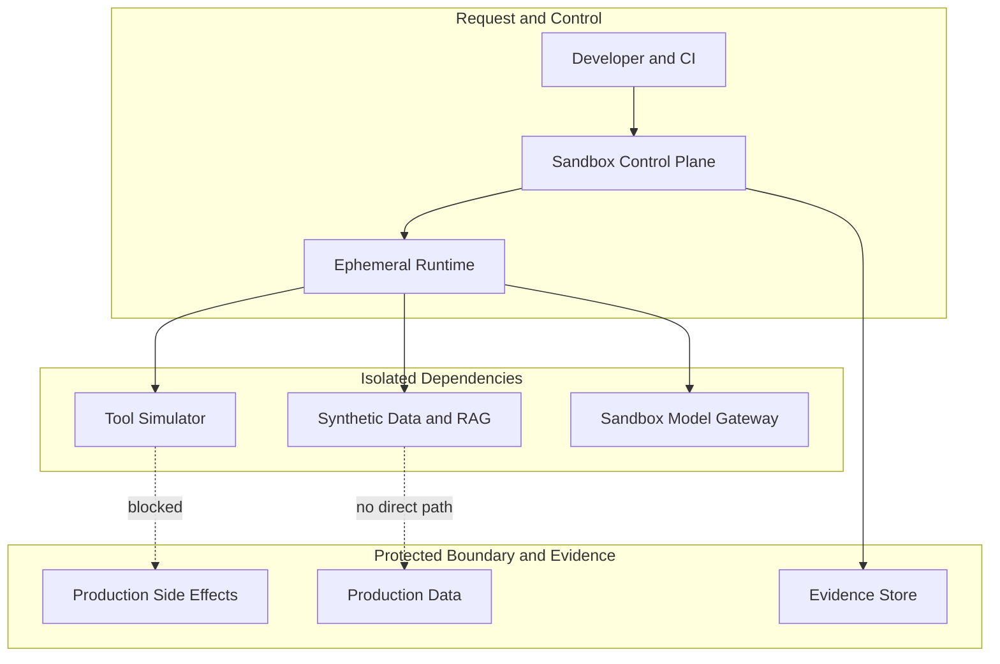
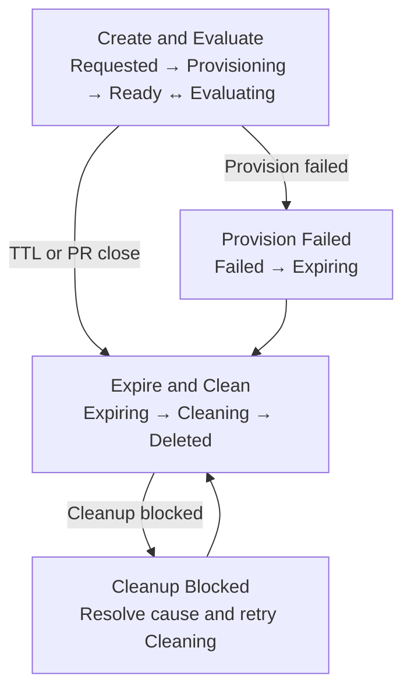
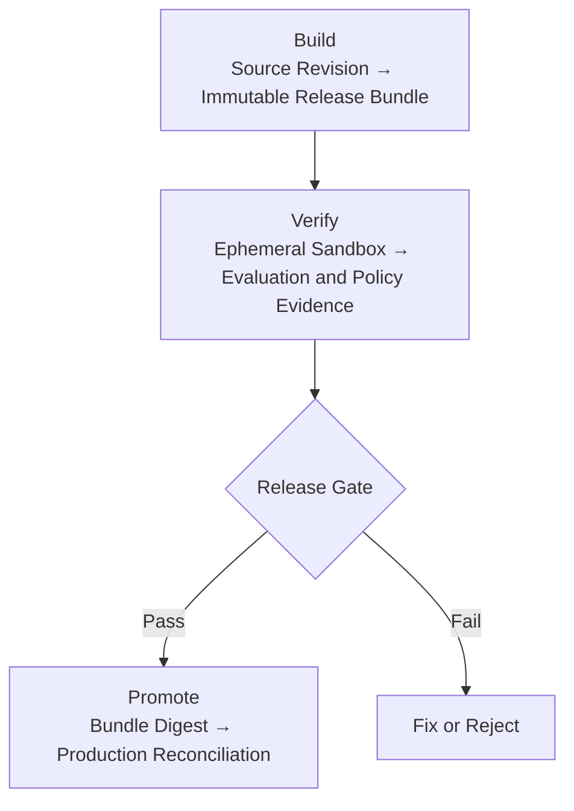

# AI Agent Sandbox와 Ephemeral Environment 설계: Production 데이터와 Side Effect 없이 Agent를 안전하게 검증하는 법

AI Agent를 검증한다면서 운영 데이터와 실제 권한을 그대로 주면 테스트가 곧 사고가 됩니다. Agent는 스스로 Tool을 골라 실행하므로 사람이 예상한 범위를 넘습니다. 이 글은 Production 데이터·Credential·실제 Side Effect와 격리하고 Synthetic Data, Tool Simulation, PR별 Ephemeral Environment, TTL Cleanup, Evaluation Evidence로 안전하게 검증하는 Sandbox 설계를 정리합니다.

회의 후속조치 Agent의 Pull Request가 열립니다. Platform은 자동으로 검증 환경을 만들고 개발자는 다음 시나리오를 실행합니다.

```text
회의록에서 담당자와 기한을 추출한다.
사내 문서에서 관련 정책을 검색한다.
Ticket을 만들고 담당자에게 메일을 보낸다.
기한이 지나면 Reminder를 예약한다.
```

첫 두 단계는 읽기 작업이지만 뒤의 두 단계는 실제 Side Effect를 만듭니다. 개발자가 Production Credential을 복사해 테스트하면 가짜 Ticket과 메일이 실제 사용자에게 전달될 수 있습니다. 반대로 모든 외부 연동을 단순한 성공 응답으로 바꾸면 Authorization·Idempotency·Timeout·부분 실패·보상 로직을 검증하지 못합니다.

AI Agent Sandbox의 목표는 단순히 Agent Process를 띄우는 것이 아닙니다. **Production 데이터와 Side Effect로부터 격리하면서도, 실제 배포 전에 필요한 품질·보안·신뢰성 Evidence를 재현 가능하게 만드는 것**입니다.

이 글은 [AI Agent Evaluation](https://aiarchitect.tistory.com/74), [AI Agent Control Plane](https://aiarchitect.tistory.com/76), [AI Agent Contract Testing](https://aiarchitect.tistory.com/80), [AI Agent Chaos Engineering](https://aiarchitect.tistory.com/84), [AI Agent Release Governance](https://aiarchitect.tistory.com/87), [AI Agent Internal Developer Platform](https://aiarchitect.tistory.com/88)을 전제로 합니다. 특정 Cloud나 Sandbox 제품의 설치법보다 **데이터·Identity·Network·Tool·수명주기·Evidence 계약**에 집중합니다.

> 이 글의 Agent, Tenant, 사용자, 데이터, Tool, Credential, Environment ID, 수치와 Threshold는 모두 교육용 합성 예시입니다. 실제 Sandbox 설계에서는 조직의 데이터 등급, Risk Appetite, Provider 계약, 법무·보안 정책, 실제 Tool 권한과 Production Architecture를 기준으로 격리 수준과 검증 범위를 결정해야 합니다.

## 1. AI Agent Sandbox는 개발용 Cluster 하나가 아니다

개발용 Cluster가 있다고 안전한 Sandbox가 되는 것은 아닙니다.

```text
Weak Sandbox
  = Non-production Compute
    + Production Data Copy
    + Shared Long-lived Credential
    + Unrestricted Egress
    + Real Write Tool

Safe Agent Sandbox
  = Isolated Compute
    + Controlled Test Data
    + Simulated or Scoped Tool
    + Short-lived Identity
    + Deny-by-default Network
    + Quota and TTL
    + Reproducible Evidence
```

AI Agent는 Prompt만 생성하지 않습니다. Model·RAG·MCP·A2A·Queue·Database·Notification을 연결하며, Tool 선택을 Runtime에 결정합니다. 따라서 Sandbox는 다음 Plane을 함께 격리해야 합니다.

| Plane | 격리 대상 | 실패 예시 |
|---|---|---|
| Data | 문서·Vector·DB·Event | Production 개인정보 유입 |
| Identity | User·Workload·Tool Credential | 개발 Agent가 운영 권한 획득 |
| Network | Ingress·Egress·DNS | 허용되지 않은 외부 API 호출 |
| Side Effect | Ticket·메일·결제·삭제 | 실제 사용자에게 테스트 결과 전송 |
| Resource | CPU·GPU·Token·Queue | PR 하나가 공용 Quota 소진 |
| Evidence | Trace·Evaluation·Audit | 어떤 조건으로 통과했는지 재현 불가 |

Sandbox는 장소가 아니라 **허용되는 데이터·행위·연결·수명에 대한 정책 묶음**입니다.

## 2. Trust Boundary와 차단할 위험을 먼저 정의한다

환경을 만들기 전에 무엇을 믿지 않을지 정합니다.



기본 위협은 다음과 같습니다.

- Prompt Injection이 Sandbox Credential을 탈취해 외부로 전송한다.
- 테스트용 Agent가 Production Tool Endpoint를 직접 호출한다.
- Production Snapshot에 개인정보·영업비밀이 남는다.
- PR 작성자가 Manifest를 바꿔 Privileged Pod나 임의 Egress를 연다.
- Shared Sandbox State 때문에 다른 팀의 테스트가 오염된다.
- Cleanup 실패로 Credential·Volume·Public Endpoint가 남는다.
- 합격 Evidence가 실제 검증한 Artifact와 다른 Revision을 가리킨다.

Threat Model은 Sandbox가 낮은 위험 환경이라는 가정이 아니라, **낮은 위험이 되도록 어떤 통제를 적용했는지 설명하는 문서**입니다.

## 3. 환경 등급과 허용 가능한 현실성을 구분한다

모든 테스트에 같은 Sandbox가 필요하지 않습니다.

| 등급 | 데이터 | Tool | Network | 목적 |
|---|---|---|---|---|
| S0 Local | Fixture | In-process Fake | 차단 | 빠른 Unit·Prompt Test |
| S1 Component | Synthetic | Stub·Container | 내부만 | Contract·Integration Test |
| S2 Ephemeral | Synthetic·승인된 비식별 | Sandbox Service | Allowlist | PR 단위 End-to-end Evaluation |
| S3 Pre-production | 제한된 대표 Dataset | 전용 Test Account | 승인된 Provider | Release Candidate 검증 |
| Production Shadow | 실제 요청의 통제된 복제 | Side Effect 차단 | Production Route 일부 | 실제 입력 분포 비교 |

현실성이 높아질수록 자동으로 더 좋은 환경이 되는 것은 아닙니다. 데이터와 권한 위험도 함께 증가합니다.

```text
Required Fidelity
  = minimum environment realism
    that can falsify the release hypothesis

Not
  = maximum possible similarity to Production
```

Prompt 형식 Regression은 S0에서 충분할 수 있습니다. Queue 재시도와 MCP Timeout은 S1이나 S2가 필요합니다. Provider별 Rate Limit과 실제 Model 품질은 S3에서 확인할 수 있습니다. 각 Test Case가 필요한 최소 환경 등급을 선언하게 합니다.

## 4. Versioned Sandbox Contract를 만든다

환경 생성 요청을 Ticket 설명이 아니라 기계 판독 가능한 계약으로 만듭니다.

```yaml
sandbox_contract:
  api_version: platform.example/v1
  environment_id: sbx-meeting-agent-pr-1842
  owner: team-collaboration-ai
  source_revision: git:8f29c1a
  release_bundle: rel-meeting-agent-20260812-09
  environment_template_digest: sha256:71ad...
  provisioner_version: sandbox-controller@18
  assurance_level: S2
  expires_at: 2026-08-13T12:00:00Z
  data_profile: synthetic-meeting-v7
  tool_profile: meeting-tools-sim-v4
  model_route: sandbox-balanced-v3
  network_profile: egress-meeting-sandbox-v2
  quota_profile: pr-standard-v5
  evidence_policy: sandbox-evidence-v6
```

Contract는 다음 질문에 답해야 합니다.

| 질문 | 계약 필드 |
|---|---|
| 무엇을 검증하는가 | Source Revision·Release Bundle |
| 어떤 데이터인가 | Data Profile·Dataset Digest |
| 어떤 Side Effect가 가능한가 | Tool Profile·Capability |
| 어디로 연결할 수 있는가 | Network Profile |
| 얼마 동안·얼마나 쓸 수 있는가 | TTL·Quota·Budget |
| 무엇을 남길 것인가 | Evidence Policy·Retention |

환경을 수동으로 수정하면 Contract와 실제 상태가 달라집니다. Desired·Effective·Observed Contract를 구분하고 Drift를 탐지해야 합니다.

## 5. Production 데이터는 기본적으로 반입하지 않는다

“개발 환경이라 괜찮다”는 데이터 처리 근거가 아닙니다.

```text
Default Rule
  Production Data → Sandbox : DENY

Exception
  Approved Purpose
  + Minimum Necessary Fields
  + De-identification Evidence
  + Time-bounded Access
  + Isolated Storage
  + Deletion Verification
```

Production 데이터 복사는 다음 위험을 만듭니다.

- 원래 동의·계약 범위를 벗어난 2차 사용
- 낮은 보안 등급 환경으로 민감정보 확산
- Prompt·Trace·Evaluation Artifact에 원문 잔존
- Vector Index나 Backup에 삭제하기 어려운 복제본 생성
- 외부 Model Provider로 데이터 전송

테스트 편의를 이유로 전체 Database Snapshot을 복사하지 않습니다. 먼저 Synthetic Data로 검증하고, 실제 분포가 꼭 필요하면 승인된 최소 Slice를 별도 경로로 처리합니다.

## 6. Synthetic Data를 업무 불변식으로 설계한다

무작위 문자열은 데이터가 아니라 Noise입니다. 좋은 Synthetic Data는 업무 규칙과 실패 조건을 보존합니다.

```yaml
synthetic_data_profile:
  id: synthetic-meeting-v7
  schema_version: 4
  seed: 48102
  locale_distribution:
    ko-KR: 0.75
    en-US: 0.25
  invariants:
    - every_action_item_has_meeting_id
    - due_date_is_after_meeting_time
    - participant_email_is_non_routable
  edge_cases:
    - ambiguous_owner
    - conflicting_due_dates
    - missing_consent
    - prompt_injection_in_transcript
  prohibited_patterns:
    - real_company_domain
    - real_phone_number
    - production_tenant_id
```

Synthetic Data 품질은 다음 축으로 봅니다.

| 축 | 질문 |
|---|---|
| Schema Fidelity | 실제 필드·타입·관계가 유지되는가 |
| Distribution Fidelity | 길이·언어·빈도·결측 패턴이 대표적인가 |
| Behavioral Fidelity | 업무 규칙과 상태 전이가 재현되는가 |
| Risk Coverage | 경계값·악성 입력·오류 조건이 포함되는가 |
| Non-identifiability | 실제 개인이나 조직을 재현하지 않는가 |

NIST AI RMF Generative AI Profile은 시스템의 데이터·콘텐츠 흐름과 의사결정 기준을 포함한 Test와 Evaluation을 강조합니다. Synthetic Dataset도 생성기 Version·Seed·Coverage·검토 Evidence를 남겨야 합니다.

## 7. Seed와 Clock으로 재현 가능한 상태를 만든다

같은 Release가 실행할 때마다 다른 Fixture와 시간을 만나면 Regression을 설명하기 어렵습니다.

```text
Reproducible Sandbox State
  = Dataset Generator Version
    + Random Seed
    + Frozen Clock
    + Time Zone
    + Initial Database Snapshot Digest
    + Queue Fixture Digest
    + Tool Scenario Version
```

시간 의존 로직은 System Clock을 직접 읽지 않고 Clock Interface를 사용합니다.

```yaml
test_clock:
  mode: frozen
  now: 2026-08-12T09:00:00+09:00
  timezone: Asia/Seoul
  advance_plan:
    - after: reminder_created
      advance: PT25H
```

Retry Backoff·Deadline·Reminder·Lease 만료·Budget Period를 실제 시간만으로 시험하면 느리고 Flaky합니다. Controlled Clock으로 시간을 전진시키되, 일부 Test는 실제 Scheduler와 Clock Skew를 검증하는 별도 Suite로 둡니다.

## 8. 비식별 데이터도 별도 승인과 수명주기를 적용한다

비식별 처리는 위험을 줄이지만 자동으로 자유로운 데이터가 되는 것은 아닙니다.

```text
Data Admission Decision
  = Classification
    + Purpose
    + Minimization
    + Re-identification Risk
    + Provider Route
    + Retention
    + Deletion Method
```

비식별 Dataset에는 다음 Metadata를 붙입니다.

```yaml
dataset_admission:
  dataset_id: eval-meeting-deid-2026q3-02
  source_classification: confidential
  transformation_version: deid-pipeline-12
  approved_fields:
    - transcript_text_redacted
    - language
    - duration_bucket
  prohibited_destinations:
    - public_model_api
    - developer_laptop
  expires_at: 2026-09-01T00:00:00Z
  deletion_evidence_required: true
```

원문과 변환 결과의 Linkage Key를 Sandbox에 두지 않습니다. 재식별 가능성을 낮추고, Dataset 수명과 환경 수명을 분리해 더 짧은 쪽을 적용합니다.

## 9. Tool Simulation의 충실도 단계를 나눈다

Tool을 모두 Mock으로 부르면 중요한 결함을 놓치고, 모두 실제 서비스로 부르면 Side Effect를 막기 어렵습니다.

| 수준 | 구현 | 검증 가능 | 한계 |
|---|---|---|---|
| Fake | 메모리 내부 구현 | Agent 분기·형식 | Protocol 현실성 낮음 |
| Stub | 요청별 고정 응답 | Contract·Error Mapping | 상태 변화 제한 |
| Simulator | 상태 기계·지연·오류 | Workflow·Retry·보상 | 운영 서비스와 Drift 가능 |
| Sandbox Account | 실제 서비스의 Test 계정 | Provider 동작·Quota | 비용·외부 의존성 |
| Shadow Proxy | 실제 요청을 무효화·기록 | Production 분포 | 강한 통제 필요 |

Tool별로 필요한 Fidelity를 정합니다.

```yaml
tool_simulation:
  ticket.create:
    level: stateful_simulator
    contract_version: ticket-mcp-v9
  mail.send:
    level: sink
    deliverability: disabled
  policy.lookup:
    level: sandbox_service
  payment.capture:
    level: strict_fake
    real_endpoint_forbidden: true
```

WireMock 같은 API Mock은 요청 조건에 따라 응답을 Stubbing하고 지연·오류를 주입할 수 있습니다. 하지만 Stub 자체도 Versioned Artifact로 관리하고 Production Contract와 Drift를 검사해야 합니다.

Simulator Drift는 별도 Gate로 관리합니다. Tool Owner가 승인한 OpenAPI·JSON Schema·MCP Tool Contract와 Sandbox Simulator의 Request·Response Schema를 비교하고, Provider Sandbox나 통제된 Contract Probe에서 수집한 비민감 Golden Interaction을 재생합니다. 새 필드·오류 코드·Pagination·Idempotency 동작이 달라지면 Simulator Version을 올리고 기존 Evaluation Evidence를 만료시킵니다.

## 10. Side Effect를 Command Envelope 안에 가둔다

Agent가 외부 시스템을 직접 호출하게 두지 않습니다. 모든 쓰기 요청을 Command Envelope로 변환합니다.

```json
{
  "command_id": "cmd-sbx-01K2...",
  "environment_id": "sbx-meeting-agent-pr-1842",
  "tenant_id": "synthetic-tenant-alpha",
  "tool": "ticket.create",
  "tool_contract_version": "ticket-mcp-v9",
  "capability": "simulate",
  "idempotency_key": "meeting-881-action-04",
  "payload": {
    "title": "Synthetic follow-up",
    "assignee": "user-017.invalid"
  },
  "expected_effect": "simulated_ticket_created"
}
```

Gateway는 Environment Claim과 Tool Capability를 확인합니다.

```text
if environment == sandbox
and capability == simulate
and tool_profile allows ticket.create
then route to Simulator
else deny and emit Policy Evidence
```

Agent Prompt의 “테스트 모드” 문구는 보안 경계가 아닙니다. Network·Identity·Gateway Policy가 실제 Endpoint 접근을 막아야 합니다.

## 11. 등록되지 않은 Tool 호출은 Fail-closed로 처리한다

새 Tool이나 Endpoint가 생겼을 때 자동으로 외부 연결을 허용하면 Sandbox 경계가 무너집니다.

```text
Known Tool + Known Contract + Allowed Capability
  → Simulate or Sandbox Route

Unknown Tool or Contract Drift
  → DENY
  → Record Unmapped Invocation
  → Fail Evaluation
```

Fail-open Simulator는 편해 보이지만 위험합니다.

| 상황 | Fail-open 결과 | Fail-closed 결과 |
|---|---|---|
| 새 Tool 등록 누락 | 실제 Endpoint로 우회 가능 | 테스트 실패 |
| Tool Schema 변경 | 잘못된 Argument 무시 | Contract Drift 탐지 |
| Sandbox DNS 오류 | Public DNS로 Fallback | 연결 차단 |
| Capability Claim 누락 | 기본 Write 권한 사용 | 권한 거절 |

Unmapped 호출을 단순 404로 숨기지 말고 Release Gate를 실패시키는 명시적 Evidence로 만듭니다.

## 12. 지연·오류·Rate Limit·부분 성공을 주입한다

항상 200 OK를 반환하는 Simulator는 Happy Path Demo에는 유용하지만 운영 검증에는 부족합니다.

```yaml
tool_scenario:
  id: ticket-partial-failure-v5
  steps:
    - match: ticket.create
      attempt: 1
      response:
        status: 202
        delay_ms: 1800
        effect: persisted_without_response
    - match: ticket.create
      attempt: 2
      response:
        status: 409
        body: duplicate_idempotency_key
    - match: ticket.get
      response:
        status: 200
        body_fixture: ticket-created.json
```

검증할 실패 유형은 다음과 같습니다.

- DNS·Connection·TLS 실패
- 고정·분포 기반 지연과 Deadline 초과
- 429와 Retry-After
- 500·503·Circuit Open
- Response Body 손상과 Schema Drift
- Write 성공 후 Response 유실
- 일부 Child Tool만 성공한 Partial Completion
- Event 지연·중복·순서 역전

WireMock 공식 문서는 고정·랜덤 지연, 잘못된 응답과 연결 Fault를 지원합니다. Simulator는 오류를 흉내 내는 데서 끝나지 않고 Agent의 Retry Budget·Idempotency·Reconciliation·Compensation 결과를 검증해야 합니다.

## 13. RAG Corpus와 Index를 Production에서 분리한다

Sandbox Agent가 Production Vector Store를 읽으면 데이터 경계와 평가 재현성이 함께 깨집니다.

```text
Synthetic Documents
  → Sandbox Ingestion Pipeline
  → Dedicated Object Prefix
  → Dedicated Vector Collection
  → Sandbox Retrieval Endpoint
  → Citation Evaluation
```

RAG Sandbox 계약은 다음을 포함합니다.

```yaml
knowledge_sandbox:
  corpus_id: meeting-policy-synthetic-v8
  corpus_digest: sha256:8bc1...
  ingestion_pipeline_version: ingest-22
  chunk_policy_version: chunk-11
  embedding_route: sandbox-embed-v4
  vector_collection: sbx_pr_1842_policy
  acl_fixture_version: acl-synthetic-v3
  delete_on_environment_expiry: true
```

Production Index의 Alias를 Sandbox에서 재사용하지 않습니다. Tenant ACL·삭제·신선도·Citation을 시험하려면 Synthetic Corpus에도 여러 Tenant와 Version, 권한 변경, 삭제된 문서, 충돌하는 문서를 포함합니다.

## 14. Model Route와 비용도 Sandbox 정책으로 통제한다

Sandbox가 무제한 Model API 사용 경로가 되면 비용과 데이터 전송 위험이 생깁니다.

| Route | 용도 | 제한 |
|---|---|---|
| Deterministic Fake Model | Workflow·Parser Test | 품질 평가 불가 |
| Small Sandbox Model | 빠른 PR Evaluation | Quality 차이 명시 |
| Production-equivalent Model | Release Candidate | 승인·Budget·Rate Limit |
| External Provider Test Project | Provider Integration | 별도 Project·Data Policy |

```yaml
model_sandbox_policy:
  route: sandbox-balanced-v3
  allowed_models:
    - reasoning-small
    - embedding-sandbox-v4
  denied_capabilities:
    - provider_file_storage
    - provider_training_opt_in
  provider_data_policy:
    retention: no_storage
    training_use: prohibited
    allowed_regions:
      - kr
  max_input_tokens_per_run: 24000
  max_output_tokens_per_run: 4000
  daily_budget_usd: 45
  production_api_key_allowed: false
```

저가 Model만 사용하면 Workflow 결함은 찾을 수 있어도 실제 품질·지연·Tool 선택 차이를 놓칠 수 있습니다. Test 목적에 따라 Route를 선언하고, Release Gate Evidence에는 사용한 Provider·Model·Policy Version을 기록합니다.

Provider의 “테스트 Project”는 데이터 보호 경계가 아닐 수 있습니다. Request 저장·Abuse Monitoring·학습 사용·지역·Support 접근·삭제 API 계약을 별도로 확인하고, Sandbox Gateway가 허용된 Project와 Region만 선택하게 합니다.

## 15. Workload Identity와 단기 Credential을 사용한다

Production Secret을 환경 변수로 복사하지 않습니다.

```text
CI Identity
  → Environment Provision Request
  → Sandbox Workload Identity
  → Credential Broker
  → Short-lived Sandbox Credential
  → Automatic Revoke on Expiry
```

SPIFFE는 Workload에 짧은 수명의 X.509-SVID나 JWT-SVID를 발급하고 자동 회전하는 모델을 제공합니다. Vault의 Dynamic Secret과 Lease는 Credential을 요청 시 생성하고 TTL 만료나 명시적 Revoke로 폐기할 수 있습니다.

```yaml
sandbox_identity:
  spiffe_id: spiffe://example.internal/ns/sbx-pr-1842/sa/meeting-agent
  credential_leases:
    - target: ticket-simulator
      capability: simulate
      ttl: PT30M
    - target: sandbox-database
      role: meeting_readwrite
      ttl: PT20M
  revoke_on:
    - environment_expired
    - pull_request_closed
    - policy_violation
```

Credential TTL이 환경 TTL보다 길어서는 안 됩니다. 환경 삭제가 실패해도 Credential Revocation은 독립적으로 실행되어야 합니다.

## 16. Network Egress를 Default Deny로 시작한다

Sandbox Network는 “인터넷이 되지만 운영만 조심해서 호출하지 않는” 구조가 아닙니다.

```yaml
apiVersion: networking.k8s.io/v1
kind: NetworkPolicy
metadata:
  name: sandbox-default-deny
spec:
  podSelector: {}
  policyTypes:
    - Ingress
    - Egress
```

그 위에 필요한 경로만 허용합니다.

```text
Allowed
  DNS Resolver
  Sandbox Model Gateway
  Tool Simulator
  Synthetic RAG Endpoint
  Telemetry Collector

Denied
  Production Private Network
  Cloud Metadata Endpoint
  Public Internet by Default
  Unregistered IP and Port
```

Kubernetes NetworkPolicy는 Pod의 Ingress와 Egress를 선언적으로 제한하지만, 실제 집행에는 이를 지원하는 Network Plugin이 필요합니다. 또한 L3·L4 규칙만으로 Domain·HTTP Path·SNI·Identity 정책을 모두 표현할 수 없습니다. Egress Gateway·Service Mesh·DNS Policy·Cloud Firewall을 조합하고 실제 차단 Test를 수행합니다.

Domain Allowlist만 검사하고 끝내지 않습니다. DNS Rebinding, CNAME 변화, HTTP Redirect, IPv4·IPv6 우회, Proxy 환경 변수, Cloud Metadata 주소와 직접 IP 호출을 Negative Test에 포함합니다. Egress Gateway는 최종 Destination과 Workload Identity를 함께 검증하고 Redirect마다 정책을 다시 평가합니다.

## 17. Namespace를 넘는 Runtime 격리를 설계한다

Namespace는 이름과 Namespaced Resource의 Scope를 제공하지만 완전한 보안 경계는 아닙니다. Node·PersistentVolume·CRD 같은 Cluster-scoped Resource는 공유될 수 있습니다.

| 위험 | 기본 통제 | 강화 통제 |
|---|---|---|
| API 권한 | Namespace RBAC | 별도 Cluster·Control Plane |
| Pod 권한 | Pod Security Restricted | Sandbox Runtime·MicroVM |
| Node 공유 | Taint·Affinity | 전용 Node Pool |
| Network | NetworkPolicy | Egress Gateway·Firewall |
| Storage | 전용 PVC·Key | 전용 Account·Project |
| Kernel | Seccomp·Capabilities Drop | Strong Isolation Runtime |

Kubernetes Pod Security Admission은 Namespace Label을 통해 `privileged`·`baseline`·`restricted` 수준을 enforce·audit·warn 모드로 적용할 수 있습니다. Sandbox 기본값은 `restricted`를 우선하고 예외는 만료되는 Policy로 관리합니다.

```yaml
metadata:
  labels:
    pod-security.kubernetes.io/enforce: restricted
    pod-security.kubernetes.io/enforce-version: v1.36
```

ValidatingAdmissionPolicy로 다음을 거절할 수 있습니다.

- Privileged·Host Network·Host Path
- 임의 LoadBalancer·NodePort
- 승인되지 않은 Image Registry
- TTL·Owner·Environment Label 누락
- Production Secret·Endpoint 참조

고위험 코드 실행이나 불신 Plugin을 시험할 때는 Namespace가 아니라 별도 Cluster·Account·MicroVM 같은 더 강한 경계를 선택합니다.

## 18. Quota·Concurrency·Token·비용 상한을 둔다

PR마다 환경을 만들면 작은 누수가 큰 비용과 Capacity 문제로 이어집니다.

```yaml
sandbox_quota:
  kubernetes:
    requests_cpu: "4"
    limits_cpu: "8"
    requests_memory: 8Gi
    limits_memory: 16Gi
    pods: 30
    persistentvolumeclaims: 6
  agent:
    concurrent_runs: 4
    max_steps_per_run: 24
    max_tool_calls_per_run: 18
    max_wall_time: PT8M
  model:
    tokens_per_minute: 120000
    daily_budget_usd: 45
```

Kubernetes ResourceQuota는 Namespace 전체의 Resource와 Object 수를 제한하고 LimitRange는 개별 Pod·Container의 최소·최대·기본값을 제약합니다. 그러나 Model Token·Tool API·Queue·Vector Query 비용은 별도 Admission Control이 필요합니다.

환경 생성 전에 예상 비용을 예약하고, 완료·만료·삭제 후 실제 비용을 정산합니다. Budget이 부족하면 Production SLO 자원을 빼앗지 않고 Queue·축소 Route·거절 정책을 적용합니다.

## 19. Ephemeral Environment의 수명주기를 상태 기계로 관리한다

Ephemeral은 이름이 아니라 자동 만료와 삭제가 보장되는 상태입니다.



각 전이는 Evidence를 남깁니다.

```yaml
environment_status:
  environment_id: sbx-meeting-agent-pr-1842
  desired_state: deleted
  effective_state: cleanup_blocked
  observed_at: 2026-08-13T12:04:11Z
  blockers:
    - external_test_account_not_revoked
  retry_after: 2026-08-13T12:09:11Z
```

삭제 요청을 보냈다는 사실과 모든 Resource가 사라졌다는 사실을 구분합니다. CleanupBlocked는 숨길 오류가 아니라 운영 Queue와 SLO가 필요한 상태입니다.

## 20. PR Event와 GitOps로 환경 생성을 자동화한다

Pull Request가 환경 수명주기의 Trigger가 될 수 있습니다.

```text
PR Open or Label
  → Validate Sandbox Contract
  → Generate Environment Manifest
  → Policy Admission
  → GitOps Reconciliation
  → Seed Synthetic State
  → Run Evaluation
  → Post Evidence Link

PR Update
  → Reconcile Revision
  → Invalidate stale Evidence

PR Close or Merge
  → Revoke Credential
  → Delete Environment
  → Verify Cleanup
```

Argo CD ApplicationSet Pull Request Generator는 열린 PR을 발견해 Application을 생성하는 용도를 제공합니다. Polling이나 Webhook으로 변경을 감지할 수 있지만 보안 경계도 함께 봐야 합니다. 공식 문서는 ApplicationSet 생성 권한과 템플릿화된 Project Field가 과도한 Resource 권한으로 이어질 수 있음을 경고합니다.

PR 작성자가 Destination Cluster·Namespace·Project·Secret Reference를 임의로 바꾸지 못하게 합니다. 사용자 입력은 제한된 Parameter로 받고 Platform이 승인된 Template을 렌더링합니다.

특히 외부 Fork와 신뢰하지 않는 PR 코드를 권한 있는 Provisioner 안에서 실행하지 않습니다. Control Plane은 PR Event Metadata와 검증된 Manifest Parameter만 읽고, Agent Code는 격리된 Workload Plane에서 실행합니다. Fork PR은 Secret 없는 S0·S1 환경만 허용하고, Maintainer 승인과 Commit 고정 뒤에만 S2·Provider Route를 사용할 수 있게 합니다.

```text
Untrusted PR Code
  ─X→ Provisioner Credential
  ─X→ GitOps Admin Project
  ─X→ Secret Broker Admin Role

Validated PR Metadata
  → Approved Template Renderer
  → Policy Admission
  → Isolated Workload Runtime
```

## 21. Provisioning을 Idempotent Operation으로 만든다

환경 생성은 여러 외부 시스템을 연결하는 장기 실행 Operation입니다.

```text
Create Namespace
→ Apply Policy and Quota
→ Issue Workload Identity
→ Provision Database
→ Create Tool Simulator State
→ Build RAG Index
→ Register Routes
→ Start Agent
→ Run Readiness Probe
```

중간 실패 후 처음부터 무조건 다시 실행하면 중복 계정·Database·Route가 생깁니다.

```yaml
provision_operation:
  operation_id: op-sbx-1842-01
  idempotency_key: repo-17:pr-1842:revision-8f29c1a
  steps:
    namespace:
      status: committed
      resource_id: ns/sbx-pr-1842
    database:
      status: committed
      resource_id: db-sbx-7af2
    tool_state:
      status: retrying
      attempt: 3
    rag_index:
      status: pending
```

각 Step은 Observe-before-Create, Idempotency Key, Timeout, Retry Policy와 Compensation을 가집니다. Operation API는 동기 HTTP Timeout보다 상태 조회와 Event 구독을 제공하는 비동기 계약이 적합합니다.

## 22. TTL·Finalizer·Janitor로 Cleanup을 보장한다

삭제는 Best-effort Script 하나에 맡기지 않습니다.

```text
Cleanup Layers
  1. Event-driven deletion on PR close
  2. Contract expires_at reconciliation
  3. Resource-level TTL where supported
  4. Periodic Janitor for orphan detection
  5. Credential lease expiration
  6. Cost and exposure alarm for stale environment
```

Kubernetes Job은 `ttlSecondsAfterFinished`로 완료 후 자동 삭제할 수 있습니다. 하지만 Namespace·Database·Object Storage·External Test Account·DNS Record는 별도 Controller가 정리해야 합니다.

```yaml
cleanup_contract:
  expires_at: 2026-08-13T12:00:00Z
  grace_period: PT30M
  finalizers:
    - revoke-credentials
    - delete-rag-collection
    - destroy-database
    - remove-dns-route
  deletion_slo: PT20M
  orphan_alarm_after: PT30M
```

Finalizer가 영구적으로 삭제를 막지 않도록 최대 재시도와 수동 복구 절차를 둡니다. Resource를 강제로 지우기 전에 남은 외부 Side Effect와 데이터 보존 의무를 확인합니다.

Cleanup 순서는 Containment를 먼저 수행합니다.

```text
1. 신규 Run과 Ingress 차단
2. Workload·Tool Credential 철회
3. 진행 중 Write Command 정지·Reconciliation
4. 필요한 Evidence와 삭제 Inventory 확정
5. RAG·Database·Queue·Object·Route 삭제
6. 잔존 Resource와 Credential Negative Test
7. Cleanup Report 완료
```

삭제가 지연돼도 1~3단계가 성공하면 추가 Side Effect와 데이터 유출 가능성을 먼저 줄일 수 있습니다.

## 23. Production Parity를 명시적 계약으로 관리한다

Sandbox가 Production과 완전히 같을 수는 없습니다. 무엇이 같은지보다 무엇이 다른지 명시하는 것이 중요합니다.

| 항목 | Parity 목표 | 허용 차이 |
|---|---|---|
| Agent Code | 동일 Digest | 없음 |
| Prompt·Policy | 동일 Release Candidate | 없음 |
| Tool Contract | 동일 Schema | Endpoint·Capability 다름 |
| Model | 핵심 Gate는 동일 Route | 빠른 PR Test는 소형 Route 허용 |
| Data | Schema·행동 분포 | 실제 식별자·민감 원문 제외 |
| Scale | 상대적 패턴 | 절대 Traffic 축소 |
| Network | Deny·Allow 구조 | Destination은 Sandbox 전용 |
| Identity | 동일 Claim 구조 | Trust Domain·권한 Scope 분리 |

```yaml
parity_report:
  release_bundle_match: true
  tool_schema_match: true
  policy_version_match: true
  model_route_match: false
  model_route_difference: fast_pr_profile
  data_distribution_coverage: 0.91
  unsupported_tests:
    - provider_regional_failover
    - production_peak_queue_depth
```

Parity가 부족한 Test는 통과시키지 않거나 더 높은 환경 등급으로 이동합니다. Sandbox 성공을 Production 안전의 완전한 증명으로 해석하지 않습니다.

## 24. Trace·Audit·Environment Evidence를 연결한다

환경이 사라져도 검증 근거는 남아야 합니다.

```yaml
sandbox_evidence:
  evidence_id: ev-sbx-1842-09
  environment_contract_digest: sha256:18ac...
  effective_environment_digest: sha256:83b2...
  release_bundle_digest: sha256:44f1...
  dataset_digest: sha256:02d9...
  tool_scenario_digest: sha256:8e17...
  trace_set_id: traces-sbx-1842-run-09
  evaluation_report: eval-9921
  policy_decisions: policy-set-713
  cost_report: cost-sbx-1842-09
  cleanup_report: pending
```

Trace에는 Environment ID·Release ID·Dataset ID·Tool Scenario ID를 공통 Attribute로 연결합니다. OpenTelemetry Semantic Conventions는 HTTP·Database·Messaging·CI/CD 등의 공통 의미를 제공하며 GenAI Convention은 전용 저장소로 이동 중이므로 사용한 Version을 고정합니다.

Prompt·Tool Argument·Retrieval Query·결과에는 민감정보가 포함될 수 있습니다. Evidence를 위해 원문을 무조건 수집하지 않고 Hash·분류·Sampling·Redaction·Access Policy를 적용합니다.

## 25. Evaluation과 Replay를 환경 안에서 실행한다

환경이 Ready라는 사실은 Agent가 안전하다는 뜻이 아닙니다.

```text
Environment Ready
  → Contract Test
  → Golden Evaluation
  → Regression Evaluation
  → Adversarial Evaluation
  → Tool State and Side-effect Assertion
  → Reliability Scenario
  → Cost and Latency Gate
  → Evidence Bundle
```

Replay는 입력만 복사하지 않습니다.

```yaml
replay_case:
  input_fixture: meeting-ambiguous-owner-17
  clock: 2026-08-12T09:00:00+09:00
  dataset_version: synthetic-meeting-v7
  tool_scenario: ticket-partial-failure-v5
  model_route: sandbox-balanced-v3
  expected:
    outcome: needs_human_review
    real_side_effect_count: 0
    simulated_ticket_count: 1
    duplicate_ticket_count: 0
    max_total_cost_usd: 0.35
```

Baseline과 Candidate를 같은 Seed·Clock·Dataset·Tool Scenario에서 비교합니다. 확률적 Model은 반복 횟수·표본 수·Confidence를 함께 기록하고 불확실한 결과를 `Inconclusive`로 처리합니다.

## 26. Adversarial Test와 Recovery Test를 격리해 실행한다

Sandbox는 정상 시나리오뿐 아니라 Production에서 시도하기 어려운 공격과 장애를 시험하는 장소입니다.

| Test | 주입 | 기대 통제 |
|---|---|---|
| Prompt Injection | 문서 안의 Tool 지시 | Trust Boundary·Tool Policy 거절 |
| Data Exfiltration | 외부 URL 전송 지시 | Egress 차단 |
| Privilege Escalation | 상위 Tenant Scope 요청 | Authorization 거절 |
| Tool Confusion | 유사한 Tool Description | Allowlist·Human Approval |
| Retry Storm | 429·Timeout 반복 | Retry Budget·Circuit Breaker |
| Lost Response | Write 성공 후 연결 끊김 | Idempotency·Reconciliation |
| Cleanup Failure | External Account 삭제 오류 | CleanupBlocked·Janitor 복구 |

공격 문자열이나 악성 Artifact가 다른 환경으로 확산되지 않게 전용 Dataset·Queue·Object Prefix를 사용합니다. Red Team Credential도 Production 권한을 갖지 않으며, Test 종료 후 Seed와 Artifact를 정책에 따라 파기합니다.

NIST GenAI Profile이 강조하는 Test·Evaluation과 기존 Chaos Engineering의 Recovery Evidence를 연결해 “공격을 탐지했다”뿐 아니라 “Side Effect가 차단되고 안전 상태로 복구됐다”를 확인합니다.

## 27. Evidence 보존과 데이터 파기를 분리한다

환경 삭제와 모든 기록 삭제를 같은 의미로 사용하면 감사 Evidence가 사라지거나 민감 데이터가 과도하게 남습니다.

| Artifact | 기본 처리 | 이유 |
|---|---|---|
| Synthetic Database | 환경과 함께 삭제 | 재생성 가능 |
| Vector Collection | 환경과 함께 삭제 | 교차 환경 오염 방지 |
| Dynamic Credential | 즉시 Revoke | 잔존 권한 차단 |
| Raw Prompt·Tool Payload | 짧은 보존·Redaction | 민감정보 위험 |
| Evaluation Summary | Release 정책 기간 보존 | Gate 재현 |
| Policy Decision | 감사 정책에 따라 보존 | 승인·거절 근거 |
| Environment·Cleanup Digest | 장기 보존 가능 | 원문 없이 상태 증명 |

```yaml
retention_policy:
  raw_trace: P7D
  redacted_trace: P30D
  evaluation_summary: P365D
  policy_decision: P365D
  synthetic_state: until_environment_deleted
  deidentified_dataset: until_dataset_expiry
```

Cleanup Report에는 삭제 대상, 결과, 남은 예외, 검증 시각을 기록합니다. “Delete API가 200을 반환했다”가 아니라 조회·Inventory·Credential Test로 삭제 완료를 확인합니다.

## 28. 환경이 아니라 검증된 Artifact를 승격한다

Sandbox Database나 Namespace를 Production으로 복사하지 않습니다.



Promotion 대상은 다음과 같습니다.

- 불변 Container·Prompt·Policy·Tool Contract Digest
- RAG Corpus·Index Build Manifest
- Evaluation·Security·Cost Evidence Reference
- 승인된 Runtime Configuration Pointer

Promotion 대상이 아닌 것은 다음과 같습니다.

- Sandbox의 수동 수정 상태
- 테스트 중 생성된 Database Row
- Sandbox Credential과 Endpoint
- PR Namespace의 Volume Snapshot
- 검증하지 않은 `latest` Alias

Production은 승인된 Bundle을 자체 Identity·Data·Network Policy로 다시 Reconcile합니다. Sandbox를 그대로 복제하면 환경 간 Credential과 데이터 경계가 섞입니다.

## 29. 합성 사례와 5단계 도입 로드맵

회의 후속조치 Agent의 PR `1842`를 검증합니다.

### 합성 Sandbox Contract

```yaml
sandbox:
  id: sbx-meeting-agent-pr-1842
  release_bundle: rel-meeting-agent-20260812-09
  assurance_level: S2
  ttl: PT24H
  data:
    profile: synthetic-meeting-v7
    seed: 48102
    production_data_allowed: false
  tools:
    ticket: stateful_simulator-v5
    mail: non_delivery_sink-v3
    policy: sandbox_service-v8
  security:
    pod_security: restricted
    egress_profile: default-deny-meeting-v2
    credential_ttl: PT30M
  budget:
    max_cost_usd: 45
    concurrent_runs: 4
  gates:
    - contract
    - regression
    - adversarial
    - reliability
    - cost
```

### 검증 결과

| Gate | 결과 | Evidence |
|---|---|---|
| Contract | Pass | Tool Schema·Release Digest 일치 |
| Regression | Pass | 420 Case, Critical Slice 저하 없음 |
| Adversarial | Pass | 외부 Egress 18건 차단 |
| Reliability | Fail | Response 유실 후 Ticket 중복 생성 |
| Cost | Pass | p95 Run 비용 0.31 USD |

평균 품질은 통과했지만 Reliability Gate가 실패했으므로 Release를 승격하지 않습니다. Idempotency Key를 Tool Gateway까지 전달하도록 수정하고 같은 Seed와 Scenario로 재실행합니다.

### 1단계: Side Effect 차단

- [ ] Production Credential과 Endpoint 참조를 Inventory한다.
- [ ] 모든 Write Tool을 Gateway와 Command Envelope 뒤로 이동한다.
- [ ] Sandbox는 Default Deny Egress와 Fail-closed Tool Policy를 적용한다.
- [ ] 실제 메일·결제·삭제가 0건임을 자동 Assertion한다.

### 2단계: 재현 가능한 데이터와 Simulator

- [ ] Synthetic Data Generator·Seed·Clock을 Versioning한다.
- [ ] Tool Contract별 Fake·Stub·Simulator 수준을 정한다.
- [ ] Timeout·429·Lost Response·부분 성공 Scenario를 만든다.
- [ ] RAG Corpus·Index·ACL Fixture를 Production과 분리한다.

### 3단계: Ephemeral Environment 자동화

- [ ] PR 기반 Contract 검증과 GitOps Provisioning을 연결한다.
- [ ] Namespace·Identity·Network·Quota를 Template으로 적용한다.
- [ ] Operation을 Idempotent하게 만들고 상태를 노출한다.
- [ ] TTL·Finalizer·Janitor·Credential Revoke를 구현한다.

### 4단계: Evidence와 Release Gate

- [ ] Environment·Release·Dataset·Scenario ID를 Trace에 연결한다.
- [ ] Evaluation·Security·Reliability·Cost Gate를 자동 실행한다.
- [ ] Parity Gap과 Unsupported Test를 Evidence에 기록한다.
- [ ] 통과한 Bundle Digest만 Promotion한다.

### 5단계: 운영 SLO와 지속 개선

- [ ] Provisioning Lead Time과 Ready 성공률을 측정한다.
- [ ] Cleanup SLO·Orphan 수·Stale Credential을 추적한다.
- [ ] Simulator와 Production Contract Drift를 감시한다.
- [ ] Sandbox Incident와 Escape Hatch를 Platform Backlog에 반영한다.

```text
Production 데이터와 Credential을 기본 차단한다.
Synthetic Data를 업무 규칙·경계값·악성 입력으로 설계한다.
Tool Simulation 수준을 목적별로 구분한다.
Side Effect는 Command Envelope와 Gateway에서 통제한다.
Network Egress는 Default Deny에서 시작한다.
Namespace만 믿지 않고 Identity·Pod·Node·Storage 경계를 겹친다.
환경은 PR Event·TTL·Janitor로 자동 생성·삭제한다.
Production Parity의 차이를 숨기지 않고 Evidence로 남긴다.
환경이 아니라 검증된 Release Bundle Digest를 승격한다.
Cleanup 완료도 Release Evidence와 같은 수준으로 검증한다.
```

좋은 AI Agent Sandbox는 Production을 작게 복제한 공간이 아닙니다. 위험한 연결은 제거하고, 검증에 필요한 현실성은 선택적으로 재현하며, 환경 생성부터 파기까지 모든 상태를 Evidence로 설명할 수 있는 **안전한 실험 제품**입니다.

다음 글에서는 이 Sandbox를 활용해 Prompt Injection·Tool Abuse·Data Exfiltration·권한 상승 경로를 지속적으로 공격하고 개선하는 **AI Agent Red Teaming과 Continuous Assurance**를 다룹니다. Attack Scenario Registry, Automated Adversarial Test, Human Red Team, Detection·Containment·Recovery Evidence와 Release·Runtime Gate의 연결을 살펴봅니다.

## 30. 공식 참고자료

- [NIST — Artificial Intelligence Risk Management Framework 1.0](https://nvlpubs.nist.gov/nistpubs/ai/NIST.AI.100-1.pdf)
- [NIST — AI RMF Generative Artificial Intelligence Profile, NIST AI 600-1](https://www.nist.gov/publications/artificial-intelligence-risk-management-framework-generative-artificial-intelligence)
- [Kubernetes — Namespaces](https://kubernetes.io/docs/concepts/overview/working-with-objects/namespaces/)
- [Kubernetes — Multi-tenancy](https://kubernetes.io/docs/concepts/security/multi-tenancy/)
- [Kubernetes — Resource Quotas](https://kubernetes.io/docs/concepts/policy/resource-quotas/)
- [Kubernetes — Limit Ranges](https://kubernetes.io/docs/concepts/policy/limit-range/)
- [Kubernetes — Network Policies](https://kubernetes.io/docs/concepts/services-networking/network-policies/)
- [Kubernetes — Pod Security Admission](https://kubernetes.io/docs/concepts/security/pod-security-admission/)
- [Kubernetes — Validating Admission Policy](https://kubernetes.io/docs/reference/access-authn-authz/validating-admission-policy/)
- [Kubernetes — Jobs and TTL for Finished Jobs](https://kubernetes.io/docs/concepts/workloads/controllers/job/)
- [Argo CD — ApplicationSet Pull Request Generator](https://argo-cd.readthedocs.io/en/stable/operator-manual/applicationset/Generators-Pull-Request/)
- [SPIFFE — Concepts](https://spiffe.io/docs/latest/spiffe/concepts/)
- [HashiCorp Vault — Understand Static and Dynamic Secrets](https://developer.hashicorp.com/vault/tutorials/get-started/understand-static-dynamic-secrets)
- [HashiCorp Vault — Lease, Renew, and Revoke](https://developer.hashicorp.com/vault/docs/concepts/lease)
- [WireMock — Stubbing](https://wiremock.org/docs/stubbing/)
- [WireMock — Simulating Faults](https://wiremock.org/docs/simulating-faults/)
- [OpenTelemetry — Semantic Conventions](https://opentelemetry.io/docs/specs/semconv/)
- [OpenTelemetry — GenAI Semantic Conventions Repository](https://github.com/open-telemetry/semantic-conventions-genai)

이 글은 2026년 8월 12일 기준 NIST, Kubernetes, Argo CD, SPIFFE, HashiCorp Vault, WireMock과 OpenTelemetry의 공식 공개 자료를 바탕으로 작성했습니다. 구체적인 Architecture·Policy·Threshold·Dataset·Tool Scenario는 설명을 위한 합성 예시입니다. 실제 적용 시 사용 중인 Kubernetes·GitOps·Secret Manager·Network Plugin·Model Provider·Tool Platform의 Version과 기능, 데이터 분류·보존 정책, 법무·보안 요구사항, Provider 계약, 실제 Production Trace와 Incident Evidence를 확인해 Sandbox의 격리 수준과 Release Gate를 결정해야 합니다.
